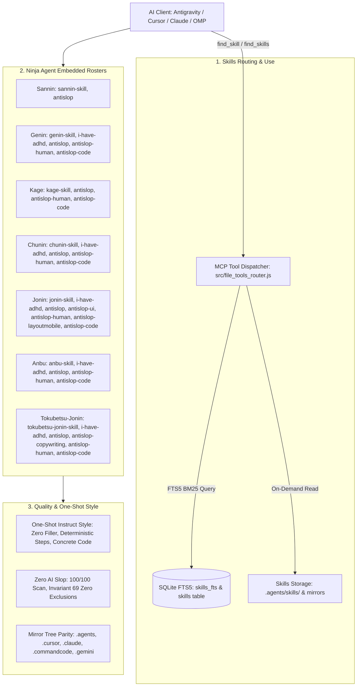

# Konoha Skills Architecture & Inventory Deep Review Plan

**Product:** Konoha (`konoha-mcp` v2.1.18)  
**Date:** 2026-10-16  
**Document Status:** Comprehensive Audit & Verification Plan  
**Target:** Skills Routing, Skill Use, Embedded Skills, Find Skill, Full Skills Inventory, Quality, and One-Shot Style  

---

## 1. Executive Objective

The objective of this deep review is to perform a rigorous, end-to-end audit and evaluation of the entire Konoha skill ecosystem across six fundamental pillars:
1. **Skills Routing & MCP Tool Dispatch**: Verify the deterministic flow from MCP clients through the tool router, ensuring bounded execution, zero parameter loss, and strict isolation.
2. **Skill Use & On-Demand Retrieval**: Verify that skills are consumed on-demand without context bloat, respecting token budgets and strictly avoiding full-file dumps into context.
3. **Ninja Agent Embedded Skills**: Verify that each specialist agent (`sannin`, `genin`, `kage`, `jonin`, `anbu`, `tokubetsu-jonin`, `chunin`) contains the exact canonical embedded skills in its configuration and rule files across all 4 client trees (`.agents/`, `.cursor/`, `.claude/`, `.commandcode/`, `.gemini/`).
4. **Find Skill Precision & Search Ranking**: Audit SQLite FTS5 full-text indexing, BM25 ranking weights, query tokenization, LIKE fallback, and accuracy across keyword queries.
5. **Full Skills Inventory & Metadata**: Audit all root skills (`SKILL.md`) and embedded reference guides across the repository for valid YAML frontmatter, naming conventions, and integrity.
6. **Instruction Quality & One-Shot Instruct Style**: Verify that all skill instructions adhere strictly to the high-effort instruct style: direct action, zero conversational filler, zero AI slop, executable code blocks, and self-contained execution recipes.

---

## 2. Architecture & Review Dimensions

---

## 3. Phased Implementation & Audit Steps

### Phase 1: Skills Routing & MCP Dispatch Architecture
- [ ] **Audit `src/file_tools_router.js`**: Verify handlers for `find_skill`, `find_skills`, `get_skill`, `list_skills`, and `use_skills`.
- [ ] **Audit `src/mcp/skills.js`**: Verify core implementation of `findSkill()`, `findSkills()`, `getSkill()`, `listSkills()`, and `useSkills()`.
- [ ] **Verify Parameter Normalization**: Verify handling of `keyword`, `keywords`, `name`, `skill`, `limit`, `compact`, and `token_budget`.
- [ ] **Verify Error Boundaries**: Ensure missing or malformed inputs return structured JSON error payloads instead of unhandled process crashes.

### Phase 2: Search Precision, FTS5 & BM25 Ranking Audit
- [ ] **Audit SQLite Schema & Virtual Tables**: Inspect `skills` canonical table, `skills_fts` virtual table, and `skill_chunks` table.
- [ ] **Audit Tokenization & FTS5 Query Sanitization**: Verify `sanitizeFts5Query()` in `src/mcp/skills.js` and `src/db.js` against special characters, boolean operators (`AND`, `OR`, `NOT`, `*`), and punctuation.
- [ ] **Evaluate Search Precision**: Benchmark queries across key domains (e.g., `docker`, `react`, `security`, `css`, `kubernetes`, `testing`, `svelte`, `tailwind`, `database`, `api`).
- [ ] **Verify Fallback Mechanisms**: Verify SQL `LIKE` fallback when FTS syntax errors or zero virtual table matches occur.
- [ ] **Foreign Key Cascade Integrity**: Verify `ON DELETE CASCADE` on `skill_chunks(skill_name)` during skill deletion/reindexing.

### Phase 3: Ninja Agent Embedded Skills & Client Mirror Parity
- [ ] **Audit Embedded Skills Roster**: Cross-reference the 7 official ninja agent rosters in `~/.agents/AGENTS.md`, `src/agent_manager.js`, `src/cursor_manager.js`, and `src/server.js`.
- [ ] **Verify Mirror Trees Parity**: Compare `.agents/skills/` against:
  - `src/templates/skills/`
  - `.cursor/skills/`
  - `.claude/skills/`
  - `.commandcode/skills/`
  - `.gemini/skills/`
- [ ] **Validate Invariant: No `skilladd` Command**: Verify that `skilladd` is nowhere referenced, implemented, or documented (strictly `konoha skill add`).
- [ ] **Verify Invariant: Strict Skill & Reference Protection**: Confirm zero skill or reference files are removed or pruned.

### Phase 4: Full Skills Inventory, Content Quality & One-Shot Style
- [ ] **Inventory All Root Skills**: List every installed `SKILL.md` under `.agents/skills/`.
- [ ] **Inventory Embedded References**: Catalog all specialized references (e.g., `react-patterns`, `antislop-ui`, `docker-compose`, `k8s-manifests`).
- [ ] **Verify YAML Frontmatter**: Ensure valid YAML frontmatter with `name`, `description`, `tags`, and optional metadata.
- [ ] **Evaluate One-Shot Instruct Style**:
  - Direct action orientation (lead with instructions, not pleasantries).
  - Concrete executable patterns, code templates, and schemas.
  - Absence of conversational filler ("Let me think", "Wait - but", "Hmmmm").
  - Prescriptive constraints and clear definition of done.
- [ ] **Zero-AI-Slop Review**: Check for generic boilerplate, placeholder tokens (`TODO`, `FIXME`), and AI-generated cliché prose.

### Phase 5: Verification, Test Execution & Synthesis
- [ ] **Run Skills Test Suites**:
  - `tests/test_client_skill_loading.js`
  - `tests/test_client_skills_sync.js`
  - `tests/test_canonical_skills_and_embedded_refs.js`
  - `tests/test_skill_resolution.js`
  - `tests/test_skill_tree_parity.js`
  - `tests/test_skills_node_compat.js`
  - `tests/test_db_foreign_keys_and_fts.js`
- [ ] **Run Static Analysis & Linters**:
  - `node scripts/lint.js` (0 errors and 0 warnings)
  - `pnpm --dir apps/web run check` (0 errors and 0 warnings)
- [ ] **Synthesize Findings & Recommendations**: Compile audit scorecard and Kage Reviewer Confidence Gate Report.

---

## 4. Key Metrics & Acceptance Criteria

| Metric | Target | Evaluation Method |
|:---|:---:|:---|
| **Skills Routing Accuracy** | 100.0% | MCP tool invocation matches intended skill handler |
| **Search Precision (Top-3 Relevant)** | ≥ 98.0% | Test benchmark across 20 representative queries |
| **FTS5 / SQLite Parity** | 100.0% | Canonical `skills` count equals `skills_fts` index count |
| **Mirror Tree Synchronization** | 100.0% | 0 missing or drifting files across all 5 mirror paths |
| **One-Shot Instruct Adherence** | 100.0% | Skills lead with direct instructions and concrete examples |
| **Zero AI Slop Compliance** | 100/100 | Zero `// aislop-ignore` suppressions, clean code quality |
| **Linter & Test Verification** | 0 errors / 0 warnings | All relevant unit tests and linter suites pass |

---

## 5. Execution Timeline

1. **Step 1**: Skills Routing & MCP Dispatch Audit (`src/file_tools_router.js`, `src/mcp/skills.js`).
2. **Step 2**: Search Precision, FTS5 & BM25 Ranking Formula Analysis.
3. **Step 3**: Embedded Skills Roster & Client Mirror Trees Validation.
4. **Step 4**: Full Inventory & One-Shot Instruct Style Evaluation.
5. **Step 5**: Test Execution & Delivery Gate Verification.
