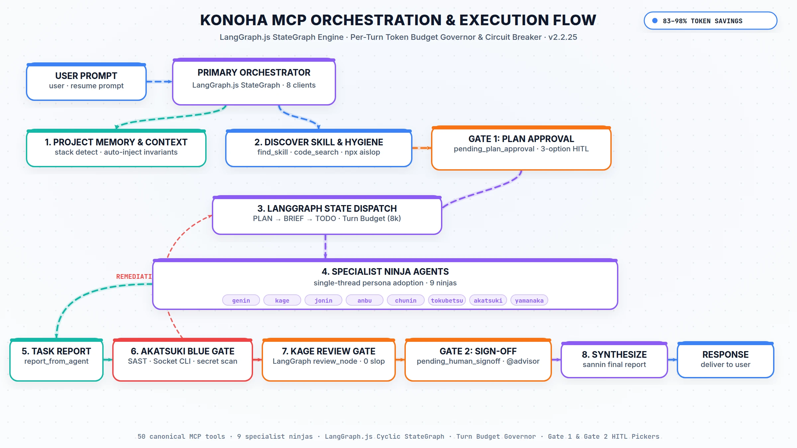
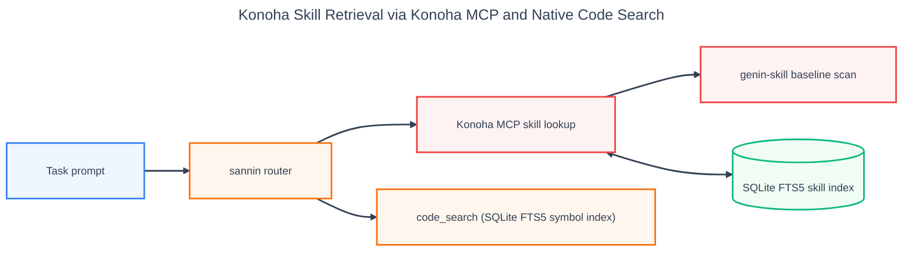
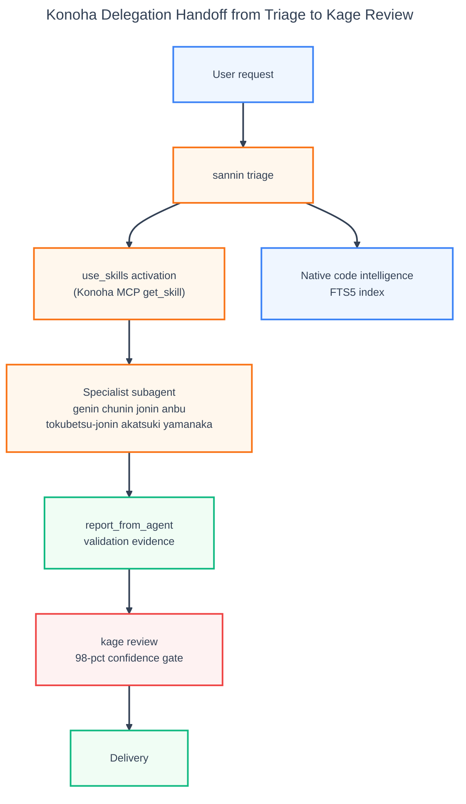

<p align="center">
  
</p>

<h1 align="center">KONOHA</h1>

<p align="center">
  <b>Give your AI coding client bounded tools instead of full-repo dumps</b><br>
  <sub>A local MCP server that adds nine specialist subagents, SQLite FTS5 skill retrieval,<br>
  native code search, two human approval gates, and a real Playwright QA loop<br>
  to Cursor, [CC], Codex, OpenCode, Command Code, Antigravity, Pi and OMP.</sub>
</p>

<p align="center">
  <a href="https://github.com/andycungkrinx91/konoha/stargazers"></a>
  <a href="https://www.npmjs.com/package/konoha-mcp"></a>
  <a href="https://github.com/andycungkrinx91/konoha/forks"></a>
  <a href="https://github.com/andycungkrinx91/konoha/issues"></a>
  <a href="https://github.com/andycungkrinx91/konoha/issues?q=is%3Aissue%20is%3Aclosed"></a>
</p>

<p align="center">
  <a href="CHANGELOG.md"></a>
  <a href="https://github.com/andycungkrinx91/konoha/actions/workflows/cross-platform.yml"></a>
  <a href="LICENSE"></a>
  <a href="docs/SETUP-CLI.md">= 24.0.0"></a>
</p>

<p align="center">
  <a href="#mcp-tools-56-canonical-58-manifest-entries"></a>
  <a href="#ninja-specialist-team-9-agents"></a>
  <a href="#supported-coding-clients-8-clients"></a>
  <a href="docs/BENCHMARK.md"></a>
</p>

<p align="center">
  <a href="docs/SECURITY.md"></a>
  <a href="https://socket.dev/npm/package/konoha-mcp"></a>
  <a href="docs/QA-AUTOMATION.md"></a>
  <a href="docs/TELEGRAM_INTEGRATION_GUIDE.md"></a>
  <a href="https://saweria.co/andycungkrinx"></a>
</p>

> **On the Socket score (overall 82; license category 70).** `konoha-mcp` is Apache-2.0, and the
> published tarball carries no imposed copyleft licence. The license category scores 70 because two
> copyleft families sit in the *optional install graph* rather than in the tarball: the
> `@img/sharp-*` prebuilt binaries (via `sharp` behind `@huggingface/transformers`) and
> `lightningcss` (frontend build tooling). They are host-specific binaries and build tooling,
> are installed from their own published packages rather than redistributed, and cannot be removed
> without dropping text embeddings or the frontend build. Their exact SPDX identifiers, and why each
> is unavoidable, are in [docs/SECURITY.md §12.6](docs/SECURITY.md) — this paragraph does not repeat
> them because `tests/test_tarball_copyleft_scan.js` fails if a copyleft identifier ships in the
> packed tarball on a line that does not also offer a permissive alternative, and `README.md` is
> inside that tarball. The score is a property of that dependency graph, not of this repository's
> licence.


<p align="center">
  <b>Jump to:</b>
  <a href="#1-the-problem-konoha-solves">Problem</a> ·
  <a href="#2-install">Install</a> ·
  <a href="#3-your-first-workflow">First workflow</a> ·
  <a href="#4-what-you-get">Features</a> ·
  <a href="#5-how-it-works">How it works</a> ·
  <a href="#6-tools-and-agents">Tools</a> ·
  <a href="#7-configuration">Config</a> ·
  <a href="#8-everyday-commands">Commands</a> ·
  <a href="#9-documentation">Docs</a>
</p>

---

## 1. The problem Konoha solves

An AI coding client with no tools guesses. Handed a 4,000-line repository it either stuffs the context window or opens the wrong file, then writes code against a function it never read.

Konoha is a local MCP server that replaces that guessing with bounded tools. Instead of "read the repo", the client gets "read 150 lines", "search this SQLite symbol index", "load the one skill that covers Playwright". Each answer is small, verifiable, and points at a real file and line.

| Instead of | You call | What comes back |
|:---|:---|:---|
| Pasting a whole file to find one function | `read_file_range` / `get_file_structure` | A signature map, or the 40 lines around the symbol, capped at 250 |
| `grep -r` across the tree | `token_efficient_grep` / `code_search` | 20 ranked matches (50 hard cap) with file and line |
| Re-teaching the same conventions every session | `find_skill` / `get_skill` | The one skill that owns the rule, capped at 8,000 bytes |
| Fixing a UI bug blind | `qa_e2e_run` with `headed: true` | A visible local Chromium running your suite, with trace and screenshot paths |
| Trusting the agent that it passed | `qa_e2e_run` | A test report with a `run_id`, capped output, and trace paths |

Two things follow from that. The client spends its context on the task instead of on discovery, and every claim it makes about your code has a file behind it.

Verified numbers live in [docs/BENCHMARK.md](docs/BENCHMARK.md) and [docs/architecture/TOKEN-BASELINE.md](docs/architecture/TOKEN-BASELINE.md); the honest summary is in [§4.1](#41-token-savings-what-the-8398-range-actually-covers).

---

## 2. Install

**Prerequisites.** Node.js `>= 24.0.0` (`node:sqlite` with FTS5 is required; `bin/cli.js` exits before loading modules on older runtimes). One MCP-capable coding client. Docker is optional: the 3-OS CI sandbox and the Red-Team lab use it, and no part of the QA or frontend path does.

> **Which version installs?** `npm` publishes `2.2.22` today. `2.2.23` is on `master` and installs from source until it is released: [CHANGELOG.md](CHANGELOG.md) is the release record.

| Mode | Command | Notes |
|:---|:---|:---|
| Persistent install | `npm install -g konoha-mcp@latest` | Puts `konoha` on PATH. No install-time lifecycle script; runtime setup is explicit. |
| In-place upgrade | `konoha upgrade` | Reinstalls with the detected package manager and re-runs the runtime lifecycle. Exits non-zero when no installer is available or when the PATH-resolved binary still reports the old version. |
| Ephemeral run | `npm exec --yes --package=konoha-mcp@latest -- konoha --version` | No persistent install. `pnpm dlx konoha-mcp` works the same way. |

`npx -g` is not valid syntax. Use one of the three forms above.

### 2.1 First four commands

```bash
npm install -g konoha-mcp@latest

# 1. Create ~/.konoha, the SQLite FTS5 database, and the skill index.
#    Add --no-embed on CI or containers without ONNX support.
konoha init --yes

# 2. Register one client, or all eight at once (append-only, timestamped backup).
konoha init --client=cursor
konoha init --client=all

# 3. Prove it works.
konoha test
konoha status
```

`konoha init` is safe to re-run: client configs are appended with a backup, never clobbered.

### 2.2 From source

```bash
git clone https://github.com/andycungkrinx91/konoha.git
cd konoha
pnpm install                     # pnpm 12.16.1, pinned in packageManager
node bin/cli.js init --client=all
```

### 2.3 If something breaks

Three failures cover most first installs:

- **`konoha` not found** — nvm/volta shim not on the PATH your client spawns from. See [TROUBLESHOOTING §`konoha` Command Not Found](docs/TROUBLESHOOTING.md#-konoha-command-not-found-nvm-path-issue).
- **MCP server not detected in your client** — check the config path for your client in [§7](#7-configuration), then run `konoha doctor`.
- **Node too old** — `konoha` prints the version it needs and exits 1. Install Node 24 and re-run.

Full per-OS detail: [docs/SETUP-CLI.md](docs/SETUP-CLI.md), [docs/VPS-INSTALL.md](docs/VPS-INSTALL.md) for headless servers (`konoha doctor --vps` first), [docs/TROUBLESHOOTING.md](docs/TROUBLESHOOTING.md) for everything else.

---

## 3. Your first workflow

Konoha is not a chat wrapper: it runs one fixed pipeline and stops twice to ask you. Here is the shape of a real exchange.

```text
You:  The /login page flashes white before the theme loads.
      Fix it, and prove it with a test.
```

What happens next, in order:

| Step | Who | What you see |
|:---:|:---|:---|
| 1 | `@sannin` | Registers the task, checks it is answerable, picks the specialists |
| 2 | `@genin` | Read-only exploration into `findings.md` — no edits |
| 3 | `@kage` | A plan: files to touch, test to add, risks |
| 4 | **Gate 1** | The plan is put to you. Approve, or reject with feedback and it regenerates |
| 5 | `@jonin` | Implements, then runs the framework's own build, lint, and Playwright |
| 6 | `@tokubetsu-jonin` | Writes the handover note when documentation was requested |
| 7 | `@kage` | Review gate: slop scan at 100/100, confidence `>= 98%` |
| 8 | **Gate 2** | Delivery sign-off, or a bounded remediation loop (max 7 cycles) |
| 9 | `@sannin` | `final_report.md` with the evidence ledger |

Both gates are three-option pickers. In HITL mode nothing auto-advances, which is the point: Gate 1 costs you one line of reading and saves a wrong-file refactor.

### 3.1 Watch a UI change happen

If the task touches frontend, the run goes headed in your own Chromium:

```bash
# 1. Serve your app.
pnpm dev

# 2. Run the suite with a visible window. No container, no viewer process.
qa_e2e_run({ project_path: ".", headed: true })

# 3. Read the report: run_id, totals, and host paths to any trace or screenshot.
```

`headed` is honoured on a normal machine and dropped under `CI=1`, so the same call is safe in pipelines. Jonin's preview opens the page in your system browser instead of starting a second one. Details: [docs/QA-AUTOMATION.md](docs/QA-AUTOMATION.md).

### 3.2 Check what it cost

```bash
konoha task list        # tasks, gates, readiness
konoha savings          # measured token deltas, per tool
```

A fresh install shows `—` until its own calls are recorded. That is deliberate: nothing is estimated.

---

## 4. What you get

Every row names the subsystem so you can verify it in source.

| Area | Capability | Subsystem | Contract |
|:---|:---|:---|:---|
| Orchestration | Sannin router (router-only, never runs worker code) | `src/mcp/workflow_sannin.js` | Rejects worker execution with `SANNIN_ROUTER_ONLY_ERROR` |
| Exploration | Genin read-only codepath reconnaissance | `genin-skill` | Zero file mutations; emits `findings.md` |
| Planning | Kage architecture plan and review | `kage-skill` | Delivery needs `>= 98%` confidence |
| Research | Chunin web intel, zero API key | `chunin-skill` | SearXNG + Wikipedia fallback, `rtk`-compressed |
| Frontend | Jonin dynamic UI builder, 4 frameworks | `src/templates/skills/jonin-skill/` | Next.js 16, SvelteKit 2, Nuxt 3, Angular 19+; `Build by konoha` signature; zero emojis |
| Backend and QA | Anbu APIs, DevOps, Playwright E2E | `anbu-skill`, `qa_codify`, `qa_e2e_run` | E2E output capped under 2,000 characters; artifacts kept outside the workspace |
| Headed QA | Local Playwright and local Chromium, visible window | `src/workflow/qa-automation/`, `live_browser_monitor.js` | No container and no second browser; `CI=1` stays headless |
| Docs | Tokubetsu-jonin office deliverables | `src/workflow/tokubetsu-scribe/` | DOCX, PDF, XLSX, PPTX, animated WebP |
| Security | Akatsuki Blue-Team gate; opt-in isolated Red-Team lab | `akatsuki-skill`, `src/workflow/akatsuki/` | `akatsuki-lab` isolation; 817-skill MITRE pack is explicit opt-in only |
| 3D | Yamanaka generative 3D and Blender refinement | `yamanaka-skill` | Manifold and PBR validation |
| Retrieval | Compact `use_skills` (single-skill `<= 8,000 B`, multi-skill `<= 4,800 B` total), session dedup | `src/mcp/skills_common.js` | `[ALREADY_IN_CONTEXT]` on repeat loads; `full: true` opt-in |
| File I/O | Bounded reads: head, range, grep, structure, clean-find | `src/file_tools_router.js` | 150-line head cap, 250-line range cap, 20-match grep cap (50 hard max) |
| Search | Tree-sitter WASM AST, SQLite FTS5, Granite/MiniLM hybrid vector + optional LSP | `code_index`, `code_search`, `code_symbol`, `code_context`, `code_impact`, `code_related`, `code_status`, `code_remove` | Replaces full-repo dumps with bounded AST/semantic spans |
| Shell | RTK global CLI proxy compresses noisy output | `rtk` | Per-command savings via `rtk gain`; no global percentage asserted here |
| Approvals | Two HITL gates: plan approval, delivery sign-off | `src/mcp/workflow_gates.js` | 3-option picker; never auto-advances in HITL mode |
| Compaction | Post-approval context compaction | `src/mcp/workflow_gates.js` | Prior exploration compacts (plan summary to ~1,200 chars) after Gate 1 |
| Quality | Two-step Zero-AI-Slop pre-gate | `aislop_scan` + `anti_slop` | 100/100 scan and 0 findings required before synthesis |
| Supply chain | Local `pnpm audit` gate (Socket.dev opt-in) | `tests/test_dependency_audit.js` | Fails on any advisory outside `APPROVED_MITIGATED_ADVISORIES`, across the root and `apps/web` workspaces; no account or token needed. Socket.dev runs only via `pnpm audit:socket` with `SOCKET_CLI_API_TOKEN`, and never blocks CI. `socket.yml` suppresses only documented capabilities (never `usesEval`), and `pnpm-lock.yaml` / `patches/**` stay audited |
| Dependency posture | No `lodash`, no dynamic execution, exact pins | `tests/test_dependency_posture.js`, `tests/test_no_dynamic_execution.js` | Fails the build if `lodash` returns, if a bundled dep loses its exact pin, or if `eval`/`new Function` reappears |
| Remediation | Bounded auto-fix loop | `src/sdlc_remediation.js` | Circuit breaker, max 7 cycles |
| Remote | Telegram dual-mode bot + prompt queue | `src/telegram/`, `src/queue/` | Numeric `chat_id` whitelist; atomic SQLite state machine |
| Secrets | Argon2id auth, AES-256-GCM vault, scrypt key derivation | `src/auth.js`, `src/crypto_vault.js` | Automatic masking in logs and TUI; zero plaintext secrets |

### 4.1 Token savings: what the 83–98% range actually covers

The headline range is **bounded-retrieval only**, not whole-system. Evidence: [docs/BENCHMARK.md](docs/BENCHMARK.md) live telemetry and [docs/architecture/TOKEN-BASELINE.md](docs/architecture/TOKEN-BASELINE.md) Section 11.4.

- Core bounded retrieval lands inside 83–98%: `find_skill` ~98%, `read_file_range` ~82–94% depending on snapshot, `read_file_head` varies by file shape.
- Structural pruning tools exceed it (`token_efficient_grep`, `file_info`, `find_files_clean` each 90%+ on the current snapshot).
- Operational routers report 0% by design (`sannin`, `anbu`, `use_skills` preserve directives as-is) so they never inflate the metric.
- Retrieval, RTK, latency, and cost are measured separately in `docs/BENCHMARK.md` (bounded retrieval 83–98%, FTS5 skill search 2,207 queries/sec; RTK 32.6% project / 59.2% global machine history). Fresh installs show `—`/`no_data` until their own calls are recorded.

Do not quote 83–98% as whole-session or cost savings.

---

## 5. How it works

### 5.1 Delegate through MCP tools, never solo

On a Konoha-configured host, non-trivial work routes through the Konoha MCP tools to a subagent:

- Skill lookup: `find_skill` / `get_skill` / `use_skills` (Konoha MCP, SQLite FTS5).
- Codebase search: `code_search` / `code_symbol` / `code_impact` (Konoha MCP, native FTS5 index).
- Bounded reads: `read_file_head`, `read_file_range`, `file_info`, `token_efficient_grep`, `get_file_structure`, `find_files_clean`.
- Quality: `aislop_scan`, `aislop_fix`, `aislop_why`; delivery gate `anti_slop`.
- Package manager: `pnpm` for JS/TS scaffolding, installs, and builds.

The orchestrator coordinates and delegates; trivial edits on a known file may run inline, everything else goes to a specialist.

### 5.2 Eight phases, two human gates

| # | Phase | Owner | Output |
|:---:|:---|:---|:---|
| 1 | `route` | Sannin | Readiness check, task registered in `sdlc_tasks` |
| 2 | `explore` | Genin | `findings.md`, read-only |
| 3 | `plan` | Kage | `plan.md`, per-agent breakdown |
| 4 | `research` | Chunin | Cited notes, only when `needs_research` |
| 5 | `execute` | Jonin / Anbu | Code + framework build/lint + Playwright E2E evidence |
| 6 | `document` | Tokubetsu-jonin | `final_docs.md` runbooks and handover |
| 7 | `review` | Kage gate | 100/100 slop scan, `>= 98%` confidence audit |
| 8 | `synthesize` + `done` | Sannin | `final_report.md` with evidence ledger |

Gate 1 (`pending_plan_approval`): compact-and-approve, or reject/regenerate with feedback. Gate 2 (`pending_human_sign-off`): compact-and-approve, or remediation (bounded, 7 cycles max). Structured reports use `report_from_agent`; scratch state lives outside the repo at `~/.konoha/tmp/<client>/<session>/scratch/tasks/<id>/` so `git add .` never picks it up.

### 5.3 Master system architecture

Nine phases, two human gates, five quality gates. Every request enters through the Sannin router, fans out to specialist agents, and exits only through the gates. Full text flow with all 18 workflows: [ALL-WORKFLOW-DIAGRAMS.md](docs/ALL-WORKFLOW-DIAGRAMS.md).







### 5.4 Subagent routing

- `@sannin` triage and synthesis. `@genin` exploration. `@kage` architecture and delivery review.
- `@chunin` research. `@jonin` frontend (SvelteKit, Next.js 16, Nuxt 3, Angular 19+; Tailwind v4). `@anbu` backend, DevOps, QA automation.
- `@tokubetsu-jonin` docs. `@akatsuki` security review by default, isolated pentest only when authorized. `@yamanaka` 3D assets.

File-based IPC (`prompt.md` / `delegate.md` / `result.md`) is retired; dispatch rejects task references to those files.

---

## 6. Tools and agents

Konoha is an **MCP Tools Orchestrator**: subagent tools emit harness-native spawn directives (`src/mcp/lazy_subagent.js`) paired with managed child-process execution (`konoha run-agent` / `src/mcp/subagent_spawner.js`) and fail-closed `UNSUPPORTED_NATIVE_SPAWN` guards when a harness lacks native subagent support. Workers communicate via structured MCP arguments, JSONL session transcripts, and `report_from_agent` — with zero disk-file IPC (`prompt.md`, `delegate.md`, `result.md`).

- Canonical diagram: `docs/diagrams/konoha-architecture.drawio` (18 tabs) plus `docs/diagrams/konoha-infrastructure-architecture.drawio` (18 tabs; page `19 Authenticated Local Web UI & Ingress Queue` replaces the architecture file's page 15).
- Rendered canvases: 13 Draw.io-projected WebPs (`scripts/generate_drawio_flow_webp.js` + `scripts/lib/drawio_flow_svg.js`) and 7 Tokubetsu-rendered workflow WebPs (`scripts/generate_tokubetsu_flow_webp.js`); style-locked by `tests/test_flow_diagram_style_lock.js`.
- Text flows: [ALL-WORKFLOW-DIAGRAMS.md](docs/ALL-WORKFLOW-DIAGRAMS.md) (Mermaid) and the manifest at [docs/diagrams/README.md](docs/diagrams/README.md).
- Deep dive: [docs/ARCHITECTURE.md](docs/ARCHITECTURE.md) (layers, data flows, query lifecycle).

### MCP tools: 56 canonical, 58 manifest entries

`src/mcp_tool_manifest.json` lists 58 entries: 56 canonical tools plus 2 hidden aliases (`find_skills`, `build_with_image_design`, 0 tokens in `tools/list`).
The unified `konoha` server exposes 56 canonical tools over MCP, including the eight `code_*` code-intelligence tools (`code_index`, `code_search`, `code_symbol`, `code_context`, `code_impact`, `code_related`, `code_status`, `code_remove`); aislop adds scan/fix hygiene.

Skill and delegation tools: `sannin`, `kage`, `jonin`, `anbu`, `chunin`, `tokubetsu_jonin`, `genin`, `akatsuki`, `yamanaka`, `akatsuki_init`, plus `report_from_agent`, `get_task_evidence`, `get_slop_findings`, `check_readiness`.

Retrieval tools: `find_skill`, `get_skill`, `use_skills` (single `<= 8,000 B`, multi `<= 4,800 B` total), `list_skills`, `optimize_report`, `migrate_skills`, project and persona memory tools (`get_project_context`, `save_project_context`, `query_project_memory`, `save_persona_memory`, `query_persona_memory`, `list_persona_memories`, `delete_persona_memory`). Lookups read the project's own skill tree (`.agents/skills` and sixteen sibling locations) alongside the SQLite index, so an unmigrated project skill still resolves and `migrate_skills` is an optimisation rather than a prerequisite.

File tools: `read_file_head`, `read_file_range`, `file_info`, `token_efficient_grep`, `get_file_structure`, `find_files_clean`.

Build specs (side-effect-free; Jonin implements the returned directives): `build_from_source`, `build_from_text`.

QA tools (Anbu-exclusive): `qa_codify` (flow JSON to Playwright spec), `qa_e2e_run` (capped runner, unique `run_id`).

Detectors and documents: `website_ai_detector` (also `konoha detect-ai`; 0–20 = Human-Built), `docs_ai_detector` (also `konoha detect-docs`), `document_create`, `spreadsheet_create`, `presentation_create`, `diagram_create`, `animation_export`, `get_resolved_task_dir`, `get_soul`, `web_search`.

aislop adds `aislop_scan`, `aislop_fix`, `aislop_why`. Search needs no second server: `code_index`, `code_search`, `code_symbol`, `code_context`, `code_impact`, `code_related`, `code_status`, and `code_remove` ship inside `konoha`.

### Ninja specialist team: 9 agents

| Agent | Role | Owns |
|:---|:---|:---|
| `@sannin` | Router and orchestrator | Triage, readiness, fan-out, synthesis |
| `@genin` | Scout | Read-only exploration, dependency mapping |
| `@chunin` | Intel | Web research with citations |
| `@jonin` | Frontend builder | 4-framework UI, dark/light, live browser check, maintenance-skill generator |
| `@anbu` | Backend, DevOps, QA | APIs, containers, Helm, Playwright E2E |
| `@tokubetsu-jonin` | Scribe | Docs, runbooks, office deliverables |
| `@kage` | Architect and governor | Plans, `@advisor` guard (`<= 8k tok/turn`, 0 when clean), 98% gate |
| `@akatsuki` | Security | Blue-Team review by default; isolated `akatsuki-lab` red-team only when authorized |
| `@yamanaka` | 3D specialist | Three.js/Manifold synthesis, Blender refinement |

Host clients select the underlying model; Konoha defines scope and role boundaries.

---

## 7. Configuration

### Supported coding clients: 8 clients

Paths below were exercised on Linux x64. The same registration and MCP handshake suites run on `windows-latest` and `macos-latest` in CI, where `%APPDATA%` and `~/Library/Application Support` take the place of `~/.config`.

| Client | MCP config path | Guardrail |
|:---|:---|:---|
| Antigravity | `~/.gemini/config/mcp_config.json` | `antigravity_tool_sanitize_hook.js` (DENY-3) |
| Cursor | `~/.cursor/mcp.json` | `cli-config.json` permissions + `hooks.json` |
| [CC] | `~/.claude.json`, `~/.claude/` | `konoha-bash-guard.js` PreToolUse (`^Bash$`) |
| OpenCode | `~/.config/opencode/opencode.json` | `permission.mcp = 'allow'` + native rules |
| Command Code | `~/.commandcode/mcp.json` | `konoha-native-blocker-cc.js` PreToolUse |
| Codex | `~/.codex/config.toml` | TOML MCP registration + prompt rules |
| Pi (pi.dev) | `~/.pi/agent/mcp.json` | `konoha-blocker.ts` extension |
| OMP | `~/.omp/agent/mcp.json` | Runtime workflow contract with `auto_approve` |

RTK rules deploy alongside (`~/.cursor/rules/rtk.mdc`, `~/.claude/rules/rtk.md`, `~/.config/opencode/rules/rtk.md`, `~/.commandcode/rules/rtk.md`, `~/.codex/rules/rtk.md`, `~/.pi/agent/extensions/rtk.ts`, `~/.gemini/.../rules/rtk.md`, `~/.omp/agent/AGENTS.md`). If RTK cannot install (offline host), init warns and continues without it. Konoha resolves the official [rtk-ai/rtk](https://github.com/rtk-ai/rtk) binary only — never the unrelated `rtk` crates.io package.

### 7.1 What gets installed

`~/.konoha/` holds the runtime (`file_tools_mcp.js`, `server.js`, `migrate.js`, `vector_search.js`, `bridge/`, `konoha.db` with `agents`, `bridges`, `sdlc_tasks`, `persona_memories`, `memory_*`, and `code_*` tables). Client configs are appended, never clobbered; every write takes a timestamped backup (`konoha config backup --client=all`, `konoha config restore --client=<name>`). Skill mirror roots include `~/.agents/skills`, `~/.cursor/skills`, `~/.claude/skills`, `~/.omp/agent/skills`, and `~/.codex/skills`.

Read-only inspection (`konoha status`, `konoha doctor`, `konoha test`) tells you what actually landed; `konoha config backup` before any client switch is the cheap undo.

### 7.2 Bridge router and Web UI

- Bridge router on port `19999` (`127.0.0.1:19999`): one enabled bridge per request, `model` prefix `<bridge>-<model>`, no gateway-level retry — it does not perform gateway-level round-robin. The optional `antigravity-extension` record targets `127.0.0.1:1313` and stays disabled until `konoha bridge enable`; automated VSIX installation and directory sync into `~/.antigravity-ide/extensions/andycungkrinx91.konoha-bridge-master-universal/` were retired in `v2.2.1` (Konoha only prunes stale legacy registry entries). Bridges start empty; add with `konoha bridge create`. Reference: [docs/LLM-BRIDGE-GATEWAY.md](docs/LLM-BRIDGE-GATEWAY.md).
- Web UI on port `1404` (`konoha ui start`): dashboard, tasks, persona, savings (`—` until measured), skills registry with vector-chunk inspector, detector page, docs with drift banner, doctor with 3D-toolchain readiness, and the live browser sessions. Guide: [docs/SETUP-WEB-UI.md](docs/SETUP-WEB-UI.md).
- Telegram: one-way completion notifications plus two-way remote prompting (`/run`, `/session`, `/status`, `/savings`, per-agent dispatch). Setup: [docs/TELEGRAM_INTEGRATION_GUIDE.md](docs/TELEGRAM_INTEGRATION_GUIDE.md).
- SearXNG zero-API-key search for Chunin: [docs/SETUP-SEARXNG.md](docs/SETUP-SEARXNG.md).

### 7.3 Guardrails

Blocked at the tool-call level on capable clients ([CC], Command Code, Antigravity, Pi, OMP): destructive shell (`rm -rf /`, `mkfs`, `dd of=/dev/...`, `DROP DATABASE`), destructive git (`reset --hard`, `push --force`, `clean -f`), secrets (`.env*`, `*.pem`, `*.key`, credentials — never `rtk`-exempt), and read-bypass (bare `cat`/`grep`/`find`; retry with `rtk <command>` or the Konoha MCP tools). Depth circuit breaker at 7 slop-remediation cycles; rate-limit fallback runs direct tool calls instead of spawning subagents. Codex, Cursor, and OpenCode remain prompt-only (no blocking-hook capability).

---

## 8. Everyday commands

| You want | Command |
|:---|:---|
| Check the install | `konoha status` · `konoha doctor` · `konoha test` |
| Browse and search the skill corpus | `konoha skill list` · `konoha skill search <query>` |
| Inspect a running task | `konoha task list` · `konoha task show <id>` · `konoha task slop <id>` |
| See measured savings | `konoha savings` |
| Query or fix the knowledge brain | `konoha data memory` · `konoha data search <q>` · `konoha data maintain` |
| Rebuild vectors | `konoha embed` (`--rebuild-embeddings` implied) |
| Back up or restore client configs | `konoha config backup --client=all` · `konoha config restore --client=<n>` |
| Open the Web UI | `konoha ui start` → `http://127.0.0.1:1404/` |
| Run QA with a visible window | `qa_e2e_run({ project_path, headed: true })` |
| Upgrade | `konoha upgrade` |
| Reclaim disk | `konoha clean` |

Full reference with every flag: [docs/MANUAL.md §5](docs/MANUAL.md) · [docs/architecture/CANONICAL-CLI.md](docs/architecture/CANONICAL-CLI.md).

Breaking changes since v2.1.17: direct specialist tools replace `delegate_to_<agent>` wrappers; 27 legacy CLI aliases removed (canonical `konoha task|data|skill|agent|status` enforced); `konoha data prune` deletes immediately with no auto-backup. Full list in [CHANGELOG.md](CHANGELOG.md).

`konoha embed` rebuilds vector embeddings (embed implies `--rebuild-embeddings`); `konoha reinstall` wipes and replaces configuration (reinstall implies `--force`).

---

## 9. Documentation

Single entry point: [docs/README.md](docs/README.md) (one topic, one source of truth; `docs/archive/` is frozen history).

| Start here if you… | Read |
|:---|:---|
| Are installing or upgrading | [Operator's Manual](docs/MANUAL.md) ([PDF](docs/MANUAL.pdf)) · [CLI setup](docs/SETUP-CLI.md) · [Troubleshooting](docs/TROUBLESHOOTING.md) |
| Want the architecture | [System Architecture](docs/ARCHITECTURE.md) · [Capability map](docs/architecture/CAPABILITY-MAP.md) · [Workflow diagrams](docs/ALL-WORKFLOW-DIAGRAMS.md) |
| Care about context cost | [Token Baseline](docs/architecture/TOKEN-BASELINE.md) · [Token Savings Benchmark](docs/BENCHMARK.md) |
| Ship frontend or QA | [QA Automation](docs/QA-AUTOMATION.md) · [QA Checklist](docs/QA-TEST-CHECKLIST.md) |
| Audit security | [Security Architecture](docs/SECURITY.md) · newest external audit [2.2.23 (2026-11-17)](docs/SecurityCompliance/security_compliance_report_2.2.23_2026-11-17.md) |
| Configure a client | [Web UI](docs/SETUP-WEB-UI.md) · [IDE](docs/SETUP-IDE.md) · [Cursor](docs/SETUP-CURSOR.md) · [MCP clients](docs/SETUP-MCP-CLIENTS.md) |
| Run it headless | [VPS install](docs/VPS-INSTALL.md) · [Bridge gateway](docs/LLM-BRIDGE-GATEWAY.md) · [SearXNG](docs/SETUP-SEARXNG.md) |
| Add your own skills | [Adding Skills](docs/ADDING-SKILLS.md) |

---

## 10. Contributing

Issues and pull requests are welcome at [github.com/andycungkrinx91/konoha](https://github.com/andycungkrinx91/konoha).

Run the narrowest check that exercises your change, then the three local cross-platform environments before handing over:

1. **Linux** — `pnpm test:sandbox [-- --shard=I/8]` (Debian clean-room container) plus `pnpm ci:act` / `pnpm ci:act:shard` (Ubuntu `act` workflow).
2. **Windows** — `docker/windows-vm/oem/run-ci.cmd [-Shard I/N]` / `retest.cmd` inside `dockur/windows`.
3. **macOS** — `KONOHA_SANDBOX_RUNTIME=container pnpm test:sandbox [-- --shard=I/8]` via [Apple's `container`](https://github.com/apple/container), plus `macos-latest` or the native replay in [docs/CI.md](docs/CI.md).

Per-change checks are `rtk node tests/<suite>.js` for one suite and `pnpm test` for the whole set; the harness and its sharding rules are documented in [docs/CI.md](docs/CI.md).

---

## 11. Support, credits, license

If Konoha saves you meaningful context or time, consider supporting development:

<p align="center">
  <a href="https://saweria.co/andycungkrinx">
    
  </a>
</p>

**Credits**

- [RTK](https://github.com/rtk-ai/rtk) — CLI output compaction proxy.
- [aislop](https://github.com/scanaislop/aislop) — slop scanner behind the delivery pre-gate.
- [anti-slop](https://github.com/miqdadbadjuber/anti-slop) by Miqdad Badjuber — review checklist standards.
- [taste-skill](https://github.com/leonxlnx/taste-skill) by Leon Lin — visual design directives for Jonin builds.
- [i-have-adhd](https://github.com/ayghri/i-have-adhd) by Ayghri — action-first output shaping.
- [vibes-plug](https://github.com/roedyrustam/vibes-plug) by Roedy Rustam — developer/cloud/security skill content.
- [dcc-mcp-blender](https://github.com/dcc-mcp/dcc-mcp-blender) — Blender bridge behind Yamanaka refinement.

**License**

Konoha is licensed under the Apache License 2.0. See LICENSE and NOTICE.

You are free to use, modify, and distribute konoha, including in commercial and proprietary products, as long as you keep the license and copyright notices, mark files you modify, and reproduce the attribution notices in NOTICE where applicable.

Versions up to v2.2.19 were released under the MIT License and remain available under MIT.
