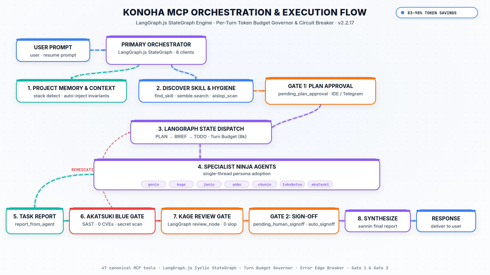
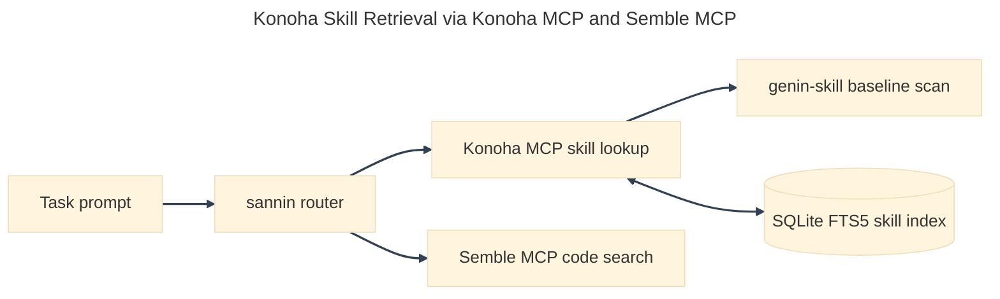
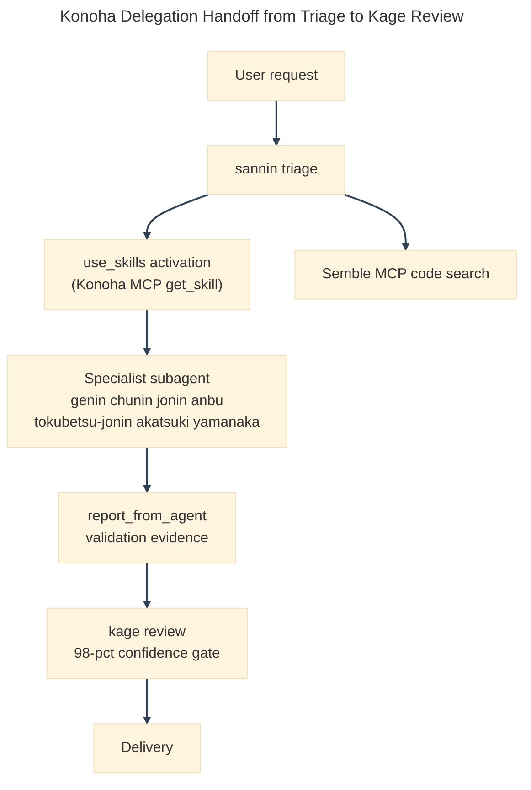

<p align="center">
  
</p>

<h1 align="center">KONOHA</h1>

<p align="center">
  <b>Multi-Agent MCP Orchestration and Context-Optimization Platform</b><br>
  <sub>LangGraph state machines · 9 specialist agents · SQLite FTS5 skill retrieval · Bounded file I/O · 8 coding clients</sub>
</p>

<p align="center">
  <a href="CHANGELOG.md"></a>
  <a href="https://github.com/andycungkrinx91/konoha/actions/workflows/cross-platform.yml"></a>
  <a href="https://www.npmjs.com/package/konoha-mcp"></a>
  <a href="LICENSE"></a>
  <a href="docs/SETUP-CLI.md">= 24.0.0"></a>
  <br>
  <a href="#mcp-tools-48-canonical-50-manifest-entries"></a>
  <a href="#ninja-specialist-team-9-agents"></a>
  <a href="#supported-coding-clients-8-clients"></a>
  <a href="docs/BENCHMARK.md"></a>
  <br>
  <a href="docs/SECURITY.md"></a>
  <a href="docs/QA-AUTOMATION.md"></a>
  <a href="docs/TELEGRAM_INTEGRATION_GUIDE.md"></a>
  <a href="https://saweria.co/andycungkrinx"></a>
</p>

<p align="center">
  <b>Quick navigation:</b>
  <a href="#quick-start">Quick Start</a> ·
  <a href="#features">Features</a> ·
  <a href="#how-it-works">How It Works</a> ·
  <a href="#architecture">Architecture</a> ·
  <a href="#configuration">Configuration</a> ·
  <a href="#documentation-index">Docs</a>
</p>

---

## Quick Start

Three ways to run Konoha. Pick one.

| Mode | Command | Notes |
|:---|:---|:---|
| Persistent install | `npm install -g konoha-mcp@latest` | Puts `konoha` on PATH. No install-time lifecycle script; runtime setup is explicit (`konoha init --yes`). |
| In-place upgrade | `konoha upgrade` | Reinstalls with the detected package manager and re-runs the runtime lifecycle. Exits non-zero when no installer is available or when the PATH-resolved binary still reports the old version. |
| Ephemeral run | `npm exec --yes --package=konoha-mcp@latest -- konoha --version` | No persistent install. `pnpm dlx konoha-mcp` works the same way. |

`npx -g` is not valid syntax. Use one of the three forms above.

### Minimal first run

```bash
npm install -g konoha-mcp@latest

# 1. Initialize ~/.konoha runtime and SQLite FTS5 database.
#    Add --no-embed on CI or containers without ONNX support.
konoha init --yes

# 2. Attach one client, or all eight at once (append-only, timestamped backup).
konoha init --client=cursor
konoha init --client=all

# 3. Verify the install.
konoha test
konoha status
```

Headless server: run `konoha doctor --vps` first; see [docs/VPS-INSTALL.md](docs/VPS-INSTALL.md).

From source:

```bash
git clone https://github.com/andycungkrinx91/konoha.git
cd konoha
pnpm install
node bin/cli.js init --client=all
```

### Requirements

- **Node.js** `>= 24.0.0` (`bin/cli.js` exits before loading modules on older runtimes; `node:sqlite` with FTS5 is required).
- **Package manager for source builds:** `pnpm@12.16.1` (pinned in `package.json#packageManager`).
- **Platform:** Linux x64 verified on this host. Windows and macOS are supported targets whose install, lint, suite, and fresh-install smoke steps run on `windows-latest` and `macos-latest` in [`.github/workflows/cross-platform.yml`](.github/workflows/cross-platform.yml); see [docs/SETUP-CLI.md](docs/SETUP-CLI.md) and [docs/CI.md](docs/CI.md). Windows under WSL2 follows the Linux path and is the lower-friction option there.
- **Search:** Semble via `uvx` for semantic code search; `rtk` binary auto-installed by `konoha init` when missing (no Rust toolchain needed).

The long form of this section — per-OS requirements, the non-root Linux path, and a real first-run transcript — is the [Operator's Manual](docs/MANUAL.md) ([PDF](docs/MANUAL.pdf)).

---

## Features

What Konoha gives you, in one table. Every row names the subsystem so you can verify it in source.

| Area | Capability | Subsystem | Contract |
|:---|:---|:---|:---|
| Orchestration | Sannin router (router-only, never runs worker code) | `src/mcp/workflow_sannin.js` | Rejects worker execution with `SANNIN_ROUTER_ONLY_ERROR` |
| Exploration | Genin read-only codepath reconnaissance | `genin-skill` | Zero file mutations; emits `findings.md` |
| Planning | Kage architecture plan and review | `kage-skill` | Delivery needs `>= 98%` confidence |
| Research | Chunin web intel, zero API key | `chunin-skill` | SearXNG + Wikipedia fallback, `rtk`-compressed |
| Frontend | Jonin dynamic UI builder, 4 frameworks | `src/templates/skills/jonin-skill/` | Next.js 16, SvelteKit 2, Nuxt 3, Angular 19+; `Build by konoha` signature; zero emojis |
| Backend and QA | Anbu APIs, DevOps, Playwright E2E | `anbu-skill`, `qa_codify`, `qa_e2e_run` | E2E output capped under 2,000 characters; artifacts kept outside the workspace |
| Docs | Tokubetsu-jonin office deliverables | `src/workflow/tokubetsu-scribe/` | DOCX, PDF, XLSX, PPTX, animated WebP |
| Security | Akatsuki Blue-Team gate; opt-in isolated Red-Team lab | `akatsuki-skill`, `src/workflow/akatsuki/` | `akatsuki-lab` isolation; 817-skill MITRE pack is explicit opt-in only |
| 3D | Yamanaka generative 3D and Blender refinement | `yamanaka-skill` | Manifold and PBR validation |
| Retrieval | Compact `use_skills` (single-skill `<= 8,000 B`, multi-skill `<= 4,800 B` total), session dedup | `src/mcp/skills_common.js` | `[ALREADY_IN_CONTEXT]` on repeat loads; `full: true` opt-in |
| File I/O | Bounded reads: head, range, grep, structure, clean-find | `src/file_tools_router.js` | 150-line head cap, 250-line range cap, 20-match grep cap (50 hard max) |
| Search | Semble semantic code search | `semble` MCP | Replaces full-repo dumps with line spans |
| Shell | RTK global CLI proxy compresses noisy output | `rtk` | Per-command savings via `rtk gain`; no global percentage asserted here |
| Approvals | Two HITL gates: plan approval, delivery sign-off | `src/mcp/workflow_gates.js` | 3-option picker; never auto-advances in HITL mode |
| Compaction | Post-approval context compaction | `src/mcp/workflow_gates.js` | Prior exploration compacts (plan summary to ~1,200 chars) after Gate 1 |
| Quality | Two-step Zero-AI-Slop pre-gate | `aislop_scan` + `anti_slop` | 100/100 scan and 0 findings required before synthesis |
| Supply chain | Socket CLI audit | `socket ci` | Mechanical blocker on High/Medium dependency findings |
| Remediation | Bounded auto-fix loop | `src/sdlc_remediation.js` | Circuit breaker, max 7 cycles |
| Remote | Telegram dual-mode bot + prompt queue | `src/telegram/`, `src/queue/` | Numeric `chat_id` whitelist; atomic SQLite state machine |
| Secrets | Argon2id auth, AES-256-GCM vault, scrypt key derivation | `src/auth.js`, `src/crypto_vault.js` | Automatic masking in logs and TUI; zero plaintext secrets |

### Token savings: what the 83–98% range actually covers

The headline range is **bounded-retrieval only**, not whole-system. Evidence: [docs/BENCHMARK.md](docs/BENCHMARK.md) live telemetry and [docs/architecture/TOKEN-BASELINE.md](docs/architecture/TOKEN-BASELINE.md) Section 11.4.

- Core bounded retrieval lands inside 83–98%: `find_skill` ~98%, `read_file_range` ~82–94% depending on snapshot, `read_file_head` varies by file shape.
- Structural pruning tools exceed it (`token_efficient_grep`, `file_info`, `find_files_clean` each 90%+ on the current snapshot).
- Operational routers report 0% by design (`sannin`, `anbu`, `use_skills` preserve directives as-is) so they never inflate the metric.
- Semble, RTK, latency, and cost are measured separately in `docs/BENCHMARK.md` (Semble ~98% on 3.2k queries; RTK 32.6% project / 59.2% global machine history). Fresh installs show `—`/`no_data` until their own calls are recorded.

Do not quote 83–98% as whole-session or cost savings.

---

## How It Works

### 1. Delegate through MCP tools, never solo

On a Konoha-configured host, non-trivial work routes through the Konoha and Semble MCP tools to a subagent:

- Skill lookup: `find_skill` / `get_skill` / `use_skills` (Konoha MCP, SQLite FTS5).
- Codebase search: `search` / `find_related` (Semble MCP).
- Bounded reads: `read_file_head`, `read_file_range`, `file_info`, `token_efficient_grep`, `get_file_structure`, `find_files_clean`.
- Quality: `aislop_scan`, `aislop_fix`, `aislop_why`; delivery gate `anti_slop`.
- Package manager: `pnpm` for JS/TS scaffolding, installs, and builds.

The orchestrator coordinates and delegates; trivial edits on a known file may run inline, everything else goes to a specialist.

### 2. Eight phases, two human gates

| # | Phase | Owner | Output |
|:---:|:---|:---|:---|
| 1 | `route` | Sannin | Readiness check, task registered in `sdlc_tasks` |
| 2 | `explore` | Genin | `findings.md`, read-only |
| 3 | `plan` | Kage | `plan.md`, per-agent breakdown |
| 4 | `research` | Chunin | Cited notes, only when `needs_research` |
| 5 | `execute` | Jonin / Anbu | Code + framework build/lint + Playwright E2E evidence |
| 6 | `document` | Tokubetsu-jonin | `final_docs.md` runbooks and handover |
| 7 | `review` | Kage gate | 100/100 slop scan, `>= 98%` confidence audit |
| 8 | `synthesize` + `done` | Sannin | `final_report.md` with evidence ledger |

Gate 1 (`pending_plan_approval`): compact-and-approve, or reject/regenerate with feedback. Gate 2 (`pending_human_sign-off`): compact-and-approve, or remediation (bounded, 7 cycles max). Structured reports use `report_from_agent`; scratch state lives outside the repo at `~/.konoha/tmp/<client>/<session>/scratch/tasks/<id>/` so `git add .` never picks it up.

### Master system architecture

Nine phases, two human gates, five quality gates. Every request enters through the Sannin router, fans out to specialist agents, and exits only through the gates. Full text flow with all 18 workflows: [ALL-WORKFLOW-DIAGRAMS.md](docs/ALL-WORKFLOW-DIAGRAMS.md).







### 3. Subagent routing

- `@sannin` triage and synthesis. `@genin` exploration. `@kage` architecture and delivery review.
- `@chunin` research. `@jonin` frontend (SvelteKit, Next.js 16, Nuxt 3, Angular 19+; Tailwind v4). `@anbu` backend, DevOps, QA automation.
- `@tokubetsu-jonin` docs. `@akatsuki` security review by default, isolated pentest only when authorized. `@yamanaka` 3D assets.

File-based IPC (`prompt.md` / `delegate.md` / `result.md`) is retired; dispatch rejects task references to those files.

---

## Architecture

Konoha is an **MCP Tools Orchestrator**: subagents run as in-process MCP tools and the orchestrator adopts a persona per dispatch. No child-process spawn per agent, no server-to-server RPC hop, no disk-file handoff.

- Canonical diagram: `docs/diagrams/konoha-architecture.drawio` (18 tabs) plus `docs/diagrams/konoha-infrastructure-architecture.drawio` (18 tabs; page `19 Authenticated Local Web UI & Ingress Queue` replaces the architecture file's page 15).
- Rendered canvases: 13 Draw.io-projected WebPs (`scripts/generate_drawio_flow_webp.js` + `scripts/lib/drawio_flow_svg.js`) and 7 Tokubetsu-rendered workflow WebPs (`scripts/generate_tokubetsu_flow_webp.js`); style-locked by `tests/test_flow_diagram_style_lock.js`.
- Text flows: [ALL-WORKFLOW-DIAGRAMS.md](docs/ALL-WORKFLOW-DIAGRAMS.md) (Mermaid) and the manifest at [docs/diagrams/README.md](docs/diagrams/README.md).
- Deep dive: [docs/ARCHITECTURE.md](docs/ARCHITECTURE.md) (layers, data flows, query lifecycle).

### MCP tools: 48 canonical, 50 manifest entries

`src/mcp_tool_manifest.json` lists 50 entries: 48 canonical tools plus 2 hidden aliases (`find_skills`, `build_with_image_design`, 0 tokens in `tools/list`).
The unified `konoha` server exposes 48 canonical tools over MCP; Semble adds `search`/`find_related` and aislop adds scan/fix hygiene.

Skill and delegation tools: `sannin`, `kage`, `jonin`, `anbu`, `chunin`, `tokubetsu_jonin`, `genin`, `akatsuki`, `yamanaka`, `akatsuki_init`, plus `report_from_agent`, `get_task_evidence`, `get_slop_findings`, `check_readiness`.

Retrieval tools: `find_skill`, `get_skill`, `use_skills` (single `<= 8,000 B`, multi `<= 4,800 B` total), `list_skills`, `optimize_report`, `migrate_skills`, project and persona memory tools (`get_project_context`, `save_project_context`, `query_project_memory`, `save_persona_memory`, `query_persona_memory`, `list_persona_memories`, `delete_persona_memory`).

File tools: `read_file_head`, `read_file_range`, `file_info`, `token_efficient_grep`, `get_file_structure`, `find_files_clean`.

Build specs (side-effect-free; Jonin implements the returned directives): `build_from_source`, `build_from_text`.

QA tools (Anbu-exclusive): `qa_codify` (flow JSON to Playwright spec), `qa_e2e_run` (capped runner, unique `run_id`).

Detectors and documents: `website_ai_detector` (also `konoha detect-ai`; 0–20 = Human-Built), `docs_ai_detector` (also `konoha detect-docs`), `document_create`, `spreadsheet_create`, `presentation_create`, `diagram_create`, `animation_export`, `get_resolved_task_dir`, `get_soul`, `web_search`.

Semble adds `search` and `find_related`; aislop adds `aislop_scan`, `aislop_fix`, `aislop_why`.

### Ninja specialist team: 9 agents

| Agent | Role | Owns |
|:---|:---|:---|
| `@sannin` | Router and orchestrator | Triage, readiness, fan-out, synthesis |
| `@genin` | Scout | Read-only exploration, dependency mapping |
| `@chunin` | Intel | Web research with citations |
| `@jonin` | Frontend builder | 4-framework UI, dark/light, live browser check, maintenance-skill generator |
| `@anbu` | Backend, DevOps, QA | APIs, containers, Helm, Playwright E2E |
| `@tokubetsu-jonin` | Scribe | Docs, runbooks, office deliverables |
| `@kage` | Architect and governor | Plans, `@advisor` guard (`<= 1k tok/turn`, 0 when clean), 98% gate |
| `@akatsuki` | Security | Blue-Team review by default; isolated `akatsuki-lab` red-team only when authorized |
| `@yamanaka` | 3D specialist | Three.js/Manifold synthesis, Blender refinement |

Host clients select the underlying model; Konoha defines scope and role boundaries.

---

## Configuration

### Supported coding clients: 8 clients

Paths below were exercised on Linux x64. The same registration and MCP handshake suites run on `windows-latest` and `macos-latest` in CI, where `%APPDATA%` and `~/Library/Application Support` take the place of `~/.config`.

| Client | MCP config path | Guardrail |
|:---|:---|:---|
| Antigravity | `~/.gemini/config/mcp_config.json` | `antigravity_tool_sanitize_hook.js` (DENY-3) |
| Cursor | `~/.cursor/mcp.json` | `cli-config.json` permissions + `hooks.json` |
| Claude Code | `~/.claude.json`, `~/.claude/` | `konoha-bash-guard.js` PreToolUse (`^Bash$`) |
| OpenCode | `~/.config/opencode/opencode.json` | `permission.mcp = 'allow'` + native rules |
| Command Code | `~/.commandcode/mcp.json` | `konoha-native-blocker-cc.js` PreToolUse |
| Codex | `~/.codex/config.toml` | TOML MCP registration + prompt rules |
| Pi (pi.dev) | `~/.pi/agent/mcp.json` | `konoha-blocker.ts` extension |
| OMP | `~/.omp/agent/mcp.json` | Runtime workflow contract with `auto_approve` |

RTK rules deploy alongside (`~/.cursor/rules/rtk.mdc`, `~/.claude/rules/rtk.md`, `~/.config/opencode/rules/rtk.md`, `~/.commandcode/rules/rtk.md`, `~/.codex/rules/rtk.md`, `~/.pi/agent/extensions/rtk.ts`, `~/.gemini/.../rules/rtk.md`, `~/.omp/agent/AGENTS.md`). If RTK cannot install (offline host), init warns and continues without it. Konoha resolves the official [rtk-ai/rtk](https://github.com/rtk-ai/rtk) binary only — never the unrelated `rtk` crates.io package.

### What gets installed

`~/.konoha/` holds the runtime (`file_tools_mcp.js`, `server.js`, `migrate.js`, `vector_search.js`, `bridge/`, `konoha.db` with `agents`, `bridges`, `sdlc_tasks` tables). Client configs are appended, never clobbered; every write takes a timestamped backup (`konoha config backup --client=all`, `konoha config restore --client=<name>`). Skill mirror roots include `~/.agents/skills`, `~/.cursor/skills`, `~/.claude/skills`, `~/.omp/agent/skills`, and `~/.codex/skills`.

Key CLI commands: `konoha init`, `konoha migrate` (`--clean`, `--rebuild-embeddings`), `konoha test`, `konoha status`, `konoha version`, `konoha upgrade`, `konoha bridge <status|list|models|create|delete|enable|disable>`, `konoha telegram <status|config|test|enable|disable|start-poller|stop-poller>`, `konoha queue <list|enqueue|cancel|complete|status>`, `konoha task <list|show|slop>`, `konoha data <backup|rebuild-fts|prune>`, `konoha db <check|restore>`, `konoha config <list|get|set|unset>`, `konoha skill <list|search|add|remove>`, `konoha agent <list|create|skill|models|delete|status>`, `konoha detect-ai <path|url>`, `konoha detect-docs <path|url>`, `konoha doctor`, `konoha ui <start|stop|restart|status|open>`, `konoha web` (port 1404).

Breaking changes since v2.1.17: direct specialist tools replace `delegate_to_<agent>` wrappers; 27 legacy CLI aliases removed (canonical `konoha task|data|skill|agent|status` enforced); `konoha data prune` deletes immediately with no auto-backup. Full list in [CHANGELOG.md](CHANGELOG.md).
`konoha embed` rebuilds vector embeddings (embed implies `--rebuild-embeddings`); `konoha reinstall` wipes and replaces configuration (reinstall implies `--force`).

### Bridge router and Web UI

- Bridge router on port `19999` (`127.0.0.1:19999`): one enabled bridge per request, `model` prefix `<bridge>-<model>`, no gateway-level retry — it does not perform gateway-level round-robin. The optional `antigravity-extension` record targets `127.0.0.1:1313` and stays disabled until `konoha bridge enable`; Antigravity IDE syncs it into `~/.antigravity-ide/extensions/andycungkrinx91.konoha-bridge-master-universal/`. Bridges start empty; add with `konoha bridge create`. Reference: [docs/LLM-BRIDGE-GATEWAY.md](docs/LLM-BRIDGE-GATEWAY.md).
- Web UI on port `1404` (`konoha web`, `konoha ui`): dashboard, tasks, persona, savings (`—` until measured), skills registry with vector-chunk inspector, detector page, docs with drift banner, doctor with 3D-toolchain readiness. Guide: [docs/SETUP-WEB-UI.md](docs/SETUP-WEB-UI.md).
- Telegram: one-way completion notifications plus two-way remote prompting (`/run`, `/session`, `/status`, `/savings`, per-agent dispatch). Setup: [docs/TELEGRAM_INTEGRATION_GUIDE.md](docs/TELEGRAM_INTEGRATION_GUIDE.md).
- SearXNG zero-API-key search for Chunin: [docs/SETUP-SEARXNG.md](docs/SETUP-SEARXNG.md).

### Guardrails

Blocked at the tool-call level on capable clients (Claude Code, Command Code, Antigravity, Pi, OMP): destructive shell (`rm -rf /`, `mkfs`, `dd of=/dev/...`, `DROP DATABASE`), destructive git (`reset --hard`, `push --force`, `clean -f`), secrets (`.env*`, `*.pem`, `*.key`, credentials — never `rtk`-exempt), and read-bypass (bare `cat`/`grep`/`find`; retry with `rtk <command>` or the Konoha/Semble tools). Depth circuit breaker at 7 slop-remediation cycles; rate-limit fallback runs direct tool calls instead of spawning subagents. Codex, Cursor, and OpenCode remain prompt-only (no blocking-hook capability).

---

## Documentation index

Single entry point: [docs/README.md](docs/README.md) (one topic, one source of truth; `docs/archive/` is frozen history).

| Guide | Answers |
|:---|:---|
| [System Architecture](docs/ARCHITECTURE.md) | Layers, data flows, query lifecycle |
| [Token Baseline](docs/architecture/TOKEN-BASELINE.md) | Measured footprints; evidence for the retrieval-only range |
| [Token Savings Benchmark](docs/BENCHMARK.md) | Live telemetry, byte-weighted formula, charts |
| [Operator's Manual](docs/MANUAL.md) ([PDF](docs/MANUAL.pdf)) | v2.2.21 install, first run, CLI/TUI/Web UI/Telegram, diagnostics |
| [Security Architecture](docs/SECURITY.md) | v2.2.21 ingress, auth, queue controls; newest external audit [2.2.19 (2026-11-09)](docs/SecurityCompliance/security_compliance_report_2.2.19_2026-11-09.md) |
| [QA Automation](docs/QA-AUTOMATION.md) · [QA Checklist](docs/QA-TEST-CHECKLIST.md) | Playwright compiler loop and validation checklist |
| [LLM Bridge Gateway](docs/LLM-BRIDGE-GATEWAY.md) | Port 19999 multiplexing, sidecar integration |
| [Web UI](docs/SETUP-WEB-UI.md) · [CLI](docs/SETUP-CLI.md) · [IDE](docs/SETUP-IDE.md) · [Cursor](docs/SETUP-CURSOR.md) · [MCP clients](docs/SETUP-MCP-CLIENTS.md) | Per-client setup |
| [SearXNG](docs/SETUP-SEARXNG.md) · [Adding Skills](docs/ADDING-SKILLS.md) · [VPS](docs/VPS-INSTALL.md) · [Troubleshooting](docs/TROUBLESHOOTING.md) | Research, skills, servers, fixes |

---

## Contributing

Issues and pull requests are welcome at [github.com/andycungkrinx91/konoha](https://github.com/andycungkrinx91/konoha). Run the narrowest check that exercises your change, then the gate before you hand it over: `pnpm test:sandbox` runs install, lint, the full suite, and the fresh-install smoke inside `konoha-sandbox:local`, leaving your host `HOME` and `node_modules` alone (on Apple-silicon macOS, `KONOHA_SANDBOX_RUNTIME=container` runs the same image through [Apple's `container`](https://github.com/apple/container) instead of Docker Desktop); `pnpm test` is the same runner without isolation; `pnpm ci:act` replays the CI workflow locally. Per-change checks are `rtk node tests/run_all.js` for the suite, `rtk npx aislop scan --changes` for the slop gate, and `rtk node scripts/sync_canonical_api.js --check` for tool sync. Keep changes local — do not push, tag, or publish without explicit instruction.

## Support

If Konoha saves you meaningful context or time, consider supporting development:

<p align="center">
  <a href="https://saweria.co/andycungkrinx">
    
  </a>
</p>

## Credits

- [Semble](https://github.com/MinishLab/semble) by MinishLab — semantic code search and dependency mapping.
- [RTK](https://github.com/rtk-ai/rtk) — CLI output compaction proxy.
- [aislop](https://github.com/scanaislop/aislop) — slop scanner behind the delivery pre-gate.
- [anti-slop](https://github.com/miqdadbadjuber/anti-slop) by Miqdad Badjuber — review checklist standards.
- [taste-skill](https://github.com/leonxlnx/taste-skill) by Leon Lin — visual design directives for Jonin builds.
- [i-have-adhd](https://github.com/ayghri/i-have-adhd) by Ayghri — action-first output shaping.
- [vibes-plug](https://github.com/roedyrustam/vibes-plug) by Roedy Rustam — developer/cloud/security skill content.
- [dcc-mcp-blender](https://github.com/dcc-mcp/dcc-mcp-blender) — Blender bridge behind Yamanaka refinement.

---

## License

Konoha is licensed under the Apache License 2.0. See LICENSE and NOTICE.

You are free to use, modify, and distribute konoha, including in commercial and proprietary products, as long as you keep the license and copyright notices, mark files you modify, and reproduce the attribution notices in NOTICE where applicable.

Versions up to v2.2.19 were released under the MIT License and remain available under MIT.
