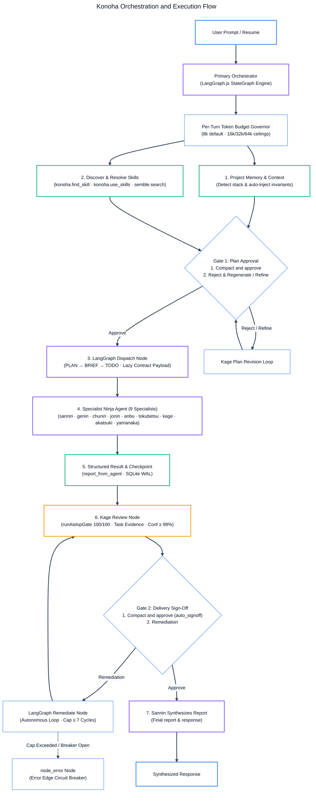
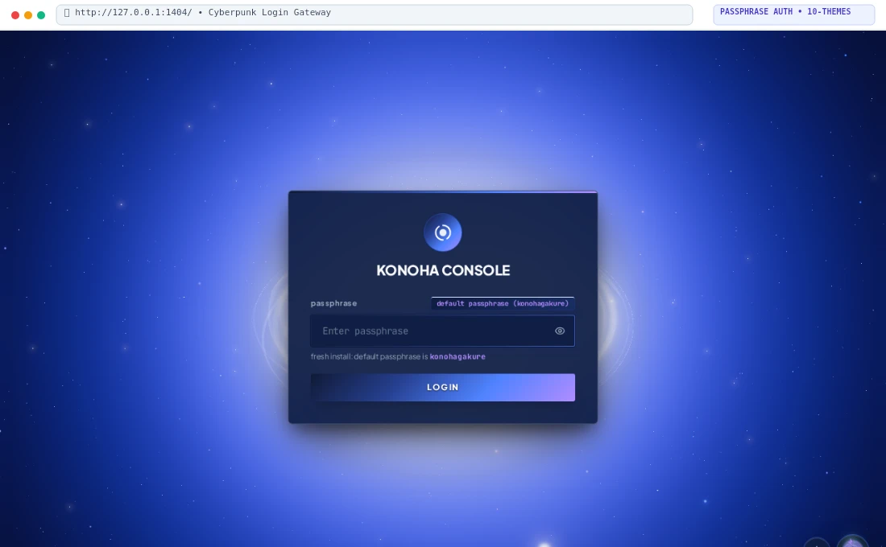
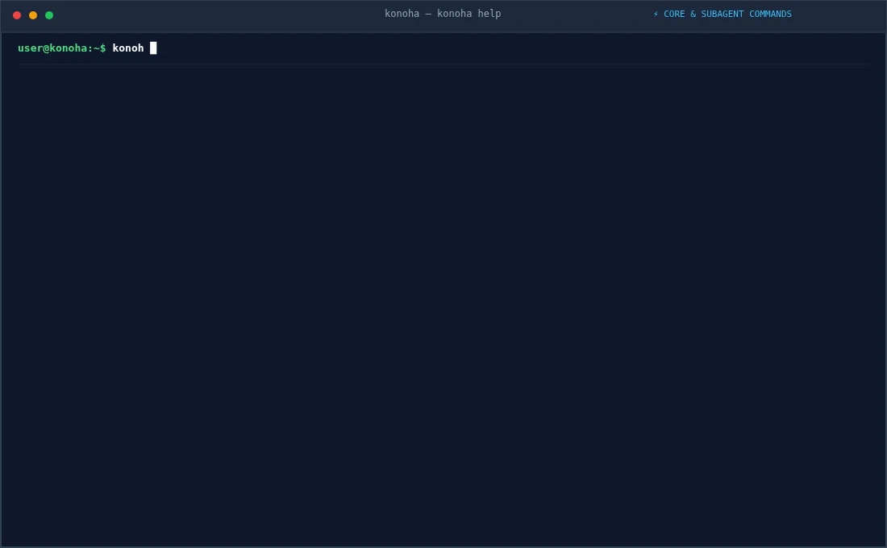
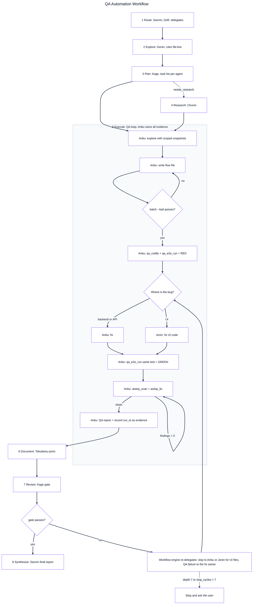
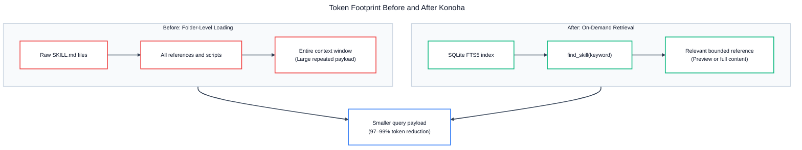

<p align="center">
  
</p>

<h1 align="center">🍃 KONOHA</h1>

<p align="center">
  <b>Enterprise Multi-Agent MCP Orchestration &amp; Context-Optimization Platform for AI Coding</b><br>
  <sub>LangGraph.js Parallel State Machines · 9 Specialist Ninja Agents · Real-Time Idle <code>@advisor</code> Guard (≤1k tok/turn) · Per-Agent Git Worktrees · 83–98% Context Reduction</sub>
</p>

<p align="center">
  <a href="CHANGELOG.md"></a>
  <a href="README.md"></a>
  <a href="README.md"></a>
  <a href="README.md"></a>
  <a href="README.md"></a>
  <a href="README.md"></a>
  <a href="README.md"></a>
  <a href="README.md"></a>
  <a href="README.md"></a>
  <br>
  <a href="README.md"></a>
  <a href="README.md"></a>
  <a href="README.md"></a>
  <a href="README.md"></a>
  <a href="docs/BENCHMARK.md"></a>
  <a href="README.md"></a>
  <a href="docs/SETUP-SEARXNG.md"></a>
  <a href="docs/TELEGRAM_INTEGRATION_GUIDE.md"></a>
  <br>
  <a href="docs/SecurityCompliance/security_compliance_report_google_policy_2.2.18_2026-11-04.md"></a>
  <a href="README.md"></a>
  <a href="README.md"></a>
  <a href="docs/SecurityCompliance/security_compliance_report_google_policy_2.2.18_2026-11-04.md"></a>
  <a href="README.md"></a>
  <a href="LICENSE"></a>
  <a href="https://saweria.co/andycungkrinx"></a>
</p>

<p align="center">
  <b>Quick Navigation:</b>
  <a href="#-flagship-demos--workflow-previews">Architecture &amp; Previews</a> •
  <a href="#-master-architectural-feature-matrix">Feature Matrix</a> •
  <a href="#-quick-start">Quick Start</a> •
  <a href="#-8-phase-multi-agent-workflow-engine">SDLC &amp; HITL Gates</a> •
  <a href="#-supported-coding-clients-matrix">8 Coding Clients</a> •
  <a href="#-mcp-tools-available">48 MCP Tools</a> •
  <a href="#-ninja-specialist-team-9-agents">9 Ninja Agents</a> •
  <a href="#-benchmark-token-footprint--optimization">Benchmarks</a> •
  <a href="#-documentation--guides-index">Docs</a>
</p>

---

## ⚡ Executive Summary — What's New in `v2.2.18`

| Pillar | Architectural Capability | Measured Guarantee |
| :--- | :--- | :--- |
| **Compact Skill Retrieval (`use_skills`)** | High-density core extraction (`extractHighDensityCore`) + session deduplication (`[ALREADY_IN_CONTEXT]`) across all 8 specialist agents while preserving `i-have-adhd` & `antislop*` | **`≤ 6,400 bytes` (~1.6k tokens)** per 5-skill batch (down from ~48.4 KB / ~12.1k tokens; **87% reduction**) |
| **Parallel Subagent Execution & Git Worktrees** | `executeNode` fans out independent tasks concurrently via `Promise.all` inside isolated git worktrees (`~/.konoha/tmp/worktrees/<task_id>/<step_id>-<agent>`); `@sannin` is strictly a router | **Zero race conditions**; deterministic conflict detection prior to worktree merge |
| **Real-Time Idle `@advisor` Monitor** | Deterministic AST/regex pre-filter (`0 tokens` when clean) + bounded on-the-fly `[ADVISOR_INTERRUPT]` correction payloads (`evict_stale_results: true`) | **`0 tokens` when idle · `≤ 1,000 tokens/turn` hard ceiling** when interrupting drift |
| **Native Walkthrough Sync & Gate 1 Compaction** | Emits native `walkthrough_steps`, `todos`, and `client_todo_directive` across all 8 clients; Gate 1 approval compacts prior exploration turns automatically | **`runSannin < 3 KB` (`2,867B`)** · **`< 1,500B` compacted context** post-approval |
| **Dynamic Jonin Frontend Architecture** | Replaces rigid templates with Astra/Fable-inspired dynamic composition, Dark & Light Mode, optional Figma/OpenDesign dual-mode, live browser monitor, and auto-generated project skill | Mandatory `<meta name="generator" content="Build by konoha">` + **`Build by konoha`** footer |
| **Append-Only `--client` Setup & Backup/Restore** | Explicit `konoha init --client=<cursor\|claude\|opencode\|omp\|codex\|pi\|antigravity\|commandcode\|all>` with non-destructive config merge and timestamped backups | Instant rollback via `konoha restore --client=<target\|all>`; zero template skill mirror injection |

---

<h2 id="-flagship-demos--workflow-previews">📸 Previews &amp; Workflow Architecture</h2>

* **Latest Release:** [v2.2.18](CHANGELOG.md) — Compact `use_skills` (`≤ 6,400B`), parallel git worktree execution, real-time idle `@advisor` (`≤ 1,000 tok/turn`), native walkthrough/TODO sync, post-approval context compaction, dynamic Jonin frontend engine, and append-only `--client` installation.
* **Latest Security Compliance:** [Google Policy Compliance v2.2.18 — Audited & Certified (2026-11-04)](docs/SecurityCompliance/security_compliance_report_google_policy_2.2.18_2026-11-04.md)

* **Reading the diagrams:** Every workflow canvas below is backed by the canonical Draw.io architecture files (`docs/diagrams/konoha-architecture.drawio` with 18 tabs plus `docs/diagrams/konoha-enterprise-architecture.drawio` with 19 tabs including `19 Authenticated Local Web UI & Ingress Queue`). Thirteen tabs are projected directly from Draw.io XML to 2400×1632 animated WebPs (`scripts/generate_drawio_flow_webp.js` + `scripts/lib/drawio_flow_svg.js`), while the 7 multi-card operational workflow diagrams (`konoha-orchestration-flow.webp` at 2400×1350, `konoha-jonin-flow.webp`, `konoha-kage-gate.webp`, `konoha-qa-flow.webp`, `konoha-telegram-flow.webp`, `konoha-akatsuki-flow.webp`, and `konoha-anbu-flow.webp` at 2400×1520) are rendered via Playwright + FFmpeg (`scripts/generate_tokubetsu_flow_webp.js`) with step-by-step sub-bullet checklists synchronized 100% with their corresponding Draw.io tabs. Both `tests/test_flow_diagram_style_lock.js` (`data-cell` coverage 19/19) and `tests/test_all_assets_webp.js` (33/33 `.webp` assets) verify structural and visual parity.

### ✧ Diagram Gallery

One featured workflow, with the full 19-tab catalogue plus the Anbu DB disaster-recovery workflow linked below:

<p align="center">
  
</p>

<sub>drawio tab 08 Orchestrator Task Artifact Flow — 11 cells, 10 connectors, owners sannin / anbu / akatsuki (2400×1350 animated WebP). The other 18 projections and workflows are one click away in the tables below.</sub>

### ✧ All 19 Drawio Tabs → Animated WebP

| Drawio tab | Animated WebP | Dimensions | Cells (v / e) | Owners |
| :--- | :--- | :--- | :--- | :--- |
| 01 System Architecture | [`konoha-flow-01-system-architecture.webp`](assets/konoha-flow-01-system-architecture.webp) | 2400×1632 | 21 / 12 | host, sannin, genin, akatsuki |
| 02 Runtime Query Lifecycle | [`konoha-flow-02-runtime-query-lifecycle.webp`](assets/konoha-flow-02-runtime-query-lifecycle.webp) | 2400×1632 | 14 / 13 | host, sannin, genin, akatsuki |
| 03 MCP Tool and Skill Routing | [`konoha-flow-03-mcp-tool-and-skill-routing.webp`](assets/konoha-flow-03-mcp-tool-and-skill-routing.webp) | 2400×1632 | 16 / 13 | sannin, jonin, genin, kage, anbu, chunin, tokubetsu-jonin, akatsuki |
| 04 LLM Bridge Gateway | [`konoha-flow-04-llm-bridge-gateway.webp`](assets/konoha-flow-04-llm-bridge-gateway.webp) | 2400×1632 | 14 / 11 | host, sannin, anbu, akatsuki |
| 05 Search Fallback Chain | [`konoha-flow-05-search-fallback-chain.webp`](assets/konoha-flow-05-search-fallback-chain.webp) | 2400×1632 | 9 / 10 | akatsuki |
| 06 Skill Registry Installation | [`konoha-flow-06-skill-registry-installation.webp`](assets/konoha-flow-06-skill-registry-installation.webp) | 2400×1632 | 11 / 11 | host, anbu, akatsuki |
| 07 Token Footprint Comparison | [`konoha-flow-07-token-footprint-comparison.webp`](assets/konoha-flow-07-token-footprint-comparison.webp) | 2400×1632 | 11 / 4 | akatsuki |
| 08 Orchestrator Task Artifact Flow | [`konoha-orchestration-flow.webp`](assets/konoha-orchestration-flow.webp) | 2400×1350 | 11 / 10 | sannin, anbu, akatsuki |
| 09 Jonin Taste-Skill Frontend Engine | [`konoha-jonin-flow.webp`](assets/konoha-jonin-flow.webp) | 2400×1520 | 7 / 5 | jonin, akatsuki |
| 10 Persistent Project Context & Auto-Compaction | [`konoha-flow-10-persistent-project-context-auto-compaction.webp`](assets/konoha-flow-10-persistent-project-context-auto-compaction.webp) | 2400×1632 | 6 / 4 | anbu, sannin, akatsuki |
| 11 Kage Pre-Delivery Reviewer Workflow Gate | [`konoha-kage-gate.webp`](assets/konoha-kage-gate.webp) | 2400×1520 | 12 / 11 | sannin, genin, kage, host, anbu, tokubetsu-jonin, akatsuki |
| 12 CLI Upgrade & Progress Engine | [`konoha-flow-12-cli-upgrade-progress-engine.webp`](assets/konoha-flow-12-cli-upgrade-progress-engine.webp) | 2400×1632 | 13 / 10 | host, anbu, akatsuki |
| 13 QA Automation Workflow | [`konoha-qa-flow.webp`](assets/konoha-qa-flow.webp) | 2400×1520 | 24 / 24 | sannin, genin, kage, chunin, anbu, jonin, tokubetsu-jonin, host, akatsuki |
| 14 Remote Access & Telegram Inbound/Outbound | [`konoha-telegram-flow.webp`](assets/konoha-telegram-flow.webp) | 2400×1520 | 18 / 13 | tokubetsu-jonin, anbu, sannin, akatsuki |
| 15 Inbound Prompt Queue & Worker Pipeline | [`konoha-flow-15-inbound-prompt-queue-worker-pipeline.webp`](assets/konoha-flow-15-inbound-prompt-queue-worker-pipeline.webp) | 2400×1632 | 15 / 10 | host, akatsuki, anbu, sannin, tokubetsu-jonin |
| 16 Akatsuki Security Controls & Dual-Mode Lab Lifecycle | [`konoha-akatsuki-flow.webp`](assets/konoha-akatsuki-flow.webp) | 2400×1520 | 22 / 15 | akatsuki, host |
| 17 Yamanaka Image-to-3D Asset Pipeline | [`konoha-yamanaka-3d-flow.webp`](assets/konoha-yamanaka-3d-flow.webp) | 2400×1632 | 15 / 9 | host, yamanaka |
| 18 LangGraph.js Orchestration Runtime | [`konoha-langgraph-flow.webp`](assets/konoha-langgraph-flow.webp) | 2400×1632 | 23 / 18 | sannin, kage, anbu, yamanaka |
| 19 Authenticated Local Web UI & Ingress Queue | [`konoha-web-ingress-flow.webp`](assets/konoha-web-ingress-flow.webp) | 2400×1632 | 14 / 9 | host, anbu, sannin, tokubetsu-jonin |

*Every row is backed by the `.drawio` XML source; the 6 Tokubetsu-Jonin multi-card workflow diagrams (Tabs 08, 09, 11, 13, 14, 16) enrich each step with detailed v2.2.18 sub-bullet checklists while preserving exact Draw.io step alignment.*

### ✧ Tokubetsu-Jonin Animated Workflows

Seven multi-card operational workflows (Tabs 08, 09, 11, 13, 14, 16 above plus `konoha-anbu-flow.webp` below) are generated by `scripts/generate_tokubetsu_flow_webp.js` using Playwright + FFmpeg (`libwebp_anim`, 24 frames, `loop: 0`):

| Workflow | Animated WebP (2400×1520) | Steps | Owner |
| :--- | :--- | :--- | :--- |
| Anbu SQLite Disaster Recovery & DB Health | [`konoha-anbu-flow.webp`](assets/konoha-anbu-flow.webp) | `konoha db check` → PRAGMA quick/integrity check → verified backup select → atomic corrupt archive → restore or `.recover` salvage → post-restore verify gate | anbu |

### 📐 Mermaid Diagram: Multi-Agent Orchestration & Execution Flow

<details>
<summary><b style="display:inline">📐 Click to expand Multi-Agent Orchestration &amp; SDLC Decision Flow (Mermaid Diagram)</b></summary>
<br>



</details>

### 🌐 Demo Web

<details>
<summary><b style="display:inline">🌐 Flagship Frontend Demo: SvelteKit 3 Web UI &amp; 10 Gradient Themes (<code>demo-web.webp</code>)</b></summary>
<br>

<p align="center">
  
</p>
</details>

### 🎬 Demo TUI

<details>
<summary><b style="display:inline">🎬 Flagship TUI Demo: All Commands &amp; Interactive Workflows in Action (<code>demo.webp</code>)</b></summary>
<br>

<p align="center">
  
</p>
</details>

---

## 🌟 Master Architectural Feature Matrix

| Category | Capability / Feature | Subsystem / Engine | Key Invariant & Contract | Status |
|:---|:---|:---|:---|:---:|
| **Orchestration & Personas** | **✧ Sannin Router** | `src/mcp/workflow_sannin.js` | Top-level triage, domain routing, `SANNIN_ROUTER_ONLY_ERROR` (never runs worker code) | ✅ `ACTIVE` |
| | **⚑ Genin Scout** | `genin-skill` | Read-only symbol search, codepath tracing, zero file mutations (`i-have-adhd` + `antislop*`) | ✅ `ACTIVE` |
| | **◎ Kage Governor** | `kage-skill` | Architecture decisions, security auditing, 98% Confidence Gate (`i-have-adhd` + `antislop*`) | ✅ `ACTIVE` |
| | **♦ Jonin Builder** | `jonin-skill` | Dynamic Astra/Fable-inspired UI across Next.js, Nuxt, SvelteKit, Angular + `Build by konoha` | ✅ `ACTIVE` |
| | **♠ Anbu Black Ops** | `anbu-skill` | Backend dev, bug fixes, DevOps, 817 offensive security skills (`i-have-adhd` + `antislop*`) | ✅ `ACTIVE` |
| | **▫ Chunin Intel** | `chunin-skill` | Zero-API-key web research (SearXNG + Wikipedia OpenSearch, `rtk` compressed) | ✅ `ACTIVE` |
| | **⬡ Tokubetsu-Jonin** | `tokubetsu-jonin-skill` | Technical documentation, API specs, runbooks, Office deliverables (`i-have-adhd` + `antislop*`) | ✅ `ACTIVE` |
| | **☠ Akatsuki Security** | `akatsuki-skill` | Dual-mode blue-team gates plus isolated red-team lab (`akatsuki-lab`, `i-have-adhd` + `antislop*`) | ✅ `ACTIVE` |
| | **❖ Yamanaka 3D** | `yamanaka-skill` | Generative 3D synthesis, manifold gate, Blender refinement (Web UI menu hidden in `v2.2.18`) | ✅ `ACTIVE` |
| | **Parallel Git Worktree Isolation** | `src/mcp/worktree_isolation.js` | Concurrent worker subagents run in isolated git worktrees (`~/.konoha/tmp/worktrees/...`) | ✅ `ACTIVE` |
| | **Real-Time Idle `@advisor` Guard** | `src/workflow/kage-reviewer/advisor_monitor.js` | `0 tokens` when clean; `≤ 1,000 tokens/turn` on-the-fly `[ADVISOR_INTERRUPT]` correction | ✅ `ACTIVE` |
| **Token & Context Optimization** | **Compact `use_skills` (`≤ 6.4 KB`)** | `src/mcp/skills_common.js` | High-density core extraction + session deduplication (`[ALREADY_IN_CONTEXT]`); `full: true` opt-in | ✅ `ACTIVE` |
| | **Bounded File I/O** | `src/file_tools_router.js` | `read_file_range`, `read_file_head` (50–100 line caps; whole-file dumps withheld) | ✅ `ACTIVE` |
| | **Semantic Code Search** | `semble` MCP | Vector embeddings & line spans replace full repository dumps | ✅ `ACTIVE` |
| | **Shell Output Compaction** | `rtk` (Rust Token Killer) | Global CLI proxy compresses noisy command outputs (60–95% savings) | ✅ `ACTIVE` |
| | **Post-Approval Context Compaction** | `src/mcp/workflow_gates.js` | Gate 1 approval compacts prior exploration turns into `< 1,500B` summary (`compaction_applied: true`) | ✅ `ACTIVE` |
| | **Hybrid Vector RAG** | `src/vector_search.js` | IBM Granite multilingual + MS MARCO MiniLM neural reranker | ✅ `ACTIVE` |
| **SDLC Quality Gates** | **Two-Stage HITL Gates** | `src/mcp/workflow_gates.js` | Gate 1 (`pending_plan_approval`) & Gate 2 (`pending_human_signoff`) with 3-option picker | ✅ `ACTIVE` |
| | **Native Walkthrough & TODO Sync** | `src/mcp/todo_walkthrough_sync.js` | Syncs `walkthrough_steps`, `todos`, and `client_todo_directive` across all 8 clients (`< 3 KB`) | ✅ `ACTIVE` |
| | **Definition-of-Readiness (DoR)** | `src/sdlc_dor.js` | Enforced/advisory check blocks unready, ambiguous prompts | ✅ `ACTIVE` |
| | **Two-Step Zero-AI-Slop Gate** | `aislop_scan` + `anti_slop` | Mechanically requires 100/100 scan & 0 findings before synthesis | ✅ `ACTIVE` |
| | **Kage Confidence Gate** | `src/mcp/workflow_gates.js` | Strict ≥ 98% verification score required across all categories | ✅ `ACTIVE` |
| | **Supply-Chain Security Gate** | Socket CLI (`socket ci`) | Mechanical blocker on High/Medium dependency vulnerabilities | ✅ `ACTIVE` |
| | **Autonomous Remediation Loop**| `src/sdlc_remediation.js` | Bounded circuit breaker (7 cycles) for auto-fixing slop findings | ✅ `ACTIVE` |
| **Frontend & UI Engine** | **Dynamic Astra/Fable Composition** | `src/templates/skills/jonin-skill/` | Archetype-specific visual storytelling; no rigid 10-theme FAB or 4-slide template lock-in | ✅ `ACTIVE` |
| | **4 Supported Frameworks** | `src/mcp/build_spec.js` | Official CLI scaffolding: Next.js 16, SvelteKit 2, Nuxt 3, Angular 19+ | ✅ `ACTIVE` |
| | **First-Class Dark & Light Mode** | `jonin-skill` | Semantic CSS variables (`--bg-canvas`, `--text-primary`), WCAG 2.2 AA, zero emoji policy | ✅ `ACTIVE` |
| | **Live Browser Monitor & Skill Gen** | `src/workflow/jonin-builder/` | Auto-opens live dev browser (`live_browser_monitor.js`) + generates `.agents/skills/<project>-frontend-maintenance/SKILL.md` | ✅ `ACTIVE` |
| | **Figma / OpenDesign Optional Mode** | `src/mcp/build_spec.js` | Optional Mode A (exported assets) or Mode B (live MCP); zero hard dependency when absent | ✅ `ACTIVE` |
| | **AI-Website Fingerprint Detector**| `src/workflow/jonin-builder/ai_detector.js` | Heuristic engine detecting AI generators (0–20 = Human-Built band) | ✅ `ACTIVE` |
| **Document Engineering** | **Office Deliverables** | `src/workflow/tokubetsu-scribe/document_engine.js` | DOCX, PDF, XLSX, PPTX with < 3% ZeroGPT AI target & discrete sections | ✅ `ACTIVE` |
| | **Animated WebP Pipeline** | `src/workflow/tokubetsu-scribe/document_engine.js` | Canonical .webp export with pure Node.js structural bitstream validation | ✅ `ACTIVE` |
| **Remote Operations & Mobile** | **Two-Stage Telegram Approvals** | `src/telegram/` | Real-time Gate 1 & Gate 2 interactive approval buttons, `/approval list`, `/doctor`, `/session` | ✅ `ACTIVE` |
| | **Persistent Prompt Queue** | `src/queue/` | SQLite atomic state machine (`pending` -> `processing` -> `completed`) | ✅ `ACTIVE` |
| **Security & Cryptography** | **Argon2id Memory-Hard Auth**| `src/auth.js` | Salted Argon2id passphrase verification + CLI reset (`konoha auth reset`) | ✅ `ACTIVE` |
| | **AES-256-GCM Crypto Vault** | `src/crypto_vault.js` | AEAD authenticated encryption at rest for tokens & credentials | ✅ `ACTIVE` |
| | **PBKDF2 Key Derivation** | `src/crypto_vault.js` | 100,000 SHA-256 iterations with host-fingerprint salt | ✅ `ACTIVE` |
| | **Zero Plaintext Secrets Invariant**| Whole repo | Automatic masking (`12345***:***abcd`) across APIs, logs, and TUI | ✅ `ACTIVE` |
| | **Offensive Red-Teaming Skills** | `anbu-skill` | 817 Anthropic cybersecurity skills & MITRE ATT&CK techniques | ✅ `ACTIVE` |
| **Cross-Client Ecosystem** | **8 Supported Coding Clients** | `src/mcp_clients_manager.js`, `src/agent_manager.js` | Antigravity, Cursor, Claude Code, OpenCode, Command Code, Codex, Pi, OMP | ✅ `ACTIVE` |
| | **Hermetic Session Isolation** | `src/db.js` | Composite PK `(client, workspace_root, session_id)` with `project_hash` preventing cross-session leakage | ✅ `ACTIVE` |

---

## 📖 Setup & Usage Guides

* [Konoha Bridge Router Guide](docs/LLM-BRIDGE-GATEWAY.md)
* [Web Configuration UI Guide](docs/SETUP-WEB-UI.md)
* [Antigravity IDE Setup Guide](docs/SETUP-IDE.md)
* [Antigravity CLI Setup Guide](docs/SETUP-CLI.md)
* [Cursor IDE & CLI Setup Guide](docs/SETUP-CURSOR.md)
* [Claude Code Setup Guide](docs/SETUP-MCP-CLIENTS.md)
* [SearXNG Multi-Source Search](docs/SETUP-SEARXNG.md)
* [Adding Skills from skills.sh](docs/ADDING-SKILLS.md)
* [Token Savings Benchmarks](docs/BENCHMARK.md)
* [Troubleshooting Guide](docs/TROUBLESHOOTING.md)
* [System Architecture](docs/ARCHITECTURE.md)

## ⚠️ The Problem & 💡 The Solution

### Architectural Comparison: The Vibe Coding Dilemma vs. Autonomous Agentic Rigor

| Developer Challenge & Problem | Traditional / Naive Approach | Konoha Enterprise Solution | Key Impact & Metric |
|:---|:---|:---|:---|
| **Vibe Coder Career Dilemma**<br>*(Transitioning from casual prompting to enterprise multi-agent engineering)* | Casual single-file prompting, copy-pasting code snippets without structure, fragile prototypes, lack of SDLC governance, and inability to architect scalable enterprise systems. | **Append-Only Client Setup (`konoha init --client=<target\|all>`)**: Turnkey initialization provisioning 9 specialized ninja subagents, 1,027 indexed domain skills, and 48 canonical MCP tools across 8 supported coding clients with automatic backup & restore (`konoha restore --client=<target\|all>`). | Elevates casual vibe coding into structured senior engineering rigor with full team delegation from Day 1. |
| **Context Window Flooding & High API Costs** | Dumping entire skill trees, unindexed files, and massive prompt boilerplates at startup (~1.1 MB payload / 800,000+ tokens) or 48.4 KB `use_skills` dumps. | **Compact `use_skills` (`≤ 6,400B`), SQLite FTS5 & Bounded File I/O**: `extractHighDensityCore` caps multi-skill batches at `≤ 6.4 KB` with session deduplication (`[ALREADY_IN_CONTEXT]`); `read_file_range` slices files to exact line spans. | **83%–98% byte-weighted reduction** on core retrieval (see `docs/BENCHMARK.md`); eliminates context bloat and LLM amnesia. |
| **Terminal Output Noise & Shell Explosion** | Build tools, test runners, and linters dump hundreds of noisy progress bars and logs directly into model context. | **RTK (Rust Token Killer) Global CLI Proxy**: Transparently intercepts terminal commands, compresses noisy outputs, and preserves critical error signals. | **60%–95% terminal output compression**; saves thousands of tokens per command execution. |
| **Generic AI Slop & Aesthetic Clichés** | Generating purple gradients, generic Inter typography, rigid cookie-cutter templates, broken mobile layouts, and excessive emoji decor. | **Dynamic Jonin + Taste-Skill v2 Frontend Engine**: Astra/Fable-inspired dynamic visual storytelling, first-class Dark & Light Mode, live browser inspection (`live_browser_monitor.js`), auto-generated project frontend maintenance skill, zero emojis, and `Build by konoha` signature. | **100/100 `aislop` scan compliance**; production-grade, bespoke human-crafted aesthetic fidelity. |
| **Hallucinated Passes, Worker Drift & Merge Conflicts** | Sequential execution bottlenecks, worker agents drifting off-spec or overwriting each other's files, and fake-green test claims. | **Parallel Git Worktrees, Real-Time Idle `@advisor` (`≤ 1k tok/turn`) & Kage 98% Gate**: Independent steps run concurrently in isolated git worktrees; idle `@advisor` interrupts drift on the fly (`0 tokens` when clean); Kage enforces `100/100` aislop + `≥ 98%` confidence. | Genuine parallel multi-agent execution with mechanical drift prevention and zero file collisions. |
| **Mobile & Remote Workflow Disconnection** | Developers chained to their desks; inability to monitor, review, or trigger agent runs remotely; local servers trapped behind NATs. | **Dual-Mode Telegram Bot & Prompt Queue**: Full remote control over mobile with two-way conversational prompting and one-way post-Kage completion notifications. | Anywhere, anytime autonomous agent interaction with real-time push alerts. |
| **Plaintext Credential Leaks & Secret Vulnerabilities** | Storing sensitive API tokens and bot tokens in plaintext `.env` files vulnerable to accidental Git commits and logs. | **AES-256-GCM AEAD Hardware-Grade Crypto Vault**: Machine-bound PBKDF2 (100,000 iterations) key derivation, OS-keyed encryption, automatic redaction in logs, and zero plaintext secret storage. | Zero-knowledge secret management; automated encryption for bot tokens & credentials. |
| **DevOps & Offensive Security Blindspots** | AI models unaware of OWASP vulnerabilities, unable to perform security assessments, and producing insecure cloud deployments. | **817 Anthropic Cybersecurity Skills & Anbu/Akatsuki Ops**: Integrated MITRE ATT&CK techniques, penetration testing in isolated `akatsuki-lab`, exploit analysis, container hardening, and enterprise defense gates. | End-to-end security hardening; comprehensive vulnerability identification and red teaming. |
| **Multi-Agent Disk Thrashing & Context Fragmentation** | Subagents exchanging files via disk files (retired file-based IPC), causing I/O lag, disk bloat, and context fragmentation. | **Direct Structured MCP Delegation & Post-Approval Compaction**: In-memory argument passing, native IDE/CLI TODO & walkthrough sync (`< 3 KB`), and automatic `< 1,500B` context compaction after Gate 1 approval. | Zero disk file loops; instant subagent dispatch with permanent project memory continuity. |
| **Fragmented IDE Configuration & Invasive Overwrites** | Destructive `--force --yes` installers that clobber existing user MCP configs or dump duplicate template skill mirrors into repositories. | **Explicit Append-Only `--client` Provisioning & Backup/Restore**: `konoha init --client=<cursor\|claude\|opencode\|omp\|codex\|pi\|antigravity\|commandcode\|all>` appends safely into global/project configs with timestamped backups. | Non-destructive setup across all 8 premier AI coding environments (IDE & CLI). |

> [!TIP]
> **Optimization Result**: Konoha and Semble retrieve bounded, task-relevant context instead of full skill trees. See [BENCHMARK.md](docs/BENCHMARK.md) for historical snapshots and reproducible `konoha savings` output; latency and cost reductions are environment-dependent and are not guaranteed.

---
## ⚙️ How It Works

For a detailed breakdown of Konoha's internal mechanics, including system layers, data flows, and query lifecycle sequence diagrams, please see the [System Architecture Guide](docs/ARCHITECTURE.md).


<details>
<summary><b>🚀 Direct Structured MCP Delegation & Zero-Loop Reporting</b></summary>
<br>

Konoha subagents execute inline via direct structured MCP tool arguments (`task`, `context`, `constraints`, `skills`, `taste_dials`) using direct specialist tools (`jonin`, `anbu`, `kage`, `genin`, etc.):
- **Eliminates Scratch Loops**: Replaces multi-step disk file reading with direct in-memory structured context passing.
- **Auto-Checkpointing (`report_from_agent`)**: Automatically distills key architectural learnings and records them into persistent project memory upon task completion.

</details>

<details>
<summary><b>🎨 Dynamic Jonin + Taste-Skill Anti-Slop Frontend Engine</b></summary>
<br>

Jonin combines bespoke **Astra / Fable-inspired visual direction** with **Taste-Skill v2** (`Leonxlnx/taste-skill`) design directives:
- **Dynamic Archetype-Driven Composition**: Eliminates rigid template lock-in. Every build adapts its layout, hero storytelling, section choreography, and interactive surfaces to the product archetype rather than forcing a fixed 4-slide carousel or bottom-left 10-theme FAB.
- **First-Class Dark & Light Mode**: Semantic CSS custom properties (`--bg-canvas`, `--bg-surface`, `--bg-elevated`, `--text-primary`, `--text-muted`, `--border-subtle`, `--accent-primary`) supporting both Dark Mode and Light Mode with WCAG 2.2 AA contrast.
- **Deterministic High-End Typography**: Enforces Geist, Cabinet Grotesk, Outfit, Satoshi, Plus Jakarta Sans, and Clash Display. Generic Inter defaults are forbidden.
- **Real-Time Browser Inspection (`live_browser_monitor.js`)**: Automatically starts the framework dev server, polls readiness, and opens the live preview URL in the developer's browser or `agent-browser` during build execution.
- **Auto-Generated Project Maintenance Skill (`project_skill_generator.js`)**: Generates `.agents/skills/<project-slug>-frontend-maintenance/SKILL.md` after every frontend build and indexes it into `konoha.db`.
- **Mandatory Konoha Signature & Zero-Emoji Policy**: Pure vector iconography (zero emojis/emoticons in UI/code), `<meta name="generator" content="Build by konoha">` in the HTML `<head>`, and visible `Build by konoha` footer branding.
- **Optional Figma & OpenDesign Integration**: Supports Mode A (exported design tokens/assets) or Mode B (live MCP servers) when configured, with zero hard dependency when absent.

</details>

<details>
<summary><b>🏢 Persistent Project-Level Context & Memory (Zero Hallucination)</b></summary>
<br>

- **Workspace Stack Profiler**: Automatically detects frameworks (Next.js, SvelteKit, Nuxt 3, Angular), styling engines (Tailwind v4, CSS Modules), and package managers (`pnpm`).
- **Project-Scoped Memory**: Persists architectural invariants, rules, and episodic learnings per repository workspace in SQLite (`~/.konoha/konoha.db`).
- **Zero Session Amnesia**: Context and invariants are preserved and automatically injected across consecutive sessions.
- **CLI Commands**: `konoha project context`, `konoha project list`, `konoha project add`, `konoha project memory`.

</details>

<details>
<summary><b>🧠 Hybrid Vector Search & Multilingual Retrieval (IBM Granite + MS MARCO MiniLM Neural Reranker)</b></summary>
<br>

Konoha integrates hybrid semantic retrieval combining **SQLite FTS5 BM25**, **IBM Granite 97M Multilingual Embeddings (ONNX)**, and **MS MARCO MiniLM Neural Cross-Encoder Reranker**:
- **Offline Bundled Models**: Both embedding and neural reranker models are pre-bundled directly in `assets/models/` (<100 MB each), enabling 100% offline installs and zero-download instant execution.
- **Dual-Stage Reranking & RAG Retrieval**: Combines sub-millisecond Reciprocal Rank Fusion (RRF, k=60) for candidate ranking with neural cross-encoder passage reranking (`searchChunksRAG()`) for high-precision RAG context retrieval.
- **Cross-Lingual Recall**: Queries in multilingual text retrieve the relevant skill documentation with **97.5% Recall@5** and **0.885 MRR@5**.
- **Zero-Config Default & Opt-in Semantic Search**: By default, Konoha runs zero-config with ultra-fast SQLite FTS5. Semantic search and neural reranking are optionally enabled via `KONOHA_SEMANTIC_SEARCH=1`.
- **Graceful Fallback**: If models are unavailable, semantic search is toggled off, or the host SQLite binary lacks compiled FTS5 (e.g. Windows), retrieval seamlessly falls back to FTS5 / LIKE search without crashing.
- **4-Tier Embedding Feature Deduplication**: Markdown heading-aware chunk hashing, in-memory `_EMBED_CACHE` (512 entries), database-level binary blob reuse across skills, and candidate nearest-chunk deduplication.
- **Persistent Persona & Project Memory**: Idempotent memory storage preventing duplicate SQLite rows, zero-hallucination factual extraction, and auto-compact turn-based prompt badges (< 120 tokens on turn >= 2).
- **Cross-Platform `agent-browser` Lifecycle**: Automated multi-package-manager detection and self-healing doctor auto-repair across Windows (`agent-browser.cmd`), Linux, and macOS.

</details>

<details>
<summary><b>🔄 Workflow: Forced MCP Delegation & Subagent Routing</b></summary>
<br>

All non-trivial work on a Konoha-configured host **MUST** flow through the Konoha MCP and Semble MCP tools and be delegated to a konoha subagent — never executed solo by the main orchestrator.

- **Skill lookup** (`konoha.find_skills`, `konoha.find_skill`, `konoha.get_skill`) — always via `konoha` MCP, never `semble`. Project-scoped skills (`.agents/skills`, `skills/`, `.cursor/skills`, `.gemini/skills`) auto-migrate into `skills.db`.
- **Codebase search** (`semble.search`, `semble.find_related`) — always via `semble` MCP, never `grep`/`rg`/`find`.
- **Bounded file reads** — `konoha.read_file_head` / `read_file_range` / `file_info` / `token_efficient_grep`, never generic `Read` / `Grep` / `Glob` / shell `cat`/`head`/`tail`.
- **Zero-AI-Slop Code Quality** — `aislop.aislop_scan`, `aislop.aislop_fix`, `aislop.aislop_why` for code hygiene and Kage review gating.
- **Project Knowledge Discovery** — inspect project-local `README.md`, `docs/`, `CONTRIBUTING.md`, `.cursorrules`, `.clauderules`, and canonical project skills (`.agents/skills`, `skills/`) before executing code.
- **Package Manager Mandate** — ALWAYS use `pnpm` (never standalone `npx` or `npm`) for all JS/TS scaffolding, installs, and builds.
- **Subagent routing** — match the task domain to a ninja agent:
  - `@genin` — codebase exploration, codepath tracing, ADHD-friendly output shaping (`genin-skill/i-have-adhd`)
  - `@kage` — architecture, security, deep analysis, anti-slop delivery gate (`kage-skill/antislop*`, `kage-skill/drawio-skill`)
  - `@chunin` — web research, documentation synthesis, citations
  - `@jonin` — UI/frontend across 4 frameworks (SvelteKit, Next.js 16, Nuxt 3, Angular v19+) using `pnpm` + Tailwind v4, React/Next.js best practices (`jonin-skill/react-patterns`, `react-performance`, `react-testing`), ADHD output shaping (`jonin-skill/i-have-adhd`); fixes UI bugs found by QA automation (never calls QA tools)
  - `@anbu` — backend development, bug fixing, QA automation & E2E verification (`anbu-skill/qa-automation`, `agent-browser` + Playwright), DevOps & cloud infrastructure, Helm chart scaffolding (`anbu-skill/helm-chart-scaffolding`), multi-stage Dockerfiles (`anbu-skill/multi-stage-dockerfile`), ADHD output shaping (`anbu-skill/i-have-adhd`), & dev/local penetration testing
  - `@tokubetsu-jonin` — technical writing, docs, runbooks, READMEs
  - `@akatsuki` — security audits, SAST/CVE review, isolated red-team operations (`akatsuki-skill`)
  - `@yamanaka` — generative 3D assets, Blender refinement, manifold and PBR validation (`yamanaka-skill`)

**The main orchestrator MUST NOT execute implementation tasks itself — it only coordinates and delegates.** Trivial edits on a known file may run inline; everything else routes through a subagent.

</details>

---

## 🏗️ Multi-Agent Architecture: MCP Tools Orchestrator

Konoha uses an **MCP Tools Orchestrator Model** (Single-Thread Persona Adoption via MCP Tools), specifically engineered to deliver maximum performance, complete cross-IDE portability, and **83–98% token savings**.

> **Canonical editable diagram:** [08 Orchestrator Task Artifact Flow](docs/diagrams/konoha-architecture.drawio) · [Complete Workflow Architecture](docs/ALL-WORKFLOW-DIAGRAMS.md) · [Diagram manifest](docs/diagrams/README.md).

### Architectural Comparison

| Dimension | 1. Agent-to-Agent (Process Spawning) | 2. MCP-to-MCP (Server-to-Server RPC) | 3. MCP Tools Orchestrator (Konoha Model) |
|:---|:---|:---|:---|
| **Execution Model** | Spawns separate LLM child processes (`invoke_subagent`). | One MCP Server calls another downstream MCP Server via backend RPC. | Subagents run as **MCP Tools** (`anbu`, `kage`); Orchestrator adopts persona dynamically. |
| **Token Efficiency** | ❌ **Poor**: High token bloat from duplicating system prompts & context (3x–10x token cost). | ⚠️ **Moderate**: Depends on RPC serialization payload size. | ✅ **Extreme (83–98% Savings)**: In-flight execution using bounded MCP context. |
| **Startup Latency** | ❌ **High**: 3–10 seconds of cold-start delay per child process launch. | ⚠️ **Moderate**: Network/IPC serialization hops between cascading servers. | ✅ **Near-Zero Latency**: Instant inline tool invocations and persona handoffs. |
| **Task Auditability** | ⚠️ Complex transcript aggregation across detached process trees. | ❌ Hidden backend execution; opaque to the client UI/user. | ✅ **Fully Transparent**: Human-readable structured task contracts (`status.json` & `report_from_agent` records). |

### Why Konoha Uses the MCP Tools Orchestrator Model

1. 🚀 **Zero Process Cold-Start**: Subagents execute in-flight as standard MCP tools without waiting for multi-second process initialization.
2. 💡 **Direct Structured Context**: Passes tasks, constraints, skills, and taste dials in-memory via MCP tool arguments without filesystem disk-thrashing loops.
3. 🛡️ **Seamless Conversation Resumption**: Re-evaluates state and enforces subagent delegation workflow on every resume or multi-turn request.

### 🔄 Structured Delegation (File-Based IPC Retired)

Konoha passes `task`, `context`, `constraints`, `skills`, `taste_dials`, and `project_path` directly to subagent MCP tools. File-based IPC (`prompt.md` / `delegate.md` / `result.md`) is retired: nothing writes or reads these files, and dispatchers reject task references to them with `retired_file_ipc`.

Structured reports use `report_from_agent` to return summaries, changed files, and project-scoped learnings. Task directories remain outside the project workspace and are cleaned after use.

### Skill Resolution

When a subagent runs, `run_mcp_agent` resolves skills in three layers:

1. **Exact match** — `agents.skills` (per-agent YAML) is queried against `skills.skill_name` and `references.name`.
2. **Fuzzy match** — if a skill name has no exact hit, Levenshtein distance ≤ 3 finds close names. Example: `devsecops-enginer` → `devsecops-engineer`.
3. **Prompt-driven autoload** — when the agent's `skills` list is empty, the prompt is tokenized and matched against `skill_name` + the first 200 chars of each skill's content. The top 3 token-coverage matches are auto-loaded and embedded into the agent instructions.

The mismatch is reported on stderr (`fuzzy-resolved skill 'x' -> 'y'`) so the orchestrator can spot recurring typos and update the YAML.

### Workspace Hygiene

Transient subagent scratch state (`status.json`, `plan.md`, `findings.md`, `final_report.md`, etc.) is written **outside** the project tree at `~/.konoha/tmp/<client>/<session>/scratch/tasks/<task_id>/`. Retired file-IPC names (`prompt.md`, `delegate.md`, `result.md`) are never created. If `~/.konoha` is not writable, the resolver falls back to `/tmp/konoha-<pid>-<ts>/`. The path is **never** rooted under `WORKSPACE_ROOT`, so `git add .` cannot accidentally commit agent scratch files. This is enforced by `src/mcp/runtime_state.js` and covered by `tests/test_scratch_path.js`.


---

## 🚀 Quick Start

### ⚡ 1-Command Global Install (Recommended via npm / pnpm)

Install Konoha globally from npm, initialize the runtime database, and append configuration for your coding clients one by one (or all at once):

```bash
# Recommended: Install globally via npm (or pnpm add -g konoha-mcp)
npm install -g konoha-mcp

# 1. Initialize ~/.konoha runtime & SQLite FTS5 database (zero automatic client config or template skill mirror injection)
konoha init

# 2. Append Konoha MCP & rules into your AI coding clients (both IDE & CLI, global & project scopes):
konoha init --client=cursor
konoha init --client=claude
konoha init --client=opencode
konoha init --client=omp
konoha init --client=codex
konoha init --client=pi
konoha init --client=antigravity
konoha init --client=commandcode
konoha init --client=all

# 3. Optional: Back up or restore client configurations (global & project scopes):
konoha config backup --client=all --scope=all
konoha config restore --client=cursor --scope=all
```

Or run directly without global installation via `npx` / `pnpm dlx`:

```bash
npx konoha-mcp init
# or: pnpm dlx konoha-mcp init
```

> [!IMPORTANT]
> **Breaking Changes Notice (Post-v2.1.17)**:
> - **Direct Specialist MCP Tools**: Deprecated `delegate_to_<agent>` MCP tool wrappers are removed in favor of direct specialist tools (`sannin`, `genin`, `kage`, `chunin`, `jonin`, `anbu`, `tokubetsu_jonin`, `akatsuki`). External callers using legacy delegate prefixes on `report_from_agent` are rejected.
> - **Canonical CLI Syntax (27 Removed Aliases)**: 27 legacy undocumented CLI aliases have been pruned: `embeddings`, `detect_ai`, `ai-detector`, `detect_docs`, `docs-detector`, `detect-doc`, `personas`, `memories`, `spirit`, `will-of-fire`, `projects`, `tasks`, `web-search`, `inbox`, `install`, `memory`, `setup`, `update`, `saving`, `agents`, `tg`, `tunnels`, `prune`, `context`, `persona`, `searxng`, `sdlc`. Canonical subcommands (`konoha task`, `konoha data`, `konoha skill`, `konoha agent`, `konoha status`, etc.) are strictly enforced.
> - **Operational Database Management (`konoha data`)**: Added canonical subcommands `konoha data backup [path]`, `konoha data rebuild-fts`, and `konoha data prune [--retention <days>]`. Note: `konoha data prune` deletes immediately, with no confirmation and no automatic backup (take `konoha data backup` first), and "alltime" stats count only data since the last prune.
> - **Session Sandbox Isolation Contract (Decision A)**: Strict per-session isolation partitions episodic memories by `session_id`; agent-facing queries without a session ID do not receive foreign episodic memories while retaining workspace project rules. Administrative listings and Web UI pass `allSessions: true`.

### 📦 Source / Clone Onboarding

For developers building from source or cloning the Git repository:

```bash
# 1. Clone repository and enter directory
git clone https://github.com/andycungkrinx91/konoha.git
cd konoha

# 2. Install dependencies via pnpm
pnpm install

# 3. Append Konoha configuration for a specific client or all 8 clients (with automatic backup):
node bin/cli.js init --client=cursor
node bin/cli.js init --client=claude
node bin/cli.js init --client=opencode
node bin/cli.js init --client=omp
node bin/cli.js init --client=codex
node bin/cli.js init --client=pi
node bin/cli.js init --client=antigravity
node bin/cli.js init --client=commandcode
# Or initialize all 8 supported clients at once:
node bin/cli.js init --client=all

# 4. Restore previous client configuration backup at any time:
node bin/cli.js restore --client=all
```

*(Optional: Run `pnpm link --global` or `npm link` so team members can run `konoha status`, `konoha test`, or `konoha migrate` directly from any terminal).*

### Automatic Dependency & Environment Provisioning

When installing Konoha, all required Node.js libraries, SQLite FTS5 database schemas, file tools MCP, and client configs are automatically provisioned:
- 📦 **Node.js dependencies**: Pure zero-native runtime with minimal production dependencies (`@bufbuild/protobuf`). Built on Node.js built-in `node:sqlite` (FTS5 + WAL) and native styling/prompting. Zero native compilation, zero build toolchain.
- 🗄️ **SQLite FTS5 Skills Database**: Automatically compiled and initialized at `~/.konoha/konoha.db` (legacy `skills.db` is auto-migrated on first open).
- 🔮 **Semble Codebase Search MCP**: Auto-configured via `uvx` for zero-setup deep code discovery.
- ⚙️ **File Tools & Prompt Hooks**: Deployed automatically to `~/.konoha/` and registered with client IDE config schemas.
- 🌉 **Local LLM Proxy Gateway**: Embedded local OpenAI-compatible bridge router on port 19999 for token-efficient model multiplexing.

> [!IMPORTANT]
> **Zero-Prompt Auto-Setup**:
>
> **Cross-Platform**: Works on Linux, macOS, and Windows (native and WSL). Supports nvm on all platforms.

Get Konoha up and running in under 2 minutes:

```bash
# 1. Zero-install one-liner via npx (or: pnpm dlx konoha-mcp init)
npx konoha-mcp init

# 2. Re-index skills & synchronize vector embeddings (IBM Granite + MS MARCO MiniLM Reranker)
konoha migrate --clean --rebuild-embeddings
# (or simply: konoha embed)

# 3. Verify the MCP server connection works
konoha test

# 4. Check installation status and index database statistics
konoha status
```

> [!NOTE]

## 📋 Requirements

- **Node.js** ≥ 24.0.0 (via nvm, Homebrew, or system package; pure Node.js runtime with built-in `node:sqlite` + FTS5, zero Python dependency)
- **Agent skills** in `~/.agents/skills/` (with `SKILL.md` files); Konoha indexes and serves skill content through SQLite FTS5 without filesystem mirrors
- **Cross-platform**: Linux, macOS, Windows (native and WSL)
<details>
<summary><h2 style="display:inline">🛠️ CLI Commands & Hard Guardrail Enforcement (v2.0.0) Reference</h2></summary>
<br>

## 🛠️ CLI Commands

To run all commands simply as `konoha <command>`, install the package globally:

```bash
npm install -g konoha-mcp
# or: pnpm add -g konoha-mcp
```

Once installed, the following CLI commands are available:

| Command | Description |
|:---|:---|
| `konoha init` | Full install: self-contained CLI runtime (`~/.konoha/bin/cli.js`) + server + migration + MCP config + GEMINI.md + global `konoha` command reconciliation (npm/pnpm/yarn shims on Linux, macOS, and Windows; supports `--client=cursor|claude|opencode|omp|all`) |
| `konoha akatsuki <subcommand>` | Akatsuki security controls: `status`, `mode [blue|red]` (automated lab setup), `env [docker|lxc]` |
| `konoha migrate` | Re-index/migrate skills database into SQLite FTS5 (supports `--clean`, `--rebuild-embeddings`, `--skip-embeddings`, `--skills-dir`) |
| `konoha reinstall` | Force clean re-installation and configuration replacement (implies `--force`) |
| `konoha embed` | Rebuild neural vector embeddings for all skill chunks (implies `--rebuild-embeddings`) |
| `konoha test` | Test MCP server with sample searches |
| `konoha status` | Show installation status and DB stats |
| `konoha version` | Display current local version (2.2.18) and check for updates from npm registry |
| `konoha upgrade` | Upgrade Konoha CLI to latest release with interactive real-time Progress Bar (`--yes` for headless); also re-reconciles the global `konoha` command shim |
| `konoha bridge status` | Show bridge router status and Antigravity session liveness (sidecar-gated bridges show `AWAITING SIDECAR` when IDE is closed) |
| `konoha bridge list` | List all configured bridges with port/provider/enabled state |
| `konoha savings` | Show token savings metrics (Today, 7 days, All time) for Skills-DB and Semble |
| `konoha db <subcommand>` | SQLite disaster recovery & integrity operations (`check [--db <path>]`, `restore [--from <backup>] [--db <path>]`) |
| `konoha data <subcommand>` | Database maintenance operations (`backup [path]`, `rebuild-fts`, `prune --retention <days>`) |
| `konoha detect-ai <path-file-or-url>` | Website/code AI-fingerprint detector (anonymiz.com-style): scans a site directory, single file, or URL for generator tags, Lucide icons, shadcn/ui shapes, Vercel/Netlify signals, attribution comments, and template assets; scores 0-100 (0-20 = Human-Built). `--json` for machine-readable output; exit code 1 when AI fingerprints are detected |
| `konoha detect-docs <path-or-url>` | Documentation AI-pattern detector: scans markdown/docs for AI-writing clichés, conversational filler, and structural fingerprints |
| `konoha doctor` | Diagnose environment health, verify `agent-browser` CLI & Chrome binary readiness, and automatically repair missing files |
| `konoha ui <subcommand>` | Optional Web UI lifecycle management (`start`, `stop`, `restart`, `status`, `open`) on port 1404 |
| `konoha web` | Launch the browser-based Web Configuration UI on port 1404 (Svelte 5 + Vite) |
| `konoha uninstall` | Remove Skills-DB (original skills untouched) |
| `konoha skill <subcommand>` | Manage custom skills (`list`, `search`, `add`, `remove`) |
| `konoha agent <subcommand>` | Manage subagent configurations (`list`, `create`, `skill`, `models`, `delete`, `status`) |
| `konoha agent models config` | Interactively pick a bridge-served model for a subagent (TUI; or `--model <id>` / `--model inherit` non-interactive) |
| `konoha task <subcommand>` | SDLC task governance (`list`, `show <id>`, `slop <id>`) with persistent SQLite audit trails |
| `konoha project set dor-mode <advisory\|enforced>` | Configure project Definition-of-Readiness gate mode |
| `konoha project set review-mode <self\|cross-provider>` | Configure project review independence mode |
| `konoha bridge <subcommand>` | Manage Konoha Bridge Router (`status`, `list`, `models`, `create`, `delete`, `enable`, `disable`) |
| `konoha telegram <subcommand>` | Dual-mode Telegram Bot manager (`status`, `config`, `test`, `enable`, `disable`, `start-poller`, `stop-poller`, `notify-kage`, `test-gate`) |
| `konoha queue <subcommand>` | Unified Inbound Prompt Queue manager (`list`, `enqueue`, `cancel`, `complete`, `status`) |
| `konoha help` | Show help |

## 🔄 8-Phase Multi-Agent Workflow Engine

Konoha structures every development task into an autonomous 8-phase state machine coordinated by `sannin` and validated by `kage`:

| Phase | Canonical Phase Name | Assigned Specialist | Key Execution Directives & Deliverables | Interactive Gate / Checkpoint |
|:---:|:---|:---|:---|:---|
| **1** | **`route`** | `✧ Sannin` | Definition-of-Readiness (DoR) gate validation, prompt triage, task container registration in `sdlc_tasks`. | Readiness & DoR Check |
| **2** | **`explore`** | `⚑ Genin` | Fast, read-only codepath reconnaissance, dependency mapping (`findings.md`). Zero file writes. | Codebase exploration report |
| **3** | **`plan`** | `◎ Kage` | Architectural plan formulation (`plan.md`), task breakdown per specialist, research detection. | **Gate 1: Plan Approval** (`pending_plan_approval`)<br>• `1. Compact and approve`<br>• `2. Reject and Regenerate PLAN` (or `Input Refine PLAN`) |
| **4** | **`research`** | `▫ Chunin` | External web intelligence, library docs, API specs lookup when requested (`needs_research: true`). | Citation-backed research notes |
| **5** | **`execute`** | `♦ Jonin` / `♠ Anbu` | Code implementation, framework build/lint verification, Playwright E2E automation (`qa_codify`/`qa_e2e_run`). | 0 errors and 0 warnings evidence |
| **6** | **`document`** | `⬡ Tokubetsu-Jonin` | Production runbooks, API specifications, and handover documentation (`final_docs.md`). | Comprehensive docs package |
| **7** | **`review`** | `◎ Kage Gate` | Zero-AI-Slop Pre-Gate (`aislop_scan` 100/100, 0 slop findings), ≥98% confidence score audit. | **Gate 2: Delivery Sign-Off** (`pending_human_signoff`)<br>• `1. Compact and approve`<br>• `2. Remediation` (loops to Anbu/Jonin, ≤7 cycles) |
| **8** | **`synthesize` & `done`** | `✧ Sannin` | Synthesis of `final_report.md` with complete evidence ledger, scratch cleanup, and clean task completion. | Final verified delivery |

## 🏛️ Native SDLC Governance Layer & Interactive HITL Gates

Konoha includes a built-in, medium-weight **Software Development Life Cycle (SDLC) Governance Layer** that operates natively without heavy external orchestration engines or external attestation frameworks:

| Governance Control | Mechanism & Enforcement | Policy & Validation Threshold | Fallback / Remediation |
|:---|:---|:---|:---|
| **Gate 1: Plan Approval** | In-band interactive client prompt on `pending_plan_approval` | Requires explicit human selection:<br>• `1. Compact and approve`<br>• `2. Reject and Regenerate PLAN` (or `Input Refine PLAN`) | Re-dispatches Kage with user feedback if rejected; never auto-advances in HITL mode. |
| **Gate 2: Delivery Sign-Off** | In-band interactive client prompt on `pending_human_signoff` | Requires explicit human selection:<br>• `1. Compact and approve`<br>• `2. Remediation` | Loops back to Anbu/Jonin with Kage findings; bounded by 7-cycle circuit breaker. |
| **Definition-of-Readiness (DoR)** | `check_readiness` tool / `sdlc_dor.js` | Evaluates prompt clarity, file existence, and absence of unresolved placeholders | Configurable per project (`dor_mode: advisory` or `dor_mode: enforced`). |
| **Two-Step Zero-AI-Slop Pre-Gate** | `aislop_scan` + `anti_slop` | Step 1 mechanical scan score = 100/100 · Step 2 anti-slop rules = 0 findings | Bounded remediation loop to Anbu/Jonin (`slop_cycles ≤ 7`). |
| **Kage Confidence Evaluation** | `src/mcp/workflow_gates.js` | Minimum ≥ 98% confidence across tasks, validation, security, and rollback | Delivery blocked below 98%; re-dispatched for remediation. |
| **Akatsuki Security Final Gate** | `src/workflow/akatsuki/` | 0 Critical, 0 High findings; Socket CLI supply chain audit clean | Blocks delivery until security audit is approved (`security_reviewed: true`). |
| **Audit Trails & Evidence** | SQLite WAL `sdlc_tasks` table | Permanent tamper-evident storage of evidence, dispatches, and metrics | Accessible via CLI (`konoha task`) and Web UI (`/tasks`). |
- **Web UI dashboard (`/dashboard`)**: agent activity, task throughput, and a GPU telemetry card that reports `no_data` when no GPU probe answers instead of guessing.
- **Web UI generative 3D (`/3d/maker`)**: Text-to-3D and Image-to-3D (upload PNG/JPEG/WebP, 12 MB cap) on one page — live preview, generative parameters, recent assets, and an interactive Blender refinement graph.
- **Web UI docs (`/docs`)**: 13 sections generated against the running server, a live MCP tool catalog from `/api/v1/tools`, and a drift banner from `/api/v1/docs/drift` that flags documentation older than the current release cut.
- **Web UI doctor (`/doctor`)** and **CLI `konoha doctor`**: readiness for all 8 coding clients plus the 3D toolchain (Blender LTS, dcc-mcp-blender, Three.js, Manifold-3D).
- **Web UI persona (`/persona`)** and **savings (`/savings`)**: all 9 agents including Yamanaka, episodic memories per agent, and byte-weighted savings that show `—` when a project has not been measured.
- **Web UI skills.sh Registry & Vector Chunks Inspector (`/skills`)**: 3-mode search toggle (`🔤 Local FTS5`, `⚡ Neural Vector`, `🌐 skills.sh Registry`), 1-click installation from `skills.sh` with non-interactive execution (`-y --agent '*'`), automated multi-directory migration, and dedicated vector chunks inspection modal with 384d Float32 vector samples.

## 🧪 Token-Efficient QA Automation (`agent-browser` + Playwright)

> **Canonical editable diagram:** [13 QA Automation Workflow](docs/diagrams/konoha-architecture.drawio) · [Full Architecture & Benchmarks](docs/QA-AUTOMATION.md) · [QA Test Checklist](docs/QA-TEST-CHECKLIST.md)

Konoha implements a token-efficient, bounded QA automation pipeline owned exclusively by `anbu`. By combining `agent-browser` interactive exploration (`snapshot -i -c` taking <500 tokens) with declarative flow specifications (`tests/e2e/flows/*.json`), deterministic `qa_codify` Playwright compilation, and bounded `qa_e2e_run` test execution (<2,000 characters output cap), Konoha achieves **92% token savings** over traditional unconstrained browser trace dumps while completely eliminating fake-green test claims. Working artifacts are directed outside the workspace with automated retention (default 20 newest runs) and managed `.gitignore` isolation in git repositories (opt out via `KONOHA_QA_GITIGNORE=0`).

<details>
<summary><b>📐 View Text-Based Mermaid Source Specification</b></summary>



</details>

## 📱 Remote Access & Dual-Mode Telegram Automation

> **Canonical editable diagrams:** [14 Remote Access & Telegram Inbound/Outbound](docs/diagrams/konoha-architecture.drawio)  
> **Dedicated Guides:** [Telegram Integration Guide](docs/TELEGRAM_INTEGRATION_GUIDE.md)

Konoha features an autonomous **Remote Access & Telegram Automation Engine** that enables remote interaction, task dispatch, and real-time execution reporting directly from your mobile device or chat client without opening inbound firewall ports:

### 1. Dual-Mode Telegram Bot Engine (`src/telegram/`)
- **One-Way Notification Mode**: Automatically delivers structured task completion reports, execution duration, token reduction telemetry (83%-98%), and Kage Reviewer confidence scores over outbound HTTPS (`getUpdates` & `sendMessage`). When prompting locally on a workstation (laptop, terminal, IDE), any session passing Kage Final Gate Review (`APPROVED` with 100/100 score and ≥98% confidence) immediately dispatches an outbound Telegram notification to keep the developer updated remotely.
- **Two-Way Remote Prompting Mode**: Accepts commands directly from Telegram:
  - `/session [number]` — View and switch active target client sessions across Antigravity, Claude Code, Codex, Pi, OpenCode, and Command Code.
  - `/session create <client> <path>` — Register and immediately target a remote project directory.
  - `/kage`, `/anbu`, `/jonin`, `/genin`, `/chunin`, `/tokubetsu-jonin`, `/sannin`, `/akatsuki`, `/yamanaka` — Direct subagent dispatch bypassing general triage.
  - `/run <prompt>` or plain text — Enqueue coding tasks into the unified prompt inbox (direct remote shell execution via `/sh` was removed in v2.2.1 for security hardening).
  - `/status`, `/savings`, `/cancel`, `/help` — Live daemon telemetry, token savings metrics, and queue cancellation.
- **Strict Security Invariant**: Enforces a strict numeric `chat_id` whitelist (`telegram_config.chat_id`) dropping unauthorized messages immediately.
- **Zero Emojis Standard**: All notifications use clean bracketed tags (`[KONOHA TASK REPORT]`, `[SUCCESS]`, `[QUEUED]`, `[KAGE REVIEW GATE PASSED]`).

### 2. Unified Inbound Prompt Queue & Autonomous Worker (`src/queue/`)
- **Atomic SQLite State Machine**: Table `prompt_queue` tracks atomic prompt states (`pending` -> `processing` -> `completed` / `failed` / `cancelled`) with filesystem session mirroring (`~/.konoha/inbox/<session>.json`).
- **Autonomous Queue Worker (`src/queue/worker.js`)**:
  - **Operational Branch (0 LLM Tokens)**: Deterministic shell commands (`kubectl`, `helm`, `docker`, `git`, `ssh`, `/sh`, etc.) execute via interactive shell (`bash -i -c`) with 100% token elimination.
  - **Autonomous AI Coding Branch**: Natural language and complex coding tasks execute via headless `agy -p ...` with structured task telemetry and Kage Reviewer confidence reporting.

## 🛰️ Cross-Platform Install

Konoha runs on Linux, macOS, and Windows (native and WSL). Install commands are the same across all platforms:

```bash
pnpm add --global github:andycungkrinx91/konoha
konoha init
```

If `konoha` is not found after install:
- **nvm on Linux/macOS**: `source ~/.nvm/nvm.sh` then `nvm use stable`
- **nvm-windows**: `nvm use <version>` then `pnpm add --global github:andycungkrinx91/konoha`
- **Windows without nvm**: Reinstall Node.js from [nodejs.org](https://nodejs.org/) and ensure PATH is set

Full platform-specific guides: [SETUP-CLI.md](docs/SETUP-CLI.md), [SETUP-IDE.md](docs/SETUP-IDE.md), [SETUP-CURSOR.md](docs/SETUP-CURSOR.md), [SETUP-MCP-CLIENTS.md](docs/SETUP-MCP-CLIENTS.md).

## 💻 Supported Coding Clients Matrix

Konoha natively integrates across **8 premier agentic coding clients** via standardized stdio Model Context Protocol (MCP) transports and tool auto-approval policies:

| Coding Client | Platform Support | MCP Configuration Path | PreToolUse Hooks & Guardrails | Status |
|:---|:---|:---|:---|:---:|
| **Antigravity** | Linux, macOS, Windows | `~/.gemini/config/mcp_config.json` | `antigravity_tool_sanitize_hook.js` (DENY-3 active) | ✅ Verified |
| **Cursor** | Linux, macOS, Windows | `~/.cursor/mcp.json` | `cli-config.json` permissions + `hooks.json` bootstrap | ✅ Verified |
| **Claude Code** | Linux, macOS, Windows | `~/.claude.json` / `~/.claude/` | `konoha-bash-guard.js` PreToolUse hook (`^Bash$`) | ✅ Verified |
| **OpenCode** | Linux, macOS, Windows | `~/.config/opencode/opencode.json` | `permission.mcp = 'allow'` + native rules | ✅ Verified |
| **Command Code** | Linux, macOS, Windows | `~/.commandcode/mcp.json` | `konoha-native-blocker-cc.js` PreToolUse hook | ✅ Verified |
| **Codex** | Linux, macOS, Windows | `~/.codex/config.toml` | TOML MCP server registration + prompt rules | ✅ Verified |
| **Pi (pi.dev)** | Linux, macOS, Windows | `~/.pi/agent/mcp.json` | `konoha-blocker.ts` TypeScript extension | ✅ Verified |
| **OMP** | Linux, macOS, Windows | `~/.omp/agent/mcp.json` | Runtime workflow contract with `auto_approve` | ✅ Verified |

### RTK (Rust Token Killer)

If `rtk` is installed on your system, Konoha auto-deploys RTK rules to all detected supported clients during `konoha init`:

| Client | RTK Rule Location |
|--------|-------------------|
| **Antigravity** | `~/.gemini/antigravity-cli/rules/rtk.md` + `~/.gemini/antigravity-ide/rules/rtk.md` |
| **Cursor** | `~/.cursor/rules/rtk.mdc` |
| **Claude Code** | `~/.claude/rules/rtk.md` |
| **OpenCode** | `~/.config/opencode/rules/rtk.md` + `~/.config/opencode/plugins/rtk.ts` |
| **Command Code** | `~/.commandcode/rules/rtk.md` |
| **Codex** | `~/.codex/rules/rtk.md` |
| **Pi (pi.dev)** | `~/.pi/agent/extensions/rtk.ts` (official RTK TypeScript extension) |
| **OMP** | `~/.omp/agent/AGENTS.md` (runtime workflow contract with RTK mandate) |

RTK is **installed automatically** by `konoha init` when missing — no Rust toolchain required. The installer resolves the official [rtk-ai/rtk](https://github.com/rtk-ai/rtk) binary via: cargo (`cargo install --git https://github.com/rtk-ai/rtk`), the official quick-install script (`~/.local/bin`, Linux/macOS), or the prebuilt Windows release. Konoha never uses the plain `cargo install rtk` crates.io package — that name belongs to an unrelated project (Rust Type Kit).

This instructs agents to prefix all shell commands with `rtk <command>`, reducing token consumption by up to 90% on common operations. If RTK cannot be installed (no network, no package manager), Konoha warns and continues without it.

**Automatic Setup:** During `konoha init`, Konoha runs `rtk init -g` globally to install the Claude Code hook automatically — no manual configuration needed. The RTK rule (`~/.claude/rules/rtk.md`) and hook are deployed alongside the MCP server setup.

---

## 🛰️ Konoha Bridge Router

Konoha ships a local **Konoha Bridge Router** on port **`19999`** that multiplexes requests across one or more inner **LLM Bridges**. The optional Antigravity IDE extension is refreshed from the live `master` branch into `~/.antigravity-ide/extensions/andycungkrinx91.konoha-bridge-master-universal/` and serves `127.0.0.1:1313`; it is never installed on CLI-only hosts. The router forwards requests to a bridge based on the model name prefix `<bridge-name>-<model-name>`, strips inbound `Authorization` / `x-api-key` / `x-konoha-gateway-*` headers, and forwards to `127.0.0.1:<bridge-port>`. Local clients never need to send an API key to the router.

Bridge configuration examples (bridges are registered manually by the user — the `bridges` table starts empty on install and is persisted in `~/.konoha/konoha.db` via `src/db_bridges.js`):

Bridges are registered manually by the user (the tables start empty on install).

Examples:

- Ollama-compatible endpoint — default `http://localhost:11434/v1`
- OpenAI-compatible endpoint — provide your own API key

Configure bridges with `konoha bridge create` (interactive wizard). You can add multiple bridges for different providers:

| Bridge Name | Default Port | Provider | Behavior |
|:---|:---:|:---|:---|
| `gpt-api` | User-defined | `openai` | Direct proxy to OpenAI-compatible endpoints (e.g. `https://api.openai.com/v1`). |
| `my-ollama` | User-defined | `openai-compatible` | Proxy to local LLM instances (e.g. Ollama, vLLM). |

> **Note:** `openai-oauth` (device code flow) support was removed in v2.0.0. Use `openai` (API key) or `openai-compatible` bridges instead.

Model routing examples:

- `my-ollama-llama3` → gateway strips `my-ollama-`, forwards `llama3` to the inner bridge on its designated local port.
- `gpt-api-gpt-4o` → gateway routes to `gpt-api` bridge configured with your OpenAI API key.

Routing behavior: the gateway selects one enabled bridge per request and does not perform gateway-level round-robin retry after an error.

Full reference: [docs/LLM-BRIDGE-GATEWAY.md](docs/LLM-BRIDGE-GATEWAY.md)

## What Gets Installed

```
~/.gemini/
├── config/
│   └── mcp_config.json   ← konoha + semble + aislop MCP (Antigravity)
└── GEMINI.md              ← Orchestrator + subagent instructions

~/.konoha/
├── file_tools_launcher.js ← cross-platform Node resolver (preferred launcher)
├── file_tools_mcp.js      ← konoha MCP server (core skill+file ops)
├── file_tools_launcher.sh ← Shell wrapper for Cursor CLI sandbox
├── file_tools_router.js   ← In-process tool dispatch router
├── platform_utils.js      ← cross-OS path helpers
├── .node_exec_path        ← recorded Node path (auto)
├── server.js              ← Pure Node.js MCP server implementation
├── migrate.js             ← Pure Node.js migration script
├── vector_search.js       ← Semantic vector search & embedding engine
├── bridge/                ← Proxy Gateway bridge modules
└── konoha.db              ← SQLite FTS5 database (+ `agents`, `bridges`, `sdlc_tasks` tables)

~/.cursor/
├── mcp.json               ← konoha + semble + aislop MCP (Cursor)
├── agents/                ← Official nine ninja subagents; host selects models
├── hooks.json             ← sessionStart → cursor_bootstrap.js
└── cli-config.json        ← Cursor CLI MCP permissions

~/.claude/
├── settings.json          ← MCP permissions (all projects)
├── CLAUDE.md              ← Global orchestrator instructions (Claude Code)
├── agents/                ← Official nine ninja subagents
└── rules/
    └── rtk.md             ← RTK rule (if rtk binary detected)

~/.config/opencode/
├── opencode.json          ← OpenCode `mcp` configuration
├── AGENTS.md              ← Global OpenCode instructions
└── rules/rtk.md           ← RTK rule when installed

~/.commandcode/
├── mcp.json               ← Command Code `mcpServers` configuration
├── settings.json          ← Command Code permissions
└── rules/
    ├── konoha.md          ← Global Command Code instructions
    └── rtk.md             ← RTK rule when installed

~/.codex/
├── config.toml            ← Codex `[mcp_servers]` configuration (TOML)
├── AGENTS.md              ← Global Codex instructions
└── rules/
    └── rtk.md             ← RTK rule when installed
```

---

## Re-indexing After Skill Changes

Run `konoha migrate` whenever you add, edit, or remove skills:

```bash
konoha migrate
```


```bash
konoha migrate --force
```

This updates `skills.db`, refreshes all system instructions, and repairs detected client MCP/rule/subagent integrations automatically. Cursor skill content remains SQLite/Konoha MCP-backed; no `.cursor/skills/` mirror is created.

---

## MCP Tools Available

After installation, Konoha registers **2 MCP servers** that work together:

### konoha — Skill Knowledge Search & Token-Efficient File Operations

The unified `konoha` server exposes 48 canonical tools for skill retrieval, bounded file operations, validated build specifications, project context, memory, search, migration, AI-website detection, QA automation, native document engineering, and subagent delegation workflows:

#### `sannin(task?, context?, constraints?, skills?, taste_dials?, project_path?, task_dir?)`
The Sannin routing workflow tool. Structured arguments are the primary path; `task_dir` remains a legacy fallback for hosts that require Markdown task artifacts.

#### Subagent Delegation Tools (`kage`, `jonin`, `anbu`, `chunin`, `tokubetsu_jonin`, `genin`, `akatsuki`)
Executes the specified subagent inline with structured task context, dynamic skill loading, project context, and optional Taste-Skill dials. In normal SDLC workflows, `@akatsuki` acts as the **Blue-Team Security Review Gate** (SAST, secrets leakage audit, dependency CVE verification, and Skill Guardian policy clearance before Kage review). For offensive pentest tasks, Akatsuki executes in isolated unprivileged containers (`akatsuki-lab`).

#### `web_search(query, num_results?, search_depth?)`
Enterprise-grade web search with multi-query decomposition, authoritative domain ranking, and Wikipedia OpenSearch fallback. Automatically Spawned by `chunin` for deep research.

#### `website_ai_detector(target)`
Website AI-fingerprint detector (anonymiz.com-style). Scans a site directory, file, or http(s) URL for generator meta tags, Lucide icon packages, shadcn/ui component shapes, Vercel/Netlify hosting signals, AI-tool attribution comments, scaffold boilerplate, and generic template asset names. Returns a 0-100 score with evidence-backed findings — **0-20 = Human-Built** (the PLAN_HUMAN_BUILT.md target band). Also available as `konoha detect-ai <target> [--json]` and in the Web UI at `/detector`.

```
website_ai_detector({ target: "./my-portfolio" })        → score, label, findings
website_ai_detector({ target: "package.json" })           → file mode (dependencies & patterns)
website_ai_detector({ target: "https://example.com" })   → URL mode (headers + HTML)
```

#### `find_skill(keyword, limit?)` (alias: `find_skills`)
Search skills by keyword using SQLite FTS5 full-text search with automatic project-scoped skill discovery and migration.

```
find_skill("anti-slop review")   → kage-skill/antislop references
find_skill("helm kubernetes")    → anbu-skill/helm-chart-scaffolding references
find_skill("react patterns")     → jonin-skill/react-patterns references
find_skill("adhd output")        → genin, anbu, jonin i-have-adhd references
find_skill("powerpoint")         → tokubetsu-jonin-skill/elite-powerpoint-designer
```

#### `get_skill(name)`
Get full content of a specific skill/reference by exact name.

```javascript
get_skill("kage-skill/antislop")
get_skill("anbu-skill/helm-chart-scaffolding")
get_skill("jonin-skill/react-patterns")
get_skill("tokubetsu-jonin-skill/elite-powerpoint-designer")
get_skill("genin-skill/i-have-adhd")
```

#### `use_skills(skills)`
Accurately resolve and load skills directly by exact name or array of names from SQLite FTS5 database (`konoha.db`) with automatic fallback warning to local mirror directories (`.agents/skills/` / `~/.agents/skills/`). Ensures skill resolution accuracy and prevents skill misattribution.

```javascript
use_skills({ skills: ["jonin-skill", "antislop-ui"] })
```

#### `list_skills()`
List all indexed skills and references with metadata.

#### `optimize_report(keyword?)`
Token-efficient skill discovery report with usage hints.

#### `build_with_image_design(name, source_dir, framework)`
Legacy alias for `build_from_source`, preserved for compatibility with existing clients.

#### `build_from_source(name, source_dir, framework, taste_dials?)`
Return a validated, side-effect-free source-fidelity specification for design mockups or reference source files (`.png`, `.html`, `.tsx`, `.svelte`, `.vue`, etc.). Supported frameworks are Next.js, Nuxt 3, SvelteKit, and Angular. Jonin implements the returned directives.

#### `build_from_text(name, description, framework, taste_dials?)`
Return a validated, side-effect-free premium specification for Next.js, Nuxt 3, SvelteKit, or Angular. Jonin implements the returned directives and runs the framework-native pnpm validation commands. Taste-Skill dials must be numeric values from 1 to 10.

#### Bounded File Tools
| Tool | Purpose | Token guard |
|------|---------|-------------|
| `read_file_head(path, max_lines?)` | Preview first N lines (default 80) | Max **200** lines |
| `read_file_range(path, start_line, end_line)` | Stream a line range with line numbers | Max **500** line span |
| `file_info(path)` | Size, line count, mtime — no content load | Metadata only |
| `token_efficient_grep(pattern, dir, glob?, ignore_case?)` | Compressed regex search | Max **20** matches (cap 50) |
| `get_file_structure(path)` | Class/function signatures only (no bodies) | AST (Python) / regex (JS/TS) |
| `find_files_clean(pattern, dir)` | Glob walk with blacklist | Skips `.git`, `node_modules`, `dist`, lockfiles |

#### QA Automation Tools (`anbu` exclusive)
| Tool | Signature | Purpose & Token Guard |
|------|-----------|------------------------|
| `qa_codify` | `(flow_path, target_spec_path?, base_url?)` | Compiles declarative flow JSON (`tests/e2e/flows/*.json`) to Playwright `.spec.js`. Rejects `@e` element refs, generates semantic locators, pre-verifies against target app, and runs syntax linting before writing. Accessible exclusively to `anbu`. |
| `qa_e2e_run` | `(test_file?, test_filter?, project_dir?, timeout_ms?)` | Headless Playwright test runner with hard output cap strictly under 2,000 characters. Strips ANSI color codes, extracts failure traces, assigns unique `run_id`, and returns clean structured JSON summary. Prevents LLM context blowup. Accessible exclusively to `anbu`. |

#### Quality & Governance Tools
| Tool | Signature | Purpose & Token Guard |
|------|-----------|------------------------|
| `anti_slop` | `(target_dir?, file_paths?)` | Deterministic rule-based anti-slop verification engine executed during Kage pre-delivery review after `aislop_scan`. Audits changed files for lazy placeholders, generic syntax comments, speculative code, and conversational fluff. Returns 0-100 score and issue breakdown. |

> [!IMPORTANT]
> **All agents must use konoha** for skill lookups, file reads, and line grep — not Cursor `Read`/`Grep`/`Glob`, Antigravity `view_file`, or shell `cat`/`head`/`grep`. Workflow: **semble** (semantic code search) → **konoha** (skills & file operations).

### semble — Semantic Code Search (default)

The `semble` server provides AI-powered semantic code search across the entire codebase. Registered via `uvx --from semble[mcp]@latest semble`. **Use semble instead of built-in grep/glob/find or Cursor `Grep`/`Glob`/`SemanticSearch` for codebase discovery.**

> Semble by MinishLab — [@software{minishlab2026semble}](https://github.com/MinishLab/semble). Uses ~98% fewer tokens than grep+read.

#### `search(query)`
Semantic search across the codebase — understands code meaning, not just text matching.

#### `find_related(file_path)`
Find files semantically related to a given file — useful for understanding dependencies and impact.

### aislop — Zero-AI-Slop Code Quality & Anti-Slop Gate
The `aislop` server (`scanaislop/aislop`) provides zero-AI-slop and code hygiene validation, rule explanations, and automated fixes. Registered via `npx -y @scanaislop/aislop-mcp@latest`.

- **Hard Pre-Gate in Kage Review**: Enforces `ai_slop_findings: 0` and `ai_slop_clean: true` before any delivery is approved.
- **Role Boundaries**:
  - `genin` & `kage`: Permitted `aislop_scan` and `aislop_why` (strictly read-only / diagnostic exploration).
  - `jonin` & `anbu`: Permitted `aislop_scan`, `aislop_why`, and `aislop_fix` (execution agents with automated repair capabilities).

---

## 🥷 Ninja Specialist Team (9 Agents)

Konoha provisions an official, synchronized team of **9 specialized ninja agents**. Each agent operates within a defined scope and strict role boundaries, with host clients controlling underlying LLM model selection:

| Ninja Agent | Rank & Role | Primary Domains & Skills | Key Responsibilities & Invariants | Output Shaping SOP |
|:---|:---|:---|:---|:---:|
| **@sannin** | **Grand Master**<br>Router & Orchestrator | Task triage, domain classification, parallel fan-out, synthesis | Analyzes prompts, enforces Definition-of-Readiness, dispatches specialist subagents, compiles final reports. Strictly router-only (`SANNIN_ROUTER_ONLY_ERROR`). | Delivery Contract |
| **@genin** | **Junior Scout**<br>Codebase Exploration | Codepath tracing, architecture exploration, dependency mapping | Fast read-only codebase reconnaissance; generates `findings.md`. Strictly forbidden from modifying files. | `i-have-adhd` + `antislop*` |
| **@chunin** | **Journeyman**<br>Intel & Web Research | Web search, RFC analysis, vendor documentation, citations | External intelligence gathering with SearXNG/Wikipedia fallback and `rtk` compression; batches multi-source queries with verified URL citations. | `i-have-adhd` + `antislop*` |
| **@jonin** | **Elite Builder**<br>Frontend & UI/UX | Next.js, SvelteKit, Nuxt 3, Angular, Tailwind v4, 3D Web | Dynamic Astra/Fable-inspired UI engineering, Dark & Light Mode, live browser monitor, project skill auto-generator, zero emojis, `Build by konoha` signature. | `i-have-adhd` + `antislop*` |
| **@anbu** | **Special Black Ops**<br>Backend & DevOps | APIs, databases, microservices, QA automation, containerization | High-concurrency backend design, Playwright E2E testing (`qa_codify`/`qa_e2e_run`), Docker/Helm deployment, bug fixing in isolated git worktrees. | `i-have-adhd` + `antislop*` |
| **@tokubetsu-jonin** | **Special Scribe**<br>Technical Writing | Documentation, API specs, runbooks, native office docs | Authors comprehensive docs, generates native DOCX, PDF, XLSX, PPTX, and animated WebP with <3% AI detection target. | `i-have-adhd` + `antislop*` |
| **@kage** | **Village Leader**<br>Architect & Governor | Systems architecture, risk assessment, delivery review, `@advisor` | Authors action plans (`plan.md`), runs Real-Time Idle `@advisor` (`≤1k tok/turn`), evaluates 98% confidence score, enforces Two-Step Zero-AI-Slop Pre-Gate. | `i-have-adhd` + `antislop*` |
| **@akatsuki** | **Security Specialist**<br>Red/Blue Team | Vulnerability scanning, SAST, CVE audit, isolated pentest | Executes Blue-Team security gates (Socket CLI, secret scan, Skill Guardian) and authorized Red-Team ops in `akatsuki-lab`. | `i-have-adhd` + `antislop*` |
| **@yamanaka** | **3D Specialist**<br>Generative 3D & Spatial | Generative 3D synthesis, Three.js/Manifold geometry, Blender LTS | Watertight manifold validation, PBR shaders, OS-aware Blender installer, 6-step refinement (Web UI menu hidden in `v2.2.18` with zero idle overhead). | `i-have-adhd` + `antislop*` |

---

## 🛡️ Default Guardrails

To ensure safety, consistency, and predictable execution, the Antigravity system enforces several strict behavioral guardrails across all subagents:

> [!IMPORTANT]
> **Core Safety & Operational Policies:**
>
> * **Proactive Execution (No commanding back)**: Subagents must never instruct the user to manually create/edit files or run terminal commands that the agent is equipped to perform itself.
> * **Protected Configuration & Secrets**: All `.env`, `.tfvars`, and `secrets.yaml` files are strictly **read-only** by default. Subagents must explicitly request user permission before accessing or modifying these files.
> * **No Git Execution**: Subagents are strictly prohibited from executing any `git` commands (including `status`, `diff`, `log`). Use `semble` for code search; `konoha` for targeted reads/grep.
> * **Locked Subagent Delegation**: Subagent delegation is locked to the 9 official Konoha agents (`sannin`, `genin`, `kage`, `chunin`, `jonin`, `anbu`, `tokubetsu-jonin`, `akatsuki`, `yamanaka`). You cannot route tasks to shadow agents or unstructured personas. Never use Antigravity `@self` / `@research`. Creating custom subagents dynamically is prohibited.
> * **Orchestrator Pipeline (Antigravity)**: User prompt → structured MCP delegation → Konoha subagent → structured result/report. Direct structured MCP tool arguments (`task`, `context`, `constraints`, `skills`) are mandated cross-client.
> * **Circuit Breaker**: Handoff loops are tracked via `depth` metadata in structured delegation context. If depth exceeds **7**, execution freezes and prompts the user for manual validation.
> * **Rate Limit Fallback**: In the event of API rate limits, the orchestrator falls back to direct tool calls (executing edits, reads, and commands directly) instead of spawning additional subagents.

### Hard Guardrail Enforcement (v2.0.0)

The destructive-command, git-safety, secret-protection, and MCP read-bypass guardrails are **enforced at the tool-call level**, not just in prompts. A shared self-contained checker (`src/guardrails.js`, `checkCommandGuardrails(command)`) is deployed flat to `~/.konoha/guardrails.js` and inlined verbatim into every client hook:

| Client | Enforcement mechanism |
|---|---|
| **Claude Code** | `~/.local/bin/konoha-bash-guard.js` PreToolUse hook (`^Bash$` matcher) — denies destructive/git/secret/read-bypass commands; `rtk`-prefixed reads pass |
| **Command Code** | `~/.local/bin/konoha-native-blocker-cc.js` PreToolUse hook — denies the native `read_file` tool **and** guards `shell_command` calls |
| **Antigravity IDE/CLI** | `~/.konoha/antigravity_tool_sanitize_hook.js` PreToolUse hook — DENY-3 runs the full shared guardrail check on every `run_command` |
| **Pi (pi.dev)** | `~/.pi/agent/extensions/konoha-blocker.ts` extension — blocks native reads and enforces the guardrails on `bash`/`bash_command` tool calls |
| **OMP** | Runtime contract (`~/.omp/agent/AGENTS.md`) — enforces MCP tool boundaries, RTK command prefixing, and 8-phase SDLC DAG execution |
| **Codex / Cursor / OpenCode** | No blocking-hook capability — prompt-only rules remain |

Blocked command categories: **destructive** (`rm -rf /`, `mkfs`, `dd of=/dev/…`, `DROP DATABASE`, `chmod 777`, recursive `chown`, `curl | sh`), **destructive-git** (`git reset --hard`, `git push --force`, `git clean -f`, `git checkout -- .`, `git rebase -i`), **secrets** (`.env*`, `secrets.yaml`, `*.tfvars`, `*.pem`, `*.key`, `id_rsa`, `credentials` — never `rtk`-exempt), and **read-bypass** (bare `cat`/`grep`/`find`/`rg`/… — retry with `rtk <command>` or use the konoha/semble MCP tools).

</details>

---

## 📊 Benchmark: Token Footprint & Optimization

The following charts demonstrate the context footprint savings per conversation session achieved by moving from full-disk loading to SQLite FTS5 on-demand retrieval:

#### Context Size Comparison (Lower is Better)

```text
Measured Byte-Weighted Reduction (latest benchmark snapshot)
────────────────────────────────────────────────────────────
read_file_range       ██████████████████████████████   90.0%
find_skill            ███████████████████████████████  97.9%
read_file_head        █████████████████████████████    83.2%
token_efficient_grep  ███████████████████████████████  99.3%
────────────────────────────────────────────────────────────
Combined, all time    █████████████████████████████    90%
```

> **Canonical editable diagram:** [07 Token Footprint Comparison](docs/diagrams/konoha-architecture.drawio) · [Diagram manifest](docs/diagrams/README.md).



📊 **Benchmark Comparison: Antigravity Session Metrics**

| Metric | Without Konoha (Baseline) | With Konoha (Optimized) | How It Is Measured |
| :--- | :---: | :---: | :--- |
| **Startup Context Load** | Full `SKILL.md` files and references read at session start | Skills retrieved per turn through the konoha MCP tools | Baseline bytes counted per call by the bridge |
| **Bounded Retrieval** | Whole file dumped into the context window | `read_file_range` 90.0% · `find_skill` 97.9% · `read_file_head` 83.2% | Byte-weighted, latest snapshot in `docs/BENCHMARK.md` |
| **Structural Pruning** | Full symbol and file listings | `token_efficient_grep` 99.3% · `find_files_clean` ~99.8% | Byte-weighted, same snapshot |
| **All-Time Totals** | — | 6,975 calls · ~220.50 MB withheld · ~57.80M tokens saved (90% byte-weighted) | Live `~/.konoha/konoha.db` telemetry |
| **Response Latency** | Environment-dependent | Not measured by the repository test suite | No fixed claim |
| **API Cost Footprint** | Provider/model-dependent | Reported from recorded provider usage; `no_data` until calls are billed | No fixed claim |

**Live Telemetry Accounting & Benchmark Integrity**:
- **Byte-weighted formula**: `Σ bytes_saved / Σ total_baseline_bytes` (see `docs/BENCHMARK.md`). Routers report 0% by design instead of inflating the metric.
- **Konoha MCP bounded file tools**: 83%–98% on core retrieval, above 99% on structural pruning tools. Regenerate with `node scripts/generate_benchmark.js`.
- **Wire-level fidelity**: `returned_bytes` is verified against provider payloads, and token counts are sampled with `cl100k_base` rather than assumed.
- **RTK shell compaction**: measured per command by `rtk gain`; no global percentage is asserted here.
- **Per-install variance**: a fresh install shows `—`/`no_data` until its own calls are recorded.

> [!TIP]
> Read the complete auto-generated [Token Savings & Optimization Benchmark Report](docs/BENCHMARK.md) for full metrics breakdown and analysis.

### Detailed Before vs After Comparison

For an in-depth breakdown of system behavior, token consumption, configuration fragmentation, and architectural overhead, please read the [Detailed Before vs After Comparison](docs/BENCHMARK.md#-detailed-before-vs-after-comparison) section in the Benchmark Report.

---

## 📖 Documentation & Guides Index

| Guide / Reference | Scope & Content | Key Subsystems Covered |
|:---|:---|:---|
| **[System Architecture](docs/ARCHITECTURE.md)** | Full architectural breakdown, layers, and data flows | MCP tools runtime, SQLite schemas, vector indexing |
| **[Token Savings Benchmark](docs/BENCHMARK.md)** | Empirical token telemetry, byte reduction, and charts | Bounded file tools, Semble MCP, RTK compaction |
| **[Web UI Guide](docs/SETUP-WEB-UI.md)** | SvelteKit 3 console setup, authentication, and themes | Port 1404, Argon2id security, 10 gradient themes, `/3d/maker`, GPU telemetry, docs drift |
| **[Telegram Remote Guide](docs/TELEGRAM_INTEGRATION_GUIDE.md)** | Remote bot setup, interactive approvals, prompt queue | Long-polling daemon, push alerts, whitelist auth |
| **[QA Test Runbook](docs/QA-TEST-CHECKLIST.md)** | Comprehensive QA validation checklist and tests | Isolated `/tmp/` tests, Playwright, Socket CLI, Aislop |
| **[QA Automation Architecture](docs/QA-AUTOMATION.md)** | Playwright E2E compiler and self-healing test loop | `qa_codify`, `qa_e2e_run`, token-efficient flows |
| **[SearXNG Search Setup](docs/SETUP-SEARXNG.md)** | Zero-API-key privacy search engine deployment | Chunin research agent, Docker Compose, JSON API |
| **[LLM Bridge Gateway](docs/LLM-BRIDGE-GATEWAY.md)** | Multi-provider proxy router on port 19999 | Local model multiplexing, sidecar integration |
| **[Security Compliance Report](docs/SecurityCompliance/security_compliance_report_google_policy_2.2.18_2026-11-04.md)** | Certified policy compliance and threat analysis | Google Policy v2.2.18 audit, AES-256 vault |

---

## ☕ Support & Sponsorship

If Konoha accelerates your engineering workflows or saves your team significant API token costs, consider supporting ongoing open-source development:

<p align="center">
  <a href="https://saweria.co/andycungkrinx">
    
  </a>
</p>

---

## Credits

* **[Semble](https://github.com/MinishLab/semble)** by MinishLab — High-performance semantic code search and dependency mapping for coding agents, providing the codebase discovery half of Konoha's optimization stack.
* **[RTK (Rust Token Killer)](https://github.com/reachingforthejack/rtk)** — High-performance CLI proxy that filters, compacts, and summarizes command outputs before they enter LLM context, preventing terminal token explosion across all 8 supported coding clients.
* **[aislop](https://github.com/scanaislop/aislop)** — The automated quality gate and AI-slop scanner for agentic coding, powering Konoha's Zero-AI-Slop Pre-Gate and mechanical delivery verification across changed files.
* **[anti-slop](https://github.com/miqdadbadjuber/anti-slop)** by Miqdad Badjuber — Anti-slop engineering standards, code cleanliness, and UI design guidelines embedded directly into Kage's review checklist and delivery SOP.
* **[taste-skill](https://github.com/leonxlnx/taste-skill)** by Leon Lin — Modern high-end visual design system, spring physics, editorial typography, and anti-slop frontend craftsmanship enriching Jonin's UI generation and design-match workflows.
* **[i-have-adhd](https://github.com/ayghri/i-have-adhd)** by Ayghri — Cognitive output-shaping and ADHD-friendly communication protocol (action-first, numbered multi-step directives, minimal preamble, zero conversational fluff) embedded across Genin, Chunin, Jonin, Anbu, and Tokubetsu-Jonin reference SOPs.
* **[vibes-plug](https://github.com/roedyrustam/vibes-plug)** by Roedy Rustam — Comprehensive suite of developer, cloud, security, and architecture skills merged into Konoha's ninja agent skill trees and indexed with SQLite FTS5 and neural embeddings.
* **[dcc-mcp-blender](https://github.com/dcc-mcp/dcc-mcp-blender)** — Blender MCP bridge that drives Konoha's Yamanaka 3D refinement pipeline (mesh modification, UV packing, PBR materials, studio rig, GLB export).

---

## License

MIT © 2026 [Andy Setiyawan | The shadow ninja with coffee](https://www.linkedin.com/in/andy-setiyawan-452396170/)