# 🌊 Konoha Complete Workflows Architecture & Flow Diagrams

This document defines all active architectural workflows within **Konoha** (`konoha-mcp`) using native, responsive, and publication-ready **Mermaid** diagrams rendered in the canonical **Tokubetsu-Jonin Light Design Standard** (pure white canvas `#FFFFFF`, dark slate typography `#0F172A`, unified 4-color gradient-wash shapes across blue, orange, green, and red, and zero dark backgrounds).

---

## 📑 Table of Contents

1. [Master Orchestration Architecture & Client-Specialist Flow](#1-master-orchestration-architecture--client-specialist-flow)
2. [Workflow 1: Core Multi-Agent MCP SDLC Orchestration Pipeline](#2-workflow-1-core-multi-agent-mcp-sdlc-orchestration-pipeline)
3. [Workflow 2: Definition-of-Readiness (DoR) Gate & Dispatch Flow](#3-workflow-2-definition-of-readiness-dor-gate--dispatch-flow)
4. [Workflow 3: Text-Based Website Build Pipeline (`build_from_text`)](#4-workflow-3-text-based-website-build-pipeline-build_from_text)
5. [Workflow 4: Mockup / Design Image Build Pipeline (`build_from_source`)](#5-workflow-4-mockup--design-image-build-pipeline-build_from_source)
6. [Workflow 5: Two-Step Zero-AI-Slop Pre-Gate & Autonomous Remediation Loop](#6-workflow-5-two-step-zero-ai-slop-pre-gate--autonomous-remediation-loop)
7. [Workflow 6: QA Automation & Token-Efficient E2E Validation Flow](#7-workflow-6-qa-automation--token-efficient-e2e-validation-flow)
8. [Workflow 7: Skills Lifecycle, SQLite FTS5 & Cross-Client Skill Deployment](#8-workflow-7-skills-lifecycle-sqlite-fts5--cross-client-skill-deployment)
9. [Workflow 8: Local LLM Proxy Bridge Gateway & Sidecar Binary RPC](#9-workflow-8-local-llm-proxy-bridge-gateway--sidecar-binary-rpc)
10. [Workflow 9: Socket.dev Supply Chain Security Gate & Policy Evaluation](#10-workflow-9-socketdev-supply-chain-security-gate--policy-evaluation)
11. [Workflow 10: Kage Reviewer 98% Minimum Confidence Delivery Gate](#11-workflow-10-kage-reviewer-98-minimum-confidence-delivery-gate)
12. [Workflow 11: Telegram Remote Reporter & Whitelisted Long Polling Dispatch](#12-workflow-11-telegram-remote-reporter--whitelisted-long-polling-dispatch)
13. [Workflow 12: Unified Prompt Inbox Queue & Governed Agent Dispatch Pipeline](#13-workflow-12-unified-prompt-inbox-queue--governed-agent-dispatch-pipeline)
14. [Workflow 13: Native Document Engineering & Animated WebP Export Pipeline](#14-workflow-13-native-document-engineering--animated-webp-export-pipeline)
15. [Workflow 14: Akatsuki Security Controls & Dual-Mode Lab Lifecycle](#15-workflow-14-akatsuki-security-controls--dual-mode-lab-lifecycle)
16. [Workflow 15: LangGraph.js Production State Graph & Error Edge Circuit Breaker](#16-workflow-15-langgraphjs-production-state-graph--error-edge-circuit-breaker)
17. [Workflow 16: Turn-Scoped Budget Execution & Resume Loop Protocol](#17-workflow-16-turn-scoped-budget-execution--resume-loop-protocol)
18. [Workflow 17: Text-to-3D Generation Pipeline (Yamanaka Graph)](#18-workflow-17-text-to-3d-generation-pipeline-yamanaka-graph)
19. [Workflow 18: Image-to-3D Upload, Relief Mesh & Blender Refinement Pipeline](#19-workflow-18-image-to-3d-upload-relief-mesh--blender-refinement-pipeline)

---

## 1. Master Orchestration Architecture & Client-Specialist Flow

```mermaid
---
title: Konoha Master System Architecture & Specialist Orchestration Flow
config:
  theme: base
  themeVariables:
    darkMode: false
    background: '#ffffff'
    mainBkg: '#eff6ff'
    primaryColor: '#eff6ff'
    primaryTextColor: '#334155'
    primaryBorderColor: '#3b82f6'
    lineColor: '#334155'
    arrowheadColor: '#334155'
    secondaryColor: '#f8fafc'
    tertiaryColor: '#f0fdf4'
    fontFamily: 'Inter, system-ui, -apple-system, sans-serif'
    fontSize: '13px'
  flowchart:
    nodeSpacing: 45
    rankSpacing: 55
    padding: 24
    wrappingWidth: 380
---
flowchart TB
    UserPrompt["End User / Client Prompt"] --> Clients["8 Supported Coding Environments<br/>Antigravity CLI/IDE · Cursor · Claude Code<br/>OpenCode · Command Code · Codex · Pi · OMP"]
    Clients --> Orchestrator["Main Orchestrator Agent<br/>(LangGraph.js Production StateGraph Router)"]

    subgraph CoreMCP ["Konoha MCP & Storage Foundation"]
        SanninRouter["✧ Sannin MCP Router<br/>(Prompt Triage &amp; Delegation)"]
        SQLiteDB[("Unified SQLite DB<br/>~/.konoha/konoha.db<br/>(FTS5 · WAL Mode · busy_timeout=5000)")]
        CodeIntel["Native Code Intelligence<br/>(code_index · code_search · code_symbol · code_context · code_impact · code_related · code_status · code_remove · AST + FTS5 + Granite)"]
        AislopScanner["Aislop MCP Server<br/>(Zero-AI-Slop Code Hygiene)"]
        SanninRouter <--> SQLiteDB
        CodeIntel <--> SQLiteDB
    end

    Orchestrator --> CoreMCP

    subgraph NinjaTeam ["Specialist Ninja Subagents"]
        Sannin["✧ sannin<br/>(Village Router &amp; Planner)"]
        Genin["⚑ genin<br/>(Read-only Code Scout)"]
        Kage["◎ kage<br/>(Architecture &amp; Quality Gates)"]
        Chunin["▫ chunin<br/>(Web Intel &amp; Citations)"]
        Jonin["♦ jonin<br/>(Frontend UI &amp; Tailwind)"]
        Anbu["♠ anbu<br/>(Backend, DevOps &amp; QA)"]
        Tokubetsu["⬡ tokubetsu-jonin<br/>(Documentation Scribe)"]
        Akatsuki["🛡️ akatsuki<br/>(Security Specialist · Blue SAST / Red Lab)"]
        Yamanaka["❖ yamanaka<br/>(Generative 3D &amp; Spatial Subsystem)"]
    end

    CoreMCP --> NinjaTeam

    subgraph QualityGate ["Verification & Quality Enforcement"]
        DoRGate["Definition-of-Readiness Gate<br/>(Advisory / Enforced Check)"]
        AkatsukiSecurityGate["Akatsuki Blue-Team Security Gate<br/>(SAST · 0 High/Crit CVEs · Skill Guardian)"]
        SlopGate["Two-Step Zero-AI-Slop Gate<br/>(100/100 Mechanical Scan)"]
        SocketGate["Socket.dev Security Gate<br/>(0 High / 0 Medium Alerts)"]
        ConfidenceGate["Kage 98% Confidence Gate<br/>(Delivery Sign-off)"]
    end

    NinjaTeam --> QualityGate
    QualityGate --> Delivery["Final Delivery &amp; User Response<br/>(Structured Confidence Report)"]

    linkStyle default stroke:#334155,stroke-width:2px;
    style CoreMCP fill:#f8fafc,stroke:#cbd5e1,stroke-width:1.5px,color:#334155;
    style NinjaTeam fill:#f8fafc,stroke:#cbd5e1,stroke-width:1.5px,color:#334155;
    style QualityGate fill:#f8fafc,stroke:#cbd5e1,stroke-width:1.5px,color:#334155;

    classDef clientNode fill:#eff6ff,stroke:#3b82f6,color:#334155,stroke-width:2px;
    classDef mcpNode fill:#f0fdf4,stroke:#10b981,color:#334155,stroke-width:2px;
    classDef agentNode fill:#fff7ed,stroke:#f97316,color:#334155,stroke-width:2px;
    classDef gateNode fill:#fff7ed,stroke:#f97316,color:#334155,stroke-width:2px;

    class UserPrompt,Clients,Orchestrator,Delivery clientNode;
    class SanninRouter,SQLiteDB,CodeIntel,AislopScanner mcpNode;
    class Sannin,Genin,Kage,Chunin,Jonin,Anbu,Tokubetsu,Akatsuki,Yamanaka agentNode;
    class DoRGate,AkatsukiSecurityGate,SlopGate,SocketGate,ConfidenceGate gateNode;
```

---

## 2. Workflow 1: Core Multi-Agent MCP SDLC Orchestration Pipeline

```mermaid
---
title: Core Multi-Agent MCP SDLC Lifecycle, LangGraph Nodes & Akatsuki Security Gate
config:
  theme: base
  themeVariables:
    darkMode: false
    background: '#ffffff'
    mainBkg: '#eff6ff'
    primaryColor: '#eff6ff'
    primaryTextColor: '#334155'
    primaryBorderColor: '#3b82f6'
    lineColor: '#334155'
    arrowheadColor: '#334155'
    secondaryColor: '#f8fafc'
    tertiaryColor: '#f0fdf4'
    fontFamily: 'Inter, system-ui, -apple-system, sans-serif'
    fontSize: '13px'
  flowchart:
    nodeSpacing: 45
    rankSpacing: 55
    padding: 24
    wrappingWidth: 380
---
flowchart TD
    Init["Prompt Ingestion"] --> Phase0["Phase 0: ROUTE — node_classify (✧ Sannin &amp; LangGraph StateGraph)<br/>• LangGraph.js Production Orchestrator<br/>• Per-Turn Budget Governor (8k default)<br/>• Node Guard &amp; Circuit Breaker"]
    Phase0 --> Phase1["Phase 1: EXPLORE (⚑ Genin, inside node_dispatch)<br/>• Read-only symbol discovery<br/>• Map blast radius &amp; dependencies<br/>• Structured report_from_agent payload"]
    Phase1 --> Phase2["Phase 2: PLAN — node_plan (◎ Kage)<br/>• Evaluate architecture &amp; trade-offs<br/>• Formulate contracted task checklist<br/>• Register tasks in sdlc_tasks"]

    Phase2 --> Gate1["GATE 1: PLAN APPROVAL — node_plan returns __end__<br/>• Authoritative pending_plan_approval<br/>• Compact &amp; approve / Reject &amp; Regenerate"]
    Gate1 --> CheckResearch{"External Intel<br/>Required?"}
    CheckResearch -- "needs_research: true" --> Phase2b["Phase 2b: RESEARCH (▫ Chunin)<br/>• Web search &amp; official doc extraction<br/>• Return citations via structured report"]
    Phase2b --> Gate2A["Phase 3a: BRIEF — node_brief · Phase 3b: TODO — node_todo"]
    CheckResearch -- "needs_replan: true" --> Phase2
    CheckResearch -- "Approved to execute" --> Gate2A
    Gate2A --> Phase3["Phase 3c: EXECUTE — node_dispatch / node_execute (♦ Jonin / ♠ Anbu)<br/>• node_dispatch delegates, node_execute runs edits<br/>• Jonin: UI · Anbu: Backend/DevOps/QA<br/>• Framework build &amp; validation commands"]

    Phase3 --> Phase4["Phase 4: DOCUMENT (⬡ Tokubetsu-Jonin, phase === 'document' loops back to node_dispatch)<br/>• Return documentation deliverables<br/>• AI detection threshold &lt; 3.0%"]
    Phase4 --> Phase5["Phase 5: REVIEW — node_review (◎ Kage, 🛡️ Akatsuki &amp; @advisor)<br/>• LangGraph node_review &amp; runAislopGate (100/100)<br/>• Akatsuki Blue-Team Security Gate (SAST, CVEs, Secrets)<br/>• Socket.dev Supply Chain Gate<br/>• Definition-of-Done &amp; @advisor Evaluation"]

    Phase5 --> CheckReview{"Security, Slop &amp; Confidence<br/>Review Approved?"}
    CheckReview -- "gateVerdict: pass → node_complete" --> Phase6["Phase 6: COMPLETE / SYNTHESIZE (✧ Sannin)<br/>• Assemble final_report.md<br/>• GATE 2 pause point: node_review returns __end__ with pending_human_signoff<br/>• Resume at node_review to consume the human decision"]
    Phase6 --> Phase7["Phase 7: DONE<br/>• Clean transient scratch directories<br/>• Present final deliverable to user"]

    CheckReview -- "gateVerdict: remediate (or unknown)" --> Remediation["node_remediate Remediation Loop<br/>• Convert findings &amp; feedback into fix tasks<br/>• Circuit Breaker check (cycles &lt;= 7)<br/>• Error edge routing to node_error on cap exceed<br/>• Returns to node_dispatch, not node_execute"]
    Remediation --> Phase3

    linkStyle default stroke:#334155,stroke-width:2px;

    classDef routeNode fill:#eff6ff,stroke:#3b82f6,color:#334155,stroke-width:2px;
    classDef executeNode fill:#fff7ed,stroke:#f97316,color:#334155,stroke-width:2px;
    classDef reviewNode fill:#fff7ed,stroke:#f97316,color:#334155,stroke-width:2px;
    classDef failNode fill:#fef2f2,stroke:#ef4444,color:#334155,stroke-width:2px;
    classDef passNode fill:#f0fdf4,stroke:#10b981,color:#334155,stroke-width:2px;

    class Init,Phase0,Phase7 routeNode;
    class Phase1,Phase2,Phase2b,Gate2A,Phase3,Phase4,Phase6 executeNode;
    class Phase5,CheckReview,CheckResearch,Gate1 reviewNode;
    class Remediation failNode;
```

---

## 3. Workflow 2: Definition-of-Readiness (DoR) Gate & Dispatch Flow

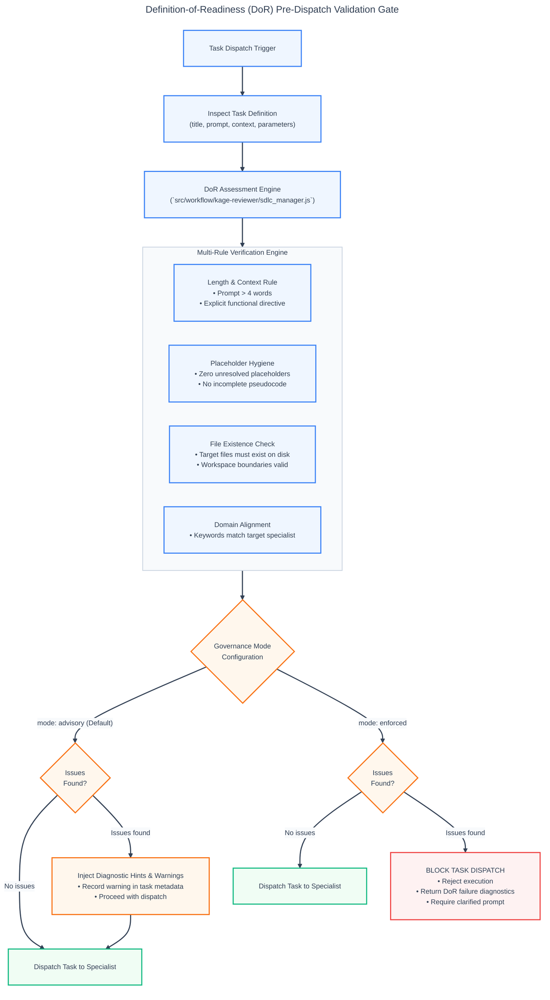

---

## 4. Workflow 3: Text-Based Website Build Pipeline (`build_from_text`)

```mermaid
---
title: Text-Based Website & UI Build Pipeline (build_from_text)
config:
  theme: base
  themeVariables:
    darkMode: false
    background: '#ffffff'
    mainBkg: '#eff6ff'
    primaryColor: '#eff6ff'
    primaryTextColor: '#334155'
    primaryBorderColor: '#3b82f6'
    lineColor: '#334155'
    arrowheadColor: '#334155'
    secondaryColor: '#f8fafc'
    tertiaryColor: '#f0fdf4'
    fontFamily: 'Inter, system-ui, -apple-system, sans-serif'
    fontSize: '13px'
  flowchart:
    nodeSpacing: 45
    rankSpacing: 55
    padding: 24
    wrappingWidth: 380
---
flowchart TD
    UserReq["User Prompt:<br/>'Build an e-commerce / dashboard / SaaS platform'"] --> Step1["Step 1: MCP Call `konoha.build_from_text`<br/>(name, description, framework, taste_dials)"]
    Step1 --> Step2["Step 2: Generate Specification Object<br/>• Canonical Framework Resolved (Next.js, Svelte, Nuxt, Angular)<br/>• Validation commands formulated<br/>• Archetype layout directives applied"]

    Step2 --> Step3["Step 3: Framework-Native CLI Scaffolding<br/>• Next.js: pnpm create next-app@latest<br/>• Nuxt: pnpm dlx nuxi@latest init<br/>• Angular: pnpm dlx @angular/cli@latest new<br/>• SvelteKit: pnpm dlx sv create"]

    subgraph MandatoryInvariants ["Project-Specific Design Invariants"]
        I1["Design Brief Authored First<br/>(9 fields, domain-derived)"]
        I2["Navigation Pattern From The Brief<br/>(menu / inline / bar / dock)"]
        I3["Theme Strategy From The Brief<br/>(single or dual)"]
        I4["Composition From IA<br/>(no fixed sections or archetype list)"]
        I5["Anti-Template Gate<br/>(no unrequested commerce/SaaS blocks)"]
        I6["Konoha Signature<br/>(generator meta + footer)"]
        I7["Mandatory package.json Scripts<br/>('build', 'lint', 'start', 'check')"]
    end

    Step3 --> MandatoryInvariants
    MandatoryInvariants --> Step4["Step 4: Elite Implementation (♦ Jonin)<br/>• Project tokens from the design brief<br/>• Reduced-motion accessible transitions<br/>• Brief-derived art direction"]

    Step4 --> Step5["Step 5: Framework Validation Suite<br/>• pnpm run build ──► 0 Errors<br/>• pnpm run lint  ──► 0 Warnings<br/>• pnpm run check ──► Clean"]

    Step5 --> Step6["Step 6: Kage Two-Step Review Gate<br/>• 100/100 aislop scan<br/>• ≥ 98% Delivery Confidence"]

    linkStyle default stroke:#334155,stroke-width:2px;
    style MandatoryInvariants fill:#f8fafc,stroke:#cbd5e1,stroke-width:1.5px,color:#334155;

    classDef reqNode fill:#eff6ff,stroke:#3b82f6,color:#334155,stroke-width:2px;
    classDef scaffoldNode fill:#fff7ed,stroke:#f97316,color:#334155,stroke-width:2px;
    classDef invNode fill:#eff6ff,stroke:#3b82f6,color:#334155,stroke-width:2px;
    classDef valNode fill:#f0fdf4,stroke:#10b981,color:#334155,stroke-width:2px;
    classDef gateNode fill:#fff7ed,stroke:#f97316,color:#334155,stroke-width:2px;

    class UserReq reqNode;
    class Step1,Step2,Step3,Step4 scaffoldNode;
    class I1,I2,I3,I4,I5,I6,I7 invNode;
    class Step5 valNode;
    class Step6 gateNode;
```

---

## 5. Workflow 4: Mockup / Design Image Build Pipeline (`build_from_source`)

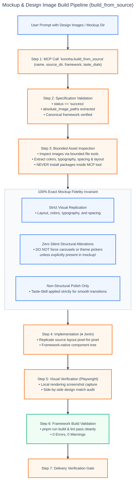

---

## 6. Workflow 5: Two-Step Zero-AI-Slop Pre-Gate & Autonomous Remediation Loop

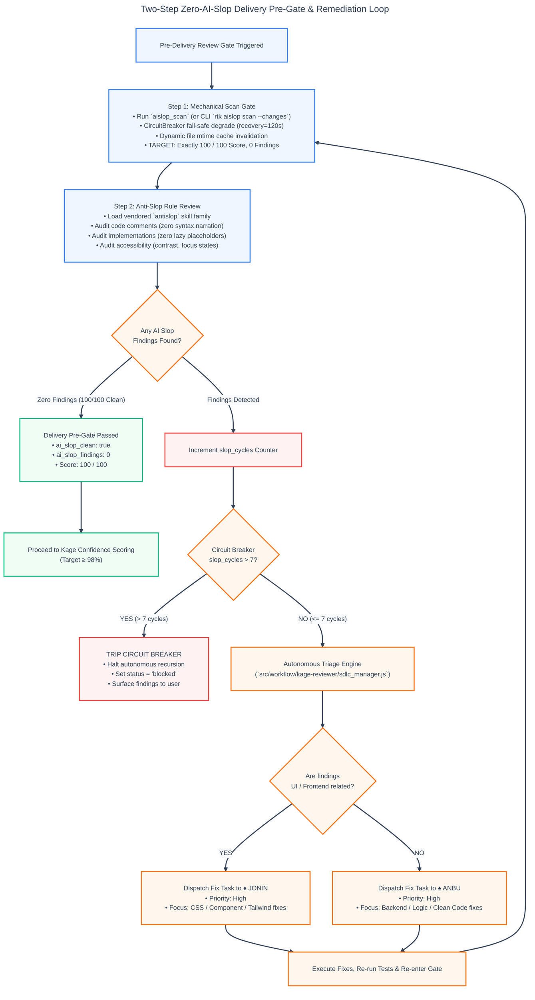

---

## 7. Workflow 6: QA Automation & Token-Efficient E2E Validation Flow

```mermaid
---
title: Token-Efficient QA Automation Pipeline (♠ Anbu Owner)
config:
  theme: base
  themeVariables:
    darkMode: false
    background: '#ffffff'
    mainBkg: '#eff6ff'
    primaryColor: '#eff6ff'
    primaryTextColor: '#334155'
    primaryBorderColor: '#3b82f6'
    lineColor: '#334155'
    arrowheadColor: '#334155'
    secondaryColor: '#f8fafc'
    tertiaryColor: '#f0fdf4'
    fontFamily: 'Inter, system-ui, -apple-system, sans-serif'
    fontSize: '13px'
  flowchart:
    nodeSpacing: 45
    rankSpacing: 55
    padding: 24
    wrappingWidth: 380
---
flowchart LR
    Start["QA Task Ingestion"] --> S1["1. Test Discovery<br/>(Check tests/ &amp; prevent duplicates)"]
    S1 --> S2["2. Flow Recording<br/>(Playwright captures JSON steps)"]
    S2 --> S3["3. Test Codification<br/>(qa_codify compiles Playwright spec)"]
    S3 --> S4["4. Headless Execution<br/>(qa_e2e_run runs Playwright test)"]
    S4 --> S5["5. Evidence Capping<br/>(Clean exit 0 &amp; output &lt; 2,000 chars)"]
    S5 --> S6["6. Persistence<br/>(Save run_id to SQLite sdlc_tasks)"]
    S6 --> Done["Kage Verification Sign-off"]

    linkStyle default stroke:#334155,stroke-width:2px;

    classDef stepNode fill:#eff6ff,stroke:#3b82f6,color:#334155,stroke-width:2px;
    classDef passNode fill:#f0fdf4,stroke:#10b981,color:#334155,stroke-width:2px;

    class Start,S1,S2,S3,S4,S5 stepNode;
    class S6,Done passNode;
```

---

## 8. Workflow 7: Skills Lifecycle, SQLite FTS5 & Cross-Client Skill Deployment

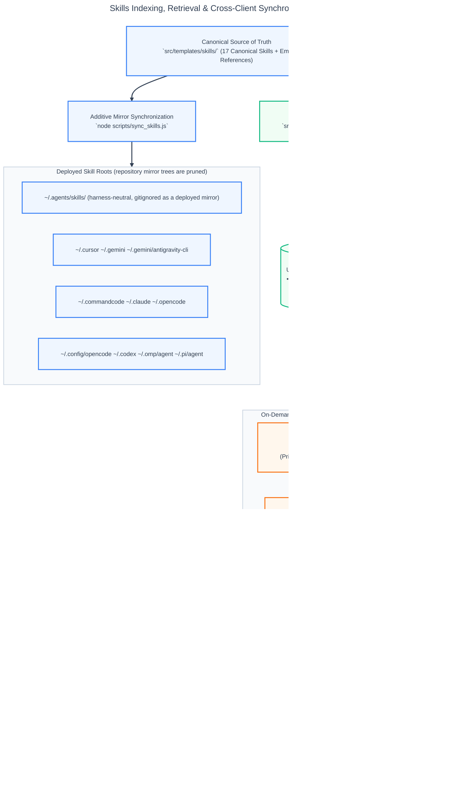

---

## 9. Workflow 8: Local LLM Proxy Bridge Gateway & Sidecar Binary RPC

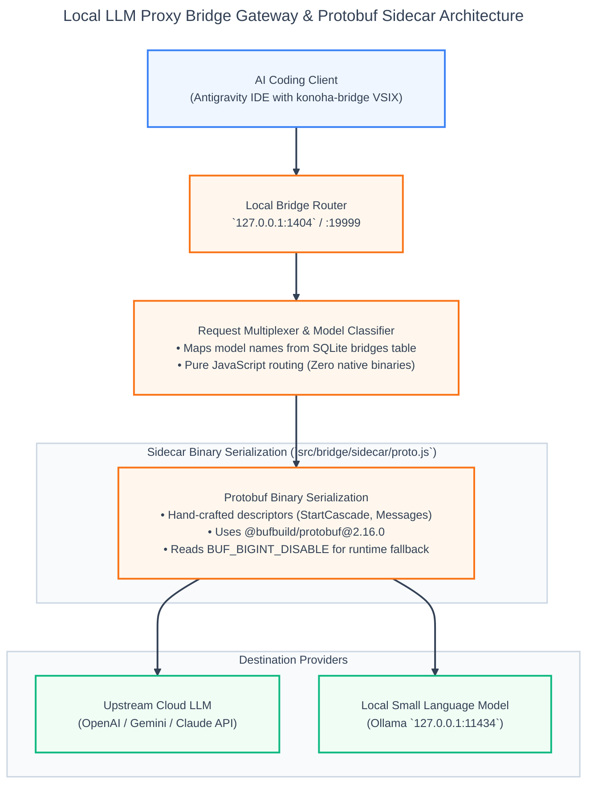

---

## 10. Workflow 9: Socket.dev Supply Chain Security Gate & Policy Evaluation

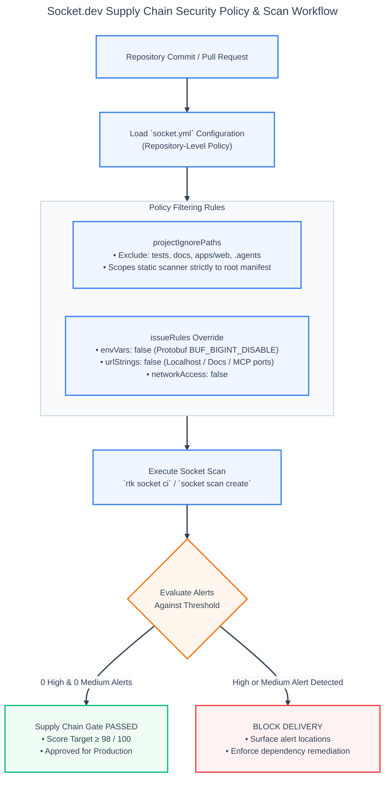

---

## 11. Workflow 10: Kage Reviewer 98% Minimum Confidence Delivery Gate

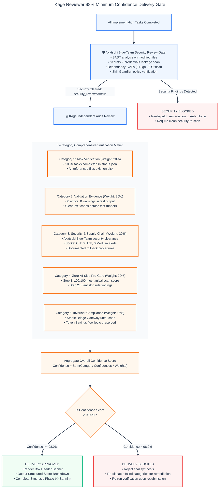

---

## 12. Workflow 11: Telegram Remote Reporter & Whitelisted Long Polling Dispatch

```mermaid
---
title: Telegram Remote Reporter & Whitelisted Long Polling Dispatch
config:
  theme: base
  themeVariables:
    darkMode: false
    background: '#ffffff'
    mainBkg: '#eff6ff'
    primaryColor: '#eff6ff'
    primaryTextColor: '#334155'
    primaryBorderColor: '#3b82f6'
    lineColor: '#334155'
    arrowheadColor: '#334155'
    secondaryColor: '#f8fafc'
    tertiaryColor: '#f0fdf4'
    fontFamily: 'Inter, system-ui, -apple-system, sans-serif'
    fontSize: '13px'
  flowchart:
    nodeSpacing: 45
    rankSpacing: 55
    padding: 24
    wrappingWidth: 380
---
flowchart TD
    subgraph OutboundReporting ["Outbound Task Status Reporter (src/telegram/notifier.js)"]
        SDLCEvent["SDLC Task Event<br/>(Task Completed / Failed / Queued)"] --> FormatReport["Format Zero-Emoji Notice<br/>• [KONOHA TASK REPORT]<br/>• Status: [SUCCESS] / [FAILED] / [QUEUED]<br/>• Duration, Agent, Evidence summary"]
        FormatReport --> CheckEnabled{"telegram_config<br/>enabled == 1?"}
        CheckEnabled -- "Yes" --> PostTelegram["HTTPS POST api.telegram.org<br/>/bot&lt;TOKEN&gt;/sendMessage<br/>to authorized chat_id"]
        CheckEnabled -- "No" --> SilentSkip["Silent No-Op<br/>(Telemetry preserved locally)"]
    end

    subgraph InboundLongPolling ["Inbound Long Polling Daemon (src/telegram/poller.js)"]
        PollerLoop["Native HTTPS Poller Loop<br/>GET /getUpdates?offset=N&amp;timeout=30"] --> UserMessage["User Message Received<br/>from Telegram Client"]
        UserMessage --> WhitelistCheck{"Is message.chat.id ==<br/>telegram_config.chat_id?"}
        WhitelistCheck -- "No" --> DropMsg["Drop Message &amp; Log Warning<br/>(Unauthorized sender rejected)"]
        WhitelistCheck -- "Yes" --> CommandRouter{"Message Type"}

        CommandRouter -- "/session [number|create]" --> SessionSwitch["Multi-Client Switcher<br/>(session_manager.js)"]
        CommandRouter -- "/sh &lt;cmd&gt;" --> ShellExec["Security Hardening Notice<br/>• /sh removed in v2.2.1<br/>• Replaced by /run pipeline"]
        CommandRouter -- "/kage, /anbu, /jonin..." --> SubagentDispatch["Direct Subagent Dispatch<br/>Enqueue prompt_queue"]
        CommandRouter -- "/run &lt;prompt&gt; | text" --> QueueEnqueue["Enqueue into prompt_queue<br/>(source: 'telegram')"]
        CommandRouter -- "/status" --> ReplyStatus["Reply with Active Daemon &amp; Task State"]
        CommandRouter -- "/savings" --> ReplySavings["Reply with Byte-Weighted Token Savings"]
        CommandRouter -- "/cancel" --> ReplyCancel["Cancel Active Queued Task"]
        CommandRouter -- "/help" --> ReplyHelp["Reply with Command Reference"]

        QueueEnqueue --> SendAck["Send Telegram Reply:<br/>[KONOHA TASK QUEUED] ID: &lt;ID&gt;"]
        SubagentDispatch --> SendAck
        QueueEnqueue --> QueueWorker["Autonomous Worker (worker.js)<br/>• Operational: 0 LLM Tokens<br/>• AI Coding: agy -p (Kage Gate)"]
    end

    linkStyle default stroke:#334155,stroke-width:2px;
    style OutboundReporting fill:#f8fafc,stroke:#cbd5e1,stroke-width:1.5px,color:#334155;
    style InboundLongPolling fill:#f8fafc,stroke:#cbd5e1,stroke-width:1.5px,color:#334155;

    classDef eventNode fill:#eff6ff,stroke:#3b82f6,color:#334155,stroke-width:2px;
    classDef routeNode fill:#fff7ed,stroke:#f97316,color:#334155,stroke-width:2px;
    classDef checkNode fill:#fff7ed,stroke:#f97316,color:#334155,stroke-width:2px;
    classDef passNode fill:#f0fdf4,stroke:#10b981,color:#334155,stroke-width:2px;
    classDef dropNode fill:#fef2f2,stroke:#ef4444,color:#334155,stroke-width:2px;

    class SDLCEvent,FormatReport,UserMessage eventNode;
    class SessionSwitch,ShellExec,SubagentDispatch,QueueEnqueue,ReplyStatus,ReplySavings,ReplyCancel,ReplyHelp,QueueWorker routeNode;
    class CheckEnabled,WhitelistCheck,CommandRouter checkNode;
    class PostTelegram,SendAck passNode;
    class SilentSkip,DropMsg dropNode;
```

---

## 13. Workflow 12: Unified Prompt Inbox Queue & Governed Agent Dispatch Pipeline

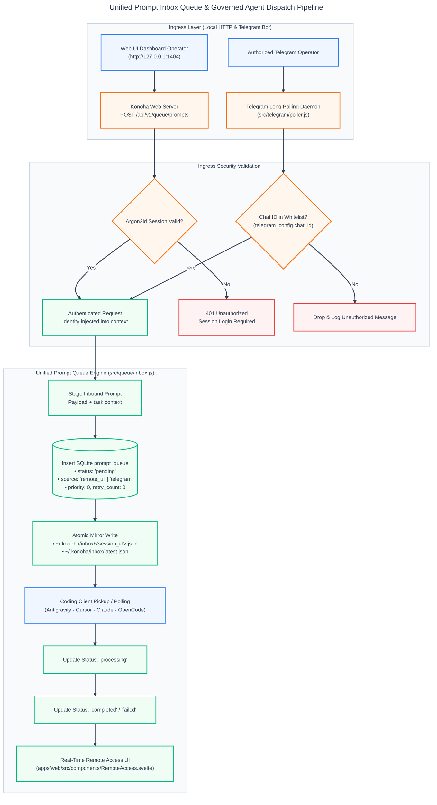

---

## 14. Workflow 13: Native Document Engineering & Animated WebP Export Pipeline

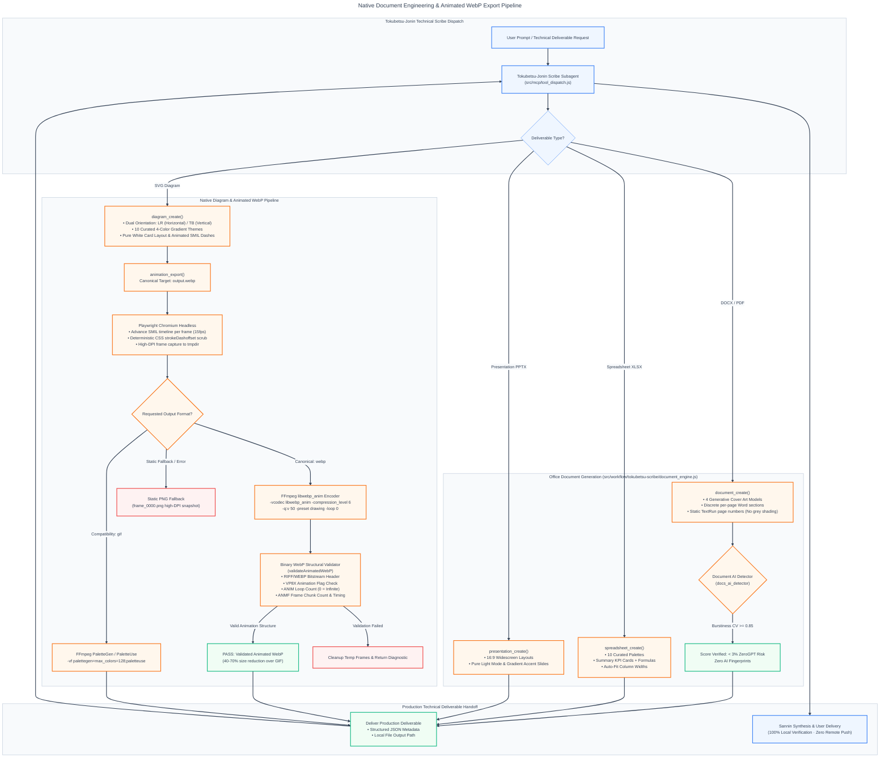

---

## 15. Workflow 14: Akatsuki Security Controls & Dual-Mode Lab Lifecycle

```mermaid
---
title: Akatsuki Security Controls, Dual-Mode Engine & Lab Lifecycle Architecture
config:
  theme: base
  themeVariables:
    darkMode: false
    background: '#ffffff'
    mainBkg: '#eff6ff'
    primaryColor: '#eff6ff'
    primaryTextColor: '#334155'
    primaryBorderColor: '#3b82f6'
    lineColor: '#334155'
    arrowheadColor: '#334155'
    secondaryColor: '#f8fafc'
    tertiaryColor: '#f0fdf4'
    fontFamily: 'Inter, system-ui, -apple-system, sans-serif'
    fontSize: '13px'
  flowchart:
    nodeSpacing: 45
    rankSpacing: 55
    padding: 24
    wrappingWidth: 380
---
flowchart TB
    Operator["Security Operator / CLI Ingress"] --> CLICommand{"Command Ingress"}

    subgraph ConfigStore ["Akatsuki State & Configuration (~/.konoha/akatsuki_config.json)"]
        CLICommand -- "konoha akatsuki mode [blue|red]" --> SetMode["Set Mode (Default: blue)<br/>• Blue = Defensive SAST / Guardian<br/>• Red = Offensive Pentest Sandbox"]
        CLICommand -- "konoha akatsuki env [docker|lxc]" --> SetEnv["Set Environment (Default: docker)<br/>• Docker = Linux/macOS/Windows<br/>• LXC = Linux/WSL bridge isolation"]
        CLICommand -- "konoha akatsuki status" --> StatusCheck["Report Mode, Env, Lab &amp; Tools"]
    end

    subgraph ModeSwitch ["Mode Gating & Authorization Firewall"]
        SetMode --> ModeBranch{"Active Mode?"}
        ModeBranch -- "Mode: BLUE (Defensive Default)" --> BlueOps["Blue-Team Defensive Operations<br/>• Direct Host SAST &amp; Secrets Audit<br/>• Dependency CVE Scans (pnpm/cargo/pip)<br/>• Skill Guardian Policy Scoring<br/>• Pre-Delivery Security Final Gate"]
        BlueOps --> BlueStopLab["Stop &amp; Remove akatsuki-lab Container<br/>(Fail-Closed Safety Invariant)"]

        ModeBranch -- "Mode: RED (Offensive Sandbox)" --> AuthGate{"Written RoE Authorization Check<br/>(Scope, Emergency Cutoff, Consent)"}
        AuthGate -- "Missing / Ambiguous" --> AuthDenied["BLOCKED: Decline Fail-Closed<br/>('Red-Team operations require authorization')"]
        AuthGate -- "Authorized &amp; Confirmed" --> SkillIdentityGate{"Caller Identity == @akatsuki?<br/>(skill_authorization.js)"}
        SkillIdentityGate -- "No / Anonymous" --> SkillDenied["BLOCKED: SKILL_AUTHORIZATION_DENIED<br/>Discovery, retrieval, dispatch &amp; delegation<br/>all fail closed"]
        SkillIdentityGate -- "Yes" --> AutoProvision["Automated Sandbox Provisioning<br/>(Idempotent Lab Setup Engine)"]
    end

    subgraph SandboxLifecycle ["Isolated Sandbox Execution (akatsuki-lab)"]
        AutoProvision --> EngineChoice{"Configured Engine?"}

        EngineChoice -- "Engine: DOCKER" --> DockerSetup["Docker Sandbox Engine<br/>• Isolated Internal Network (internal=true)<br/>• Unprivileged Non-Root (UID 1000 akatsuki)<br/>• Dropped Capabilities: --cap-drop=ALL<br/>• Memory limit: 2GB · CPU limit: 2 cores"]

        EngineChoice -- "Engine: LXC" --> LXCSetup["LXC System Container Engine<br/>• Isolated Bridge labbr0 (ipv4.nat=false)<br/>• Egress ACL lab-egress (Reject external traffic)<br/>• Unprivileged container (security.privileged=false)<br/>• Pinned Debian 12 Attacker Container"]

        DockerSetup --> SandboxReady["Sandbox Active: akatsuki-lab<br/>(Zero Host Network &amp; Zero Host FS Mounts)"]
        LXCSetup --> SandboxReady
    end

    subgraph ToolingGuard ["Approved Tool Execution & Persona Boundary"]
        SandboxReady --> LabDb["Lab-local SQLite · ~/.konoha/akatsuki-lab/lab.db<br/>lab_runs · lab_tool_invocations · kali_tools · red_skill_audit<br/>(main konoha.db never touched; LAB_DB_ISOLATION_VIOLATION on cross-path)"]
        LabDb --> ToolDispatch["Approved 10-Tool Sandbox Execution<br/>nmap · tshark · metasploit · zap · nuclei<br/>ffuf · sqlmap · testssl · trivy · curl_probe"]
        ToolDispatch --> EvidenceCollection["Structured Evidence Archival<br/>• Output XML / JSON / Logs to /tmp/akatsuki_*<br/>• Diagnostic Cleanup After Probe Execution"]
        EvidenceCollection --> GateHandoff["Handoff to Phase 8 Security Review Gate<br/>• Zero Critical &amp; High Findings<br/>• Remediation Patch Synthesis"]

        NonAkatsuki["Non-Akatsuki Agent Delegation<br/>(@genin, @anbu, @jonin, @chunin, @kage)"] --> PersonaCheck{"Offensive Skill Requested?"}
        PersonaCheck -- "Yes (classifySkill → red)" --> PersonaDenied["DENIED: SKILL_AUTHORIZATION_DENIED<br/>(red skills are @akatsuki-only, fail-closed)"]
    end

    linkStyle default stroke:#334155,stroke-width:2px;
    style ConfigStore fill:#f8fafc,stroke:#cbd5e1,stroke-width:1.5px,color:#334155;
    style ModeSwitch fill:#f8fafc,stroke:#cbd5e1,stroke-width:1.5px,color:#334155;
    style SandboxLifecycle fill:#f8fafc,stroke:#cbd5e1,stroke-width:1.5px,color:#334155;
    style ToolingGuard fill:#f8fafc,stroke:#cbd5e1,stroke-width:1.5px,color:#334155;

    classDef cliNode fill:#eff6ff,stroke:#3b82f6,color:#334155,stroke-width:2px;
    classDef blueNode fill:#eff6ff,stroke:#3b82f6,color:#334155,stroke-width:2px;
    classDef redNode fill:#fef2f2,stroke:#ef4444,color:#334155,stroke-width:2px;
    classDef sandNode fill:#fff7ed,stroke:#f97316,color:#334155,stroke-width:2px;
    classDef passNode fill:#f0fdf4,stroke:#10b981,color:#334155,stroke-width:2px;
    classDef failNode fill:#fef2f2,stroke:#ef4444,color:#334155,stroke-width:2px;

    class Operator,CLICommand,StatusCheck cliNode;
    class BlueOps,BlueStopLab blueNode;
    class SetMode,SetEnv,AutoProvision,ToolDispatch,SkillIdentityGate redNode;
    class DockerSetup,LXCSetup,SandboxReady,EvidenceCollection,LabDb sandNode;
    class GateHandoff passNode;
    class AuthDenied,PersonaDenied,SkillDenied failNode;
```

---

## 16. Workflow 15: LangGraph.js Production State Graph & Error Edge Circuit Breaker

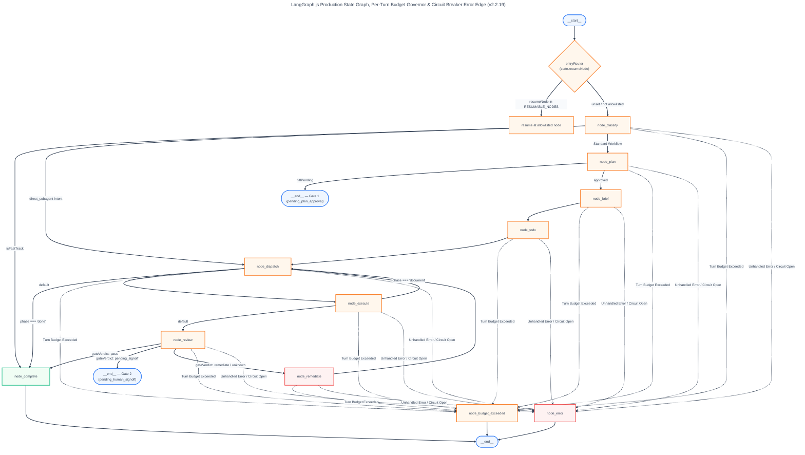

---

## 17. Workflow 16: Turn-Scoped Budget Execution & Resume Loop Protocol

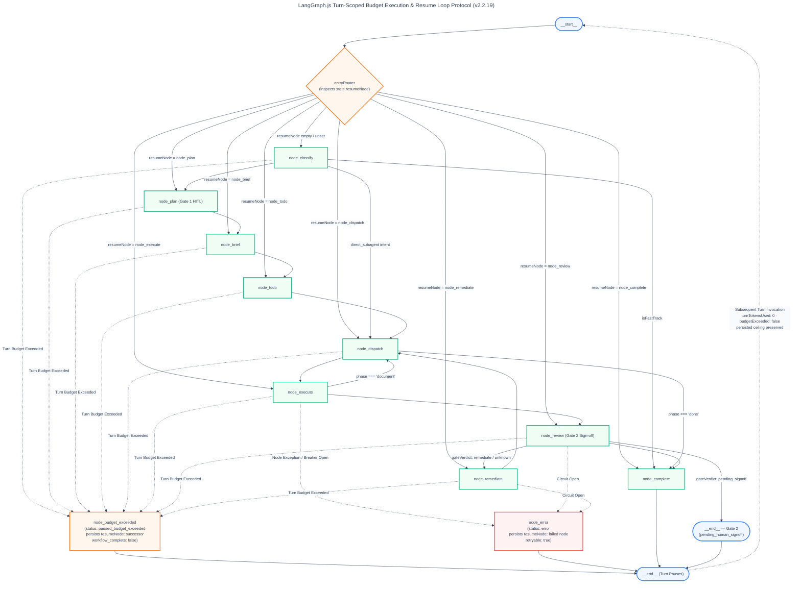

### Architectural Guarantees & Operational Lifecycle

1. **Turn vs Workflow Scoping**: Reaching a per-turn token ceiling (8k, 16k, 32k, or 64k) suspends the **current turn** rather than terminating the workflow. The node cursor is cleanly persisted in SQLite checkpoint storage via `resumeNode`.
2. **Deterministic Resumption Routing**: When the caller resumes via `sannin`, `entryRouter` evaluates `state.resumeNode` against the allowlist `RESUMABLE_NODES` and dispatches directly to the resume point. Earlier nodes are skipped, preserving monotonic progress.
3. **No Caller Overhead**: Resuming turns do not require re-supplying `token_budget` or prior-turn arguments; persisted ceilings survive across turn boundaries automatically.
4. **Single-Owner Token Metering**: Every node update passes through `finalizeNodeResult` in `src/mcp/langgraph/budget.js`, which computes `tokensUsed`, `turnTokensUsed`, `budgetExceeded`, and `resumeNode` in one place.
5. **Per-Thread Circuit Breaker**: Error edges are guarded by thread-scoped breakers (`workflow:${threadId}`). When `node_remediate` trips the breaker it sets `gateVerdict = 'circuit_open'`, and `reviewRouter`/`remediateRouter` route to `node_error`. The 3-consecutive-failure trip count and the wiring itself live in the guard/breaker modules; only the routing consequence is asserted here.
6. **HITL resume is a self-resume**: a Gate pause is produced by `finalizeNodeResult(..., { selfResume: true, selfNode })`, so `resumeNode` names the same node that paused. `node_plan` pauses Gate 1; `node_review` pauses Gate 2. Budget exhaustion instead records the **successor** node.
7. **Early-exit ordering**: `node_execute` loops back to `node_dispatch` (not to itself) when `phase === 'document'`, and `node_remediate` always returns to `node_dispatch`. The graph never loops `node_execute → node_execute` or `node_remediate → node_review`.

---

## 18. Workflow 17: Text-to-3D Generation Pipeline (Yamanaka Graph)

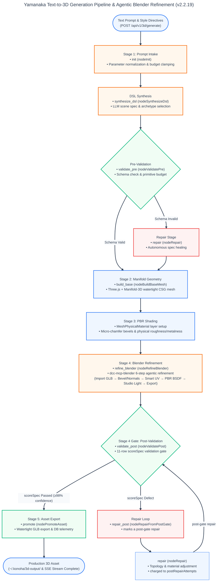

### Architectural Guarantees & Operational Lifecycle

1. **14-Node Pipeline Sequencing**: Text-to-3D executes the full LangGraph in `src/workflow/yamanaka/graph.js` — `init` → `refine_request` → (`settle_refine_failure`) → `chunin_search` → `object_brief` → `synthesize_dsl` → `validate_pre` → `build_base` → `refine_blender` → `inspect` → (`fix` back to `build_base`) → `validate_post` → `promote`, with `repair` looping back to `build_base` on a pre-gate scoreSpec defect and back to `validate_post` on a post-gate defect (the post-gate pass is routed through `repair_post` and charged to its own `postRepairAttempts` budget). `settle_refine_failure` and `fix` are conditional branches, not optional extras.
2. **Watertight Manifold Invariant**: Geometry generated by Manifold-3D is mathematically guaranteed watertight (zero self-intersections, watertight non-manifold edge count = 0) prior to Blender hand-off.
3. **Agentic 6-Step Blender Processing**: `dcc-mcp-blender` applies deterministic bevel modifiers, smart UV unwrapping, principled PBR BSDF material networks, studio three-point lighting, and export verification.
4. **11-Row scoreSpec Validation Gate**: `validate_post` enforces Production geometric and shading tolerances before promoting staging assets to production (`~/.konoha/3d-output/`).
5. **Real-Time Telemetry & Progress Streaming**: SSE endpoint `GET /api/v1/3d/generate/:jobId/stream` emits stage transitions, node timers, and GPU memory utilization to the Web UI in real time.

---

## 19. Workflow 18: Image-to-3D Upload, Relief Mesh & Blender Refinement Pipeline

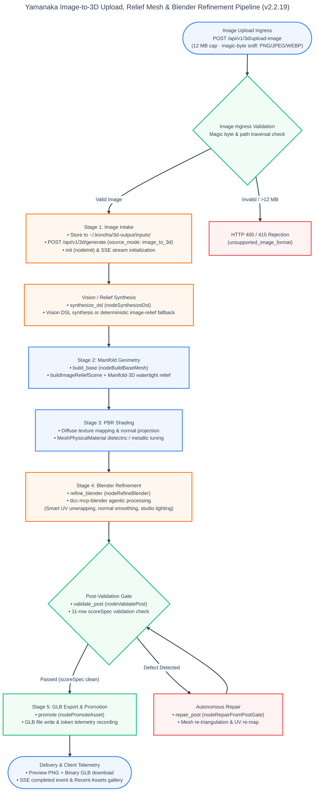

### Pipeline Stages & Operational Guarantees

1. **Ingress Security & Sniffing**: `POST /api/v1/3d/upload-image` validates true file types via magic bytes (`PNG`, `JPEG`, `WEBP`) with strict 12 MB payload cap, returning HTTP 415 on unsupported formats and blocking path traversal attacks.
2. **Deterministic Relief Fallback**: When external vision APIs are unconfigured or circuit-broken, `synthesize_dsl` seamlessly activates `buildImageReliefScene` to generate clean bas-relief geometry from heightmap luminosity without hallucinated rigs.
3. **PBR Shading Parity**: Image textures map directly across generated geometry with physical dielectric roughness and metallic controls, adhering to the Zero-AI-Slop no-flat-shading rule.
4. **Blender LTS Agentic Refinement**: The 6-step `dcc-mcp-blender` headless worker pipeline refines edge bevels, projects UV coordinates, and configures studio rendering environments.
5. **Asset Registry & Downloader**: Exported `.glb` binaries and `.png` previews are indexed under `~/.konoha/3d-output/` with instant browser download endpoints (`/api/v1/3d/assets/:filename`).
