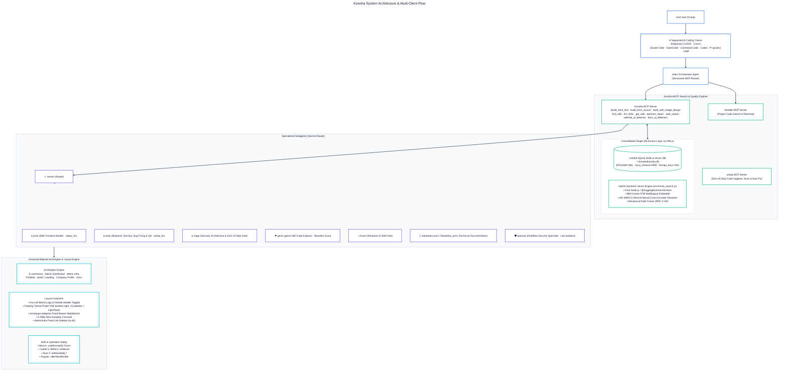

# ⚙️ How It Works: System Architecture & Multi-Archetype Engine

## Architecture

> **Canonical editable diagram:** [01 System Architecture](diagrams/konoha-architecture.drawio) · [Enterprise Infrastructure View](diagrams/konoha-enterprise-architecture.drawio) · [Complete Workflow Architecture](ALL-WORKFLOW-DIAGRAMS.md) · [Diagram manifest](diagrams/README.md).

---

## 🛠️ Canonical Konoha MCP Tools Matrix (47 Canonical Tools)

| Tool Category | Registered Tools (47 Total) | Description |
| :--- | :--- | :--- |
| **Bounded File Operations (6)** | `read_file_head`, `read_file_range`, `file_info`, `token_efficient_grep`, `get_file_structure`, `find_files_clean` | Bounded token-safe file inspections preventing context window pollution. |
| **Skill Discovery & Loading (5)** | `find_skill`, `list_skills`, `get_skill`, `optimize_report`, `use_skills` | High-speed FTS5 SQLite skill querying, precise skill resolution via `use_skills`, and token-efficient snippet-first ingestion. |
| **Autonomous Website Builders (2)** | `build_from_source`, `build_from_text` | Side-effect-free structured specifications for multi-archetype website generation. |
| **Specialist Delegation & Security Sandbox (9)** | `sannin`, `kage`, `jonin`, `anbu`, `akatsuki`, `akatsuki_init`, `chunin`, `tokubetsu_jonin`, `genin` | In-line direct subagent delegation, lab container initialization, and specialist workflow execution. |
| **AI Fingerprint Detection (2)** | `website_ai_detector`, `docs_ai_detector` | Website (0-20 Human-Built target) and Document AI detectors (.docx, .pdf, .pptx, text). |
| **Project Context & Memory (4)** | `get_project_context`, `save_project_context`, `query_project_memory`, `report_from_agent` | Episodic architectural memory and context tracking across client workspaces. |
| **Persona Memory & Soul (5)** | `save_persona_memory`, `query_persona_memory`, `list_persona_memories`, `delete_persona_memory`, `get_soul` | Agent & user persona traits, patterns, architectural rules, and Ninja's Soul doctrine in SQLite and markdown. |
| **SDLC Governance & Quality Gates (4)** | `anti_slop`, `check_readiness`, `get_task_evidence`, `get_slop_findings` | Deterministic rule-based anti-slop verification pre-gate, DoR auditing, automated task evidence collection, and slop findings query. |
| **Intel & Web Search (1)** | `web_search` | Real-time web evidence gathering and documentation lookups with Wikipedia fallback. |
| **Skills Migration & Administration (2)** | `get_resolved_task_dir`, `migrate_skills` | Isolated session task directory resolution and cross-workspace skill synchronization. |
| **QA Automation (2)** | `qa_codify`, `qa_e2e_run` | Deterministic Playwright spec compilation from declarative flow JSON and bounded test execution (<2,000 chars output cap). |
| **Native Document Engineering (5)** | `document_create`, `spreadsheet_create`, `presentation_create`, `diagram_create`, `animation_export` | Enterprise Office deliverable creation (DOCX, PDF, XLSX, PPTX, SVG) and high-performance Animated WebP diagram animation with pure Node.js structural bitstream verification. |

### 🧠 Cross-Agent Output Skill (`i-have-adhd`)

Agent-to-skill mapping is declared in `src/templates/agents.yaml` and surfaced through the `AGENTS.md` / `GEMINI.md` routing tables. The `i-have-adhd` skill (from [ayghri/i-have-adhd](https://github.com/ayghri/i-have-adhd), MIT) is embedded into exactly five agents — **genin, jonin, anbu, tokubetsu-jonin, chunin** — and shapes their final responses (action first, numbered steps, one concrete next action, no preamble/closers). **Sannin (router) and Kage (reviewer) deliberately do not load it**; their output formats are governed by the routing SOP and the delivery-gate contract. Parity and scoping are enforced by `tests/test_i_have_adhd_skill.js`.

---

## 💾 Consolidated Single-Database Access Layer (`src/db.js`)

All database interactions across the entire Konoha codebase are consolidated under `src/db.js`, ensuring consistent connection setup, unified schema definitions, and eliminating schema drift:

1. **Canonical Path Ownership**: `DB_PATH = path.join(os.homedir(), ".konoha", "konoha.db")` is defined exclusively in `src/db.js` (with automatic one-time legacy migration from `skills.db`).
2. **Unified Pragmas**: Every connection opened via `db.getConnection()` automatically configures:
   - Built-in `node:sqlite` driver (zero native C++ build addons)
   - `PRAGMA journal_mode=WAL;` (Write-Ahead Logging for high-concurrency read/write)
   - `PRAGMA foreign_keys=ON;`
   - `PRAGMA busy_timeout=5000;` (5-second retry timeout to eliminate database locks)
   - `PRAGMA synchronous=NORMAL;`
3. **Unified Schema DDL (`setupSchema`) & Linear Migration Engine**: Linear migration runner tracking SQLite `PRAGMA user_version = 5` (version 2.2.11), ensuring atomic transactions, composite indices (`idx_sdlc_tasks_status_updated`, `idx_persona_memories_agent_proj`), and automated `PRAGMA integrity_check` verification. Canonical initialization containing every table and trigger across all subsystems (`skills`, `skills_fts` + sync triggers, `skill_chunks`, `tool_calls`, `active_sessions`, `agents`, `bridges`, `projects`, `sdlc_tasks`, `persona_memories`, `persona_memories_fts`, `kali_tools`). Features dynamic FTS5 capability detection via `hasFts5Support` with automatic fallback to relational tables and SQL `LIKE` filtering on platforms where SQLite lacks compiled FTS5 modules (e.g. Windows).
4. **Operational Maintenance & Recovery Routines**:
   - **Online Backup (`konoha data backup [path]`)**: Performs zero-downtime, non-blocking snapshots using SQLite `VACUUM INTO`. Default target is `~/.konoha/backups/konoha_backup_<timestamp>.db`.
   - **FTS5 Self-Healing Index Rebuild (`konoha data rebuild-fts`)**: Rebuilds all full-text search indexes (`skills_fts`, `persona_memories_fts`) from canonical tables via `rebuildAllFts()`.
   - **Retention Pruning (`konoha data prune --retention <days>`)**: Prunes older execution logs from `tool_calls` beyond the retention window (default 90 days) while preserving all-time summary counters.
   - **Agent Name Normalization (`normalizeAgentName`)**: Maps runtime aliases (e.g. `mcp_kage`, `delegate_to_jonin`) to canonical agent identities across telemetry reporting.
   - **Foreign Key Cascade Integrity**: Enforces `ON DELETE CASCADE` from `projects` to `persona_memories` with `PRAGMA foreign_keys = ON`, eliminating orphaned records.

---

## 🧠 Hybrid Vector Search & Multilingual Retrieval (`src/vector_search.js`)

Konoha provides cross-lingual semantic retrieval fused with FTS5 BM25 keyword matching:

1. **IBM Granite 97M Multilingual Embedding (ONNX)**:
   - Model: `onnx-community/granite-embedding-97m-multilingual-r2-ONNX` (384-dimensional dense vectors, int8 quantized).
   - Pre/Post-processing: Tokenized via `tokenizers`, CLS-token extracted from `last_hidden_state`, and L2-normalized.
2. **Alibaba GTE Multilingual Cross-Encoder Reranker**:
   - Model: `onnx-community/gte-multilingual-reranker-base` (int8 quantized).
   - Pairs query with candidate chunk snippets; scores with sigmoid logit transformation.
3. **Cross-Platform `sqlite-vector` SIMD Acceleration**:
   - Lazily downloads platform-specific prebuilt binary (`linux-x64`, `linux-arm64`, `darwin-arm64`, `darwin-x64`, `windows-x64`) to `~/.konoha/vendor/sqlite-vector/`.
   - Build-time capability detection: if dynamic extension loading is disabled or unsupported in SQLite, falls back to in-memory cosine similarity calculation without errors.
4. **Markdown Heading Chunker**:
   - Chunks documentation by section headers (`#`, `##`, `###`), preserving semantic context boundaries.
   - Max 2,000 characters per chunk with 100-character boundary overlap.
5. **Reciprocal Rank Fusion (RRF)**:
   - Merges vector similarity rankings with FTS5 BM25 ranks using standard `RRF(d) = sum(1.0 / (60 + rank))`.
6. **Cross-Lingual Evaluation Benchmark**:
   - Tested against 40 real English and Indonesian queries:
     - **English**: 100.0% Recall@5 (MRR 0.892)
     - **Indonesian**: 95.0% Recall@5 (MRR 0.879)
     - **Overall**: 97.5% Recall@5 (MRR 0.885 vs FTS5 0.769)
7. **Zero-Config Default & Opt-In Flag**:
   - Semantic retrieval is enabled via `KONOHA_SEMANTIC_SEARCH=1`. When unset, Konoha defaults to pure SQLite FTS5 for zero-dependency instant startup.
8. **4-Tier Embedding Feature Deduplication**:
   - **Chunk-Level**: Document sections hashed via SHA-256 over normalized whitespace in `chunk_document()`, pruning duplicate markdown blocks before vectorization.
   - **In-Memory Cache**: `_EMBED_CACHE` (4,096 capacity) serves cached dense vectors in 0 ms with zero redundant ONNX compute.
   - **DB-Level Blob Reuse**: `index_single_skill_chunks()` checks `skill_chunks` for matching `chunk_text`, reusing existing binary blobs across skills.
   - **Candidate Deduplication**: Nearest chunks deduplicated by content in `scan_nearest_chunks()` to ensure diverse top-K representation.
9. **Persistent Persona & Context Memory Optimization**:
   - Idempotent `save_memory()` updates existing records instead of duplicating rows.
   - Strictly zero-hallucination factual extraction from `projects` and `persona_memories`.
   - Auto-compact turn-based badges reduce prompt context footprint to < 120 tokens on turn >= 2.

---

## 🌐 Universal Polyglot & Multi-Framework Architecture

Konoha is completely unconstrained and polyglot by design. It natively supports **all programming languages** (TypeScript, JavaScript, Python, Go, Rust, C/C++, Java/Kotlin, PHP, Ruby, C#, Elixir, Zig, Shell) and **all frameworks** across web, backend, mobile, desktop, and cloud infrastructure with automated RTK toolchains.

## 🏗️ Multi-Archetype Website Builder Specifications

Konoha features an autonomous multi-archetype generator (`konoha.build_from_text` and `konoha.build_from_source`) with turnkey presets across all modern web frameworks (Next.js, SvelteKit, Nuxt, Angular, Astro, Remix, Vue, React, Solid, and beyond):

1. **Next.js 16 (React 19, Tailwind CSS v4)**
2. **SvelteKit 2 (Svelte 5 Runes, Tailwind CSS)** — stable scaffold via `pnpm dlx sv create` for generated sites (the Konoha Web UI dashboard itself runs SvelteKit 3 RC)
3. **Nuxt 3 (Vue 3 Composition API, Tailwind CSS)**
4. **Angular v19+ (Standalone Components, Signals)**

### 📐 Archetype Directory Matrix

| Archetype | Key Structural Invariants | Target Scenarios |
| :--- | :--- | :--- |
| **Admin & Infra Dashboard** | Fixed Left Sidebar (`w-64`) on desktop + Top Header bar + Bottom MobileDock | Cloud monitoring, K8s cluster management, user management, metrics telemetry |
| **Portfolio / Personal** | Far-left logo sticky header + Projects Bento grid + Skills matrix + Contact form | Software engineers, cloud architects, designers, consultants |
| **SaaS & Landing Page** | High-impact hero + Bento features + Monthly/Annual pricing switcher + Testimonials | SaaS startups, developer tools, waitlists, app launches |
| **Company Profile** | Mission hero carousel + Team leadership grid + Services tabs + Office locations | Corporate businesses, digital agencies, consulting firms |
| **E-Commerce** | 4-slide 3D hero carousel + 50-item catalog + Faceted filters + Slide-over cart drawer | Retail storefronts, brand merchandise, digital product stores |
| **Documentation** | 3-column layout (Left Sidebar Nav, Center Markdown Content, Right TOC) | Open-source libraries, API specifications, technical handbooks |

---

## 🛡️ Quality & Verification Gates

1. **Zero-AI-Slop Pre-Gate with `aislop` MCP**:
   - Hard pre-gate: `kage` executes `aislop_scan` scoped to all changed files before any confidence percentage is assessed.
   - Requires `ai_slop_clean: true` and `ai_slop_findings: 0` in `kage_review.json`. Missing or non-zero findings mechanically block workflow delivery.
   - Role boundaries: Genin and Kage are strictly read-only (`aislop_scan`, `aislop_why`); execution agents Jonin and Anbu have access to `aislop_fix` to remediate issues.
2. **Kage Reviewer 98% Minimum Confidence Gate**:
   - Every task is reviewed by `kage` for structural integrity, zero hallucination, and security compliance.
   - Evaluates real recorded task evidence in `status.json` and writes structured `kage_review.json`. If confidence < 98% (Minimum Required: ≥ 98% across all verification categories), delivery is blocked and tasks are re-delegated for remediation.
3. **Zero Errors & Zero Warnings**:
   - Validation requires `pnpm run build`, `pnpm run lint`, and `pnpm run check` (for SvelteKit) to complete with 0 errors and 0 warnings.
4. **High-Efficiency Auto-Compaction & Turn Reset Invariant**:
   - Automatically activates after 2 MCP delegations (`turn >= 2`) across all 8 coding clients.
   - Preserves token budget by compacting instruction boilerplate while permanently retaining the primary skill SOP preview (250 chars) so fixing agents never lose their methodology.
   - Bounds instruction truncation to 1200 chars and constraint truncation to 600 chars at sentence boundaries (no mid-sentence chopping).
   - Enforces a 30-minute idle reset (`SESSION_IDLE_RESET_SECONDS = 1800`) preventing cross-session turn accumulation in long-lived MCP server processes.
5. **Append-Only Prompt History & Original Task Authority**:
   - `src/prompt_hook.js` records user inputs in an append-only format (`# Session Prompts`) with `## Original Task` as the authoritative goal.
   - Subsequent user messages or pasted errors are recorded as timestamped `## Follow-up N` refinements that never replace, delete, or overwrite the original bug task.
6. **Real Validation Evidence Assessment in `report_from_agent`**:
   - `report_from_agent()` verifies that completion claims contain real command output evidence matching passing markers (`exit code 0`, `0 errors`, `passed`, `succeeded`).
   - Unsubstantiated claims are automatically downgraded to `status: "unverified"`, preventing unverified tasks from silently completing the workflow.
7. **Episodic Learnings & Memory Hygiene**:
   - Only learnings from verified tasks (`verified = True`) are persisted to episodic memory in `persona_memory.js`.
   - `memory_content_exists()` performs deduplication against the SQLite database, preventing corrupted or hallucinated diagnoses from polluting future prompts.
   - **Session Isolation Contract (Decision A)**: Episodic memories are strictly isolated per active session in agent-facing `queryMemories` and `listMemories`. Cross-session visibility is permitted only via explicit opt-in (`allSessions: true` or `crossSession: true`) used by Web UI listings and CLI management commands, and for non-episodic project-scoped memories (rules, architecture, preferences, patterns).
8. **Authorized Penetration Testing in Dev/Local Environments**:
   - `anbu` is authorized to conduct penetration testing and vulnerability assessments in dev/local environments (`localhost`, `127.0.0.1`, dev containers, local clusters).
   - The workflow review gate utilizes pentest-aware validation (`_is_pentest_task`, `_is_clean_validation`) allowing diagnostic exploit checks and HTTP error responses without false rejection, while strictly prohibiting unhandled fatal crash exceptions.
9. **CLI Upgrade Engine, Progress Tracking & Subprocess Resilience**:
   - `KonohaProgressBar` delivers real-time terminal progress reporting (`0%` to `100%`) with shaded block indicators (`██████░░░░`), active elapsed timers, and unreferenced interval tickers (`timer.unref()`) to prevent event-loop stalls.
   - Animated Terminal Feedback: `startSpinner()` renders a 10-frame braille spinner (90ms interval) with in-place line redraw (`\r\x1b[2K`) on TTY; automatically falls back to static `›` lines on non-TTY, CI, or `NO_COLOR` environments, with `KONOHA_SPINNERS=0` as an explicit opt-out.
   - Unicode-Accurate Table Widths: `getVisualLength()` implements East Asian Width accounting (CJK ideographs, Hangul, kana, fullwidth forms) plus emoji-presentation BMP symbols that render as 2 columns in modern terminals, and `truncateVisual()` strips ANSI escapes before measuring/cutting — eliminating column overlap in agent/skill/status tables.
   - 7-Stage Upgrade Lifecycle: Detects package managers (`pnpm`/`npm`), streams GitHub downloads, synchronizes `~/.konoha/` runtime assets, indexes SQLite FTS5 skills, registers all 8 MCP client configs, and verifies extension bridges.
   - **Non-Destructive User Skills & Config Preservation (v2.0.2)**: `copySkillsDirFast` executes additive-only synchronization without destination pruning, safeguarding pre-existing custom skills in all 8 client skill directories. SQLite FTS5 migration (`src/migrate.js`) operates via non-destructive upserts (`INSERT OR REPLACE`), avoiding table wipes unless `--clean` is explicitly passed. Instruction files (`GEMINI.md`, `AGENTS.md`, `CODEX.md`, `instructions.md`) inject Konoha directives within managed boundary tags (`<!-- KONOHA-START -->...<!-- KONOHA-END -->`) preserving 100% of existing user prompts, rules, and preambles, while `agents.yaml` performs union-merge to protect user custom agent definitions.
   - Subprocess & Daemon Isolation: `cmdTest` strictly sanitizes `KONOHA_DAEMON` from testing environments, while pure Node.js execution and normalized path separators (`/`) are preserved across all handlers.
10. **Multi-IDE Auto-Approval & Granular Tool Permissions Engine**:
   - Zero-Interruption Execution: Automates permission whitelisting across all 8 supported environments (Antigravity IDE/CLI, Cursor, Claude Code, Command Code, OpenCode, Codex, Pi/pi.dev, OMP), eliminating manual approval popups for routine reads, searches, and tests.
   - Uniform MCP Tool Grants: Deploys `autoApprove: ["*"]` and `auto_approve: true` across `konoha` (47 tools), `semble` (2 tools), and `aislop` (4 tools).
   - Client-Native Directives: Adapts to individual client paradigms, configuring VS Code/Cursor User settings (`cursor.mcp.autoApprove`, `cursor.agent.autoApprove`), Claude Code bypass modes (`permissionMode: "bypassPermissions"`, `mcp__*` prefix matching), OpenCode V1 object schemas (`permission: { read: 'allow', ... }`), and Codex TOML tool blocks (`approval_mode = "auto"`).
11. **Native SDLC Governance Layer & Quality Gates**:
   - **Definition-of-Readiness (DoR) Gate**: Validates task substance (> 4 words), absence of unresolved placeholders (`TODO`, `FIXME`, `???`), existence of referenced files, and domain keyword alignment before dispatch. Operates in `advisory` mode by default (injecting diagnostic hints) or `enforced` mode (blocking dispatch until criteria are met).
   - **Cross-Provider Independent Review**: Automatically detects model and bridge independence between implementing agents (e.g. `anbu`, `jonin`) and the reviewer (`kage`), ensuring objective, cross-provider second-opinion audits when multi-model bridges are active.
   - **Two-Step Anti-Slop Delivery Gate**: Enforces mandatory zero-AI-slop compliance (`ai_slop_clean: true` and `ai_slop_findings: 0`) prior to final delivery — Step 1 `aislop_scan` (aislop scanner with CircuitBreaker fail-safe degrade and dynamic file mtime cache invalidation), Step 2 `anti-slop` rule review via the vendored `antislop` skill family (https://github.com/miqdadbadjuber/anti-slop).
   - **Autonomous Kage → Anbu Remediation Loop**: Automatically converts anti-slop findings into high-priority remediation tasks for `anbu`, re-evaluating upon completion. The loop is strictly bounded by Konoha's delegation-depth circuit breaker (`slop_cycles > 7`) to prevent infinite recursion.
   - **Persistent SQLite Audit Trail (`sdlc_tasks`)**: Persists structured task state, DoR results, validation evidence, and slop audit history in SQLite WAL mode (`~/.konoha/konoha.db`). Managed via CLI (`konoha task list`, `konoha task show <id>`, `konoha task slop <id>`) and MCP tools (`check_readiness`, `get_task_evidence`, `get_slop_findings`). Delivery is strictly blocked if any SDLC task remains in `blocked` or `failed` state.
   - **Web UI Governance Dashboard (`/tasks`)**: Visual task explorer, interactive Definition-of-Readiness tester, task detail & audit evidence modal, and real-time project governance configuration (`/api/v1/sdlc/*`).
   - **QA Automation Evidence Rule**: For browser, E2E, and UI regression tasks, validation evidence must be generated via `qa_e2e_run` (Anbu owner) containing a valid `run_id`, clean exit code 0, 0 failures, and strict output capping under 2,000 characters. Unsubstantiated or fake green claims are rejected by the review gate (see `docs/QA-AUTOMATION.md`).
12. **Base Personality: High Effort + Instruct Style Across All Agents**:
   - Injected authoritative, action-first base personality across all ninja subagents (`sannin`, `genin`, `kage`, `chunin`, `jonin`, `anbu`, `tokubetsu-jonin`) and main orchestrators across all 8 supported clients.
   - Combines deep internal reasoning (silent deliberation during High/Max effort) with crisp, direct, instruction-following output.
   - Strictly prohibits conversational filler ("hmmmm", "let me check", "wait - but", "let me see", "I will now proceed to", "let me examine"), hesitation markers, and sycophantic praise. Mandates ADHD-friendly formatting (numbered procedures, immediate next action first) and mandatory `FIRST ACTION: call konoha.find_skill`.
13. **Strict Zero Dark Theme & 3-Color Minimum Gradient Invariants for Documentation**:
   - Strictly forbids dark theme styles (dark covers, dark headers, dark footers, black fills) across all generated and refined document formats: Word (`.docx`), PowerPoint (`.pptx`), Excel (`.xlsx`), and PDF (`.pdf`). All canvases must be pure white (`#FFFFFF`) or pearl (`#F8FAFC`).
   - Mandates a smooth multi-stop gradient with a minimum of 3 colors (e.g. Sapphire-to-Azure-to-Sky `#1E3A8A` → `#2563EB` → `#60A5FA`) for decorative accents, cover ribbons, running headers/footers, and divider lines.
   - Enforces business-class enterprise typography, light table header fills (`#F1F5F9`), two-pass dynamic `Page X of Y` pagination, and metadata sanitization.
14. **Konoha Bridge 1.6.0 VSIX Extension**:
   - Upgraded local extension binary (`assets/konoha-bridge-1.6.0.vsix`) with hardened bridge routing, latency optimizations, and automated Antigravity IDE/CLI extension installation.
15. **Cross-Client Mirror Parity & Universal Workflow Enforcement (v2.0.0)**:
   - Synchronizes official skills from canonical source `.agents/skills` across active repository mirror trees (`src/templates/skills`, `.cursor/skills`, `.gemini/skills`, `.commandcode/skills`, `.claude/skills`, `.omp/skills`) via `node scripts/sync_skills.js`.
   - Universal stdout reminder in `src/workflow/sannin-orchestrator/workflow_reminder.js` guarantees workflow continuity on new sessions, session resume, and auto-compaction turns across all 8 supported coding clients.
   - Removed `--skip-embeddings` from explicit skill install flows (`addSkillDirect`, `createSkillFromTemplate`), ensuring newly added skills are fully queryable via both FTS5 text search and IBM Granite vector embeddings.
16. **Strict Non-Destructive Preservation & Union-Merge (v2.0.2)**:
   - User custom skills and configuration are never pruned or overwritten during fresh installs or upgrades (`copySkillsDirFast` additive-only, `--clean` removed from default migrations, `injectManagedConfig` preserving custom user rule blocks, and custom agent union-merge in `agents.yaml`).
17. **Cross-Platform Windows Web UI Resilience (v2.0.2)**:
   - Headless browser launch via `cmd.exe /c start ""` with `windowsHide: true`, 30-attempt polling window, port-scoped daemon management, process tree cleanup via `taskkill /F /T /PID`, PowerShell `-Unique` ownership kill, `netstat -ano` fallback, and Windows `SIGBREAK` support.
18. **Architectural Modularization & Strict Zero-Exclusions Gate (v2.0.2)**:
   - Extracted 1,068 lines of UI CLI commands into `bin/lib/ui_commands.js` to preserve the < 9,000 lines complexity threshold. Enforces strict zero-exclusions across application code — `aislop-ignore` and config suppressions are strictly forbidden on codebase files, mandating root-cause architectural resolution.
19. **QA Automation Workflow & Bounded Browser Loop (v2.1.0)**:
   - Integrates deterministic `agent-browser` + Playwright Test execution owned by `anbu`. Interactive exploration is bounded to scoped snapshots (< 500 tokens), codified deterministically via `qa_codify` with zero LLM tokens, and executed headless via `qa_e2e_run` with strict 2,000 character output capping and cryptographic `run_id` tracking.
20. **13-Page Enterprise Cloud Architecture & Universal High-Contrast Visual Standards (v2.1.0)**:
   - Full 13-page Draw.io enterprise cloud model in `docs/diagrams/konoha-enterprise-architecture.drawio` using official AWS/GCP cloud boundary stencils and service color hierarchy with 0 geometric collisions. All Mermaid documentation diagrams enforce pure white background (`#ffffff`) with high-contrast `#0f172a` arrows and matching arrowhead markers.
21. **Canonical Skills Single Source of Truth & Database Parity (v2.1.13 - v2.1.14)**:
   - Centralizes canonical skill definitions into `src/canonical_skills.js` (15 canonical ninja and core skills, with `helm-chart-scaffolding` consolidated into `anbu-skill`). Prevents duplicate standalone skill indexing during auto-detection across project, client, and mirror directories while strictly preserving all global skills and client mirror trees.
22. **Least-Privilege Security Boundaries & Scoped Client Tool Permissions (v2.1.13)**:
   - Hardens client configuration managers (`src/mcp_clients_manager.js`, `src/cursor_manager.js`) by eliminating dangerous wildcard grants (`*`, `Bash(*)`) in favor of explicit, bounded tool manifests. Auto-approvals are strictly constrained to declared MCP tools without granting unconstrained shell or ambient system execution.
23. **Native LibreOffice Shim Integrity & Supply Chain Hardening (v2.1.13)**:
   - Protects document compilation pipelines against runtime DLL/SO injection and interposition attacks in `soffice.py` through cryptographically verified trusted shims, isolated execution environments, and zero dynamic C compilation at invocation time.
24. **Deterministic Accurate Skill Resolution via `use_skills` (v2.1.14)**:
   - Resolves and loads skill instructions directly from SQLite FTS5 database (`konoha.db`) by exact name or array of names, with automatic fallback warning to mirror directories (`.agents/skills/`, `~/.agents/skills/`). Eliminates skill misattribution and ensures precise subagent capability loading.
25. **Rule-Based `anti_slop` Verification Pre-Gate & Tokubetsu-Jonin Human Document Design Layer (v2.1.14)**:
   - Adds `anti_slop` MCP tool executed in Kage pre-delivery review alongside `aislop_scan`. Enforces mandatory agent anti-slop skills matrix (`antislop`, `antislop-ui`, `antislop-copywriting`, `antislop-human`, `antislop-layoutmobile`, `antislop-code`). Refines Tokubetsu-Jonin design layer for generated documents (DOCX, PPTX, XLSX, PDF): 20 gradient themes (T01–T20), medium slate `#64748B` body text, zero dark colors, font pairing contracts, and mandatory Kage review before completion.
26. **Mandatory Release Permission Gate & Zero Auto-Release Invariant (v2.1.14+)**:
   - The agent MUST ALWAYS explicitly ask the user for permission before creating git release commits, creating tags, pushing to GitHub release branches, or triggering npm publication. Auto-releasing without prior explicit user request and authorization is strictly prohibited. All changes remain local until the user explicitly commands a release.
27. **Windows Silent Execution & Background Resolution Caching Invariant (v2.1.15)**:
   - Eliminates terminal window popping and command flashing on Windows by enforcing `windowsHide: true` across all background `child_process` spawns (`spawn`, `spawnSync`, `execSync`). Memoizes Web UI static asset directory resolution (`resolveWebUiDir`, `getDistDir`) and npm root lookups to prevent unneeded process executions during HTTP route navigation.
28. **Telegram Remote Task Reporting & Whitelist Long Polling Invariant (v2.1.17)**:
   - Implements outbound asynchronous task reports (`src/telegram/notifier.js`) and inbound long polling daemon (`src/telegram/poller.js`) adhering strictly to the zero-emoji standard (`[KONOHA TASK REPORT]`, `[SUCCESS]`, `[FAILED]`, `[QUEUED]`, `[ERROR]`). All inbound prompts are strictly gated behind authorized chat ID whitelisting (`telegram_config.chat_id`), immediately dropping unauthorized interactions. Supports commands `/run`, `/status`, `/savings`, `/kage`, `/cancel`, `/help`.
29. **Cloudflare Zero Trust Ingress Tunnel & Unified Prompt Inbox Invariant (v2.1.17)**:
   - Employs process-supervised Cloudflare Quick Tunnel (`cloudflared tunnel --url http://localhost:1404`) with edge identity authentication (`Cf-Access-Jwt-Assertion` / `Cf-Access-Authenticated-User-Email`, named tunnels only) plus a constant-time `auth_pin` fallback via `src/tunnel/security.js`, and the password login in `src/auth.js` for the dashboard itself. All inbound prompts are staged into SQLite `prompt_queue` and mirrored into `~/.konoha/inbox/latest.json` for asynchronous client pickup, fully monitored via the SvelteKit Remote Access dashboard (`/remote`).
30. **Telegram One-Way Local Session Kage Review Gate Notification & Agent List Non-Blocking Invariant (v2.1.17)**:
   - In Telegram One-Way Mode, whenever a local workstation session (terminal, IDE, CLI) passes the Kage Final Gate Review (`APPROVED` with 100/100 zero-slop and ≥98% confidence score), `notifyKageReviewPassed` in `src/telegram/notifier.js` is automatically triggered via `src/mcp/memory_reporting.js` to dispatch outbound real-time notifications to Telegram.
   - `konoha agent list` renders a fast non-blocking table (<0.2s) by default, while interactive raw-mode TUI is strictly scoped behind `--tui`, `--interactive`, or `-i`, ensuring zero hangs in automated test runners and PTY environments.
   - Headless task execution in `src/queue/worker.js` enforces `execFile(agyBin, agyArgs, ...)` with structured arguments and dynamic `resolveAgyBin()`, completely eliminating command injection risks.
31. **Crypto Vault & AES-256-GCM Secret Encryption at Rest (v2.1.17)**:
   - Provides authenticated symmetric encryption (`src/crypto_vault.js`) for sensitive credentials stored in SQLite at rest, including Telegram Bot tokens (`telegram_config.bot_token`), webhook secrets, and Cloudflare Tunnel tokens (`tunnel_config.token`, `tunnel_config.auth_pin`).
   - Uses NIST-standard AES-256-GCM AEAD with 96-bit unique random initialization vectors and 128-bit GMAC authentication tags (`enc:v1:<iv>:<tag>:<ciphertext>`).
   - Key derivation leverages persistent host machine identity (`~/.konoha/.vault_key` with `0600` permissions, scrypt PBKDF fallback, or explicit `KONOHA_MASTER_KEY` override).
   - Features transparent decryption on read, automatic re-encryption on save, tampering rejection, and legacy plaintext backward-compatibility without breaking existing workflows or external dependencies.
32. **CLI Router Consolidation & Direct Subagent MCP Invocation (v2.1.18)**:
   - Removed 27 legacy top-level router aliases in `bin/cli.js`, requiring canonical command syntax and exiting with code 1 for unknown aliases.
   - Consolidated MCP subagent dispatch directly into specialist tools (`sannin`, `genin`, `kage`, `chunin`, `jonin`, `anbu`, `tokubetsu_jonin`), eliminating deprecated `delegate_to_*` wrappers and enforcing strict caller validation in `report_from_agent`.
33. **Dual-Target Website AI Detector & Operational Database Hardening (v2.1.18)**:
   - `konoha detect-ai` and `website_ai_detector` support both directory trees and single-file targets (`package.json`, source files, `.html`, assets) with bounded line extraction.
   - Added database operational tools (`konoha data backup`, `rebuild-fts`, `prune`), atomic backup on foreign key migration, and clean cascading deletion of orphaned project memories.
34. **Web UI Universal 3D Gradient Engine, Rasengan Theme FAB, 2s Crystalline Glass Crack & Vector Re-embedding (v2.1.18)**:
   - Enforces universal 3D perspective (`perspective(1200px)`), theme gradient borders (`--theme-grad-1` through `4`), multi-stop layered elevation shadows (`var(--shadow-3d)`), and high-contrast Plus Jakarta Sans & JetBrains Mono typography hierarchy across all Web UI components.
   - Features authentic swirling SVG Rasengan Theme FAB (`fixed bottom-6 right-6 z-[100]`) with orbiting electric lightning bolts and 2-second procedural 3D Three.js Rasengan theme transition overlay (`animate-huge-rasengan`) and optical shatter flash (`animate-shatter-flash`) with zero counters or arbitrary HUD timers.
   - Unifies all interactive buttons with tactile 3D depth (`.btn-3d`, `.btn-3d-primary`, `.btn-3d-secondary`) strictly driven by theme CSS variables, eliminating hardcoded dark button styles in pure light mode.
   - Exposes on-demand neural vector re-embedding endpoint (`POST /api/v1/skills/reembed` & `/api/v1/vectors/reembed`) and 3D button in `Skills.svelte` to dynamically recalculate IBM Granite 384-dim ONNX neural embeddings with live progress and Server-Sent Event updates.
   - Cleans sidebar section headers (`OPRATION & DIAGNOSTICS`) with explicit left-margin alignment (`ml-1`, `text-left`, `justify-start`) and replaces hardcoded dashboard header placeholders with dynamic active section and route name breadcrumbs.
   - Adds responsive mobile menu sidebar toggle on the far left of the mobile header (`lg:hidden`) with slide-out drawer navigation and backdrop dismissal, cleanly eliminating bottom dock clutter, and permanently embeds author attribution: `Created by Andy Setiyawan` with verified profile link in the sidebar footer.
35. **OMP Client Architecture & Workflow Contract (v2.2.0)**:
   - Deep integration for the OMP coding agent via `src/omp_manager.js`, configuring MCP servers in `~/.omp/agent/mcp.json` (`konoha`, `semble`, `aislop`) with strict schema validation (`$schema: "https://agent-plugins.org/schemas/1.0.0/mcp.schema.json"`), `"type": "stdio"`, bare executable paths (`node`, `uvx`, `npx`), and auto-wired setup during agent initialization in `src/agent_manager.js`.
   - Supports bounded file tools through `file_tools_launcher.js`, active client auto-detection (`OMP_CLIENT`, `OMP_SESSION`, `ACTIVE_CLIENT=omp`), and token-efficient Semble codebase search.
   - Enforces host-native advisor review continuity (`reviewMode: agent-end`) executed cleanly after all Konoha multi-agent workflows and Kage review gates conclude.
   - Preserves user custom configuration while strictly synchronizing global and project skills across mirror trees.
36. **Proxy Gateway Process Lifecycle, Savings Telemetry Performance & Prompt Token Optimization (v2.1.18)**:
   - **Proxy Gateway Stop Resilience**: Implemented cross-platform port-targeted termination (`killProcessOnPort` in `src/platform_utils.js`) for the Bridge Proxy Gateway (port 19999). Resolves listening PIDs via `lsof`/`fuser` on Linux/macOS and escalates from `SIGTERM` to `SIGKILL` if still bound; Windows queries PIDs via `netstat` and executes `taskkill /F`. Synchronized the Web UI `/bridges` and CLI lifecycle endpoints with verified socket checks (`checkPortActive(19999)`).
   - **Incremental Transcript Cache & Dynamic Savings Telemetry**: Refactored `calculateAllModelTokens()` with `{ mtime, size }` persistent transcript caching (`~/.konoha/transcript_cache.json`) and in-memory TTL, slashing execution time from 9.35s to < 30ms. Replaced the static 15,000-byte baseline fallback in `find_skill` with dynamic `SUM(byte_size)` candidate metrics and cleaned legacy database normalizations, allowing savings ratios to accurately fluctuate between 83% and 98% based on real payload sizes.
   - **Prompt Token Optimization**: Decoupled canonical agent skills from raw database reference expansion in `src/agent_manager.js`, keeping agent prompts strictly scoped to top-level canonical skills. Emits concise on-demand discovery instructions in generated subagents and rules, shrinking `AGENTS.md`, `.cursorrules`, and subagent markdowns by > 85% (> 35,000 tokens saved per turn).
37. **Console Content Width, PageHero Shell & Post-Login Form Field Harmonization (v2.1.18)**:
   - **Authoritative Shared Width & Gutter Tokens**: Implemented `--content-max-width: 80rem` (1280px), `--content-gutter: 2rem` (32px), and `--content-gutter-mobile: 1rem` (16px) in `apps/web/src/app.css`. Applied uniformly through `.console-content-container` in `apps/web/src/routes/+layout.svelte` to all standard console routes (`/clients`, `/bridges`, `/remote`, `/savings`, `/agents`, `/skills`, `/persona`, `/context`, `/search`, `/semble`, `/detector`, `/tasks`, `/doctor`, `/settings`), centering with symmetric margins to the right of the sidebar.
   - **Explicit Route Layout Exceptions**: Preserved `/dashboard` and `/docs` as explicit exceptions via `isCustomLayoutRoute` in `+layout.svelte`, retaining their full content stage width and custom scrolling behavior.
   - **Unified PageHero Component**: Created reusable `apps/web/src/components/PageHero.svelte` implementing the measured `/remote` reference hero (`glass-card-3d rounded-[5px] p-8 border`, 3D gradient, `var(--color-border)`, `var(--shadow-3d)`, high-contrast typography, and responsive badge/actions/stats snippets) across all standard routes and `/docs`.
   - **Post-Login Form Field Styling**: Applied `.login-field-effect` across all post-login form inputs, selects, and textareas, matching `Login.svelte` reference (`rounded-[3px]`, `background-color: var(--color-surface)`, `border: 1px solid var(--theme-border-strong)`, and travelling neon focus border sweep with ambient glow).
38. **Atomic Authentication Reset, Travelling Neon Focus & Dynamic Toast Theming (v2.2.0)**:
   - **Atomic Bootstrap Reset & Recovery**: Implemented `resetAuthToDefault()` in `src/auth.js` to restore default credentials (`konohagakure`, `is_bootstrap: true`) and purge stale sessions without requiring authenticated state. Added CLI commands `konoha web reset-password` and `konoha auth reset`.
   - **Credential Isolation**: Configured `apps/web/playwright.config.js` with `reuseExistingServer: false` and isolated test credentials (`KONOHA_AUTH_FILE: '/tmp/konoha_test_web_auth.json'`), eliminating test runner credential pollution on user environments.
   - **Travelling Neon Focus Sweep**: Replaced heavy multi-layer box shadows with an animated 1.5px travelling neon border sweep (`@keyframes neonBorderSweep`) using double-background clipping (`padding-box, border-box`) and ambient breathing pulse (`@keyframes neonGlowPulse`), standardizing input corner radius to 3px.
   - **Dynamic Glass Toasts**: Added `--theme-surface-glass` token to `themeState.svelte.js` and updated `ToastHost.svelte` with dynamic theme backgrounds and 4-gradient accent bars.

---

## 🔄 8-Phase Multi-Agent Workflow & Native SDLC Governance Lifecycle

Konoha coordinates all software development through an autonomous, state-driven 8-phase orchestration pipeline governed by `src/mcp/workflow.js` and backed by the native SDLC task engine in `src/workflow/kage-reviewer/sdlc_manager.js` (visualized in Draw.io diagram [Page 11: Kage Pre-Delivery Reviewer Workflow Gate](diagrams/README.md#manifest)):

```mermaid
---
title: 8-Phase Multi-Agent SDLC Orchestration Workflow
config:
  theme: base
  themeVariables:
    darkMode: false
    background: '#ffffff'
    mainBkg: '#ffffff'
    primaryColor: '#ffffff'
    primaryTextColor: '#0f172a'
    primaryBorderColor: '#8b5cf6'
    lineColor: '#334155'
    arrowheadColor: '#334155'
    secondaryColor: '#f8fafc'
    tertiaryColor: '#ffffff'
    fontFamily: 'Inter, system-ui, -apple-system, sans-serif'
    fontSize: '13px'
  flowchart:
    nodeSpacing: 45
    rankSpacing: 55
    padding: 24
    wrappingWidth: 380
---
flowchart TD
    %% Entry & Phase 1-3
    UserPrompt(["User Prompt"]) --> P1["Phase 1: Route<br/><b>(✧ Sannin)</b>"]
    P1 --> P2["Phase 2: Explore<br/><b>(⚑ Genin)</b>"]
    P2 --> P3["Phase 3: Plan<br/><b>(◎ Kage)</b>"]

    %% Gate 1: Human-in-the-Loop Plan Approval
    P3 --> Gate1{"Gate 1: Plan Approval<br/><b>(pending_plan_approval)</b>"}
    Gate1 -->|Approved / Autonomous| DecisionResearch{"needs_research?"}
    Gate1 -->|Rejected| P3
    DecisionResearch -->|Yes| P4["Phase 4: Research<br/><b>(▫ Chunin)</b>"]
    DecisionResearch -->|No| P5["Phase 5: Execute<br/><b>(♦ Jonin / ♠ Anbu)</b>"]
    P4 --> P5

    %% Execution & Documentation
    P5 --> P6["Phase 6: Document<br/><b>(⬡ Tokubetsu-Jonin)</b>"]
    P6 --> P7["Phase 7: Review Gate<br/><b>(◎ Kage &amp; @advisor)</b><br/>• 🛡️ Akatsuki Blue-Team Security Gate<br/>• Two-Step Zero-AI-Slop Pre-Gate (100/100)<br/>• ≥ 98% Confidence Evaluation"]

    %% Review Quality Gate & Autonomous Remediation Loop
    P7 --> DecisionReview{"Security, Slop, Confidence &amp; @advisor Gate"}
    DecisionReview -->|Security flaw, slop findings &gt; 0, or advisor reject| Remediation["Autonomous Remediation Loop<br/><b>(♠ Anbu / ♦ Jonin)</b>"]
    Remediation -->|re-evaluate| P7
    DecisionReview -->|"Akatsuki cleared, 0 slop, advisor approved<br/>≥ 98% confidence"| Gate2{"Gate 2: Delivery Sign-Off<br/><b>(pending_human_signoff)</b>"}
    Gate2 -->|Signed Off / Autonomous| P8["Phase 8: Synthesize & Done<br/><b>(✧ Sannin)</b>"]
    Gate2 -->|Changes Requested| P5

    %% Final Delivery
    P8 --> DeliveryReport(["Delivery Report to Orchestrator"])

    %% Styling Classes
    classDef startEnd fill:#ffffff,stroke:#3b82f6,stroke-width:2px,color:#0f172a;
    classDef phase fill:#ffffff,stroke:#8b5cf6,stroke-width:2px,color:#0f172a;
    classDef decision fill:#ffffff,stroke:#f59e0b,stroke-width:2px,color:#0f172a;
    classDef remediation fill:#ffffff,stroke:#ef4444,stroke-width:2px,color:#0f172a;
    classDef approved fill:#ffffff,stroke:#10b981,stroke-width:2px,color:#0f172a;

    class UserPrompt,DeliveryReport startEnd;
    class P1,P2,P3,P4,P5,P6,P7 phase;
    class Gate1,DecisionResearch,DecisionReview,Gate2 decision;
    class Remediation remediation;
    class P8 approved;

    linkStyle default stroke:#334155,stroke-width:2px;
```

### 📋 Workflow Phase Matrix (Canonical 8-Phase SDLC Lifecycle)

The Konoha orchestration engine executes through 8 canonical runtime phases in `src/mcp/workflow_runner.js`:

| Phase | Assigned Agent | Core Mandate & Actions | Dispatch / Input Mode | Output / Reporting Mode | Phase Exit Gate |
| :--- | :--- | :--- | :--- | :--- | :--- |
| **1. Route** | `sannin` | Task resolution, Definition-of-Readiness check (`checkReadiness`), execution track classification (`fast_track` vs `full_sdlc`), task directory isolation (`scratch/tasks/<task_id>/`), root task registration in `sdlc_tasks`. | `<USER_REQUEST>` prompt | `status.json`, SQLite `sdlc_tasks` | DoR check passed (or advisory hints injected in advisory mode). Fast-track bypasses Gate 1. |
| **2. Explore** | `genin` | Read-only codebase exploration, symbol indexing, dependency discovery, architecture boundary tracing. Does NOT modify code. | Structured MCP args (`task`, `context`) | `findings.md`, `report_from_agent` | Non-empty `findings.md` and completed exploration dispatch. |
| **3. Plan** | `kage` | Analyzes exploration findings, defines decoupled `- [agent]: task` items, detects if web research is required (`needs_research: true`), registers subtasks in SQLite `sdlc_tasks`. | Structured MCP args, `findings.md` | `plan.md`, `report_from_agent` | Locked architectural plan. If `hitl_mode: enabled` and not fast-track, pauses at **Gate 1 (Plan Approval)**. |
| **4. Research** | `chunin` | Conducts real-time web research and documentation verification when requested by Kage plan (`needs_research: true`). | Structured MCP args (`task`, `context`) | `research_evidence.md`, `report_from_agent` | Structured findings returned back to Kage for plan finalization. |
| **5. Execute** | `jonin` (UI) / `anbu` (Backend/DevOps/QA) | Implements designated task, runs QA automation loop for browser/E2E tasks (`qa_codify`, `qa_e2e_run`, scoped snapshots), runs framework-native validation commands (`pnpm build`, `pnpm lint`, `pnpm check`), captures zero-exit code and error/warning evidence. | Structured MCP args (`task`, `context`, `constraints`) | Modified project files, `report_from_agent` with recorded validation entries | Clean validation evidence (`exit code 0`, `0 errors`, `0 warnings`) and task status updated to `completed`. |
| **6. Document** | `tokubetsu-jonin` | Generates or updates technical documentation, API specifications, runbooks, and changelogs. Enforces zero dark theme and human-authentic writing. | Structured MCP args, `plan.md` | `final_docs.md`, `report_from_agent` | Technical documentation and changelog synchronized with changes (< 3.0% AI risk). |
| **7. Review** | `kage`, `akatsuki` (Blue-Team) &amp; `@advisor` | Comprehensive pre-delivery quality, security, and confidence gate: (1) **Akatsuki Blue-Team Security Gate** (`akatsuki_review.json` 0 High/Crit CVEs, host SAST, secret leakage scan, Skill Guardian policy clearance), (2) Two-Step Zero-AI-Slop Pre-Gate (`aislop_scan --changes` 100/100, 0 findings), (3) Socket.dev supply chain audit, and (4) calculated confidence $\ge 98.0\%$. When security, slop, or `@advisor` issues arise, dispatches remediation to Anbu/Jonin. | All task evidence, `akatsuki_review.json`, `kage_review.json` | `kage_review.json` with scores, `status.review` | Akatsuki security cleared (`security_reviewed: true`), 100/100 aislop score (0 findings), `@advisor` approved, all subtasks completed, ≥98% confidence. |
| **8. Synthesize** | `sannin` | Compiles comprehensive `final_report.md` with Kage Reviewer Confidence Gate Report, updates root task to `completed` in SQLite `sdlc_tasks`, purges transient scratch files. If `hitl_mode: enabled`, pauses at **Gate 2 (Delivery Sign-Off)**. | All phase artifacts & review JSON | `final_report.md`, `status: completed` | Root container marked completed; clean payload delivered to host. |

### 🏛️ Native SDLC Task Governance & Session Isolation Invariants

1. **Definition-of-Readiness (DoR) Pre-Dispatch Gate**:
   - Evaluates prompt substance (> 4 words), absence of unresolved placeholder markers (`TODO`, `FIXME`, `???`), verification of referenced file paths, and domain keyword alignment before any subagent is dispatched.
   - Operates in `advisory` mode by default (surfaces diagnostic hints without blocking) or `enforced` mode (blocks dispatch with actionable guidance until prompt meets readiness criteria).

2. **Hierarchical Task Structure & Session Deadlock Immunity**:
   - **Root Task Container (`task_id`)**: Created by Sannin upon prompt receipt. Represents the overarching user request. Maintained with `status: 'in_progress'` throughout the workflow lifecycle, and marked `'completed'` only when Sannin finishes final synthesis.
   - **Unit Subtasks (`status.tasks`)**: Created during the `plan` phase from `plan.md`, persisted into SQLite `sdlc_tasks` with `project_path: resolvedTaskDir`. Each subtask is executed independently, captures verified validation evidence, and transitions to `'completed'`.
   - **Delivery Gate Isolation**: In `src/mcp/workflow.js`, Kage's review gate strictly validates that all unit subtasks belonging to the active workflow are `'completed'` in both `status.json` and SQLite `sdlc_tasks`. It checks the root container to ensure it is not `'blocked'` or `'failed'` while deliberately excluding it from self-completion checks. This guarantees that long-running persistent client sessions (Antigravity IDE/CLI, Cursor, Claude Code) never deadlock or block new workflows due to orphan tasks from earlier prompts.

3. **Autonomous Remediation Loop with Circuit Breaker**:
   - If Kage's Zero-AI-Slop Pre-Gate detects any AI slop findings (`ai_slop_findings > 0`), the workflow automatically synthesizes a high-priority remediation task and dispatches `anbu` (or `jonin` for UI files).
   - Once remediation completes, Kage re-evaluates the two-step gate.
   - Bounded by Konoha's delegation-depth circuit breaker (`slop_cycles <= 7`) to prevent infinite remediation loops.

4. **100% Passing Test Baseline**:
   - Verified across all JavaScript test suites (`rtk node tests/run_all.js`) at 100% pass rate.

5. **Strict Zero-Exclusions Invariant**:
   - Application codebase must NEVER be suppressed, ignored, or excluded via `aislop-ignore`, comments, or config directives (only external `node_modules`, `vendor/`, and cache directories may be excluded).
   - Slop, complexity, or lint issues must be resolved architecturally (e.g. modularizing the 1,068-line UI subsystem from `bin/cli.js` into `bin/lib/ui_commands.js` to strictly adhere to the < 9,000 line threshold).

6. **Cross-Platform Web UI Subsystem Architecture**:
   - Modularized command execution in `bin/lib/ui_commands.js` provides cross-platform background daemon controls (`start`, `stop`, `restart`, `status`, `daemon`, `service`, `build`, `preview`, `open`).
   - Hardened for Windows with `windowsHide: true` on browser and daemon spawn, 30-attempt port polling, port-scoped process tree cleanup (`taskkill /F /T /PID`), PowerShell `-Unique` ownership kill, and `netstat -ano` fallback. Supports Windows `SIGBREAK` alongside POSIX `SIGINT`/`SIGTERM`.
   - Native OS background daemon service support via Linux `systemd --user` (`konoha-ui.service`) and macOS `launchd` (`com.konoha.ui.plist`).

7. **Remote Access, Bi-Directional Telegram Ingress & Zero-Trust Tunnel Architecture (v2.1.17)**:
   - **Dual-Mode Telegram Bot Engine (`src/telegram/`)**: Outbound Zero-Emoji task completion reports, telemetry, and Kage Reviewer confidence badges. Inbound native HTTPS long polling (`getUpdates`) with numeric chat ID whitelist enforcement (`telegram_config.chat_id`).
   - **Autonomous Task Ingress (`/run <task>`)**: In v2.2.1, arbitrary shell execution via Telegram (`/sh`) was permanently removed for security hardening. Autonomous tasks are submitted via `/run <task>` and executed through the governed agent pipeline with strict guardrails.
   - **Multi-Client Workspace Switcher (`/session`)**: Select and target active client sessions and project directories across Antigravity, Cursor, Claude Code, Codex, Pi, OpenCode, Command Code, and OMP (`/session <number>` and `/session create <client> <path>`).
   - **Direct Subagent Dispatch**: Dedicated slash commands (`/kage`, `/anbu`, `/jonin`, `/genin`, `/chunin`, `/tokubetsu-jonin`, `/sannin`) bypass general routing deliberation and directly assign prompts to specialized ninja agents.
   - **Unified Inbound Prompt Queue & Autonomous Worker (`src/queue/`)**: SQLite table `prompt_queue` maintains atomic states (`pending` -> `processing` -> `completed` / `failed`) with filesystem mirroring (`~/.konoha/inbox/<session>.json`). Worker executes operational commands deterministically with 100% token elimination (0 LLM tokens) and AI coding tasks via headless `agy -p ...`.
   - **Cloudflare Zero Trust Ingress Tunnel (`src/tunnel/`)**: Background supervisor for `cloudflared` managing public ingress without opening inbound firewall ports. Validates Zero Trust edge identity (`Cf-Access-Jwt-Assertion`, named tunnels only) or the constant-time `auth_pin` fallback with local loopback protection on `127.0.0.1:1404`.
   - **Tunnel Ingress PIN & Authentication Hardening (SEC-04)**: Mandatory `auth_pin` enforcement when Cloudflare Zero Trust headers are absent or running quick/ephemeral tunnels. Empty PINs are strictly rejected across both API (`POST /api/v1/tunnel/config`) and persistence (`saveTunnelConfig`). Evaluates PINs using CSPRNG generation (`crypto.randomInt()`), constant-time matching (`crypto.timingSafeEqual()`), secure cookie flags (`HttpOnly`, `SameSite: Lax`), and disallows query string exposure (`?pin=`). Unauthenticated open access modes (`open_named`) are permanently eradicated.
   - **Trusted Proxy IP Whitelist**: Ingress forwarding headers (`CF-Connecting-IP`, `X-Forwarded-For`) are only honored when originating from trusted socket peer IPs, eliminating spoofed remote client addresses.

8. **Session Sandbox Isolation & Persona Memory Scoping (Decision A Contract)**:
   - **Strict Per-Session Episodic Isolation**: When an explicit `session_id` is passed without `allSessions: true`, `queryMemories` isolates episodic memories strictly to the calling session to prevent cross-session contamination.
   - **Project-Level Rule Visibility**: Project-scoped memories that are non-episodic (`memory_type != 'episodic'`) remain visible across sessions within the same project directory.
   - **Explicit Cross-Session Opt-In**: Web UI endpoints (`/api/v1/persona`, `/api/v1/projects/:hash`) and administrative tools pass `allSessions: true` (or `crossSession: true`) to list and inspect memories across all sessions.
   - **Options Shadowing Defense**: Prevents variable re-scoping bugs from inadvertently dropping `allSessions` or query filtering parameters.

9. **Web UI Modern User Feedback, Animated Error Experience, Hybrid Search & Themed Scrollbar Architecture (v2.1.18)**:
   - **Pure Svelte 5 Runes Feedback System (`apps/web/src/lib/state/toast.svelte.ts`, `dialog.svelte.ts`)**: Permanent eradication of SweetAlert and legacy alerts. Built on native Svelte 5 runes (`$state`, `$derived`). The toast notification host (`ToastHost.svelte`) handles auto-dismiss countdowns, hover/focus pausing, and queue management with palette-driven 4-gradient accent strips. The confirm modal (`ConfirmModal.svelte`) leverages the native HTML5 `<dialog>` API with `.showModal()` for focus trapping, backdrop blur, and Escape dismissal.
   - **Secure Form Dialogs (`FormDialogModal.svelte`)**: Interactive dialog supporting multi-field inputs, dynamic validation, password visibility toggle, dirty-state confirmation, and secret clearing on close.
   - **Animated Error Experience (`apps/web/src/routes/+error.svelte`)**: Universal error view rendered inside the full application layout with persistent header and sidebar navigation. Features animated SVG themes (radar sweep for 404, security lock for 401/403, hourglass for 429 cooldown, reactor core for 5xx), sanitized "Copy Details" action, and automatic HTTP 307 redirect for `/skill` -> `/skills`.
   - **True Hybrid RRF Skill Search (`src/vector_search.js`, `apps/web/src/components/Skills.svelte`)**: Consolidated search interface combining SQLite FTS5 BM25 keyword matching with IBM Granite 97M ONNX 384-dimensional dense neural vector embeddings fused via Reciprocal Rank Fusion (`k=60`). Provides transparent engine badges (`FTS5 + Vector`, `Vector`, `FTS5`) and relevance scores.
   - **Universal Themed Scrollbars & Visual Parity (`apps/web/src/app.css`)**: Standards-compliant `scrollbar-color` and `::-webkit-scrollbar` variables eliminating white scrollbar tracks in dark mode. Full `.login-field-effect` harmonization across all post-login form elements with standardized 3px input border-radius parity.

10. **Dual-Track Execution Engine, Polyglot Stack Detection & 2-Way HITL Approvals (v2.2.0)**:
   - **Dual-Track Execution Engine (Point 1.3)**: Distinguishes between Fast-Track Direct Execution and the Full SDLC Pipeline. Slash commands (`/anbu`, `/jonin`, `/genin`, `/chunin`, `/kage`, `/tokubetsu-jonin`, `/sannin`), quick questions, single-file edits, typo fixes, and ad-hoc inspections bypass the 8-phase DAG and Gate 1 pause for immediate turnaround with zero pipeline overhead. Greenfield builds and multi-subsystem refactors execute through the Canonical 8-Phase DAG.
   - **Configurable Two-Stage HITL Gates**: Enforces Gate 1 (`pending_plan_approval`) and Gate 2 (`pending_human_signoff`) strictly through SQLite database status when `hitl_mode === 'enabled'`. Keywords in prompts never self-bypass gates. Autonomous mode (`hitl_mode === 'disabled'`) proceeds hands-free.
   - **Telegram 2-Way Interactive Approvals**: Inline keyboard buttons `[✅ Approve]` and `[❌ Reject]` dispatched to Telegram mobile bot. Supports `/approval list` and `/approval <id>`. Enforces strict mutual exclusion between 1-way and 2-way modes to eliminate duplicate notifications. Broadcasts completion alerts across all clients.
   - **Complete Elimination of File-Based IPC**: Zero usage of `prompt.md`, `delegate.md`, or `result.md`. Task inputs are ingested from `<USER_REQUEST>` / `sdlc_tasks.description`, dispatches pass structured tool arguments, and results are reported directly via `konoha.report_from_agent`.
   - **Dynamic Polyglot Stack Detector (`src/mcp/stack_detector.js`)**: Inspects workspace manifests and dynamically selects native ecosystem commands across Node/TS, Python, Go, Rust, PHP, and Java.
   - **RTK Boundary Anti-cat/Anti-grep Guardrail (`src/guardrails.js`)**: Rejects all shell file readers (`rtk cat`, `rtk head`, `rtk grep`, etc.) at the tool-call boundary with 100% redirection to `konoha.read_file_range` and `semble.search`.

11. **Hardened Runtime, Universal Project Sync & SQLite Primary Skill Authority (v2.2.3)**:
   - **Migration Timeout & NaN Crash Prevention (`bin/lib/paths.js`, `bin/commands/migrate.js`)**: Increased baseline migration timeout to 180s (3 minutes) to accommodate large SQLite FTS5 re-indexing and neural vector embedding generation across multi-core systems. Hardened `MIGRATION_TIMEOUT_MS` resolution against `NaN` crashes using defensive `Number.isFinite()` normalization.
   - **SQLite FTS5 & Neural Vector Primary Authority (`src/mcp/skills.js`)**: Enforced SQLite FTS5 and dense neural vector RAG as the single primary authority for all skill lookups across all IDE clients. On-disk markdown mirrors serve strictly as fallbacks when SQLite is unavailable.
   - **Universal Workspace Synchronization (`src/agent_manager.js`, `bin/commands/project.js`, `init.js`, `migrate.js`)**: `deployProjectWorkspace` is universally triggered upon `konoha project add <path>`, `konoha migrate`, `konoha embed`, and `konoha init`. Automatically synchronizes all ninja rules, contracts, and MCP server declarations across Cursor, Gemini/Antigravity, Claude Code, Command Code, Codex, and OMP.
   - **Consumer Ignore Injection & Core Repository Exclusion**: `deployProjectWorkspace` automatically injects managed `.gitignore` and `.dockerignore` blocks (`## Start Konoha config+skill ... ## End Konoha config+skill`) into consumer project workspaces. Defensively excludes the Konoha engine repository root via `isTargetKonohaRepo` so core configs (`AGENTS.md`, `CLAUDE.md`, `GEMINI.md`, `.cursorrules`, `.claude.json`, `.commandcode/mcp.json`) remain tracked in version control.
   - **End-to-End Test Automation Matrix**: 100% test pass rate across 12 Playwright specs (46 test scenarios) and live `agent-browser` (v0.27.0) automation verifying Web UI, chat interactions, theme switches, and mobile dock responsiveness.

12. **Unified Deterministic Prompt Architecture (< 8 KB), Lightweight Contracts (< 1.2 KB) & Alphabetized CLI Governance (v2.2.4)**:
   - **Single Deterministic Token-Bounded Prompt Architecture (`src/mcp/memory_reporting.js`)**: Eradicated legacy Turn 2 auto-compaction branching (`isAutoCompact`). Every turn (Turn 1, Turn 2, Turn 3, ...) generates a unified, token-bounded prompt format strictly < 8,000 bytes (< 8 KB, ~1,800 tokens) with 100% prefix determinism ($T_1 == T_2 == T_3$) for maximum provider KV prompt caching. Dynamic task inputs are placed strictly at the prompt suffix (`## TASK INSTRUCTIONS`).
   - **Lightweight On-Demand Contract Architecture (`src/agent_contract.js`, `src/agent_manager.js`, `src/cursor_manager.js`)**: Replaced 45 KB monolithic on-disk markdown instruction files (`AGENTS.md`, `GEMINI.md`, `CLAUDE.md`, `.cursorrules`, etc.) and bundled templates with lightweight pointer contracts strictly < 1.2 KB (1,097–1,211 bytes, saving > 97% file I/O tokens per cold start). Full multi-agent specifications, framework invariants, and operational guidelines are retrieved dynamically on-demand via `konoha.get_skill('konoha/contract')` and `getClientContract(client)`.
   - **Alphabetized CLI Architecture (`bin/commands/help.js`, `bin/cli.js`)**: Reorganized all 30 CLI commands alphabetically (A–Z) with `agent` 1st. Exposed SDLC Governance and `hitl_mode` (`enabled` vs `disabled`) in `konoha project context` output and provided configuration via `konoha project set hitl-mode <enabled|disabled>`.
   - **7-Ninja Team Parity**: Shipped default templates (`src/templates/agents.yaml`, `src/templates/AGENTS.md`, `src/templates/GEMINI.md`) and contract generators uniformly enforce the complete 7-ninja team roster (`@sannin`, `@genin`, `@kage`, `@chunin`, `@jonin`, `@anbu`, `@tokubetsu-jonin`) with canonical distributed skills and zero unbundled host references.

