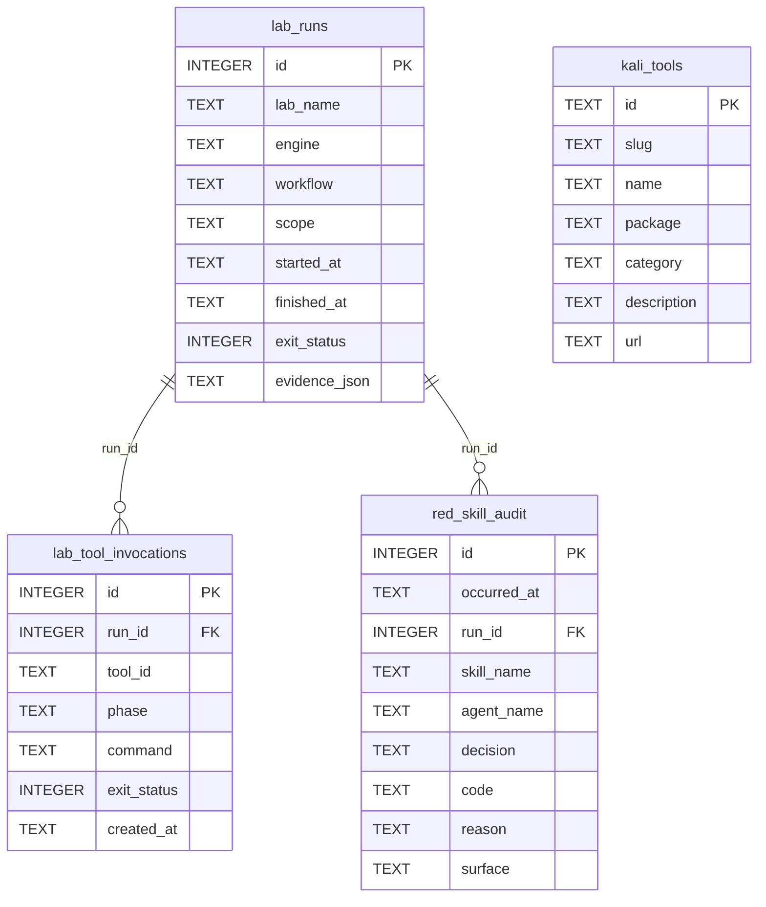

# Konoha Database ERD

Two physically separate SQLite files. Nothing joins across them, and no write path bridges them.

| Store | Path | Owner module |
|---|---|---|
| Main DB | `~/.konoha/konoha.db` (override `KONOHA_DB_PATH`) | `src/db.js` → `getConnection()` |
| Akatsuki Lab DB | `~/.konoha/akatsuki-lab/lab.db` (override `KONOHA_LAB_DB_ROOT`) | `src/workflow/akatsuki/lab_db.js` → `openLabDb()` |

`src/db.js#getConnection()` throws `LAB_DB_ISOLATION_VIOLATION` for any lab path; `getLabDbPath()` throws unless the path is inside the lab root and is not the main DB. The boundary is structural, not a config flag.

## Main DB

Sixteen tables appear below — those with relationships or security relevance. The
remaining main tables (`assets`, `asset_files`, `generation_jobs`, `llm_requests_3d`,
`schema_migrations`, `validation_results`) and SQLite's own `*_fts*`, `sqlite_sequence`,
and `_sqliteai_vector` bookkeeping tables are omitted as standalone storage.

```mermaid
erDiagram
    agents ||..o| soul_archetypes : "agent_name (logical)"
    skills ||--o{ skill_chunks : "skill_name = name"
    projects ||--o{ persona_memories : "project_hash"
    projects ||..o{ active_sessions : "project_hash (logical)"

    agents {
        TEXT name PK
        TEXT icon
        TEXT title
        TEXT model
        TEXT model_tier
        TEXT purpose
        TEXT skills
        TEXT delegate_when
        TEXT constraints_text
        TEXT workflow
        TEXT description
        TEXT instructions
        TEXT delegation_keywords
        TEXT cursor_fallback_model
        INTEGER enable_mcp_tools
    }

    soul_archetypes {
        TEXT agent_name PK
        TEXT name
        TEXT role
        TEXT voice
        TEXT calling
        TEXT antislop_skills
        TEXT adhd_shaping
        TEXT source
        TEXT updated_at
    }

    skills {
        TEXT name PK
        TEXT skill_name
        TEXT type
        TEXT tags
        TEXT content
        TEXT file_path
        INTEGER byte_size
        INTEGER line_count
    }

    skill_chunks {
        INTEGER id PK
        TEXT skill_name FK
        INTEGER chunk_index
        TEXT chunk_text
        BLOB embedding
    }

    projects {
        TEXT project_hash PK
        TEXT project_path
        TEXT project_name
        TEXT framework
        TEXT styling
        TEXT package_manager
        TEXT context_summary
        TEXT tech_stack
        TEXT dor_mode
        TEXT review_mode
        TEXT hitl_mode
        TEXT advisor_mode
        INTEGER advisor_max_tokens
        TEXT created_at
        TEXT updated_at
    }

    persona_memories {
        TEXT id PK
        TEXT project_hash FK
        TEXT session_id
        TEXT agent_name
        TEXT memory_type
        TEXT title
        TEXT content
        TEXT tags
        INTEGER importance
        TEXT created_at
        TEXT updated_at
    }

    active_sessions {
        TEXT client PK
        TEXT workspace_root PK
        TEXT session_id PK
        TEXT project_hash
        TEXT transcript_path
        TIMESTAMP last_active_at
    }

    tool_calls {
        INTEGER id PK
        DATETIME timestamp
        TEXT tool
        TEXT query
        INTEGER returned_bytes
        INTEGER total_library_bytes
        INTEGER bytes_saved
        INTEGER tokens_saved
        INTEGER input_tokens
        INTEGER output_tokens
        INTEGER cached_tokens
        TEXT agent
        TEXT client
    }

    sdlc_tasks {
        TEXT id PK
        TEXT description
        TEXT status
        TEXT dor_result
        TEXT review_mode
        TEXT evidence
        TEXT slop_result
        INTEGER slop_cycles
        TEXT project_path
        TEXT session_id
        TEXT client
        TEXT created_at
        TEXT updated_at
    }

    bridges {
        TEXT name PK
        INTEGER port
        TEXT provider
        INTEGER enabled
        TEXT target_url
        TEXT api_key
    }

    webhooks {
        TEXT id PK
        TEXT name
        TEXT url
        INTEGER enabled
        TEXT auth_type
        TEXT auth_token
        TEXT custom_header
        TEXT events
        INTEGER last_status
        TEXT last_delivered_at
        TEXT created_at
        TEXT updated_at
    }

    prompt_queue {
        TEXT id PK
        TEXT source
        TEXT sender_info
        TEXT prompt
        TEXT status
        TEXT session_id
        TEXT workspace_root
        TEXT client
        TEXT result_summary
        REAL token_savings_percent
        INTEGER kage_confidence_score
        TEXT created_at
        TEXT processed_at
        TEXT completed_at
    }

    telegram_config {
        INTEGER id PK
        INTEGER enabled
        TEXT mode
        TEXT transport
        TEXT bot_token
        TEXT chat_id
        TEXT webhook_secret
        TEXT last_notified_at
        TEXT updated_at
    }

    telegram_session_targets {
        TEXT chat_id PK
        TEXT client
        TEXT workspace_root
        TEXT session_id
        TIMESTAMP updated_at
    }

    lg_checkpoints {
        TEXT thread_id PK
        TEXT checkpoint_ns PK
        TEXT checkpoint_id PK
        TEXT parent_checkpoint_id
        TEXT type
        BLOB checkpoint
        BLOB metadata
    }

    lg_writes {
        TEXT thread_id PK
        TEXT checkpoint_ns PK
        TEXT checkpoint_id PK
        TEXT task_id PK
        TEXT task_path
        INTEGER idx PK
        TEXT channel
        TEXT type
        BLOB value
    }
```

Declared foreign keys are `skill_chunks.skill_name → skills.name` and `persona_memories.project_hash → projects.project_hash`. Dotted relations are logical joins with no constraint.

`lg_writes` is keyed on `(thread_id, checkpoint_ns, checkpoint_id, task_id, idx)`; it references `lg_checkpoints` logically, not by a declared foreign key.

`persona_memories_migrated` and `active_sessions_migrated` are not shown: they exist only while a foreign-key/PK rebuild is running and are dropped when it commits.

## Akatsuki Lab DB

`kali_tools` is a standalone reference table: no foreign keys, seeded from `src/templates/akatsuki_lab/kali_tools.json` when empty.

## Why these do not merge

| Concern | Main DB | Lab DB |
|---|---|---|
| Lifetime | Persistent, backed up | Ephemeral, purged on confirmed teardown |
| `kali_tools` catalog | Absent by design | Owned here since the Kali catalog migration |
| Red-skill audit | Absent by design | `red_skill_audit`, written through a supplied connection or an existing-file-only open; never created by auditing |
| Vector extension | Loaded | Never loaded |
| Legacy skill migration | Runs at startup | Never runs |
| Writer | `getConnection()` | `openLabDb()`; `openLabAuditConnection()` when only appending audit rows |

See `docs/security/DATABASE-ISOLATION-INVENTORY.md` for the guard-by-guard enforcement list and `docs/security/RED-SKILL-INVENTORY.md` for skill classification.
