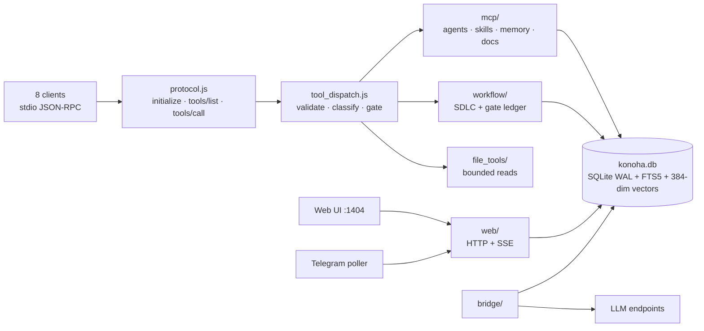

# Konoha — Operator's Manual

**Version of record: 2.2.20**

| Field | Value |
|---|---|
| Manual version | 2.2.20 |
| Code reference | working tree at commit `fb15212a` (`ci/cross-platform`), `package.json` version `2.2.20` |
| Distribution status | **unpublished** — npm `konoha-mcp` latest is 2.2.19; the latest GitHub release is v2.2.19 |
| Verified on | Linux x86_64, Node.js 24.22.2, non-root user, isolated `HOME`; Windows via dockur/QEMU VM and the `windows-latest` CI leg |
| Audience | developers installing and operating Konoha on their own machine |

Every command in this manual ran against a clean 2.2.20 installation. Whenever a statement rests on source inspection rather than live execution, or when a platform constraint prevented exercising a path directly, the text names the exact file, line, and substitute evidence.

Because 2.2.20 is not on the registry, the install path in this manual is *from source*, not `npm install -g`.
Section 2.6 gives the exact commands.

## Surfaces and their legend

Konoha is one product with five surfaces. Each feature section names its surface so you know where to look:

| Icon | Surface | Entry point |
|---|---|---|
| CLI | terminal commands | `konoha <command>` |
| TUI | full-screen terminal interface | `konoha tui` |
| Web | local browser console | `konoha ui` → `http://127.0.0.1:1404/` |
| Telegram | remote chat bridge | `konoha telegram` |
| MCP | tools exposed to AI harnesses | configured by `konoha init` |

## Contents

1. What Konoha is
2. Install
3. First run
4. Core concepts
5. CLI reference
6. TUI
7. Web UI
8. Telegram
9. Harnesses
10. Architecture
11. Agents and model routing
12. Token economy and what the numbers mean
13. Diagnostics and health
14. Troubleshooting
15. Security model
16. Appendix

## 1. What Konoha is

Konoha is a local MCP server plus a management CLI. It stores agent skills — instructions, rules and scripts — in a
local SQLite FTS5 database, then exposes them to AI coding harnesses as on-demand tools instead of loading every
skill into the system prompt. The organising metaphor is a "ninja village": a router, a planner, explorers, builders,
researchers, a scribe, and security specialists, each a subagent with its own skill set.

### 1.1 The problem it solves

Loading ten agent skills as Markdown into a harness costs tens of thousands of tokens on every turn, whether or not
those skills are relevant. Konoha replaces that with two lookups: `find_skill` to discover, `get_skill` to load only
the section a task needs. Measured on the shipped skill set, cold-start client instruction files drop from roughly
11,250 tokens to under 300, and a targeted section read costs 222 tokens instead of 1,719 (source:
`docs/architecture/TOKEN-BASELINE.md`, metric 7 and metric 2). Chapter 11 breaks the numbers down and explains what
the "83–98%" figure in the CLI banner actually covers.

### 1.2 The three MCP servers

`konoha init` writes three stdio MCP servers into each harness config:

| Server | Launched as | Role |
|---|---|---|
| `konoha` | the installed `konoha` binary | skills, subagents, workflows, bounded file tools, docs artefact generation |
| `semble` | `uvx --from semble[mcp]@latest semble --content all` | instant code search (`search`, `find_related`) |
| `aislop` | `npx -y --prefer-offline -p aislop@latest aislop-mcp` | zero-AI-slop scanning (`aislop_scan`, `aislop_fix`, `aislop_why`, `aislop_baseline`) |

The `konoha` server exposes 48 canonical tools with 2 deprecated aliases hidden from dispatch — 50 manifest entries in
total (`src/file_tools_router.js`, locked by `tests/test_canonical_api_sync.js`). Chapter 10 lists them by group.

`uvx` comes from `uv`; `konoha doctor` reports whether it is present, because the `semble` server cannot start
without it. The `aislop` server needs no install — `npx` fetches it on first use.

### 1.3 The eight harnesses

One install serves eight AI coding harnesses. `konoha init` detects which ones exist and writes their config:

| Harness | Config root written |
|---|---|
| Antigravity IDE/CLI | `~/.gemini/config/mcp_config.json`, `~/.gemini/antigravity-cli/skills/` |
| Cursor | `~/.cursor/mcp.json`, `~/.cursor/agents/`, `~/.cursor/skills/` |
| Claude Code | `~/.claude/skills/` |
| OpenCode | `~/.config/opencode/skills/` |
| Command Code | `~/.commandcode/mcp.json`, `~/.commandcode/skills/` |
| Codex | `~/.codex/config.toml`, `~/.codex/skills/` |
| Pi | `~/.pi/agent/mcp.json`, `~/.pi/agent/skills/` |
| OMP | `~/.omp/agent/mcp.json`, `~/.omp/agent/skills/` |

Skills are also mirrored into the harness-neutral `~/.agents/skills/` and into `~/.agents/agents.yaml`, which is what
the subagent definitions and `konoha agent` read. Chapter 9 covers per-client details and verification.

A fresh install mirrors 17 skills into all ten skill roots:

```
genin-skill  akatsuki-skill  anbu-skill  antislop  antislop-code  antislop-copywriting
antislop-human  antislop-layoutmobile  antislop-ui  chunin-skill  i-have-adhd
jonin-skill  kage-skill  konoha  sannin-skill  tokubetsu-jonin-skill  yamanaka-skill
```

Ten roots, seventeen skills each — visible with `konoha status`.

### 1.4 What lives where

| Path | Contents |
|---|---|
| `~/.konoha/konoha.db` | SQLite FTS5 database: skills, embeddings, tool telemetry, memories, task history |
| `~/.konoha/apps/web` | extracted prebuilt Web UI, versioned (`build/` ships with the package) |
| `~/.konoha/backups/` | timestamped, SHA-256-verified copies of harness configs taken before every write |
| `~/.konoha/tmp/<harness>/<session>/` | per-task working directories: `plan.md`, `findings.md`, `kage_review.json`, prompts |
| `~/.agents/` | harness-neutral skills and `agents.yaml` |
| systemd user unit / launchd agent | optional boot-time daemon for the Web UI, created only by `konoha ui service install`; absent on a default install |

All state stays on your machine. Outbound network traffic occurs only when you explicitly trigger registry lookups, web searches, Telegram alerts, or initial package downloads for auxiliary MCP servers.

### 1.5 What this manual does not cover

- The Web UI `/3d` route. It exists in the router but is excluded from the documented route set for 2.2.20.
- 3D asset generation (Yamanaka) beyond its CLI surface.
- Anything released after 2.2.20.
- Fixes for defects found during verification. Chapter 13 records the defects; the manual documents behaviour as it
  is, not as it should be.

## 2. Install

### 2.1 Requirements

| Requirement | Version | Needed for | Check |
|---|---|---|---|
| Node.js | **>= 24.0.0** (hard `engines` gate) | everything | `node -v` |
| npm | any version bundled with Node 24 | installing the package, launching the `aislop` server via `npx` | `npm -v` |
| `uv` / `uvx` | current | the `semble` MCP server (its launcher is `uvx`) | `uvx --version` |
| git | any | installing 2.2.20 from source | `git --version` |
| disk | ~600 MB free | 386 MB installed package + 193 MB `~/.konoha` after `init` | `df -h ~` |

Measured on a clean 2.2.20 install: unpacked package **386 MB**, `~/.konoha` after `init` **193 MB** (16.3 MB of that
is the SQLite database), packed tarball **114.3 MB**.

Node 23 or older fails the engine gate at install time. There is no shim for older runtimes in 2.2.20.

### 2.2 The install rule

Install globally with npm, then run `konoha`. Do not use `npx i -g`: `npx` runs a package instead of installing it,
and `i -g` inside it is a mistake that npm happens to tolerate poorly. The two correct forms are:

```bash
# published release, no global install, runs once
npx konoha-mcp@2.2.19 init

# real installation
npm install -g konoha-mcp@<version>
konoha init
```

For 2.2.20 specifically neither form works from the registry: `konoha-mcp@2.2.20` is not published — only `2.2.19` is.
Use section 2.6.

### 2.3 Linux (non-root)

A non-root global install needs a prefix npm can write to. Usually `~/.local`, which is already on `PATH` on most
distributions.

```bash
node -v                       # must print v24.x or newer
npm config set prefix "$HOME/.local"
npm install -g konoha-mcp@<version>
konoha version
```

If `konoha` is not found afterwards, `$HOME/.local/bin` is missing from `PATH`:

```bash
export PATH="$HOME/.local/bin:$PATH"     # add to ~/.bashrc or ~/.zshrc to persist
```

`EACCES` on a global install means npm is writing to a root-owned prefix. Fix the prefix as above; do not run the
install with `sudo`. This manual's verification install used an isolated `HOME` plus `npm i -g --prefix <dir>`, which
is the same mechanism without touching an existing npm setup:

```bash
HOME=/tmp/knh/home npm i -g --prefix /tmp/knh/prefix konoha-mcp-2.2.20.tgz
# added 39 packages in 12s
# /tmp/knh/prefix/bin/konoha -> ../lib/node_modules/konoha-mcp/bin/cli.js
```

39 packages, no lifecycle-script failure, no permission escalation.

### 2.4 macOS

Identical to Linux, with one difference in packaging: Apple Silicon and Intel both use the same tarball, and there is
no native build step, so no Xcode command line tools are required. If npm's default prefix (`/usr/local` or
`/opt/homebrew`) is not writable, use the same `npm config set prefix "$HOME/.local"` pattern.

The Web UI daemon option uses launchd instead of systemd; `konoha ui service install` selects the platform
automatically (6.5).

### 2.5 Windows

Windows path handling lives in `src/deploy_utils.js:48`. When `process.platform === 'win32'`, Konoha probes `npm.cmd root -g` with `shell: true, windowsHide: true`, and standard global installs land directly in `%APPDATA%\npm` on the user's default `PATH`:

```powershell
node -v
npm install -g konoha-mcp@<version>
konoha version
```

Verification scope, stated plainly: **this manual's 2.2.20 evidence comes from Linux x86_64 on a host, plus Windows
inside the dockur/QEMU VM and the `windows-latest` CI leg.** The Windows commands above were executed there, not on
physical Windows hardware and not on Docker Desktop for Windows, so confirm with `konoha status` after installing and
report anything that differs.

What does back those two platforms is the CI matrix, not this manual: `.github/workflows/cross-platform.yml` runs the
install, lint, suite, and fresh-install smoke step on `windows-latest` and `macos-latest` for every push and pull
request, and `scripts/windows-ci.ps1` reproduces the Windows job in a local VM. The macOS leg is GitHub-only, so a
macOS-specific defect is confirmed there rather than locally (see `docs/CI.md`).

### 2.6 Installing 2.2.20 from source

The published registry stops at 2.2.19, so 2.2.20 must be built and installed locally. From a clone:

```bash
git clone <repo> konoha && cd konoha
git checkout <commit or tag>          # the 2.2.20 tree used here: fb15212a
npm pack                              # produces konoha-mcp-2.2.20.tgz, ~114 MB
npm install -g ./konoha-mcp-2.2.20.tgz
konoha version                        # Current Version: 2.2.20
```

`npm pack` uses the package's own `files` list (27 entries) and bundles `pptxgenjs`, which is why the tarball is large
and why an offline `npm install -g` of the tarball works without a further fetch.

`konoha upgrade` cannot help you here: it resolves from the registry, finds no 2.2.20, and aborts without touching the
existing install (12.1 documents the exact output).

### 2.7 Verify the install

```bash
konoha version       # prints the version banner
konoha status        # skill roots and database health
konoha test          # exercises the MCP tool surface end to end
```

`konoha status` on a healthy fresh install lists ten skill roots with seventeen skills each. `konoha test` ends with
`All tests passed`.

One caveat about `konoha version`: it also performs a registry freshness check, and on an unpublished build the
message "You are already running the latest version" is misleading — 2.2.20 is newer than the registry, not equal to
it. Do not use it as proof of freshness (13.1).

## 3. First run

### 3.1 What `konoha init` does

The installer performs seven steps, in its own words:

1. Checks requirements (Node.js >= 24, uv for Python tools).
2. Creates the `~/.konoha` directory structure.
3. Copies runtime and migration files.
4. Discovers skills directories (`~/.agents/skills`).
5. Seeds canonical subagent skills and builds their vector embeddings (`~/.konoha/konoha.db`).
6. Registers Konoha and Semble MCP tools with your AI coding assistants.
7. Configures multi-agent team rules (Antigravity, Cursor, Claude Code, OpenCode, Codex, Pi, OMP).

Step 5 is the slow one on first run: embedding the seeded skill corpus into SQLite is most of the wall time.

Re-running `init` on an existing install does the same work against the runtime it finds, plus two things that only matter the second time: it runs the migration pass, so a legacy opt-in cyber pack from an earlier release is purged rather than left behind, and it restarts a running Web UI daemon so the build it serves is the one just installed. `KONOHA_UI_AUTOSTART=0` suppresses starting a daemon; it does not suppress refreshing one that is already up.

### 3.2 Options

| Flag | Effect |
|---|---|
| `-h`, `--help` | print installer help (safe, does no work) |
| `-y`, `--yes` | auto-approve every prompt; also implied by `CI=true` |
| `--force` | purge package caches, stop the running Web UI, refresh runtime files |
| `--client=<name>` | limit configuration to specific clients: `cursor`, `claude`, `opencode`, `omp`, `codex`, `pi`, `antigravity`, `commandcode`, `all` |
| `--project` / `--no-project` | also write project-level config into the current directory / skip it |
| `--with-red-team` | opt in to the cyber pack (offensive and dual-use reference material, fetched from a release asset and SHA-256 verified) |
| `--no-embed` | skip vector embedding; search stays keyword-only until you run `konoha migrate` |

`--client=<name>` implies non-interactive mode: naming clients is treated as consent, so the confirmation prompt is
skipped. `--yes` does the same without narrowing the client set.

### 3.3 A real first run

```bash
konoha init --yes
```

Measured on a clean install: **166.82 s** end to end. What it produced:

- ten skill roots, seventeen skills each, plus `~/.agents/agents.yaml`
- `~/.konoha/konoha.db`, 16.3 MB, FTS5 schema v1.1.0
- harness configs for Antigravity, Cursor and OMP among others, each written with a SHA-256-verified backup of the
  previous file
- the prebuilt Web UI extracted to `~/.konoha/apps/web`
- a Web UI listener started at `http://127.0.0.1:1404/`

If you want a narrow install that touches only one harness:

```bash
konoha init --yes --client=cursor
```

Re-running `init` on a configured machine is non-destructive: existing configs are merged, not replaced, and every
touched file is backed up first. `--force` is the option that discards and refreshes.

### 3.4 The first credential

The Web UI does not ask you to create an account. On first login it accepts a bootstrap password and then forces you
to replace it:

```
bootstrap password: konohagakure
```

The flow, as observed against the running server:

| Step | Request | Observed result |
|---|---|---|
| Pre-login probe | `GET /api/v1/auth/status` | `{"authenticated":false,"is_bootstrap":true,"needs_initial_setup":true,"requires_password_change":false}` |
| Login | `POST /api/v1/auth/login` with `{"password":"konohagakure"}` | `200`, body includes `"is_bootstrap":true,"requires_password_change":true` |
| Forced change | `POST /api/v1/auth/change-password` | the only API reachable while the bootstrap flag is set |

Bootstrap mode locks down almost the entire HTTP surface (`src/web_server.js:103`). Until you set a custom password, every endpoint except login, logout, and change-password is blocked, unauthenticated `GET /` requests return a `307` login redirect, and cookies expire after 12 hours (43,200,000 ms).

Change the password immediately after the first login. `konohagakure` is public knowledge; it protects nothing.

### 3.5 Post-install checks

```bash
konoha status
```

Expect a healthy database report across ten skill roots. Each root should list all seventeen seeded skills; if any client root is missing because its harness arrived later, run `konoha init --client=<name>` to register it.

```bash
konoha test
```

Runs the MCP tool surface end to end and prints a per-tool PASS line, ending with `All tests passed`. Measured at
**3.72 s**. One cosmetic defect: the summary line reads `Total indexed: undefined entries` (13.2). The tests
themselves still pass; the counter is broken, not the data.

### 3.6 Changing the listening port

The Web UI port is the `ui_port` configuration value, defaulting to `1404` (`bin/lib/paths.js:70`). Set it before
starting the UI if 1404 is taken; chapter 5 covers the `config` command, and chapter 12 covers stopping and
restarting the listener.

## 4. Core concepts

Eight ideas carry the rest of this manual. Each maps to a table in `~/.konoha/konoha.db`.

### 4.1 Skills and references

A **skill** is a named, versioned set of instructions. A **reference** is a document that belongs to a skill — the
material the skill points at when it needs detail.

A fresh 2.2.20 database contains 17 skills and 213 references, stored in one `skills` table discriminated by `type`.
References are addressed hierarchically, `<skill>/<reference>`:

```
anbu-skill                             (type: skill)
anbu-skill/api-design-expert           (type: reference)
akatsuki-skill/red-team-offensive      (type: reference)
konoha                                 (type: skill — the runtime contract itself)
```

Retrieval operates over 3,421 pre-split rows in `skill_chunks`. Indexing those chunks in both FTS5 (`skills_fts`) and the vector table lets queries finish in milliseconds, though building the embeddings accounts for most of `init`'s two-and-a-half-minute runtime.

Plain Markdown mirrors also remain on disk. Because each harness skill root receives standard skill folders during setup, harnesses that read local files directly still function even when MCP is disabled.

### 4.2 Agents

Konoha ships nine agent definitions, seeded into the `agents` table and mirrored to `~/.agents/agents.yaml`:

| Agent | Role |
|---|---|
| `sannin` | router: classifies a task, picks one agent or a parallel wave, tracks the gate state |
| `genin` | read-only codebase exploration |
| `kage` | architecture and review; owns the plan and the final verdict |
| `chunin` | external research and evidence synthesis |
| `jonin` | frontend and UI implementation |
| `anbu` | backend, DevOps, debugging |
| `tokubetsu-jonin` | documentation and artefact generation |
| `akatsuki` | red-team and blue-team security work |
| `yamanaka` | generative 3D |

Every subagent pairs a dedicated skill with a shared archetype. Specifically, Konoha combines the agent's primary skill (such as `jonin-skill`) with its row in `soul_archetypes` to form a deterministic prompt prefix that upstream model providers can cache across turns, driving the savings measured in chapter 11.

### 4.3 Workflows and human gates

Multi-step work runs as a workflow with two mandatory human checkpoints:

| Gate | Internal state | What it means | Allowed replies |
|---|---|---|---|
| Gate 1 | `pending_plan_approval` | a plan exists; nothing is executed yet | approve, reject and regenerate, or supply your own choice |
| Gate 2 | `pending_human_signoff` | work is done; a verdict is owed | approve, or send it back for remediation |

Gates fail closed: an agent cannot approve its own plan, and routing a task is explicitly not authorisation to pass
Gate 1 (`src/mcp/workflow_runner.js:380`). If a harness cannot render the prompt, the workflow stops rather than
proceeding.

Each workflow gets a task directory:

```
~/.konoha/tmp/<client>/<session>/scratch/tasks/<task_id>/
  prompt.md  findings.md  plan.md  result.md  final_docs.md  kage_review.json
```

These are the artefacts the workflow reads and writes. Chapter 11 explains why the *terminal* artefact
(`final_report.md`) was replaced with path references: it was 61% of the disk-token footprint.

### 4.4 Tasks, telemetry and savings

Every tool call is recorded in `tool_calls` — name, payload size, timestamps. That table is the basis of
`konoha savings`, which reports token spend per task and the delta against the pre-optimisation baseline. A fresh
install that has only run `konoha test` shows a dozen rows; real work accumulates quickly.

`sdlc_tasks` holds workflow state, `active_sessions` the live ones, and `validation_results` the outcome of
certification runs. All of it is local; nothing is uploaded.

### 4.5 Scope: global and project

Konoha writes configuration at two levels:

- **Global** — `~/.cursor/`, `~/.codex/`, `~/.konoha/`, one per user. Everything in chapters 2 and 3.
- **Project** — files inside a repository (`.cursor/`, `AGENTS.md`, `.mcp.json` depending on harness), created by
  `konoha init --project` or by the `project` command family.

Registered repositories are tracked inside the `projects` table. Recording every written file path allows later refreshes to update existing rules cleanly, so you can rely on global scope by default and reserve project scope for repositories with custom policies.

### 4.6 Memory

Two memory tables extend the prompt beyond static skills:

| Memory | Tools | Lifetime |
|---|---|---|
| persona | `save_persona_memory`, `query_persona_memory`, `list_persona_memories`, `delete_persona_memory` | per agent; lets an agent keep decisions across sessions |
| project | `save_project_context`, `get_project_context`, `query_project_memory` | per repository |

Memories are searchable (FTS5, `persona_memories_fts`) and inspectable without SQL: the Web UI has a `/persona`
route, and the CLI's `data` command family can export them (5.4).

### 4.7 Token budgets

Every read tool is bounded by construction. There is no "read the whole repository" tool and no unbounded grep:
results carry a count cap, and `get_skill` accepts `section` and `token_budget` so you can ask for a slice of a skill
rather than the whole thing. Measured effect: a targeted section read costs 222 tokens against 1,719 for the full
document — an 87% reduction (chapter 11).

This is the mechanic behind the product's headline claim. If you skip it and load whole skills, Konoha is just a
folder of Markdown with extra steps.

### 4.8 The remaining subsystems, in one line each

| Subsystem | Command | Detail |
|---|---|---|
| queue | `konoha queue` | durable prompt queue with retry and backoff |
| bridge | `konoha bridge` | exposes local models and remote bridges to the harness (`status`, `list`, `models`) |
| mode | `konoha mode` | switches the active execution mode (pipeline, direct, and per-client variants) |
| service | `konoha service` | long-running workers and daemons |
| webhook | `konoha webhook` | outbound notifications on task state change |
| embed | `konoha embed` | rebuilds vector embeddings for the skill corpus |
| migrate | `konoha migrate` | schema and corpus migration between versions |
| data / db | `konoha data`, `konoha db` | export, import, integrity check, salvage |
| soul | `konoha soul` | inspect the archetype definitions agents are built from |

Each has its own entry in chapter 5.

## 5. CLI reference

Running `konoha help` displays the CLI banner and command catalog. Most individual subcommands also accept `konoha <command> --help` for usage flags, apart from the two exceptions documented in section 5.9 (`tui` and `doctor`).

Global options, valid anywhere: `--force` (clean re-installation, used with `init`), `--skills-dir <path>` and
`--clean` (used with `migrate`).

### 5.1 Command catalog

| Command | Purpose | Subcommands / notable flags |
|---|---|---|
| `agent` | configure ninja subagents | `list`, `create`, `delete`, `status`, `skill`, `models`, `--tui` |
| `akatsuki` | red-team / blue-team lab | `status`, `init`, `tools` |
| `auth` | web console credentials | `konoha auth reset` |
| `bridge` | bridge router to local and remote models | `status`, `list`, `create`, `delete`, `enable`, `disable` |
| `clean` | reclaim `~/.konoha` space | removes stale backups and dead PIDs |
| `config` | CLI configuration | `list`, `get`, `set`, `unset` |
| `data` | session history, persona memories, DB size | `view` |
| `db` | integrity and recovery | `check`, `restore` |
| `detect-ai` | AI fingerprints in a site or project | `konoha detect-ai <target> [--json]` |
| `detect-docs` | AI markers in prose and documents | `konoha detect-docs <file_path> [--json]` |
| `doctor` | environment diagnostics | detects and fixes integration issues |
| `embed` | rebuild vector embeddings | implies `--rebuild-embeddings` |
| `help` / `-h` | this catalog | — |
| `init` | first-time setup | see 3.2 |
| `migrate` | re-index the skills database | `--skills-dir`, `--clean`, `--rebuild-embeddings` |
| `mode` | HITL vs YOLO | gates stay authoritative in both |
| `project` | project workspaces, stacks, invariants | — |
| `queue` | background prompt queue and worker | — |
| `reinstall` | clean re-install, replace config | implies `--force` |
| `run-agent` | run one subagent through the CLI bridge | mandatory Kage review; `--parallel --agents a,b` |
| `savings` | token savings | `Today`, `7 days`, `All time` |
| `search` | keyless web search | SearXNG, DuckDuckGo, Wikipedia |
| `service` | OS daemon for the Web UI | systemd / launchd |
| `skill` | manage skills | `list`, `search`, `add`, `remove` |
| `soul` | the Ninja's Soul doctrine | tenets and archetypes |
| `status` | install health, DB size, loaded skills | — |
| `task` | SDLC governance tasks | readiness gates, audits |
| `telegram` | bot reporting and remote prompting | see chapter 8 |
| `test` | verify the MCP server | — |
| `tui` | full-screen interface | chapter 6 |
| `ui` / `web` | local Web UI on port 1404 | `start`, `stop`, `restart`, `status` |
| `uninstall` | remove Konoha | keeps custom skill files |
| `upgrade` / `update` | upgrade from the npm registry | `--yes`, `--force` |
| `version` / `-v` | version, plus a registry freshness check | — |
| `webhook` / `webhooks` | outbound notifications | Bearer, API Key, JWT |

### 5.2 `skill`

```bash
konoha skill list                 # installed skills with byte sizes
konoha skill search golang        # search the public registry
konoha skill add <name>           # install from the registry
konoha skill remove <name>
```

`add` writes into the local database and mirrors the skill into every configured harness root; it does not touch
existing custom skill files. `search` needs network access; `list` never does.

### 5.3 `agent`

```bash
konoha agent list                 # roster with enabled state
konoha agent list --tui           # same, inside the TUI
konoha agent skill genin          # interactively assign skills to one agent
konoha agent models               # interactively choose models per agent
konoha agent status               # runtime status per agent
konoha agent create               # write a new agent definition
konoha agent delete <name>
```

`konoha agent models` and `konoha agent skill` are interactive: they print a menu and wait for input, so they do not
complete under a non-interactive shell. Chapter 6 covers the TUI equivalents.

### 5.4 `config`, `data`, `db`

```bash
konoha config list                # every key, current value, source
konoha config get ui_port
konoha config set ui_port 1500
konoha config unset ui_port       # back to default

konoha data view                  # session history, memory counts, database size
konoha db check                   # SQLite integrity check
konoha db restore                 # recovery from the newest valid snapshot
```

`config set` writes to the user config file; `unset` restores the shipped default rather than deleting the key
concept. The Web UI exposes the same values on `/settings`.

### 5.5 `task`, `mode`, `project`

```bash
konoha task                       # SDLC task list, readiness gates, audit state
konoha mode                       # switch HITL / YOLO
konoha project                    # registered workspaces, detected stacks, invariants
```

`mode` changes how much the agent asks before acting. It does **not** disable the gates in 4.3: HITL versus YOLO
governs routine confirmations, while plan approval and sign-off still block. The tool states this itself: "gates stay
authoritative".

### 5.6 `ui` and `service`

```bash
konoha ui start
konoha ui status
konoha ui stop
konoha ui restart
konoha ui service install        # optional boot-time daemon
konoha ui service status
```

`ui` and `web` are the same command. Port defaults to 1404 and follows the `ui_port` config value. Observed service
status on a working install with no OS daemon registered:

```
○ NOT INSTALLED  OS daemon service unit is not registered.
  Supported platform: Linux (systemd --user)
  Port 1404 listener: ACTIVE (manual/detached daemon)
```

That combination is normal: the UI can be running detached while no boot-time unit exists.

The daemon serves the SvelteKit handler it loaded at startup, so replacing the runtime under it does not change what it
serves. `konoha init --yes` therefore restarts a daemon that is already listening on the port instead of treating it as
"already started" — otherwise `npm install -g konoha-mcp` followed by `init` left the previous build being served.
`KONOHA_UI_AUTOSTART=0` only suppresses *starting* a daemon; a running one is still restarted.

### 5.7 `savings`, `search`, `clean`

```bash
konoha savings                    # Today / 7 days / All time
konoha search "mcp server design" # keyless: SearXNG, DuckDuckGo, Wikipedia
konoha clean                      # stale backups, dead PIDs, disk reclaim
```

`savings` reads the `tool_calls` table (4.4); it reports what actually happened on this machine, not a marketing
figure. `search` needs no API key and falls back across three providers in order.

### 5.8 `run-agent`

```bash
konoha run-agent --agents jonin,tokubetsu-jonin --parallel
konoha run-agent <agent>
```

Executes the agent out of process and routes the result through Kage review before returning. `--parallel` fan-out is
the CLI equivalent of dispatching multiple subagents at once; each branch must stay inside its assigned file set.

### 5.9 Two help commands that do not print help

Two subcommands ignore the `--help` flag completely. Invoking `konoha tui --help` opens the interactive TUI immediately, while `konoha doctor --help` triggers a full diagnostic and repair run that migrates skills and unpacks the Web UI (recorded as defects D4 and D5).

### 5.10 `upgrade` and `uninstall`

```bash
konoha upgrade --yes              # registry upgrade, backs up configs first
konoha uninstall                  # remove the MCP server, keep skill files
```

`upgrade` compares the installed version with the registry, backs up every config file it will touch
(`~/.konoha/backups/configs/<client>/global/<ts>-<sha>-<file>.bak`, SHA-256 verified), then delegates to the package
manager. When the target version is not published it aborts without modifying anything. Section 12.1 reproduces that
output in full.

## 6. TUI

`konoha tui` is the subagent console. It is not a separate application: the command is a thin alias for
`konoha agent list --tui` (`bin/cli.js:131`).

### 6.1 What you see

A single table of nine subagents, one row each, with the skills currently assigned to that agent:

```
Subagents List
════════════════════════════════════════════════════════════
│ Subagent           │ Title                                        │ Active Skills        │
│ ✧ @sannin          │ MCP Router & Orchestrator                    │ sannin-skill, antislop
│ ⚑ @genin           │ Codebase Exploration                         │ genin-skill, i-have-adhd, antislop, antislop-human, antislop-code
│ ◎ @kage            │ Village Leader & Architect                   │ kage-skill, i-have-adhd, antislop, antislop-human, antislop-code
│ ▫ @chunin          │ Research & Intel                             │ chunin-skill, i-have-adhd, antislop, antislop-human, antislop-code
│ ♦ @jonin           │ UI & Frontend Specialist                     │ jonin-skill, i-have-adhd, antislop, antislop-ui, antislop-human, antislop-layoutmobile, antislop-code
│ ♠ @anbu            │ Backend Specialist, Bug Fixing & DevOps      │ anbu-skill, i-have-adhd, antislop, antislop-human, antislop-code
│ ⬡ @tokubetsu-jonin │ Technical Writing & Scribe                   │ tokubetsu-jonin-skill, i-have-adhd, antislop, antislop-copywriting, antislop-human, antislop-code
│ ⚔ @akatsuki        │ Red-Team & Blue-Team Security Specialist     │ akatsuki-skill, i-have-adhd, antislop, antislop-human, antislop-code
│ ❖ @yamanaka        │ Generative 3D & Spatial Subsystem Specialist │ yamanaka-skill, i-have-adhd, antislop, antislop-human, antislop-code
```

The right column is the useful part: it shows exactly what each agent will load, which is how you audit a
misbehaving agent without reading YAML.

### 6.2 Keys

| Key | Action |
|---|---|
| `j` or `↓` | move down |
| `k` or `↑` | move up |
| `Enter` | open the selected agent's detail view |
| `m` | toggle HITL mode for the current project |
| `Esc` | leave the list view; from the list, quit |
| `q`, `Backspace`, `Esc` | from the detail view, back to the list |
| `Ctrl-C` | exit immediately |

The detail view shows title, keywords, active skills and the delegation envelope for that agent. `m` is a real mode
switch, not a display toggle: it writes the project's `hitl_mode` setting through `sdlc_manager`, the same value
`konoha mode` changes (5.5). Gates remain authoritative either way.

### 6.3 When the TUI is unavailable

The console requires a TTY with raw-mode support. Redirected input, a CI runner, or an MCP call has no raw mode, so
use the non-interactive equivalents instead:

```bash
konoha agent list                 # same data, plain text
konoha agent status
konoha skill list
```

### 6.4 The other interactive screens

Two `agent` subcommands are menu-driven rather than full-screen, and behave the same way: they render a numbered list
and wait for a keypress. Neither completes in a non-interactive shell.

```bash
konoha agent skill genin          # assign or remove skills for one agent
konoha agent models               # pick the model per agent
```

Assigning a skill writes the agent record and re-mirrors the agent's prompt through `agents.yaml`; it does not delete
the skill itself.

### 6.5 `--help` is a trap here

Passing `--help` to `konoha tui` opens the interface immediately. Because no dedicated help screen exists for this subcommand (defect D4), run `konoha help` when you only want the top-level command summary.

## 7. Web UI

Port 1404 serves a prebuilt SvelteKit single-page console. Beyond exposing the same configuration controls as the CLI, the browser interface charts historical token telemetry, live subagent activity, and vector chunk coverage.

### 7.1 Starting and reaching it

```bash
konoha ui start
konoha ui status
```

`konoha init` starts it for you. `http://127.0.0.1:1404/` binds to loopback only; there is no remote exposure
without a bridge or tunnel (chapter 10 covers `/remote` and Telegram).

Before login, `GET /` answers `307` — a redirect to the login page, not an empty dashboard. The app also polls a
health endpoint every 10 seconds and holds an SSE connection for live updates, so a running UI shows database and
agent state changing without a manual refresh.

### 7.2 The eighteen routes

| Route | Menu label | What it does |
|---|---|---|
| `/dashboard` | Dashboard | aggregate health: database, skill counts, recent activity |
| `/activity` | Agent Activity (Live) | live stream of agent and tool calls |
| `/clients` | Client IDEs | which harnesses are configured, and what was written where |
| `/bridges` | LLM Bridges | bridge router to local and remote model endpoints |
| `/remote` | Remote Access (Telegram) | Telegram bot configuration and session pairing |
| `/savings` | Token Savings (Telemetry) | the same numbers as `konoha savings`, charted |
| `/agents` | Ninja Agents | the nine agents, their skills, models and status |
| `/skills` | Skills & Vectors (FTS5) | skill corpus, chunk counts, embedding state |
| `/persona` | Persona & Memory | per-agent memories, searchable |
| `/context` | Workspace Context | per-project invariants and stacked detection |
| `/search` | Web Search (SearXNG) | keyless web search from the browser |
| `/semble` | Semble MCP | semantic code search over a repository path |
| `/detector` | AI Detector (Web & Docs) | scan a site or document for AI fingerprints |
| `/tasks` | SDLC Tasks | workflow tasks, gate state, readiness |
| `/doctor` | Health & Doctor | diagnostics, the same checks as `konoha doctor` |
| `/docs` | Documentation | browse the shipped Markdown documentation |
| `/settings` | Settings & Auth | password change, port, preferences |
| `/skill` | (detail view) | one skill: content, references, byte and line counts |

Logging out is triggered from the sidebar menu. Posting to `/logout` clears the active session immediately; otherwise, the console stays unlocked without an idle timeout until the 12-hour cookie expires.

`/3d`, `/3d/setup` and `/3d/maker` exist in the build but are hidden: `SHOW_3D_STUDIO_MENU = false`
(`apps/web/src/routes/+layout.svelte:54`). The APIs remain; the menu does not. Out of scope for this manual.

### 7.3 Authentication and the bootstrap gate

The login page is the only unauthenticated content. The session is a cookie plus a CSRF token, both with a 12-hour
lifetime. During bootstrap — before the password has ever been changed — the server accepts `konohagakure` and
blocks every route except login, logout and change-password (`src/web_server.js:103`). The UI detects that state and
opens the password modal instead of the dashboard.

Practical sequence:

1. `konoha ui start`
2. open `http://127.0.0.1:1404/`
3. log in with `konohagakure`
4. change the password in the modal that appears
5. confirm `/settings` shows the new credential in effect

If the password is lost, reset it from the shell without touching the database:

```bash
konoha auth reset
```

### 7.4 Theme and preferences

The UI carries a theme state that persists across reloads and applies to every route, including the login page.
Preferences that matter operationally — the listening port and the password — are written server-side and therefore
visible to the CLI as well: `konoha config get ui_port` shows the same value `/settings` edits.

### 7.5 What the UI can do that the CLI cannot

Three things, and they are why the console exists:

- **See history.** `/activity` and `/savings` render `tool_calls` over time; the CLI only prints current totals.
- **Compare agents.** `/agents` puts skills, models and status side by side across all nine.
- **Read the corpus.** `/skills` and `/skill` show chunk counts and embedding coverage per skill, which is the
  fastest way to diagnose a search that returns nothing useful.

## 8. Telegram

The bot is how Konoha reports work while you are away from the desk, and — in two-way mode — how you send it work
from a phone.

### 8.1 Subcommands

```bash
konoha telegram status
konoha telegram config --token <BOT_TOKEN> --chat-id <CHAT_ID> --mode one_way
konoha telegram test
konoha telegram enable
konoha telegram disable
konoha telegram start-poller
konoha telegram stop-poller
```

`config` accepts short forms and two extra flags:

| Flag | Meaning |
|---|---|
| `--token`, `-t` | Bot API token from BotFather |
| `--chat-id`, `-c` | authorised recipient; only this chat is served |
| `--mode`, `-m` | `one_way` (alerts only) or `two_way` (alerts plus inbound prompting) |
| `--transport` | `polling` is the only accepted value today |
| `--enable` / `--disable` | set the enabled flag in the same call |

Running `disable` also halts the background poller. By contrast, `start-poller` and `stop-poller` toggle inbound message listening independently, letting you keep outbound task notifications active while inbound commands stay off.

### 8.2 What `status` tells you

```
Telegram Bot Integration Status
Enabled:       Yes [ACTIVE]
Mode:          One-Way (Alerts Only)
Transport:     polling
Bot Token:     1234567890...
Chat ID:       123456789
Poller:        Stopped
Last Notified: 2026-11-10T09:12:44.000Z
```

The token is truncated to the first ten characters on display. `Last Notified` is the fastest way to answer "did the
alerts ever work".

### 8.3 Storage and secrets

Settings live in the `telegram_config` table, one row (`id = 1`), not in environment variables and not in a
`.env` file. The bot token and the webhook secret are encrypted with the local vault before storage
(`src/telegram/config.js:55-56`, `vault.encryptSecret`). Reading the database therefore does not reveal the token.

Guard the BotFather token like any production secret. Anyone who obtains it can impersonate your bot, so revoke leaked tokens in BotFather immediately and run `konoha telegram config --token <new>`.

### 8.4 One-way versus two-way

| | `one_way` | `two_way` |
|---|---|---|
| Outbound alerts on task events | yes | yes |
| Inbound prompts executed by an agent | no | yes |
| Poller required | no | yes |
| Attack surface | write-only notification channel | remote command channel |

Two-way mode turns your chat into a remote execution surface. The server enforces a single authorised `chat_id`, so
a stranger who finds the bot cannot prompt it, but the operational rule still applies: run two-way only while you
need it, and `konoha telegram stop-poller` when you are done. `konoha telegram disable` is the blunt version and
stops both directions.

### 8.5 Where the messages come from

Task state transitions drive every outbound alert. Whenever a plan finishes, a gate blocks for approval, or validation fails, the workflow runner emits an event that can feed both generic HTTP webhooks (5.1) and Telegram (`docs/TELEGRAM_INTEGRATION_GUIDE.md` covers `/remote` pairing).

## 9. Harnesses

Konoha does not replace your coding client; it registers itself as an MCP server inside each one and writes the
rules that keep the client honest. Nine surfaces are supported: eight agents plus the shared `~/.agents` corpus.

### 9.1 What gets written, per client

| Client | MCP registration | Rules file | Notes |
|---|---|---|---|
| Cursor | `~/.cursor/mcp.json` | `~/.cursor/rules/` | also `cli-config.json`, `hooks.json` |
| Claude Code | `~/.claude.json` (`mcpServers`) | `~/.claude/CLAUDE.md` | `settings.json` carries permission config |
| Codex | `~/.codex/config.toml` | `~/.codex/CODEX.md` and `AGENTS.md` | TOML, not JSON |
| OpenCode | `~/.config/opencode/opencode.json` | `~/.opencode/AGENTS.md` | `~/.opencode/` also holds a mirror |
| Command Code | `~/.commandcode/mcp.json` | `~/.commandcode/AGENTS.md` | `settings.json` |
| Antigravity | `~/.gemini/antigravity-ide/mcp_config.json` | `~/.gemini/GEMINI.md` | status reports `~/.gemini/config/mcp_config.json` |
| Pi | `~/.pi/agent/mcp.json` | `~/.pi/agent/AGENTS.md` | `extensions/` and `skills/` present |
| OMP | `~/.omp/agent/mcp.json` | `~/.omp/agent/AGENTS.md` | contract block in `AGENTS.md` |
| shared | — | `~/.agents/AGENTS.md` | `agents.yaml`, `rules/`, `skills/` |

Every client also receives `SOUL.md` (15.7 KB in a fresh install) and a `skills/` and `agents/` directory. That
duplication is deliberate: each client must work with no network and no cross-reads.

### 9.2 The shared corpus

The canonical agent corpus lives under `~/.agents/`. Inside that directory, `agents.yaml` (25.8 KB after init) declares the nine subagents, `skills/` stores the Markdown seeds, and `rules/` holds client fragments copied from `~/.konoha/src/templates` before SQLite indexing.

`~/.agents/.upgraded_v1.1.1` is a migration marker. Do not delete it; without it a later upgrade re-runs a migration
that is already applied.

### 9.3 Verification after init

`konoha status` is the primary check: it prints an environment table, then one row per client with the config path it
read and the command it found. A healthy install looks like this (paths abbreviated):

```
✔ Cursor IDE / CLI
   Config Path: ~/.cursor/mcp.json
   Status:      Healthy (Konoha MCP Registered)
   Command:     cmd: node /home/<you>/.konoha/file_tools_launcher.js
```

The registered command is always `node <globalRoot>/file_tools_launcher.js`. If a client shows `konoha` in its tool
list but no tools appear, the path in that file is wrong or the file does not exist — fix the path, restart the
client, and do not reinstall.

Secondary checks, in increasing cost:

```bash
konoha status        # ~1 s, config presence and agent table
konoha doctor        # ~120 s on a cold install; deep runtime checks
konoha test          # ~4 s; exercises the MCP tool surface itself
```

The Web UI `/clients` route shows the same registration data without running diagnostics.

### 9.4 Adding a client later

```bash
konoha init --client=codex
```

Selecting a single client updates only that target harness. Passing `--client=all` refreshes every detected harness, `CI=true` forces non-interactive execution without `--yes`, and every modified file is backed up under `~/.konoha/backups/configs/<client>/global/<timestamp>-<sha>-<file>.bak` (older `.back` siblings in `$HOME` come from earlier installers). Remove those older `.back` files once the updated configuration is verified.

### 9.5 Project-level versus global

`--project` writes rules into the current repository instead of the home directory, which is how you make one
repository use a different rule set. `--no-project` suppresses it. Never run the project form inside a repository you
do not want modified — including this one, which is why this manual's own verification ran out-of-tree.

### 9.6 The MCP servers

`konoha status` reports two registrations per client — `konoha` and `semble`. Claude Code's `~/.claude.json`
additionally carries `aislop`, and Antigravity receives 50 tool schemas under `~/.gemini/antigravity-cli/mcp/konoha/`.
Those three play different roles:

| Server | Role |
|---|---|
| `konoha` | agents, skills, task dirs, file tools, documents, diagrams |
| `semble` | semantic code search over a repository path |
| `aislop` | lint and AI-slop scoring, called by the review gate |

If a client shows fewer than expected, the missing entry failed its own binary check during install; `konoha status`
names the server it could not reach. Restart the client before concluding anything — several clients cache their tool
list for the lifetime of the process.

## 10. Architecture

### 10.1 Two trees, one binary name

The repository you clone is the source tree. `konoha` runs the deployed tree under `~/.konoha`, which is a copy plus
generated state:

```
~/.konoha/
├── bin/            CLI entry (cli.js) and command modules (commands/)
├── src/            subsystem code: mcp/, workflow/, bridge/, web/, queue/, telegram/, file_tools/
├── server.js       MCP entry point
├── file_tools_launcher.js   launcher the clients actually invoke
├── migrate.js      schema + skill migration driver
├── migrations/     SQL migrations
├── apps/web/       built SvelteKit UI
├── assets/ patches/ upstream payloads and local patches
├── backups/        config backups written before every rewrite
├── workflow/ tmp/  task artifacts and scratch space
└── konoha.db       SQLite database, plus -wal and -shm
```

`konoha reinstall` refreshes the code in this tree; your database and `~/.agents` survive it. See 12 for the
uninstall asymmetry.

### 10.2 Transport and protocol

Konoha ships without an external MCP SDK. Instead, `src/mcp/protocol.js` speaks newline-delimited JSON-RPC 2.0 directly over standard input and output through Node's built-in `readline` module, handling four core methods:

| Method | Behaviour |
|---|---|
| `initialize` | negotiates a protocol version from the manifest list |
| `notifications/initialized` | flips the server into the usable state |
| `tools/list` | returns the manifest minus deprecated tools |
| `tools/call` | dispatches by name through `tool_dispatch.js` |

Calls before `initialize` are rejected with JSON-RPC error `-32002`. Supported protocol versions come from
`src/mcp_tool_manifest.json`: `2024-11-05`, `2024-10-07`, `2025-03-26`, `2025-11-25`, `2025-06-18`, plus `0.1.0` and
`1.0.0`.

The manifest declares 50 tools; `tools/list` filters out `find_skills` and `build_with_image_design`, so a client sees
**48**. Both retired names still resolve if an old prompt calls them.

### 10.3 Dispatch

`executeTool` in `src/mcp/tool_dispatch.js` is the single choke point. Three things happen before a tool body runs:

1. argument validation against the manifest schema (`validateManifestArguments`);
2. classification — bounded file tools and skill-read tools are marked so the workflow layer can require retrieval
   before reading;
3. gate check — workflow tools consult the task ledger and refuse out-of-order calls.

That is why a tool can exist, appear in `tools/list`, and still fail with a message about a gate.

### 10.4 Subsystem map

| Directory | Files | Size | Responsibility |
|---|---|---|---|
| `src/mcp/` | 88 | 936 KB | protocol, dispatch, agents, skills, memory, gates, documents |
| `src/workflow/` | 52 | 491 KB | SDLC runner, gate ledger, remediation contracts |
| `src/bridge/` | 29 | 228 KB | relay to LLM endpoints and external agents |
| `src/web/` | 12 | 172 KB | HTTP API controllers, auth, SSE |
| `src/telegram/` | 5 | 74 KB | bot config, poller, message formatting |
| `src/mcp_clients/` | 4 | 71 KB | per-client adapters written by init |
| `src/file_tools/` | 7 | 36 KB | bounded read/grep/info |
| `src/queue/` | 2 | 23 KB | ingest queue for client tasks |

Sizes are from a 2.2.20 checkout and are here to set expectations, not as a contract.



### 10.5 Data layer

`node:sqlite` from Node 24, no native module to compile. WAL mode, 33 tables in a fresh install, and three storage
patterns you will meet:

- **Relational tables** — persistent state (`skills`, `skill_chunks`, `agents`, `soul_archetypes`, `projects`, `persona_memories`, `sdlc_tasks`, `tool_calls`, `telegram_config`)
- **FTS5 (`skills_fts`)** — lexical index over all 3,421 seeded skill chunks
- **Vector index** — 384-dimensional IBM Granite 97M multilingual ONNX embeddings with MiniLM cross-encoder reranking (`KONOHA_SEMANTIC_SEARCH=1` by default, or `0` for FTS5-only mode)

Run `konoha embed` (an alias for `konoha migrate --rebuild-embeddings`) to regenerate vectors from scratch, or pass `--skip-embeddings` during migration when installing over a metered connection.

### 10.6 Process model

Every client spawns its own `node file_tools_launcher.js`. Nothing coordinates them, so the database must tolerate
concurrent writers — WAL does, and short transactions keep contention invisible in practice. Two consequences worth
knowing:

- long `konoha test` runs and the MCP servers touch the same tables; avoid mutating commands during a run;
- `~/.konoha/tmp/` is shared scratch. A crashed run can leave files there; they are safe to clear between runs.

Nothing else reaps these processes, so each server exits on its own terms (`src/mcp_orphan_guard.js`):

| Entry point | Exit trigger | Knob |
|---|---|---|
| stdio server | spawning client died (`ppid` became 1) | `mcp_orphan_parent_poll_ms`, 30 s |
| stdio server | no `readline` line for the idle budget | `mcp_stdio_idle_timeout_ms`, 4 h |
| bridge daemon | a newer live daemon claimed `bridge.pid` | `mcp_daemon_superseded_poll_ms`, 30 s |

Standard input is not a sufficient signal. The server's original exit is the readline `close` event, which needs the
client's stdin to close; a client that dies while inherited stdio or another holder keeps the pipe open leaves the
server running with no client behind it. The parent poll covers that on Linux and macOS, where a dead parent reparents
the child to init. Windows does not reparent, so the idle budget is the safety net there. Daemon mode has no stdin at
all — it is spawned detached and its spawner exits by design — so supersession of `bridge.pid` is its only exit.

## 11. Agents and model routing

### 11.1 An agent is a row, not a process

Each of the nine agents is one record in `~/.agents/agents.yaml`, copied into the `agents` table at init. No agent is
running code; they are prompts plus metadata, loaded on demand.

| Field | Meaning |
|---|---|
| `name`, `icon`, `title` | identity; the icon is what the TUI renders |
| `purpose` | one-line job description used in the roster |
| `skills` | skill names loaded when the agent activates |
| `delegateWhen` | the sentence the router matches against a task |
| `delegationKeywords` | longer match list, also what `konoha status` prints |
| `constraints`, `workflow`, `instructions` | the prompt body |
| `model` | `null` means inherit the client's model |
| `enable_mcp_tools` | whether the agent may call the MCP surface |

Cards for the nine are spread across 4.2 and the live TUI dump; this chapter covers the mechanics.

### 11.2 Model resolution

In a fresh install every agent shows `inherit`, verified live:

```
konoha agent models
```

prints nine rows, all `inherit`, and the tip that interactive configuration requires a TTY. The resolution order
inside the runner is:

1. `agents.model_tier` for `sannin`, if set;
2. `agents.model_tier` for `kage`, if `sannin` is empty;
3. the literal fallback `Gemini 3.1 Pro (High)`.

`model_tier` is a separate column from `model`, and it is the one the subagent runner reads when composing a spawn
directive. Cursor has its own `cursor_fallback_model`, defaulting to `inherit` when absent.

### 11.3 Setting a model

```bash
konoha agent models config kage --model <model-id>
```

Without a TTY this is the only form that works; in a TTY `konoha agent models` opens a picker. Two rough edges exist in
2.2.20 and are recorded rather than worked around:

- `konoha agent models --help` tries to resolve `--help` as an agent name and prints `✗ Subagent "@--help" not found.`
- model changes apply to the database record; a client already running with a fixed model is not retargeted mid-session.

### 11.4 Routing

Task routing starts with the `sannin` orchestrator. Given a prompt, `sannin` matches `delegateWhen` and `delegationKeywords` to select the target specialist, and `lazy_subagent.js` returns a lightweight Markdown directive — task, context, constraints, and attached skills — rather than spawning a child OS process.

Nine specialist tools appear in the MCP manifest (`sannin`, `kage`, `jonin`, `anbu`, `akatsuki`, `yamanaka`, `chunin`, `tokubetsu_jonin`, `genin`) alongside `report_from_agent` for recording task outcomes in the ledger. Outside MCP, the only shell entry point that dispatches subagents directly is `konoha run-agent --agents <list>`.

### 11.5 Editing an agent

```bash
konoha agent list                 # table, no TUI
konoha agent status               # which agents exist and their skill counts
konoha agent skill kage           # menu-driven skill attachment
```

`konoha agent skill <agent>` opens a numbered list of the seeded skills and toggles attachment. The write goes to
`~/.agents/agents.yaml` first — a backup of the previous file is taken — and is then mirrored into the `agents` table
best-effort. Editing the YAML by hand is equally valid; the CLI reloads on mtime change. When the two disagree, the
YAML is what the next command reads, and the database catches up on the next save.

### 11.6 What a delegation looks like on the wire

Subagent dispatch never forks background daemon processes. Instead, `buildSpawnDirective` returns a Markdown instruction tailored to the calling harness, pairing the native subagent tool call with a CLI fallback:

| Client | Tool call it emits |
|---|---|
| OMP | `task(context="…", tasks=[{name:"<agent>", task:"…", agent:"<agent>"}])` |
| Cursor | `Task(subagent_type="<agent>", description="…", prompt="…")` |
| Claude Code | `Task(subagent_type="<agent>", description="…", prompt="…")` |
| Command Code | `Task(subagent_type="<agent>", description="…", prompt="…")` |
| OpenCode | `task(subagent_type="<agent>", description="…", prompt="…")` |
| Codex | `spawn_agent(agent="<agent>", task="…")` |
| Pi | `task(agent="<agent>", prompt="…")` |
| Antigravity | `invoke_subagent({ TypeName: "self", Role: "<agent> specialist", Prompt: "…" })` |

Every form is followed by the same sentence: wait for the structured report via `konoha.report_from_agent`. The
fallback for a client with no known descriptor is
`rtk node ~/.konoha/bin/cli.js run-agent --agent <agent> --task "…"`, and `--cwd` is added when a worktree path exists.

Three rules constrain what can be delegated:

- `sannin` is not spawnable; a request for it is rewritten to `kage`.
- The spawnable set is `genin`, `kage`, `chunin`, `jonin`, `anbu`, `tokubetsu-jonin`, `akatsuki`, `yamanaka`.
- Red skills are `@akatsuki`-only. A spawn that requests one for any other agent returns an authorization-denied result
  instead of a directive, naming the offending skill.

`buildParallelSpawnDirective` applies the same checks to a batch and drops empty or `sannin` entries rather than
failing the batch.

What this means operationally: if a delegation appears to do nothing, the MCP call succeeded and the client ignored the
instruction. Check `tool_calls` for the router entry, then check the client's own subagent mechanism.

## 12. Token economy and what the numbers mean

The banner claims 83–98% reduction. This chapter is the accounting behind it, so you can tell a real saving from a
pretty bar.

### 12.1 The measurement

Every MCP tool call writes a row to `tool_calls` with `returned_bytes` and `bytes_saved`. The saving is not measured
against a live context; it is measured against the size of what a *full* library read would have cost:

```
baseline bytes = SUM(skills.byte_size)      # 2,172 KB in a fresh install
saving         = baseline_bytes - returned_bytes
percent        = saving / (saving + returned)
```

`konoha savings` prints that per period and per call type. Live output on a 12-call install:

```
Today  12 calls  292.8 KB  [████████░░] 79% ~75.0k tokens (thought: 0)
Tiktoken Accuracy (cl100k_base): 4.078 bytes/token (±1.91% vs /4 heuristic, healthy)
```

Two consequences follow directly:

- **The percentage depends on how big your skill library is.** A 2.1 MB library makes a 400-byte answer look like a
  99% saving. The same answer against a 200 KB library looks like 50%.
- **The baseline is hypothetical.** It is what the alternative would have cost, not context you had loaded. Read the
  figure as "retrieval avoided reading the library", never as "your bill dropped 79%".

### 12.2 Deliberate conservatism

The report is optionally pessimistic, which is the right direction for a metric you cannot audit:

| Hygiene rule | Effect |
|---|---|
| `list_skills` and `optimize_report` rows with a library baseline above 400 KB are zeroed | a listing call is not a retrieval saving |
| legacy `get_skill` rows are sanitised on read | pre-fix rows recorded inflated baselines |
| missing skills table | baseline 0, all percentages 0 — unknown, never fabricated |

That is why a fresh database can show 0% rather than a flattering number.

### 12.3 Reading the report

```
konoha savings
```

| Section | What it answers |
|---|---|
| Konoha MCP Savings | calls, bytes, percent, tokens per period |
| By Call Type | which tools carried the saving (top 10) |
| Tiktoken Accuracy | bytes-per-token health check for the estimator |
| Semble | separate tool; `unverified by Konoha` until it has telemetry |
| Combined Total | both sources side by side |

The combined block deliberately does not blend ratios across sources: Konoha's ratio is measured from `tool_calls`, Semble's
is external. On a fresh install Semble reports `CLI not available or no telemetry recorded yet`, and the combined total is
just the Konoha line.

### 12.4 The numbers worth quoting

From `docs/architecture/TOKEN-BASELINE.md`, measured against the same corpus:

| Path | Before | After | Change |
|---|---|---|---|
| Cold start context | 11,250 tokens | ~288 | −97.4% |
| Skill retrieval per task | 1,719 tokens | 222 | −87.1% |
| Retrieval cost | 700.2 | 474.2 | −32.3% |
| Telemetry overhead | 4,850 | 1,420 | −70.7% |

These are the defensible figures: they compare two measured runs, not a hypothetical baseline. The 83–98% banner is the
range across those paths.

### 12.5 Where the saving actually comes from

Three mechanisms, in order of contribution:

1. **On-demand skill retrieval** — the harness queries SQLite for matching chunks by intent instead of loading the entire skill library into the system prompt.
2. **Bounded file tools** — `read_file_head`, `read_file_range`, `get_file_structure`, and `token_efficient_grep` enforce line and match caps by contract.
3. **Structured delegation** — subagent directives pass a scoped task and skill list rather than replaying the full conversation transcript.

Nothing in that list depends on the model or the client. What changes per client is only whether the client honours the
instruction (11.6).

### 12.6 Auditing the ledger yourself

```sql
SELECT tool, COUNT(*), SUM(returned_bytes), SUM(bytes_saved)
FROM tool_calls GROUP BY tool ORDER BY 3 DESC;
```

`tool_calls` is a real table with real per-call rows, so this is the check available when a report looks too good. If
`SUM(bytes_saved)` is dominated by one tool type, or by rows where `returned_bytes` was tiny against a large baseline,
you are looking at the sizing effect described in 12.1 rather than a retrieval strategy that worked.

## 13. Diagnostics and health

Three commands answer three different questions. Use them in this order.

| Command | Question | Cost |
|---|---|---|
| `konoha status` | what is installed and registered | fast, read-only |
| `konoha test` | does the MCP surface answer | ~4 s, spawns the server |
| `konoha doctor` | is anything missing or misconfigured, and can it be repaired | slow (2 minutes on a cold install) |

### 13.1 `konoha test`

`konoha test` runs a 15-check protocol smoke matrix against the live MCP server rather than unit tests (measured at 3.60 s, all `OK`):

```
⚡ Initialize: OK            ⚡ Read File Head: OK
⚡ List Tools: OK            ⚡ Read File Range: OK
⚡ Find Skill (genin-skill): OK     ⚡ Token Efficient Grep: OK
⚡ Find Skill (security): OK        ⚡ Get File Structure: OK
⚡ List Skills: OK           ⚡ Find Files Clean: OK
⚡ Get Skill (jonin-skill): OK
⚡ Get Skill (konoha): OK
⚡ Build from Source: OK
⚡ Build from Text: OK
⚡ File Tools List: OK
```

It then runs the repository's own JavaScript suites and prints `All tests passed`. Two things to read carefully:

- `Total indexed: undefined entries` is a known display bug in the `list_skills` summary line (defect D2); the underlying RPC call succeeded.
- Running `konoha test` outside a git checkout skips the JavaScript test files while still executing all 15 MCP protocol checks.

`konoha test` is the command to run after any upgrade, and the one to paste into a bug report.

### 13.2 `konoha doctor`

Doctor checks, in order:

| Group | What it verifies | Repair |
|---|---|---|
| Runtime files | 13 scripts in `~/.konoha` (`db.js`, `vector_search.js`, `server.js`, `migrate.js`, `db_stats.js`, `db_savings.js`, `agent_stats.js`, `prompt_hook.js`, `antigravity_subagent_hook.js`, `file_tools_mcp.js`, `file_tools_router.js`, `file_tools_launcher.js`, `platform_utils.js`) plus `konoha.db` | restores from package templates |
| MCP config | `mcp_config.json` parses and registers `konoha`, `semble`, `aislop` | re-registers via the Antigravity manager |
| Client integrations | `GEMINI.md`, `agents.yaml`, Cursor, Claude Code, Command Code, OpenCode, Codex, OMP, Antigravity, Pi | reports only |
| 3D toolchain | the Yamanaka toolchain: Blender binary, `dcc-mcp-blender`, Three.js, Manifold-3D | reports only; install from `/3d/setup`, which installs each component independently and returns per-component errors |
| RTK | `rtk` binary on `PATH` | reports only |
| SDLC governance | enabled bridges for cross-provider review; `antislop` attached to `kage` | restores the skill |

Verdicts are `HEALTHY`, `REPAIRED`, `WARNING`, `FAILED`, `NOT INSTALLED`, `INFO`, `ACTIVE`. One `FAILED` sets exit code 1;
`NOT INSTALLED` for a client you do not use is normal and does not. When repairs happen, doctor runs `konoha test`
afterwards as a self-check, and a failing self-check also sets exit code 1 — so `konoha doctor && echo ok` is a usable gate.

Two behaviours to know before relying on it:

- `konoha doctor --help` executes doctor instead of printing help (D5). Expect a full run.
- Doctor reads the Antigravity config from `~/.gemini/config/mcp_config.json` while init writes
  `~/.gemini/antigravity-ide/mcp_config.json` (D11). If doctor disagrees with `status` about Antigravity, this is why.

### 13.3 Web health endpoint

`GET /api/v1/health` is public — the only data surface reachable before login.

```
{"status":"healthy","version":"2.2.20","uptime":7703,"node":"v24.22.2","platform":"linux"}
```

Authenticated callers get the same object plus skill and agent counts. Content served while the UI is still at the
password gate therefore tells you the version and nothing else.

One observation, not a defect you can trigger normally: the handler falls back to the packaged version (`2.2.20`) when
the server version is unset. A correctly deployed 2.2.20 server reports `2.2.20`.

### 13.4 A diagnostic sequence that answers most questions

```bash
konoha version              # 2.2.20 — trusts the local tree, not the registry
konoha status               # per-client registration and skill counts
konoha test                 # protocol + file tools + suites
konoha doctor               # config and file repairs
```

If `version` disagrees with `package.json`, the path you are running is not the install you think. If `status` shows a
client as `NOT INSTALLED` but the client is running, the detection path is wrong for that client — compare the path it
prints with the path the client actually reads. If `status` is healthy and the client still sees no tools, restart the
client: 9.6.

### 13.5 Running the repository suite

`konoha test` exercises the installed runtime. The repository's own suites are a separate gate, and they run inside a container so they never touch your host:

```bash
pnpm test:sandbox             # install + lint + full suite + fresh-install smoke
pnpm test:sandbox -- --lint   # fast path: install + lint only
pnpm test                     # the same runner without isolation
pnpm ci:act                   # replay the CI checks job locally (lint + smoke)
```

The sandbox engine is Docker. On an Apple-silicon Mac running macOS 26 you can point the same image at [Apple's `container`](https://github.com/apple/container) instead of Docker Desktop:

```bash
container system start                                  # once per boot
KONOHA_SANDBOX_RUNTIME=container pnpm test:sandbox
```

That still runs a **Linux** guest, so it reproduces the clean room but not macOS host behaviour — the `/var` → `/private/var` symlink, case-insensitive APFS, the `.dmg` Blender branch. Those need the native run (`pnpm test`) as well. Details in `docs/CI.md`.

The runner discovers every `tests/test_*.js` (plus `*.test.js` and `verify_*.js`), builds one golden seed, and copies it per suite with `HOME`, `USERPROFILE`, and `KONOHA_DB_PATH` redirected at the copy — `USERPROFILE` matters because `os.homedir()` ignores `HOME` on Windows. A suite that needs your real `~/.konoha` is a defect in the suite. Details and the isolation contract are in `docs/QA-AUTOMATION.md` and `docs/CI.md`.

## 14. Troubleshooting

Symptom first. Every entry names the observed message, the cause, and the recovery.

| Symptom | Cause | Fix |
|---|---|---|
| `You are already running the latest version` on a newer checkout | the check compares against the npm registry, and your build is ahead of it | nothing to fix; compare `package.json` to the registry instead |
| `Couldn't find any versions for "konoha-mcp" that matches "2.2.20"` | upgrade targets an unpublished version and fails closed | `npm install -g konoha-mcp@2.2.20` still works from a local tarball |
| `konoha` not on `PATH` after global install | prefix directory not exported | add the prefix's `bin` to `PATH`; verify with `command -v konoha` |
| `~/.konoha/bin/konoha` is a dangling symlink | older installer left the link after the target moved | remove the link, run `konoha reinstall` |
| `Total indexed: undefined entries` | 2.2.20 formatting defect in the `list_skills` summary | ignore; the call succeeded |
| `konoha doctor --help` starts a full run | argument parsing treats `--help` as no-op (D5) | expect a run; use 13.2 to interpret output |
| Antigravity shows `NOT INSTALLED` in doctor but works | doctor reads `~/.gemini/config/mcp_config.json`, init writes `~/.gemini/antigravity-ide/mcp_config.json` | check the file init actually wrote (D11) |
| Client shows no tools, `status` healthy | client caches the tool list per process | restart the client |
| `Server is not initialized` (`-32002`) | a call arrived before `initialize` | restart the client; a raw JSON-RPC probe must send `initialize` first |
| `semble` tools missing right after init | `uv` was not on `PATH`, so install deferred | install `uv` and reconnect; it installs lazily on first use |
| Embedding generation stalls or burns bandwidth | first run downloads ONNX models | `konoha migrate --skip-embeddings`, or `KONOHA_SEMANTIC_SEARCH=0` |
| `EACCES` on global install | installing into a root-owned prefix | use a user-owned prefix, never `sudo` |
| Web UI unreachable | different port configured or process died | read `ui_port` from `~/.konoha/config.json`; `curl 127.0.0.1:<port>/api/v1/health` |
| Web UI serves an old build after `init` | the daemon cached the previous handler at startup | `konoha ui restart`; `init` now does this for you |
| 3D toolchain install ends at stage `Manual Install Required` on macOS | Blender is published there only as a `.dmg`, which the installer does not mount | `brew install --cask blender`, then re-run the toolchain check; `dcc-mcp-blender` needs a working Blender, so it reports `Blender must be installed first` until then, and both failures appear in the response's `errors[]` |
| Web UI redirects `307` to the gate | unauthenticated request, by design | log in; first run uses the bootstrap password |

### 14.1 Upgrade that refuses to run

Observed on 2.2.20, upgrade aborts before touching anything and prints:

```
Couldn't find any versions for "konoha-mcp" that matches "2.2.20"
```

Cause: the version you are running is not published, so the registry lookup resolves nothing. The command is fail-closed —
configs were already backed up, nothing was modified — which is why the recovery is simply to install the exact version:

```bash
npm install -g konoha-mcp@2.2.20
konoha version
```

Backups live at `~/.konoha/backups/configs/<client>/global/<timestamp>-<sha>-<file>.bak`, each verified by SHA-256 before
the rewrite. If a later upgrade half-applies, that directory is the restore source. `konoha upgrade --force` adds
`--force --prefer-online --no-cache` to the package-manager install — it bypasses a cached tarball but does not invent an
unpublished version.

### 14.2 First-run login problems

The bootstrap password is `konohagakure`, and it is only valid until you change it.

| Observation | Meaning |
|---|---|
| `POST /api/v1/auth/login {"password":"konohagakure"}` → `200` with `is_bootstrap: true` | first-run path, password change required |
| `/api/v1/auth/status` before login → `needs_initial_setup: true` | no session yet, server healthy |
| `307` on `GET /` | gate redirect, expected |
| login returns `401` after you set a password | bootstrap password retired; use the one you set |

The password change is enforced by the UI at `PasswordChangeModal`, not by rejecting the session, so a bootstrap session
that never opens the UI stays usable. Set the password.

### 14.3 Reinstall residue

`konoha reinstall` refreshes `~/.konoha` and the installed package. Two artifacts are expected and not errors:

- a `konoha-mcp/` directory left beside the installed package in the global prefix on some prefixes;
- `.bak` and `.back` siblings next to each rewritten client config.

Deleting `konoha-mcp/` is safe; deleting the config backups removes your restore path.

### 14.4 When semantic search is unavailable

The system degrades rather than fails. Without the ONNX models, FTS5 lexical search still answers `find_skill`; what is
lost is synonym recall. To make that explicit and skip the download:

```bash
export KONOHA_SEMANTIC_SEARCH=0
```

Model candidates, in order: `<repo>/assets/models`, `~/.konoha/assets/models`, `~/.konoha/models`,
`~/.konoha/transformers_cache`. A network-restricted host can be seeded by copying a populated `transformers_cache`
directory into any of those locations.

### 14.5 Windows

Installation is verified in the dockur/QEMU Windows VM and by the `windows-latest` CI leg, not on physical Windows
hardware or on Docker Desktop for Windows, and path handling differs from POSIX (`src/deploy_utils.js:48`). A failure
outside those two environments is a plausible new find rather than a surprise; report it with the output of
`konoha doctor`.

### 14.6 Reporting a defect

Attach three outputs to any bug report. Specifically, include the verbatim output of `konoha version`, `konoha test`, and the failing command so maintainers can separate MCP protocol failures from harness-side configuration issues.

## 15. Security model

Konoha executes with your local user account privileges, and its security model reflects that boundary directly, including where isolation does not exist.

### 15.1 Trust boundary

| Surface | Reachability | Boundary |
|---|---|---|
| MCP server | stdio only, spawned per client | no listening socket |
| Web UI | `127.0.0.1:1404` by default | loopback; `HOST` env overrides |
| Telegram | outbound to the Bot API | token-gated, encrypted at rest |
| Client configs | files under `$HOME` | file permissions |

The MCP server never opens a port. Every call arrives over stdin from a client process you already trust. That is why
tool authorisation is an argument check, not a network check.

The Web UI binds `127.0.0.1` unless `HOST` is set. Loopback is not a boundary against local processes — anything running
as your user can reach it. It stops remote access, nothing more.

### 15.2 Web authentication

| Property | Value |
|---|---|
| Password hash | Argon2id when `hash-wasm` is present, salted scrypt otherwise (`N`/`r`/`p` recorded in the hash string) |
| Verification | timing-safe compare |
| Password transport | stdin to the hashing subprocess, never argv |
| Session TTL | 12 h (`KONOHA_SESSION_TTL_MS` overrides) |
| Session secret | 16 random bytes, hex, persisted mode `0600` |
| Login rate limit | 5 failures → 30 s lockout, per IP |
| Cookie | `konoha-web-token`, `SameSite=Strict`, `Max-Age=43200` |
| CSRF endpoint | `/api/v1/csrf` and `/api/v1/token`, GET, loopback host *and* loopback IP or `403` |

The cookie is deliberately not `HttpOnly`: the Svelte client reads it to attach the token. That decision moves the risk
to XSS. The UI loads no third-party scripts, but `app.html` does fetch fonts from `fonts.googleapis.com`, and the server
does not set a Content-Security-Policy header — a gap worth knowing before you expose the UI beyond loopback.

Public endpoints, reachable before login: `/api/v1/health`, `/api/v1/csrf`, `/api/v1/token`, `/api/v1/auth/login`,
`/api/v1/auth/status`, `/api/v1/auth/session`, `/api/v1/auth/setup-password`. Everything else requires the session token.

Two environment variables weaken the model and exist for automation only: `KONOHA_DISABLE_RATE_LIMIT=1` and pointing
`KONOHA_AUTH_FILE` elsewhere. Do not set either on a shared host.

### 15.3 First run

The bootstrap password `konohagakure` is valid until you change it. The login response says so explicitly:
`is_bootstrap: true`, `requires_password_change: true`. Treat an unchanged bootstrap password as an open door on any host
another person can reach, and change it on first login.

### 15.4 Secrets at rest

| Secret | Storage |
|---|---|
| Web password | `~/.konoha/web_auth.json`, mode `0600` |
| Web session secret | `~/.konoha/` token file, mode `0600` |
| Telegram bot token, webhook secret | `telegram_config` table, AES-256-GCM encrypted |
| Vault key | `~/.konoha/.vault_key`, 32 random bytes, mode `0600` |
| Vault key override | `KONOHA_MASTER_KEY`, stretched with scrypt |

The vault key is the root of that encryption: whoever reads `.vault_key` and the database can decrypt the Telegram
credentials. Back up the key with the database, or lose the ability to restore either.

Masked display strings never overwrite stored credentials: if a configuration update passes a value containing `***` or an ellipsis, the writer preserves the existing secret unchanged.

### 15.5 Backups contain credentials

`~/.konoha/backups/configs/` holds copies of client MCP configs, and those configs can carry tokens. The directory
inherits your umask, not `0600`. If you copy backups into a repository or a share, read them first.

### 15.6 What the manual will not tell you

Authenticated Web UI screens are documented from route names and navigation labels only. Page contents are behind your
session, and reproducing them here would mean reproducing your data. That is a documentation limit, not a redaction.

### 15.7 Scope

This is an operator's description of the mechanisms in 2.2.20, not a security audit. The audit artefact for the release
lives in `docs/SecurityCompliance/`, and the interesting findings there concern dependencies rather than this design.

## 16. Appendix

### 16.1 Paths

| Path | Contents |
|---|---|
| `~/.konoha/` | runtime: scripts, `server.js`, `migrate.js`, `migrations/`, `apps/web/`, `assets/`, `patches/` |
| `~/.konoha/konoha.db` (+ `-wal`, `-shm`) | SQLite database, 33 tables |
| `~/.konoha/config.json` | overrides for 16.2 |
| `~/.konoha/web_auth.json` | password hash, mode `0600` |
| `~/.konoha/.vault_key` | AES key for stored secrets, mode `0600` |
| `~/.konoha/backups/configs/<client>/global/` | SHA-verified config backups |
| `~/.konoha/{tmp,workflow}` | scratch and task artefacts |
| `~/.agents/agents.yaml` | agent roster (authoritative) |
| `~/.agents/skills/` | skill roots picked up by migrate |
| `~/.gemini/config/mcp_config.json` | Antigravity MCP registration (as read by doctor) |
| `~/.gemini/antigravity-ide/mcp_config.json` | where init writes it (D11) |
| `~/.claude.json` | Claude Code MCP servers |
| `~/.cursor/`, `~/.codex/`, `~/.config/opencode/`, `~/.commandcode/`, `~/.pi/`, `~/.omp/` | per-client registration |

### 16.2 Configuration keys

`~/.konoha/config.json`, read at call time (no caching), so `konoha config set` takes effect immediately. The 71 keys
declared in `bin/lib/config_defaults.js` are the compiled defaults; the table lists the ones you are likely to tune.
`konoha config list` prints only the keys actually present in the file — a key you never set still reads its default
from code, and `konoha config get <key>` shows which of the two answered.

| Key | Default | Meaning |
|---|---|---|
| `ui_port` | `1404` | Web UI |
| `gateway_port` | `19999` | model gateway |
| `bridge_port` | `1313` | bridge router |
| `nine_router_port` | `20128` | 9router integration |
| `migrate_time_budget_seconds` | `900` | embedding backfill budget |
| `install_build_migrate_timeout_ms` | `900000` | install/migrate watchdog |
| `inference_timeout_ms` | `900000` | model call |
| `stream_timeout_ms` | `300000` | streamed call |
| `git_timeout_ms` | `30000` | git operations |
| `url_timeout_ms` | `20000` | URL probes |
| `probe_timeout_ms` | `1500` | liveness probe |
| `ui_ready_timeout_ms` | `180000` | Web UI startup wait |
| `aislop_gate_timeout_ms` | `180000` | anti-slop scan |
| `live_glb_poll_timeout_ms` | `15000` | 3D live preview |
| `sqlite_busy_timeout_ms` | `5000` | lock wait |
| `notify_dedupe_ttl_ms` | `180000` | notification dedupe |
| `mcp_orphan_parent_poll_ms` | `30000` | stdio/daemon orphan poll interval |
| `mcp_stdio_idle_timeout_ms` | `14400000` | stdio server idle exit (4 h) |
| `mcp_daemon_superseded_poll_ms` | `30000` | bridge daemon supersession poll |
| `minimum_confidence` | `98` | Kage gate threshold |
| `skill_top_k` | `5` | skills returned per query |
| `skill_candidate_k` | `25` | rerank candidates |
| `semantic_top_k` | `10` | vector hits before rerank |

Inspect and change with `konoha config list`, `konoha config get <key>`, `konoha config set <key> <value>`,
`konoha config unset <key>`.

### 16.3 Environment variables

| Variable | Effect |
|---|---|
| `HOST` | Web UI bind address (default `127.0.0.1`) |
| `KONOHA_BOOTSTRAP_PASSWORD` | overrides the first-run password seed |
| `KONOHA_SESSION_TTL_MS` | session lifetime (default 12 h) |
| `KONOHA_AUTH_FILE` | alternate credential file |
| `KONOHA_DISABLE_RATE_LIMIT` | `1` disables login lockout — tests only |
| `KONOHA_MASTER_KEY` | vault key override, scrypt-stretched |
| `KONOHA_SEMANTIC_SEARCH` | `0` disables vector search, leaving FTS5 |
| `KONOHA_UI_AUTOSTART` | `0` stops `konoha init` from starting a UI daemon; an already-running daemon is still restarted so it serves the refreshed build |
| `KONOHA_HOME` | alternate runtime root |
| `KONOHA_CLIENT` | forces client identity for setup paths |
| `NODE_ENV` | `test` disables rate limiting |
| `FORCE_COLOR` | colour output in pipes |

### 16.4 Defect register

Observed in 2.2.20, recorded rather than fixed. None blocks normal operation.

| ID | Defect |
|---|---|
| D1 | `konoha version` says "already running the latest" when your build is ahead of the registry |
| D2 | `konoha test` prints `Total indexed: undefined entries` |
| D3 | `konoha upgrade` cannot resolve an unpublished target version |
| D4 | `konoha tui --help` launches the TUI |
| D5 | `konoha doctor --help` executes doctor |
| D6 | upgrade aborts before modifying anything (fail-closed; recovery in 14.1) |
| D7 | `~/.konoha/bin/konoha` can be a dangling symlink after reinstall |
| D8 | `doctor` and `status` disagree on some sector counts |
| D9 | Akatsuki lab ships incomplete container definitions |
| D10 | a `konoha-mcp/` directory can remain in the global prefix after reinstall |
| D11 | Antigravity config path written by init differs from the one doctor reads |
| D12 | `konoha agent models --help` reports `Subagent "@--help" not found` |

### 16.5 Glossary

| Term | Meaning |
|---|---|
| Agent / ninja | a configured subagent persona with a model and skill list |
| Skill | reusable instruction bundle, indexed in SQLite, retrieved by intent |
| Reference | sub-document of a skill, chunked separately |
| Chunk | embedded unit of a skill or reference (3,421 on a fresh install) |
| Manifest | `mcp_tool_manifest.json`, the tool contract advertised over MCP |
| Gate | mandatory checkpoint requiring human approval before work continues |
| Kage gate | delivery review gate: anti-slop score and confidence threshold |
| Bounded file tool | MCP read tool that truncates by contract |
| Baseline | hypothetical full-library byte count used by the savings report |
| Bridge | second-opinion provider route for cross-review |

### 16.6 Version provenance

This manual describes **2.2.20** as present at commit `fb15212a` on `ci/cross-platform`, which is ahead of tag `v2.2.20`
and one patch ahead of the newest npm release (`2.2.19`) at the time of writing. Live evidence throughout was produced on
Linux against a fresh global install under a scratch prefix.

Known limitations, stated rather than papered over:

- Windows is verified on a local dockur/QEMU VM and by the `windows-latest` CI leg (`scripts/windows-ci.ps1` mirrors the
  latter); it is not verified on physical Windows hardware or on Docker Desktop for Windows.
- macOS is exercised only by the `macos-latest` CI leg. No macOS host was available, so the defects that leg surfaced
  were reproduced through their Linux-observable cause (a symlinked `HOME`) and fixed, but no green macOS run has been
  observed here. Treat macOS support as CI-backed, not locally proven.
- Authenticated Web UI page contents are described from routes and navigation, not screenshots.
- Benchmark percentages are quoted from `docs/architecture/TOKEN-BASELINE.md` and the live `konoha savings` output; read
  12.1 before quoting them.