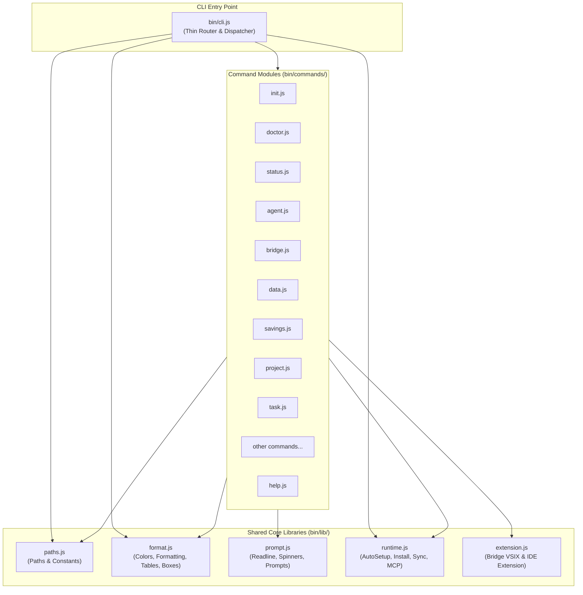

# Implementation Plan: Modular CLI Architecture Refactoring (`bin/cli.js`)

**Target Version**: `2.1.18` (Development, Unreleased)  
**Document**: `docs/PLAN.md`  
**Execution Environment**: Antigravity IDE / CLI  
**Author**: Sannin / Kage Architecture Review  
**Date**: 2026-10-14  

---

## 1. Goal Description

`bin/cli.js` is currently a monolithic **9,419-line** file containing 145 functions that combine:
1. Command-line argument parsing and command routing
2. Terminal styling, colors (`C`), and ASCII table/box rendering
3. Readline prompts, confirmation dialogues, and spinners
4. Installation runtime, MCP registration, auto-setup, and hooks
5. 27 canonical command implementations (ranging from 50 to 750 lines each)

This monolith makes maintenance risky, slows down team collaboration, increases code merge conflicts, and obscures domain boundaries.

The objective is to refactor `bin/cli.js` into a **modular, maintainable, high-performance CLI architecture** with a thin router (< 500 lines) in `bin/cli.js`, shared utilities in `bin/lib/`, and isolated, single-responsibility command handlers in `bin/commands/`.

---

## 2. User Review Required

> [!IMPORTANT]
> **Zero Breaking Changes to CLI Surface**: All CLI commands, subcommands, flags, options, exit codes, and output formatting will remain 100% identical. Users and automated callers will experience zero behavioral differences.

> [!IMPORTANT]
> **Test String Assertions Compatibility**: 5 existing test suites (`test_antigravity_bridge_contract.js`, `test_client_disconnect_and_bridge_scope.js`, `test_cross_client_contract.js`, `test_token_hygiene_and_platform.js`, `test_migrate_fallback.test.js`) read `bin/cli.js` directly with `fs.readFileSync` and check for specific code strings.
> Following the proven pattern already established by `test_ui_cross_platform_lifecycle.js` (which concatenates `bin/cli.js` and `bin/lib/ui_commands.js`), these tests will be updated to also inspect the newly extracted modules in `bin/lib/` and `bin/commands/`.

> [!WARNING]
> **Protected Systems Invariant**:
> - Token Savings Flow Logic (`tools_savings_logger.js`, baseline calculation) remains strictly untouched.
> - Bridge Gateway internals (`src/bridge_router.js`, bridge servers) remain strictly untouched.
> - Local commit only: No releases, no tag creation, no npm publishing.

---

## 3. Architecture Overview

### Current Monolithic Structure (9,419 lines)
```
bin/
├── cli.js                         (9,419 lines — EVERYTHING in 1 file)
└── lib/
    ├── paths.js                   (constants)
    ├── ui_commands.js             (web, ui, service subcommands)
    └── yaml_utils.js              (yaml helpers)
```

### Proposed Modular Architecture
```
bin/
├── cli.js                         (~450 lines: thin router, command dispatcher, signal handling)
├── lib/
│   ├── paths.js                   (existing: directory and database paths)
│   ├── format.js                  (NEW ~280 lines: C colors, log/info/warn/error/success, visual widths, table & box drawing)
│   ├── prompt.js                  (NEW ~180 lines: readline lifecycle, confirmPrompt, askQuestion, spinners)
│   ├── runtime.js                 (NEW ~580 lines: ensureAutoSetup, installCliRuntime, reconcileGlobalCommand, syncTemplateSkills, MCP & hook registration)
│   ├── extension.js               (NEW ~240 lines: autoInstallKonohaBridgeExtension, installExtensionViaCli, findIdeExecutable)
│   ├── ui_commands.js             (existing: web, ui, service subcommands)
│   └── yaml_utils.js              (existing: YAML parsing and dumping)
└── commands/
    ├── init.js                    (~680 lines: cmdInit, package cache purges, core directory setup)
    ├── doctor.js                  (~760 lines: cmdDoctor, diagnostic checks, self-healing repairs)
    ├── status.js                  (~420 lines: cmdStatus, integration health, system state)
    ├── agent.js                   (~520 lines: cmdAgent, startAgentTui, startAgentModelTui, cmdAgentModels, cmdAgentStatus)
    ├── bridge.js                  (~560 lines: cmdBridge, start/stop/restart/list/models/status/delete/enable/disable/create)
    ├── data.js                    (~530 lines: cmdData, view/prune/vacuum/rebuild-fts/backup/export/memory/add/search/delete)
    ├── migrate.js                 (~160 lines: cmdMigrate, cmdMigrateHelp, embedding triggers)
    ├── test.js                    (~240 lines: cmdTest, test runner execution)
    ├── savings.js                 (~330 lines: cmdSavings, telemetry tables, token savings reporting)
    ├── detect.js                  (~150 lines: cmdDetectAi, cmdDetectDocs)
    ├── project.js                 (~260 lines: cmdProject, project context management)
    ├── task.js                    (~220 lines: cmdTask, task filter parsing)
    ├── skill.js                   (~160 lines: cmdSkill, skill listing, adding, toggling)
    ├── upgrade.js                 (~250 lines: cmdUpgrade, semver comparison, update fetching)
    ├── version.js                 (~60 lines: cmdVersion, version reporting)
    ├── clean.js                   (~60 lines: cmdClean, cache and temp directory purging)
    ├── uninstall.js               (~270 lines: cmdUninstall, safe configuration removal)
    ├── soul.js                    (~80 lines: cmdSoul, Will of Fire tenets and archetype spirits)
    ├── search.js                  (~150 lines: cmdSearch, SearXNG / web search)
    ├── telegram.js                (~150 lines: cmdTelegram, bot notifier and polling lifecycle)
    ├── tunnel.js                  (~120 lines: cmdTunnel, cloudflare tunnel status/start/stop)
    ├── queue.js                   (~90 lines: cmdQueue, task queue status/drain)
    └── help.js                    (~120 lines: cmdHelp, ASCII logo, core command catalog, options)
```

### Architectural Data Flow Diagram



---

## 4. Proposed Changes Grouped by Phase

### Phase 1: Shared Core Libraries (`bin/lib/`)
Extract foundational rendering, terminal interaction, and runtime deployment logic so command handlers can import them without circular dependencies.

#### [NEW] `bin/lib/format.js`
- Export ANSI color constants `C = { reset, bold, dim, cyan, green, yellow, magenta, red, white, ... }`
- Export logging utilities: `log()`, `info()`, `success()`, `warn()`, `error()`, `header()`, `rgb()`, `applyGradient()`, `applyGradientToBorders()`, `getThemeForHeader()`
- Export visual string math: `isWideSymbol()`, `getVisualLength()`, `truncateVisual()`, `padEndVisual()`, `padStartVisual()`, `stripAnsi()`
- Export visual box/table renderers: `drawBox()`, `drawTable()`, `drawIntegrationRow()`, `drawLogo()`, `computeTableWidths()`, `getStatusTheme()`, `gradientStatusCell()`, `sectionTitle()`

#### [NEW] `bin/lib/prompt.js`
- Export prompt lifecycle: `askQuestion()`, `confirmPrompt()`, `closeReadline()`, `isCancel()`
- Export spinners: `startSpinner()`
- Export utility helpers: `fileExists()`, `ensureDir()`, `copyFile()`, `checkPython()`

#### [NEW] `bin/lib/runtime.js`
- Export runtime installation and auto-setup: `installCliRuntime()`, `reconcileGlobalCommand()`, `syncTemplateSkills()`, `_treeFingerprint()`, `copySkillsDirFast()`, `smokeTestKonohaFilesMcp()`, `installFileTools()`, `ensureAutoSetup()`, `updateGeminiMd()`, `moveUnusedSkills()`
- Export MCP registration helpers: `registerMcp()`, `registerPermissions()`, `unregisterPermissions()`, `registerHooks()`
- Export database schema and skill contract checkers: `hasCompleteDatabaseSchema()`, `detectSkillsDirs()`, `detectCustomSkills()`, `hasCanonicalGeninSkill()`, `verifySkillDatabaseContract()`

#### [NEW] `bin/lib/extension.js`
- Export IDE and bridge installers: `autoInstallKonohaBridgeExtension()`, `installExtensionViaCli()`, `findIdeExecutable()`
- Export tooling installers: `installUv()`, `getUvCommand()`, `refreshSemblePackage()`, `getUvxCommand()`, `getAgentBrowserCommand()`, `installAgentBrowser()`

---

### Phase 2: High-Volume Command Handlers (`bin/commands/`)
Extract the largest command implementations that account for over 4,500 lines of `bin/cli.js`.

#### [NEW] `bin/commands/doctor.js` (748 lines)
- `cmdDoctor(args)`: Comprehensive system diagnostics (SQLite schema, Python, MCP tools, permissions, file repair, agent sync, port bindings).
- `cmdDoctorHelp()`: Usage, options, flags.

#### [NEW] `bin/commands/init.js` (677 lines)
- `cmdInit(args, options)`: Interactive and non-interactive setup, package cache purging (`purgePackageCaches`), core directory setup (`ensureCoreDirectories`), client MCP server configuration.
- `cmdInitHelp()`: Help documentation.

#### [NEW] `bin/commands/agent.js` (520 lines)
- `cmdAgent(args)`: Subagent listing, creation, skill toggling, deletion, and status.
- `startAgentTui()`, `startAgentModelTui()`, `cmdAgentModels()`, `cmdAgentStatus()`, `cmdAgentHelp()`.

#### [NEW] `bin/commands/bridge.js` (560 lines)
- `cmdBridge(args)`: LLM Proxy Gateway management.
- `cmdBridgeStart()`, `cmdBridgeStop()`, `cmdBridgeRestart()`, `cmdBridgeList()`, `cmdBridgeModels()`, `cmdBridgeStatus()`, `cmdBridgeDelete()`, `cmdBridgeEnable()`, `cmdBridgeDisable()`, `cmdBridgeCreate()`, `loadBridges()`, `saveBridgeSqlite()`, `checkPortActive()`, `getNextAvailablePort()`, `cmdBridgeHelp()`.

#### [NEW] `bin/commands/data.js` (530 lines)
- `cmdData(args)`: SQLite data and memory management.
- `cmdDataView()`, `cmdDataPrune()`, `cmdDataVacuum()`, `cmdDataRebuildFts()`, `cmdDataBackup()`, `cmdDataExport()`, `cmdDataMemory()`, `cmdDataAdd()`, `cmdDataSearch()`, `cmdDataDelete()`, `cmdDataHelp()`.

#### [NEW] `bin/commands/status.js` (375 lines)
- `cmdStatus(args)`: Installation, daemon, skill count, model provider, and client status.
- `cmdStatusHelp()`.

---

### Phase 3: Standard Command Handlers (`bin/commands/`)
Extract all remaining subcommands into individual modules.

#### [NEW] `bin/commands/savings.js` (323 lines)
- `cmdSavings(args)`, `cmdSavingsHelp()`

#### [NEW] `bin/commands/project.js` (262 lines)
- `cmdProject(args)`, `cmdProjectHelp()`

#### [NEW] `bin/commands/uninstall.js` (267 lines)
- `cmdUninstall(args)`, `cmdUninstallHelp()`

#### [NEW] `bin/commands/upgrade.js` (241 lines)
- `cmdUpgrade(args)`, `cmdUpgradeHelp()`, `getActiveModels()`, `parseSemver()`, `semverCompare()`, `fetchJsonUrl()`, `getLatestVersion()`

#### [NEW] `bin/commands/test.js` (238 lines)
- `cmdTest(args)`, `cmdTestHelp()`

#### [NEW] `bin/commands/task.js` (215 lines)
- `cmdTask(args)`, `cmdTaskHelp()`, `parseTaskFilterFlags()`

#### [NEW] `bin/commands/skill.js` (160 lines)
- `cmdSkill(args)`, `cmdSkillHelp()`

#### [NEW] `bin/commands/migrate.js` (143 lines)
- `cmdMigrate(args)`, `cmdMigrateHelp()`

#### [NEW] `bin/commands/detect.js` (132 lines)
- `cmdDetectAi(args)`, `cmdDetectAiHelp()`, `cmdDetectDocs(args)`, `cmdDetectDocsHelp()`

#### [NEW] `bin/commands/search.js` (134 lines)
- `cmdSearch(args)`

#### [NEW] `bin/commands/telegram.js` (133 lines)
- `cmdTelegram(args)`

#### [NEW] `bin/commands/tunnel.js` (106 lines)
- `cmdTunnel(args)`

#### [NEW] `bin/commands/queue.js` (85 lines)
- `cmdQueue(args)`

#### [NEW] `bin/commands/soul.js` (63 lines)
- `cmdSoul(args)`

#### [NEW] `bin/commands/version.js` (56 lines)
- `cmdVersion(args)`, `cmdVersionHelp()`, `getCliVersion()`

#### [NEW] `bin/commands/clean.js` (52 lines)
- `cmdClean(args)`, `cmdCleanHelp()`

#### [NEW] `bin/commands/help.js` (120 lines)
- `cmdHelp()`: Top-level help documentation, ASCII logo banner, command categories table.

---

### Phase 4: Refactored `bin/cli.js` Router (< 450 lines)

#### [MODIFY] `bin/cli.js`
- Imports commands and shared libraries:
  ```js
  #!/usr/bin/env node
  'use strict';

  const path = require('path');
  const { C, log, error } = require('./lib/format');
  const { closeReadline } = require('./lib/prompt');
  const {
    ensureAutoSetup,
    installCliRuntime,
    reconcileGlobalCommand,
    syncTemplateSkills
  } = require('./lib/runtime');
  const { ensureUiDaemonAutoStart, cmdUi, cmdWeb, cmdUiService } = require('./lib/ui_commands');

  // Command handlers
  const { cmdInit } = require('./commands/init');
  const { cmdMigrate } = require('./commands/migrate');
  const { cmdTest } = require('./commands/test');
  const { cmdStatus } = require('./commands/status');
  const { cmdDoctor } = require('./commands/doctor');
  const { cmdUninstall } = require('./commands/uninstall');
  const { cmdClean } = require('./commands/clean');
  const { cmdSavings } = require('./commands/savings');
  const { cmdDetectAi, cmdDetectDocs } = require('./commands/detect');
  const { cmdSkill } = require('./commands/skill');
  const { cmdAgent } = require('./commands/agent');
  const { cmdVersion } = require('./commands/version');
  const { cmdUpgrade } = require('./commands/upgrade');
  const { cmdProject } = require('./commands/project');
  const { cmdTask } = require('./commands/task');
  const { cmdData } = require('./commands/data');
  const { cmdSoul } = require('./commands/soul');
  const { cmdBridge } = require('./commands/bridge');
  const { cmdSearch } = require('./commands/search');
  const { cmdTelegram } = require('./commands/telegram');
  const { cmdTunnel } = require('./commands/tunnel');
  const { cmdQueue } = require('./commands/queue');
  const { cmdHelp } = require('./commands/help');
  ```
- Maintains the canonical `main()` switch dispatcher:
  ```js
  const command = process.argv[2];
  const args = process.argv.slice(3);

  async function main() {
    // Silent auto-setup on every command (except help/uninstall/version)
    const skipAutoSetup = ['uninstall', 'help', '--help', '-h', '--version', '-v', 'version'].includes(command);
    if (!skipAutoSetup) {
      try { ensureAutoSetup(); } catch (_) {}
    }

    // Auto-start Web UI daemon silently in background
    const skipUiAuto = ['ui', 'web', 'service', 'uninstall', 'help', '--help', '-h', '--version', '-v', 'version'].includes(command);
    if (!skipUiAuto) {
      ensureUiDaemonAutoStart({ silent: true }).catch(() => {});
    }

    try {
      switch (command) {
        case 'init':
        case 'reinstall':
          if (command === 'reinstall' && !args.includes('--force')) args.push('--force');
          await cmdInit(args);
          break;
        case 'migrate':
          await cmdMigrate(args);
          break;
        case 'embed':
          if (!args.includes('--rebuild-embeddings')) args.push('--rebuild-embeddings');
          await cmdMigrate(args);
          break;
        case 'test':
          await cmdTest(args);
          break;
        case 'status':
          await cmdStatus(args);
          break;
        case 'savings':
          await cmdSavings(args);
          break;
        case 'detect-ai':
          await cmdDetectAi(args);
          break;
        case 'detect-docs':
          await cmdDetectDocs(args);
          break;
        case 'doctor':
          await cmdDoctor(args);
          break;
        case 'clean':
          await cmdClean(args);
          break;
        case 'uninstall':
          await cmdUninstall(args);
          break;
        case 'web':
          await cmdWeb(args);
          break;
        case 'ui':
          await cmdUi(args);
          break;
        case 'service':
          await cmdUiService(args);
          break;
        case 'version':
        case '--version':
        case '-v':
          await cmdVersion(args);
          break;
        case 'upgrade':
          await cmdUpgrade(args);
          break;
        case 'skill':
          await cmdSkill(args);
          break;
        case 'agent':
          await cmdAgent(args);
          break;
        case 'data':
          await cmdData(args);
          break;
        case 'soul':
          await cmdSoul(args);
          break;
        case 'project':
          await cmdProject(args);
          break;
        case 'task':
          await cmdTask(args);
          break;
        case 'bridge':
          await cmdBridge(args);
          break;
        case 'search':
          await cmdSearch(args);
          break;
        case 'telegram':
          await cmdTelegram(args);
          break;
        case 'tunnel':
          await cmdTunnel(args);
          break;
        case 'queue':
          await cmdQueue(args);
          break;
        case 'help':
        case '--help':
        case '-h':
        case undefined:
          await cmdHelp();
          break;
        default:
          error(`Unknown command: ${command}`);
          log(`Run ${C.cyan}konoha help${C.reset} for usage.`);
          process.exit(1);
      }
    } finally {
      closeReadline();
    }
  }
  ```
- Retains backwards-compatible exports:
  ```js
  module.exports = {
    syncTemplateSkills,
    installCliRuntime,
    reconcileGlobalCommand,
    ensureUiDaemonAutoStart
  };
  ```

---

### Phase 5: Test Suite Updates for Modular Source Inspection

#### [MODIFY] `tests/test_antigravity_bridge_contract.js`
- Update source inspection to read `bin/cli.js` + `bin/lib/extension.js` (where `autoInstallKonohaBridgeExtension` resides).

#### [MODIFY] `tests/test_client_disconnect_and_bridge_scope.js`
- Update source inspection to read `bin/cli.js` + `bin/lib/extension.js` (where `installExtensionViaCli` resides).

#### [MODIFY] `tests/test_cross_client_contract.js`
- Update source inspection to read `bin/cli.js` + `bin/lib/runtime.js` + `bin/lib/extension.js`.

#### [MODIFY] `tests/test_token_hygiene_and_platform.js`
- Update source inspection to read `bin/cli.js` + `bin/lib/runtime.js` + `bin/commands/doctor.js`.

#### [MODIFY] `tests/test_migrate_fallback.test.js`
- Update source inspection to read `bin/cli.js` + `bin/commands/migrate.js`.

---

## 5. Verification Plan

### Automated Tests
Run the entire CLI test suite sequentially:
```bash
node tests/run_all.js cli
```
Run individual targeted test suites to confirm zero regressions:
```bash
node tests/test_cli_canonical_subcommands.js
node tests/test_cli_help_contract.js
node tests/test_cli_implied_flags.js
node tests/test_cli_project_commands.js
node tests/test_cli_removed_aliases_router.js
node tests/test_client_disconnect_and_bridge_scope.js
node tests/test_antigravity_bridge_contract.js
node tests/test_cross_client_contract.js
node tests/test_token_hygiene_and_platform.js
node tests/test_migrate_fallback.test.js
node tests/test_package_tarball_files.js
node tests/test_soul_engine.js
node tests/test_version_sync.js
```

### Biome Linter & AI Slop Gate
```bash
npm run lint
rtk aislop scan --changes
```
Must pass with **0 errors**, **0 warnings**, and a **100/100** aislop score.

### Package Tarball Verification
Verify that `npm pack --dry-run` automatically packages all new `bin/commands/*.js` and `bin/lib/*.js` files (governed by `"files": ["bin/", ...]`) without including forbidden artifacts.
```bash
npm pack --dry-run
```

### Manual CLI Smoke Verification (in Sandbox Home)
Test top-level CLI commands to ensure output fidelity:
```bash
env HOME="/tmp/konoha-modular-test" KONOHA_UI_AUTOSTART=0 node bin/cli.js --version
env HOME="/tmp/konoha-modular-test" KONOHA_UI_AUTOSTART=0 node bin/cli.js help
env HOME="/tmp/konoha-modular-test" KONOHA_UI_AUTOSTART=0 node bin/cli.js soul
env HOME="/tmp/konoha-modular-test" KONOHA_UI_AUTOSTART=0 node bin/cli.js status
```

---

## 6. Step-by-Step Execution Sequence

1. **User Approval**: Review this plan and approve execution.
2. **Phase 1 Execution**: Create `bin/lib/format.js`, `bin/lib/prompt.js`, `bin/lib/runtime.js`, `bin/lib/extension.js`. Run linter.
3. **Phase 2 Execution**: Create `bin/commands/` directory. Extract heavy handlers: `doctor.js`, `init.js`, `agent.js`, `bridge.js`, `data.js`, `status.js`.
4. **Phase 3 Execution**: Extract standard handlers: `savings.js`, `detect.js`, `project.js`, `task.js`, `skill.js`, `upgrade.js`, `version.js`, `clean.js`, `uninstall.js`, `soul.js`, `search.js`, `telegram.js`, `tunnel.js`, `queue.js`, `test.js`, `migrate.js`, `help.js`.
5. **Phase 4 Execution**: Refactor `bin/cli.js` into the clean, modular router (< 450 lines).
6. **Phase 5 Execution**: Update test source readers in the 5 test suites. Execute `node tests/run_all.js cli`.
7. **Phase 6 Verification**: Execute `npm run lint` and `rtk aislop scan --changes`. Run documentation checks `npm run test:docs`.
8. **Local Commit**: Create clean atomic local commit with username `andycungkrinx91`.
