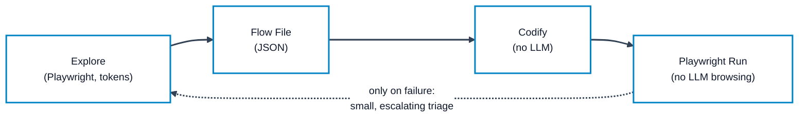
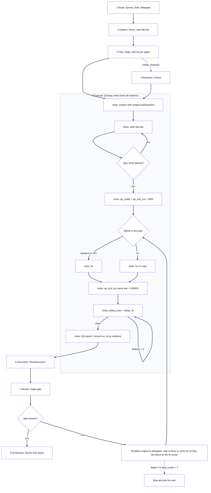

# QA Automation Architecture & Token-Efficient Workflow

The **QA Automation Workflow** integrates Playwright into Konoha's 8-phase SDLC architecture, owned end-to-end by **Anbu**. It guarantees bounded token consumption, zero AI slop, and verifiable tool evidence across all automated test loops.

## Core Philosophy

Browsing web applications using LLMs is expensive in token consumption. Re-running a known test scenario should cost **zero LLM tokens**.

1. **Explore once** with a throwaway Playwright script (scoped `locator().ariaSnapshot()`; captures console & network errors).
2. **Save working steps** as a *flow file* (`.json` array of semantic commands).
3. **Codify automatically** via `qa_codify` into a deterministic Playwright test, compiled and run once before it is emitted (zero LLM involved).
4. **Run and re-run with Playwright** via `qa_e2e_run` with compact, capped summaries (zero LLM browsing).

> [!IMPORTANT]
> **Prerequisite: Playwright in the target project.** Verify with `pnpm exec playwright --version` before step 1. Playwright is a hard requirement for QA only — it is already a runtime dependency of Konoha, so the core install never fails on it. The target project owns the version, the browser cache, and `PLAYWRIGHT_BROWSERS_PATH`; install browsers once with `pnpm exec playwright install chromium`.
>
> When no Playwright project resolves above the output path, `qa_codify` returns `{ ok: false, error: 'qa_blocked', reason: 'playwright-not-installed', fix: 'pnpm exec playwright install chromium' }` and emits no spec. `qa_e2e_run` shells out to the same runner and shares the prerequisite. Record a blocked browser as **BLOCKED**, never as a pass.
>
> There is no pinned CLI and no global resolution chain: a second Playwright install diverges from the project's pinned browser build and produces version-skew failures that look like product bugs.



---

## Canonical Flow Diagram



---

## Token Rules & Budgets

| Operation | Strategy | Rationale |
|---|---|---|
| **Snapshot Scoping** | `page.locator(scope).ariaSnapshot()`; guard the selector with `count()` and fall back to `body`, never `html` | Minimizes accessibility tree size; excludes static structural nodes without timing out on absent containers. |
| **Differential Inspection** | Re-query a locator (`textContent`, `isVisible`, `waitFor`) instead of a second snapshot | Avoids reloading the entire accessibility tree into context. |
| **Visual Evidence** | Max 2 screenshots per finding (`~/.konoha/tmp/qa/`, JPEG q60) | Prevents image token bloat. |
| **Batch Execution** | One script run, one `chromium.launch()` | Single round-trip execution for sequential commands. |
| **State Persistence** | `context.storageState({ path: '~/.konoha/tmp/qa/state/auth.json' })`, replayed via `browser.newContext({ storageState })` | Reuses session cookies instead of repeating login flows. |
| **Output Cap** | Max 4,000 characters per interaction; max 15 actions per area without findings | Prevents runaway page output flooding LLM context. |

---

## Zero-Slop & Zero-Hallucination Contract

Every QA claim in Konoha must be backed by concrete tool execution output:

| Claim | Required Verification Evidence |
|---|---|
| Route / Selector exists | Genin cites exact `file:line` from Semble codebase exploration. |
| Flow works | `qa_codify` compile + Playwright run exit 0 on that flow file hash. |
| Bug confirmed | RED `qa_e2e_run` summary with unique `run_id` for the codified spec. |
| Bug fixed | GREEN `qa_e2e_run` summary with unique `run_id` on the same test spec. |
| Clean scope | Documented as `none found in <scope>, <N> actions` (never "bug-free"). |

### Strict Anti-Fake Green Rules
- No `test.skip`, `test.fixme`, `.only`, or `try/catch` wrapping assertions.
- No weakening assertions or increasing timeouts to force a passing run.
- Tests failing due to application defects must be resolved in application code.

### Anti-Slop & Persona Prompt Invariants
- **Placeholder Detection Boundary (G-07):** The placeholder comment regex strictly matches standalone stubs (`// placeholder`, `// placeholder.`, `// placeholder - stub`, `/* placeholder */`) while preserving descriptive English comments (`// Placeholder regex markers...`).
- **Compact Persona Budget (G-03):** Compact mode system prompts mathematically enforce a strict 1,400-byte cap for the agent persona block (including headers, Instructions, Constraints, and the 16-character truncation suffix margin), guaranteeing that Constraints are permanently preserved and never pushed out of context.
- **Direct Specialist Delegation & Reporting (G-18):** `report_from_agent` strictly rejects callers with `delegate_to_*` prefixes, requiring direct specialist names (`anbu`, `jonin`, etc.).

### Database Concurrency, Mutation Atomicity & Client Config Preservation (G-08, G-02a, G-16)
- **SQLite Concurrency & Upfront Write Locking (G-08):** `Database.prototype.transaction()` acquires a write lock upfront at transaction entry using `BEGIN IMMEDIATE`. In SQLite WAL mode, this prevents concurrent processes from interleaving read-modify-write workflows, eliminating `SQLITE_BUSY` ("database is locked") deadlocks. Nested transaction calls cleanly map to SQLite savepoints (`SAVEPOINT konoha_sp_${depth}`).
- **Atomic Multi-Statement Writes (G-02a):** Multi-statement data modifications across `src/persona_memory.js` (`saveOrUpdateProject`, `saveMemory`, `deleteProject`, `pruneAllProjects`, `pruneProjectMemories`) and `src/db_agents.js` (`importYamlToDb`, `autoMigrateYamlToDb`, `bulkImportAgents`) execute inside atomic transactions (`conn.transaction(...)`), preventing partial mutations or table wipeouts on process interruption or transient failures.
- **Client Configuration Preservation & Pristine Backup (G-16):** Writers for OpenAI Codex (`~/.codex/config.toml`) and OpenCode (`~/.config/opencode/opencode.json`) automatically create a pristine backup copy (`.bak`) before modifying developer configurations, creating the backup only if it does not already exist so that subsequent runs never overwrite the initial user backup. Furthermore, Codex config generation preserves user-defined custom agent tables and top-level user settings byte-for-byte without emitting duplicate tables.

---

## MCP Tools Reference

### 1. `qa_codify`
- **Signature**: `qa_codify(flow_path, out_path, name, lang?, skip_verification?)`
- **Access**: Granted to **Anbu** only.
- **Verification Gate**: Compiles the flow to `.konoha-verify-<flowHash12>.spec.js` next to `out_path`, runs it with the project's Playwright, and deletes it on exit 0. A failing step returns `{ ok: false, error: 'flow-failed' }` with trimmed reporter output and emits no test code.
- **Lint Guard**: Rejects transient `@e` refs and forbidden test directives (`skip`, `fixme`, `pause`, sleeps).

### 2. `qa_e2e_run`
- **Signature**: `qa_e2e_run(project_path, grep?, last_failed?, max_failures?)`
- **Access**: Granted to **Anbu** only.
- **Summary Cap**: Hard output cap under 2,000 characters.
- **Evidence Output**: Emits a unique `run_id`, test duration, totals, file hashes, and first 12 lines of failure messages (ANSI stripped).

---

## Measured Token Reductions (Measured Snapshot)

Measurements conducted on Konoha Web UI (`/detector` route):

| Inspection Method | Raw Characters | Estimated Tokens | Reduction vs Bare |
|---|---|---|---|
| Raw Playwright JSON Report | 8,420 chars | ~2,105 tokens | Baseline (0%) |
| `qa_e2e_run` Compact Summary | 275 chars | ~68 tokens | **96.7% reduction** |
| Subsequent Playwright Re-runs | 0 tokens | 0 tokens | **100% reduction** |

*Note: Token counts are measured snapshots from the local test environment and vary depending on page DOM complexity.*

---

## What QA Writes and Where

| Path | Created by | Handling |
|---|---|---|
| `~/.konoha/tmp/qa/<run_id>/` | `qa_e2e_run`: `report.json`, copied failure traces (`trace-*.zip`) and screenshots (`screenshot-*.png`) | Outside the project. Pruned by retention. |
| `~/.konoha/tmp/qa/projects/<hash>/` | `qa_e2e_run`: Playwright working directory, including artifacts and `.last-run.json` | Outside the project. Stable per project hash. Never pruned by retention. |
| `~/.konoha/tmp/qa/state/` | Exploration scripts: `context.storageState()` snapshots | Outside the project. Never pruned. |
| `test-results/`, `playwright-report/`, `blob-report/`, `playwright/.cache/` | Playwright defaults (if triggered directly by user or manual run) | Ephemeral. Ignored via managed `.gitignore` block. |
| `<test-dir>/e2e/flows/`, specs, `reports/` | `qa_codify`, Anbu | **Deliverables. Version-controlled. Never ignored, never pruned.** |

### Retention Rules & Tunables

1. **Execution Timing**: Retention executes at the end of every `qa_e2e_run` after the current run folder is populated.
2. **Target Scope**: Direct children of `~/.konoha/tmp/qa/` matching `^qa-\d+-[a-f0-9]+$` only. `state/`, `projects/`, and other folders are strictly ignored.
3. **Retention Count**: Keeps the newest $N$ runs (default $N = 20$). Tunable via environment variable `KONOHA_QA_RETENTION_COUNT=<N>`.
4. **Task Evidence Protection**: Never deletes a run whose `run_id` is recorded as validation evidence on an open SDLC task (`status != 'completed'`).
5. **Lookup Fallback**: If the SDLC evidence database is unavailable, retention deletes nothing younger than 7 days and reports `retention: evidence lookup unavailable`.
6. **Task Record Preservation**: A completed SDLC task permanently retains its `run_id`, summary, file hashes, and status in SQLite `sdlc_tasks` even after raw test traces and reports are pruned.

### Managed `.gitignore` Block (Fallback)

1. **Placement**: Placed inside `<project_path>/.gitignore` in a managed block between `# KONOHA-QA-START` and `# KONOHA-QA-END`.
2. **Git Project Check**: Verified by checking for `.git` directory or file in `project_path` or ancestor directories. Non-git folders are never modified.
3. **Opt-Out**: Disable automated `.gitignore` injection by setting `KONOHA_QA_GITIGNORE=0`.
4. **Pre-Existing Committed Files Limit**: Adding an entry to `.gitignore` does not untrack files that have already been committed to git history. Users must untrack previously committed artifact directories manually.

---

## Test Suite Runner & Isolation Contract (G-01, G-17)

Konoha's test runner (`tests/run_all.js`, executed via `pnpm test` or `node tests/run_all.js [--parallel]`) enforces multi-tenant test isolation. It discovers every `tests/test_*.js`, `tests/*.test.js`, and `tests/verify_*.js` file, minus the unreleased `tests/test_yamanaka_*.js` suites (named in the run banner; still runnable by passing one as the filter), so a new suite is discovered without editing a list.

Every test and lint entry point in `package.json` is routed through `scripts/rtk_exec.js`, so suite output reaches the orchestrating model as a failure-focused summary instead of thousands of raw lines:

- Mode follows the command: test runners use `rtk test` (failures only), the lint gate uses `rtk err` (errors and warnings only), anything else uses the plain RTK proxy. `KONOHA_RTK_MODE=test|err|plain` overrides the choice.
- `scripts/rtk_exec.js` resolves RTK through `getRtkCommand()` (PATH, `~/.local/bin`, `~/.cargo/bin`, `/usr/bin`, `/opt/homebrew/bin`, `%LOCALAPPDATA%`), so Linux, macOS, and Windows take the same path.
- When RTK is missing the wrapped command still runs unchanged, and the wrapper prints `[rtk_exec] RTK unavailable` to stderr: no CI image or user machine is blocked by the wrapper.
- `KONOHA_RTK_DISABLE=1` bypasses wrapping for debugging; `KONOHA_RTK_CMD=/path/to/rtk` pins a specific binary.
- Child exit codes are propagated verbatim, so the wrapper never hides a failing suite.

Installing RTK itself, per platform:

```bash
winget install rtk-ai.rtk                                             # Windows
brew install rtk                                                      # macOS
cargo install --git https://github.com/rtk-ai/rtk                     # Linux (needs a Rust toolchain)
```

Measured on a 400-line noisy suite fixture (`tests/fixtures/rtk_exec_noisy.js`): 29,513 B of raw stdout becomes 352 B through `rtk test`, and a fixture exiting 5 still exits 5. Note that the plain `rtk <cmd>` proxy does **not** shrink piped stdout — compression comes from the `test` and `err` subcommands, which is why the wrapper selects them explicitly instead of prefixing `rtk` blindly.

Isolation contract:

Three different things in this repo are called a sandbox. They do not nest, and a green run in one proves nothing about the others:

| Layer | Mechanism | What it isolates | Not what |
|---|---|---|---|
| **Container gate** | `pnpm test:sandbox` → `docker/sandbox.Dockerfile` (or `KONOHA_SANDBOX_RUNTIME=container`) | The whole host from `pnpm lint` + `pnpm test` + fresh-install smoke: read-only `/src`, container `HOME`, pnpm store and Playwright cache in named volumes | Not the `apps/web` e2e specs, and not the QA tools |
| **Runner + guard** | `tests/run_all.js` env overrides, plus `assertSandbox()` from `tests/helpers/sandbox_guard.js` | `HOME`/`USERPROFILE`/`KONOHA_DB_PATH` per suite, and refusal to run a mutating suite against the real `$HOME` | Not a container: it protects files, not the process or network |
| **QA tool** | `qa_e2e_run` / `qa_codify` shelling out to the target project's `pnpm exec playwright` | Nothing but the auth file and the rate limiter — the project runs on the host as-is | Not the container gate; a project with no Playwright reports `qa_blocked` instead of being containerized |

1. **Golden Seed & Snapshot Isolation (G-01)**:
   - The runner initializes or reuses a seeded template environment (`$TMPDIR/konoha_golden_seed_*`, holding a pre-configured `konoha.db` and runtime files, built once with `init --yes` under a scratch `HOME`). A candidate seed is reused only when it is complete, its recorded version matches `package.json`, its source fingerprint matches the current `src/`/`bin/` tree, and its copied fingerprint still matches the seed itself — so a stale seed from a previous build is rebuilt instead of silently tested.
   - Before launching each test suite, the runner creates a dedicated, ephemeral snapshot directory (`$TMPDIR/konoha_suite_*`) via `cp -a --reflink=auto --no-preserve=ownership`. The ownership flag matters inside containers, where the seed was written by a different uid and a preserved ownership would make the copy unwritable. Where no `cp` exists (Windows) the fallback is `fs.cpSync`, which would have to recreate the seed's `.konoha/node_modules` symlink — on Windows that needs Developer Mode or elevation, and when it fails the walk covers the whole dependency tree (~21k files) once per suite. That one path is excluded from the walk and rebuilt as a junction, which needs no privilege.
   - The seed is warmed once before any suite is scheduled, so its build is never attributed to a suite's duration and never blocks the other workers mid-run. `KONOHA_SEED_DIR` names a seed explicitly (CI restores one from a cache and does not want a rebuild); when set it is the only candidate, so a cache miss cannot silently reuse an unrelated seed from `$TMPDIR`, and a non-empty directory that is not a seed is refused rather than deleted. `node tests/run_all.js --seed-only` builds or validates the seed and exits without running suites.
   - Each suite process is executed with isolated environment overrides:
     - `HOME`: points to the ephemeral suite snapshot directory.
     - `USERPROFILE`: the same directory. `os.homedir()` reads `USERPROFILE` on win32 and ignores `HOME`, so without it a suite that calls `os.homedir()` escapes the sandbox while the product reads `HOME` — the two then disagree mid-suite.
     - `KONOHA_DB_PATH`: points to `$HOME/.konoha/konoha.db`.
     - `KONOHA_UI_AUTOSTART`: set to `'0'` by default. `tests/test_ui_autostart.js` is the exception — the runner deletes the variable for that suite, because the suite asserts that autostart *happens* and that `'0'` suppresses it.
     - `PYTHONUSERBASE`: points to a read-only scratch directory under `/tmp`.
     - `KONOHA_TEST_SANDBOX`: set to `'1'`.
   - Upon suite completion, the ephemeral snapshot directory is purged, ensuring zero cross-suite mutations and zero writes to the user's real `$HOME`.
   - The suite list can be split across machines with `--shard=I/N` or `KONOHA_TEST_SHARD=I/N`. Assignment is round-robin over the discovered order (`tests/helpers/shard.js`), so the shards partition the list exactly once and need no duration data; a selector that does not parse or whose index is out of range exits 2 instead of silently running everything, and a shard that selects no suite exits 2 instead of reporting an empty run as passing.

2. **Standalone Guard for Mutating Test Suites (G-17)**:
   - Mutating test suites (`test_web_ui.js`, `test_official_agent_protection.js`, `test_telegram_session_manager.js`, `test_telegram_integration.js`) invoke `assertSandbox()` from `tests/helpers/sandbox_guard.js` at entry.
   - If executed directly against the real user `$HOME` without `KONOHA_TEST_SANDBOX=1` or with `HOME === os.userInfo().homedir`, the suite throws an `Error` and terminates immediately.
   - To run a mutating test suite standalone in manual debugging, developers must supply a sandboxed HOME:
     ```bash
     HOME=$(mktemp -d) KONOHA_TEST_SANDBOX=1 node tests/test_web_ui.js
     ```
   - The default gate is the container sandbox, which needs no manual HOME juggling:
     ```bash
     pnpm test:sandbox            # full suite, container-local HOME and /tmp
     pnpm test:sandbox -- --lint  # fast path
     ```
     See [Container sandbox](CI.md#container-sandbox-rule-12). The `mktemp` form above is the fallback for machines with neither engine; on Apple-silicon macOS, `KONOHA_SANDBOX_RUNTIME=container pnpm test:sandbox` runs the same image through [apple/container](https://github.com/apple/container) without Docker Desktop.
