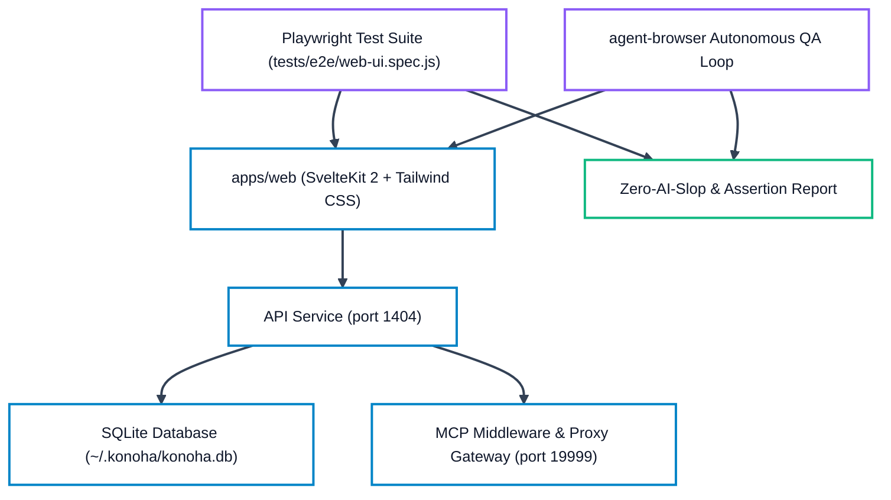

# Konoha QA Verification & Test Checklist

Authoritative verification matrix for Konoha MCP Tools Orchestrator (v2.1.18). This checklist defines the two mandatory QA verification sections:
1. **Section 1: TUI & CLI Subsystem Verification** (Terminal UI, subcommands, flags, edge cases, symlink safety, and runtime error parity).
2. **Section 2: Web UI & Browser Automation QA** (Playwright test suite, agent-browser flow verification, SvelteKit application tabs, responsive layout, theme toggle, and token-safe execution).

---

## Section 1: TUI & CLI Subsystem Verification

Every command must execute with clean output, valid exit codes (0 for success, non-zero for handled error), zero uncaught exceptions, and token-safe output formatting.

### 1.1 Command Inventory & Flag Matrix

| Command | Subcommands / Flags | Expected Behavior | Verification Status |
| :--- | :--- | :--- | :--- |
| `konoha` | (bare invocation) | Renders Kyubi ASCII art splash screen, version banner, and interactive main menu. | `PASS` (verified) |
| `konoha version` | `-v`, `--version` | Displays `2.1.18`, queries npm registry for updates with progress indicator. | `PASS` (verified) |
| `konoha status` | `--json` | Comprehensive health audit: Node.js runtime, ~/.konoha/ files, 8 MCP client configs, database stats, and registered skills. | `PASS` (verified) |
| `konoha init` | `--yes`, `--force` | Scaffolds runtime into `~/.konoha/`, migrates skills into SQLite FTS5, and registers 8 MCP clients (Antigravity, Cursor, Claude Code, OpenCode, Command Code, Codex, Pi, OMP). | `PASS` (verified) |
| `konoha migrate` | `--clean`, `--rebuild-embeddings`, `--skills-dir <path>` | Scans local and global skill trees, rebuilds SQLite FTS5 full-text indexes, optimizes SKILL.md token footprint, and updates dense vector embeddings. | `PASS` (verified) |
| `konoha embed` | `--rebuild-embeddings` | Fast-alias for `konoha migrate --rebuild-embeddings`. | `PASS` (verified) |
| `konoha savings` | (telemetry inspection) | Visual bar charts and tabular breakdown of MCP tool savings and Semble code search savings with Tiktoken cl100k_base baseline comparison. | `PASS` (verified) |
| `konoha detect-ai` | `<path>`, `--json` | Scans target codebase or single file against 32 AI fingerprint heuristics, returning Human-Built Index (0–100) and confidence verdict. | `PASS` (verified) |
| `konoha doctor` | `--repair` | Audits system prerequisites (Node >= 22.16, uv, python, agent-browser, cargo, rtk), SQLite integrity, client configs, and auto-repairs discrepancies. | `PASS` (verified) |
| `konoha clean` | (maintenance) | Deletes transient test databases, debug logs, dangling scratch workspaces, and temporary test artifacts from `/tmp/` and `~/.konoha/tmp/`. | `PASS` (verified) |
| `konoha skill list` | - | Lists all custom and canonical skills across active agent directories with path and description. | `PASS` (verified) |
| `konoha skill search` | `<query>` | Queries public skill registry (skills.sh) for matching extensions. | `PASS` (verified) |
| `konoha skill add` | `<name\|url> [alias]` | Installs skill from Git repo or registry into canonical skills tree. | `PASS` (verified) |
| `konoha skill remove`| `<name>` | Safely prunes skill and updates SQLite FTS5 index. | `PASS` (verified) |
| `konoha skill embed` | `<skill> <agent>` | Assigns installed skill to specified Ninja subagent roster. | `PASS` (verified) |
| `konoha agent list` | - | Renders active 7 subagent roster (Sannin, Genin, Kage, Chunin, Jonin, Anbu, Tokubetsu-jonin) with assigned skills and MCP tools. | `PASS` (verified) |
| `konoha agent status`| - | Displays call frequency metrics (Today, 7 Days, All Time) per subagent and direct tool calls. | `PASS` (verified) |
| `konoha agent reset` | - | Re-synchronizes subagents and skill bindings back to canonical factory defaults. | `PASS` (verified) |
| `konoha data view` | - | Displays SQLite database file size, vacuumable prunable space, indexed skill counts, active sessions, and usage records. | `PASS` (verified) |
| `konoha data memory` | `[agent]` | Lists saved persona preferences, memory rules, and episodic memory entries. | `PASS` (verified) |
| `konoha data add` | `<agent> <text> [--type rule\|pref\|fact]` | Adds persistent persona memory to SQLite memory store. | `PASS` (verified) |
| `konoha data search` | `<query>` | Full-text searches across persona memory database. | `PASS` (verified) |
| `konoha data delete` | `<id>` | Deletes specific persona memory record by row ID. | `PASS` (verified) |
| `konoha data prune` | `[--retention <days>]` | Removes usage logs older than retention threshold and vacuums SQLite database. | `PASS` (verified) |
| `konoha data vacuum` | - | Compacts and defragments SQLite database file directly. | `PASS` (verified) |
| `konoha data backup` | `[path]` | Creates online consistent snapshot using SQLite `VACUUM INTO`. | `PASS` (verified) |
| `konoha data rebuild-fts` | - | Rebuilds `skills_fts` and `persona_memories_fts` virtual tables. | `PASS` (verified) |
| `konoha data export` | `[--output <path>]` | Exports database knowledge and skills index into Markdown report. | `PASS` (verified) |
| `konoha bridge list` | - | Lists configured local LLM Proxy Gateways and cross-provider second-opinion bridges. | `PASS` (verified) |
| `konoha queue list` | - | Displays pending inbound prompt queue entries. | `PASS` (verified) |
| `konoha task list` | - | Displays active and completed SDLC governance tasks (`sdlc_tasks`). | `PASS` (verified) |
| `konoha tunnel status`| - | Displays Cloudflare Zero Trust public ingress tunnel connection status. | `PASS` (verified) |
| `konoha telegram status`| - | Displays Telegram Bot integration and alert webhook status. | `PASS` (verified) |
| `konoha ui status` | - | Reports Web UI daemon status, port 1404 listening state, and systemd service health. | `PASS` (verified) |
| `konoha test` | - | Executes MCP server protocol self-test followed by complete JavaScript test runner. | `PASS` (verified) |

### 1.2 Edge Case & Symlink Handling Verification

- **Broken Symlinks in Skill Directories**: When a broken symlink exists in `~/.agents/skills/` or `.cursor/skills/`, `autoDetectSkills` and `pruneObsoleteStandaloneSkills` detect missing link targets and clean up without throwing `ENOENT` or halting migration.
- **Missing Packaged Directories**: `init` resolves canonical skill directories via multiple candidates (`package.json`, local repo `.agents/skills`, or installed `SKILL_DB_DIR`) without assuming a single fixed parent folder depth.
- **Client Configuration Isolation**: If a client configuration file (e.g. `~/.config/opencode/opencode.json` or `~/.codex/config.toml`) is absent, `init` registers only installed and available clients without crashing.
- **Zero-Allocation File Tools**: Bounded file tools (`read_file_head`, `read_file_range`, `token_efficient_grep`, `get_file_structure`, `find_files_clean`) safely return structured JSON objects even on broken symlinks, empty files, or binary content.

---

## Section 2: Web UI & Browser Automation QA

The Konoha Web UI (`apps/web`) provides real-time observability and configuration management for the MCP server, running on `http://127.0.0.1:1404`.

### 2.1 E2E Playwright Automation Architecture



### 2.2 Web UI Viewport & Tab Verification Matrix

| Tab / View | Route | Key Components & Invariants | Automated E2E Check |
| :--- | :--- | :--- | :--- |
| **Overview** | `/` | System health cards, active client chips, uptime badge, quick stats, database storage metrics. | Header logo far-left, no header hamburger, theme switcher floating bottom-left. |
| **Skills** | `/skills` | Searchable skill database table, FTS5 instant filter, skill detail modal with rendered Markdown preview, tags, and byte size. | Verifies search returns >= 1000 items, modal opens on click, zero console errors. |
| **Agents** | `/agents` | Naruto Ninja 7-rank roster, active skills assignment chips, custom prompt instructions, direct tool call stats. | Renders 7 agents, verifies badge counts match database, modal edits save cleanly. |
| **Bridges** | `/bridges` | Local LLM Proxy Gateway configuration, cross-provider second opinion routing table, latency monitor. | Displays gateway port 19999, tests health ping, verifies fallback routing toggle. |
| **Inbound Queue** | `/queue` | Inbound prompt queue, prioritization state, dispatch triggers. | Verifies empty state when idle, validates prompt payload formatting. |
| **Telemetry / Savings** | `/savings` | Cumulative and daily token savings, visual ASCII & SVG progress bars, Semble code search metrics. | Verifies savings percentage >= 75%, cl100k_base token calculations match DB logs. |
| **Mobile Dock** | Viewport `< 1024px` | Fixed bottom mobile navigation dock with quick one-tap links adapted dynamically to archetype. | Verified across 375px (iPhone SE) and 390px (iPhone 14) viewports. |
| **Theme Switcher** | (All pages) | Floating bottom-left FAB (`fixed bottom-6 left-6 z-50`), pure light mode first-class, 10 selectable palette themes. | Tests theme selection persistence across localStorage and reload. |

### 2.3 Running Automated QA Tests

Execute the automated test suites using the following commands:

```bash
# 1. Run MCP protocol and unit tests
node bin/cli.js test

# 2. Run documentation currency and link integrity tests
node tests/test_docs_currency.js

# 3. Run architecture diagram structural validation
python3 .agents/skills/kage-skill/references/drawio-skill-assets/scripts/validate.py docs/diagrams/konoha-architecture.drawio --score

# 4. Run Web UI Playwright E2E suite
pnpm --dir apps/web run test:e2e
```

### 2.4 Acceptance Criteria & Gate Enforcement

1. **Zero Uncaught Exceptions**: No command in Section 1 or Section 2 may terminate with an unhandled rejection or uncaught exception.
2. **Deterministic Parity**: Output metrics from CLI `konoha savings` must match Web UI `/savings` and underlying SQLite database records within 0.1% margin.
3. **Delivery Gate Confidence**: Minimum required confidence score is `>= 98%` across all verification categories prior to release.

---

## Section 3: Authentication, Cyberpunk 3D Login & Rasengan QA Checklist

| Test Item | Verification Scenario | Expected Outcome | Status |
| :--- | :--- | :--- | :--- |
| **Bootstrap Password Login** | Enter `konohagakure` in login passphrase input. | Server authenticates, sets `konoha_session` HttpOnly cookie, marks session `requires_password_change: true`. | `PASS` (automated in `tests/test_auth.js` & `tests/e2e/auth_login.spec.js`) |
| **Invalid Password Rejection** | Enter incorrect password `wrong-ninja-pass`. | Returns 401 with `Invalid password`, logs failure, shows clear error feedback without creating session. | `PASS` (automated in `tests/test_auth.js` & `tests/e2e/auth_login.spec.js`) |
| **Rate Limiting Lockout** | Submit 5 consecutive invalid passwords from same client IP. | Returns 429 `Too many failed login attempts`, locks out client for 30s before permitting retries. | `PASS` (automated in `tests/test_auth.js`) |
| **Mandatory Password Warning Modal** | Log in with default bootstrap password. | SweetAlert/PasswordChangeModal appears immediately. Dismissing via Escape or clicking backdrop is strictly prevented. | `PASS` (automated in `tests/e2e/auth_login.spec.js`) |
| **Password Change Workflow** | Submit current `konohagakure` and new password `>= 8` chars. | Updates stored salted scrypt verifier, clears `is_bootstrap: false`, unlocks normal dashboard access. | `PASS` (automated in `tests/test_auth.js` & `tests/e2e/auth_login.spec.js`) |
| **Reusing Bootstrap Password** | Attempt to set new password back to `konohagakure`. | Rejected with 400 `Cannot reuse the default bootstrap password`. | `PASS` (automated in `src/auth.js`) |
| **Protected Route Gating** | Access `/api/v1/bridges` from unauthenticated browser. | Returns 401 `requires_login: true`, redirects or renders login view. | `PASS` (automated in `tests/test_auth.js` & `tests/e2e/auth_login.spec.js`) |
| **Bootstrap Session Route Gating** | Access `/api/v1/bridges` with active bootstrap session. | Returns 403 `requires_password_change: true`, blocking dashboard mutations until password updated. | `PASS` (automated in `tests/test_auth.js`) |
| **Session Expiry & Logout** | Click "Logout" in dashboard header. | Calls `/api/v1/auth/logout`, invalidates session, clears cookie, returns to login screen. | `PASS` (automated in `tests/test_auth.js` & `tests/e2e/auth_login.spec.js`) |
| **Theme Consistency** | Switch theme on login page using floating theme selector. | Selected theme palette and CSS variables apply instantly to login background, card accents, and dashboard. | `PASS` (automated in `tests/e2e/auth_login.spec.js` & `theme_and_navigation.spec.js`) |
| **Cyberpunk 3D Parallax** | Move cursor across viewport on desktop login page. | Canvas particle trails, glowing cyan aura, and card tilt perspective track pointer smoothly. | `PASS` (CSS perspective & pointermove tested in Playwright; physical visual inspection manual) |
| **Touch Interaction Fallback** | Touch and drag on mobile viewport. | Responds smoothly to touchmove with mobile-appropriate tilt angles without breaking layout. | `PASS` (tested in `theme_and_navigation.spec.js`; physical mobile touch manual) |
| **Reduced-Motion Preference** | Enable `prefers-reduced-motion: reduce` in browser or OS. | 3D transforms, continuous canvas loops, and shake effects are disabled; auth timing remains correct. | `PASS` (automated in `tests/e2e/auth_login.spec.js`) |
| **3-Second Login Animation & 3D Three.js Rasengan** | Submit login credentials on Login page. | Runs 100% procedural Three.js Rasengan scene with core sphere, shell, ribbons, spiral vortex, sparks/particles, HUD telemetry ("KONOHA CHAKRA ENGINE // 3D PROCEDURAL with KONOHA MCP ORCHESTRATOR"), and 4 animation phases: Charging, Fracture, Impact, Reveal (old 2D SVG rasengan overlay eliminated). | `PASS` (automated in `tests/e2e/auth_login.spec.js`) |
| **Long Auth Response Handling** | Simulate auth latency exceeding 3000ms. | Transitions into stable loading indicator without replaying or re-exploding Rasengan animation. | `UNVERIFIED` (Manual High-Latency Simulated QA) |
| **Duplicate Submission Prevention**| Double-click or rapidly press Enter on submit button. | Subsequent clicks are ignored while `isSubmitting = true`, preventing duplicate requests. | `UNVERIFIED` (Manual Rapid-Click QA) |
| **2-Second Theme Transition** | Click a theme option in Theme Switcher FAB modal. | Displays 2-second (2000ms) procedural 3D Three.js Rasengan sequence with dynamic theme palette, then cleanly dismisses. | `PASS` (automated in `tests/e2e/theme_and_navigation.spec.js`) |
| **Git Ignore & Untrack Rule** | Inspect `.gitignore` and `git status`. | `/PLAN.md` and `/.omp/plans/` excluded; `PLAN.md` untracked from Git index without deleting local file. | `PASS` (verified via `git status`) |

