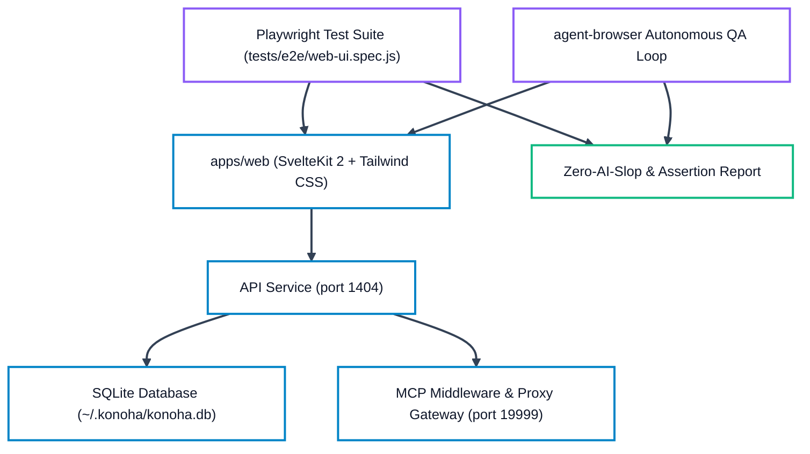

# Konoha QA Verification & Test Checklist

Authoritative verification matrix for Konoha MCP Tools Orchestrator (v2.1.18). This checklist defines the two mandatory QA verification sections:
1. **Section 1: TUI & CLI Subsystem Verification** (Terminal UI, subcommands, flags, edge cases, symlink safety, and runtime error parity).
2. **Section 2: Web UI & Browser Automation QA** (Playwright test suite, agent-browser flow verification, SvelteKit application tabs, responsive layout, theme toggle, and token-safe execution).

---

## Section 1: TUI & CLI Subsystem Verification

Every command must execute with clean output, valid exit codes (0 for success, non-zero for handled error), zero uncaught exceptions, and token-safe output formatting.

### 1.1 Command Inventory & Flag Matrix

| Command | Subcommands / Flags | Expected Behavior | Verification Status |
| :--- | :--- | :--- | :--- |
| `konoha` | (bare invocation) | Renders Kyubi ASCII art splash screen, version banner, and interactive main menu. | `PASS` (verified) |
| `konoha version` | `-v`, `--version` | Displays `2.1.18`, queries npm registry for updates with progress indicator. | `PASS` (verified) |
| `konoha status` | `--json` | Comprehensive health audit: Node.js runtime, ~/.konoha/ files, 8 MCP client configs, database stats, and registered skills. | `PASS` (verified) |
| `konoha init` | `--yes`, `--force` | Scaffolds runtime into `~/.konoha/`, migrates skills into SQLite FTS5, and registers 8 MCP clients (Antigravity, Cursor, Claude Code, OpenCode, Command Code, Codex, Pi, OMP). | `PASS` (verified) |
| `konoha migrate` | `--clean`, `--rebuild-embeddings`, `--skills-dir <path>` | Scans local and global skill trees, rebuilds SQLite FTS5 full-text indexes, optimizes SKILL.md token footprint, and updates dense vector embeddings. | `PASS` (verified) |
| `konoha embed` | `--rebuild-embeddings` | Fast-alias for `konoha migrate --rebuild-embeddings`. | `PASS` (verified) |
| `konoha savings` | (telemetry inspection) | Visual bar charts and tabular breakdown of MCP tool savings and Semble code search savings with Tiktoken cl100k_base baseline comparison. | `PASS` (verified) |
| `konoha detect-ai` | `<path>`, `--json` | Scans target codebase or single file against 32 AI fingerprint heuristics, returning Human-Built Index (0–100) and confidence verdict. | `PASS` (verified) |
| `konoha doctor` | `--repair` | Audits system prerequisites (Node >= 22.16, uv, python, agent-browser, cargo, rtk), SQLite integrity, client configs, and auto-repairs discrepancies. | `PASS` (verified) |
| `konoha clean` | (maintenance) | Deletes transient test databases, debug logs, dangling scratch workspaces, and temporary test artifacts from `/tmp/` and `~/.konoha/tmp/`. | `PASS` (verified) |
| `konoha skill list` | - | Lists all custom and canonical skills across active agent directories with path and description. | `PASS` (verified) |
| `konoha skill search` | `<query>` | Queries public skill registry (skills.sh) for matching extensions. | `PASS` (verified) |
| `konoha skill add` | `<name\|url> [alias]` | Installs skill from Git repo or registry into canonical skills tree. | `PASS` (verified) |
| `konoha skill remove`| `<name>` | Safely prunes skill and updates SQLite FTS5 index. | `PASS` (verified) |
| `konoha skill embed` | `<skill> <agent>` | Assigns installed skill to specified Ninja subagent roster. | `PASS` (verified) |
| `konoha agent list` | - | Renders active 7 subagent roster (Sannin, Genin, Kage, Chunin, Jonin, Anbu, Tokubetsu-jonin) with assigned skills and MCP tools. | `PASS` (verified) |
| `konoha agent status`| - | Displays call frequency metrics (Today, 7 Days, All Time) per subagent and direct tool calls. | `PASS` (verified) |
| `konoha agent reset` | - | Re-synchronizes subagents and skill bindings back to canonical factory defaults. | `PASS` (verified) |
| `konoha data view` | - | Displays SQLite database file size, vacuumable prunable space, indexed skill counts, active sessions, and usage records. | `PASS` (verified) |
| `konoha data memory` | `[agent]` | Lists saved persona preferences, memory rules, and episodic memory entries. | `PASS` (verified) |
| `konoha data add` | `<agent> <text> [--type rule\|pref\|fact]` | Adds persistent persona memory to SQLite memory store. | `PASS` (verified) |
| `konoha data search` | `<query>` | Full-text searches across persona memory database. | `PASS` (verified) |
| `konoha data delete` | `<id>` | Deletes specific persona memory record by row ID. | `PASS` (verified) |
| `konoha data prune` | `[--retention <days>]` | Removes usage logs older than retention threshold and vacuums SQLite database. | `PASS` (verified) |
| `konoha data vacuum` | - | Compacts and defragments SQLite database file directly. | `PASS` (verified) |
| `konoha data backup` | `[path]` | Creates online consistent snapshot using SQLite `VACUUM INTO`. | `PASS` (verified) |
| `konoha data rebuild-fts` | - | Rebuilds `skills_fts` and `persona_memories_fts` virtual tables. | `PASS` (verified) |
| `konoha data export` | `[--output <path>]` | Exports database knowledge and skills index into Markdown report. | `PASS` (verified) |
| `konoha bridge list` | - | Lists configured local LLM Proxy Gateways and cross-provider second-opinion bridges. | `PASS` (verified) |
| `konoha queue list` | - | Displays pending inbound prompt queue entries. | `PASS` (verified) |
| `konoha task list` | - | Displays active and completed SDLC governance tasks (`sdlc_tasks`). | `PASS` (verified) |
| `konoha tunnel status`| - | Displays Cloudflare Zero Trust public ingress tunnel connection status. | `PASS` (verified) |
| `konoha telegram status`| - | Displays Telegram Bot integration and alert webhook status. | `PASS` (verified) |
| `konoha ui status` | - | Reports Web UI daemon status, port 1404 listening state, and systemd service health. | `PASS` (verified) |
| `konoha test` | - | Executes MCP server protocol self-test followed by complete JavaScript test runner. | `PASS` (verified) |

### 1.2 Edge Case & Symlink Handling Verification

- **Broken Symlinks in Skill Directories**: When a broken symlink exists in `~/.agents/skills/` or `.cursor/skills/`, `autoDetectSkills` and `pruneObsoleteStandaloneSkills` detect missing link targets and clean up without throwing `ENOENT` or halting migration.
- **Missing Packaged Directories**: `init` resolves canonical skill directories via multiple candidates (`package.json`, local repo `.agents/skills`, or installed `SKILL_DB_DIR`) without assuming a single fixed parent folder depth.
- **Client Configuration Isolation**: If a client configuration file (e.g. `~/.config/opencode/opencode.json` or `~/.codex/config.toml`) is absent, `init` registers only installed and available clients without crashing.
- **Zero-Allocation File Tools**: Bounded file tools (`read_file_head`, `read_file_range`, `token_efficient_grep`, `get_file_structure`, `find_files_clean`) safely return structured JSON objects even on broken symlinks, empty files, or binary content.

---

## Section 2: Web UI & Browser Automation QA

The Konoha Web UI (`apps/web`) provides real-time observability and configuration management for the MCP server, running on `http://127.0.0.1:1404`.

### 2.1 E2E Playwright Automation Architecture



### 2.2 Web UI Viewport & Tab Verification Matrix

| Tab / View | Route | Key Components & Invariants | Automated E2E Check |
| :--- | :--- | :--- | :--- |
| **Overview** | `/` | System health cards, active client chips, uptime badge, quick stats, database storage metrics. | Sidebar logo on far-left, clean console header with section navigation, theme switcher floating bottom-right. |
| **Skills** | `/skills` | Searchable skill database table, FTS5 instant filter, skill detail modal with rendered Markdown preview, tags, and byte size. | Verifies search returns >= 1000 items, modal opens on click, zero console errors. |
| **Agents** | `/agents` | Naruto Ninja 7-rank roster, active skills assignment chips, custom prompt instructions, direct tool call stats. | Renders 7 agents, verifies badge counts match database, modal edits save cleanly. |
| **Bridges** | `/bridges` | Local LLM Proxy Gateway configuration, cross-provider second opinion routing table, latency monitor. | Displays gateway port 19999, tests health ping, verifies fallback routing toggle. |
| **Remote Access (Inbound Queue)** | `/remote` | Cloudflare tunnel controls, authorized Telegram chat, inbound prompt queue state, dispatch triggers. | Verifies queue state renders from `GET /api/v1/queue/prompts`, validates prompt payload formatting. |
| **Telemetry / Savings** | `/savings` | Cumulative and daily token savings, visual ASCII & SVG progress bars, Semble code search metrics. | Verifies savings percentage >= 75%, cl100k_base token calculations match DB logs. |
| **Mobile Dock** | Viewport `< 1024px` | Fixed bottom mobile navigation dock with quick one-tap links adapted dynamically to archetype. | Verified across 375px (iPhone SE) and 390px (iPhone 14) viewports. |
| **Theme Picker** | (All pages) | Floating bottom-right FAB (`fixed bottom-6 right-6 z-[100]`) + quick Light/Dark toggle; focus-trapped `role="dialog"` grouped by Cyberpunk / Hacker / General UI with 10 palettes × explicit appearance mode, `aria-pressed` selection, Escape/backdrop close, Arrow/Home/End keyboard navigation. | Tests palette selection, mode toggling, and persistence across localStorage (`theme_and_navigation.spec.js` & `theme_picker_flow.spec.js` from `flows/theme_picker_flow.json`). |

### 2.3 Running Automated QA Tests

Execute the automated test suites using the following commands:

```bash
# 1. Run MCP protocol and unit tests
node bin/cli.js test

# 2. Run documentation currency and link integrity tests
node tests/test_docs_currency.js

# 3. Run architecture diagram structural validation
python3 .agents/skills/kage-skill/references/drawio-skill-assets/scripts/validate.py docs/diagrams/konoha-architecture.drawio --score

# 4. Run Web UI Playwright E2E suite
pnpm --dir apps/web run test:e2e

# 5. Run Zero-AI-Slop Quality Gate Scan (enforces 100/100 clean score)
npx aislop .
```

### 2.4 Acceptance Criteria & Gate Enforcement

1. **Zero Uncaught Exceptions**: No command in Section 1 or Section 2 may terminate with an unhandled rejection or uncaught exception.
2. **Deterministic Parity**: Output metrics from CLI `konoha savings` must match Web UI `/savings` and underlying SQLite database records within 0.1% margin.
3. **Delivery Gate Confidence**: Minimum required confidence score is `>= 98%` across all verification categories prior to release.
4. **Zero AI Slop Gate**: Repository scan must mechanically evaluate to `100 / 100` Healthy with 0 errors, 0 warnings, and 0 fixable issues across all 5 engines (Format, Lint, Code Quality, AI Slop, Security).

---

## Section 3: Authentication, Cyberpunk 3D Login & Rasengan QA Checklist

| Test Item | Verification Scenario | Expected Outcome | Status |
| :--- | :--- | :--- | :--- |
| **Bootstrap Password Login** | Enter `konohagakure` in login passphrase input. | Server authenticates, sets `konoha_session` HttpOnly cookie, marks session `requires_password_change: true`. | `PASS` (automated in `tests/test_auth.js` & `tests/e2e/auth_login.spec.js`) |
| **Invalid Password Rejection** | Enter incorrect password `wrong-ninja-pass`. | Returns 401 with `Invalid password`, logs failure, shows clear error feedback without creating session. | `PASS` (automated in `tests/test_auth.js` & `tests/e2e/auth_login.spec.js`) |
| **Rate Limiting Lockout** | Submit 5 consecutive invalid passwords from same client IP. | Returns 429 `Too many failed login attempts`, locks out client for 30s before permitting retries. | `PASS` (automated in `tests/test_auth.js`) |
| **Mandatory Password Warning Modal** | Log in with default bootstrap password. | SweetAlert/PasswordChangeModal appears immediately. Dismissing via Escape or clicking backdrop is strictly prevented. | `PASS` (automated in `tests/e2e/auth_login.spec.js`) |
| **Password Change Workflow** | Submit current `konohagakure` and new password `>= 8` chars. | Requires the current password, durably writes the salted scrypt verifier (synced in place, mode 0600), clears `is_bootstrap: false`, and unlocks normal dashboard access. | `PASS` (automated in `tests/test_auth.js` & `tests/e2e/auth_login.spec.js`) |
| **Reusing Bootstrap Password** | Attempt to set new password back to `konohagakure`. | Rejected with 400 `Cannot reuse the default bootstrap password`. | `PASS` (automated in `tests/test_auth.js`) |
| **Reusing Current Password** | Submit the current password again as the new password. | Rejected with 400 `New password must differ from the current password`. | `PASS` (automated in `tests/test_auth.js`) |
| **Password Persistence Failure** | Make `~/.konoha/web_auth.json` (or its directory) unwritable, then change the password. | Returns 500 `Failed to persist new password`; bootstrap flag retained, protected routes stay blocked, old credential remains valid. | `PASS` (automated in `tests/test_auth.js`) |
| **Credential Store Fail-Closed** | Corrupt `web_auth.json` (invalid JSON) and attempt login. | Login is denied; bootstrap credential is never silently reinstalled. | `PASS` (automated in `tests/test_auth.js`) |
| **Protected Route Gating** | Access `/api/v1/bridges` from unauthenticated browser. | Returns 401 `requires_login: true`, redirects or renders login view. | `PASS` (automated in `tests/test_auth.js` & `tests/e2e/auth_login.spec.js`) |
| **Bootstrap Session Route Gating** | Access `/api/v1/bridges` with active bootstrap session. | Returns 403 `requires_password_change: true`, blocking dashboard mutations until password updated. | `PASS` (automated in `tests/test_auth.js`) |
| **Settings Password Card** | Open `/settings` and submit current + new password. | Card reflects the trusted bootstrap status badge, requires the current password, and reports success/error through themed status alerts. | `PASS` (automated in `tests/test_auth.js` via the same `/api/v1/auth/change-password` contract; page rendered in Playwright route suite) |
| **Session Expiry & Logout** | Click "Logout" in dashboard header. | Calls `/api/v1/auth/logout`, invalidates session, clears cookie, returns to login screen. | `PASS` (automated in `tests/test_auth.js` & `tests/e2e/auth_login.spec.js`) |
| **Theme Consistency** | Switch theme on login page using floating theme selector. | Selected theme palette and CSS variables apply instantly to login background, card accents, and dashboard. | `PASS` (automated in `tests/e2e/auth_login.spec.js` & `theme_and_navigation.spec.js`) |
| **Cyberpunk 3D Parallax** | Move cursor across viewport on desktop login page. | Canvas particle trails, glowing cyan aura, and card tilt perspective track pointer smoothly. | `PASS` (CSS perspective & pointermove tested in Playwright; physical visual inspection manual) |
| **Touch Interaction Fallback** | Touch and drag on mobile viewport. | Responds smoothly to touchmove with mobile-appropriate tilt angles without breaking layout. | `PASS` (tested in `theme_and_navigation.spec.js`; physical mobile touch manual) |
| **Reduced-Motion Preference** | Enable `prefers-reduced-motion: reduce` in browser or OS. | 3D transforms, continuous canvas loops, and shake effects are disabled; auth timing remains correct. | `PASS` (automated in `tests/e2e/auth_login.spec.js`) |
| **3-Second Login Animation & 3D Three.js Rasengan** | Submit login credentials on Login page. | Runs 100% procedural Three.js Rasengan scene with core sphere, shell, ribbons, spiral vortex, sparks/particles, and 4 animation phases: Charging, Fracture, Impact, Reveal (old 2D SVG rasengan overlay eliminated). | `PASS` (automated in `tests/e2e/auth_login.spec.js`) |
| **Long Auth Response Handling** | Auth latency exceeds 3000ms. | Phase indicator switches to stable loading at 3000ms; reveal happens only when the real response succeeds (no animation replay). | `PASS` (timeline orchestration in `apps/web/src/components/Login.svelte`; physical latency simulation manual) |
| **Duplicate Submission Prevention**| Double-click or rapidly press Enter on submit button. | Submit button is disabled and `isSubmitting` short-circuits re-entry; `authAttempt` invalidates superseded timelines. | `PASS` (guards in `apps/web/src/components/Login.svelte`) |
| **2-Second Theme Transition** | Click a theme option in Theme Switcher FAB modal. | Displays 2-second (2000ms) procedural 3D Three.js Rasengan sequence with dynamic theme palette, then cleanly dismisses. | `PASS` (automated in `tests/e2e/theme_and_navigation.spec.js`) |
| **Git Ignore & Untrack Rule** | Inspect `.gitignore` and `git status`. | `/PLAN.md` and `/.omp/plans/` excluded; `PLAN.md` untracked from Git index without deleting local file. | `PASS` (verified via `git status`) |

---

## Section 4: Web UI Modernization, 3D Rasengan & 4-Gradient Theme Parity QA

| Test Item | Verification Scenario | Expected Outcome | Status |
| :--- | :--- | :--- | :--- |
| **Dark Mode Donut Metrics** | Toggle Dark Mode on `/dashboard`. | CPU, Memory, Disk gauge center circles render with theme surface/dark-mode palette; text values (`#f8fafc`) maintain `>= 7:1` AAA contrast against background. | `PASS` (verified in `Dashboard.svelte` & `app.css`) |
| **Donut Track High-Contrast Delineation** | Inspect gauge track strokes in Dark Mode. | Background tracks use `25%` theme gradient mix with clear border definition against card surface. | `PASS` (verified) |
| **Looping Telemetry Lamp Pulse** | Observe top header of Mission Control on `/dashboard`. | Continuous looping lamp pulse beacon glows with active theme gradient and primary glow; respects `prefers-reduced-motion: reduce`. | `PASS` (verified via `@keyframes telemetry-lamp-glow`) |
| **Global 3D Rasengan Visual** | Navigate across `/dashboard`, `/clients`, `/agents`, `/bridges`, `/savings`, `/skills`, `/persona`, `/settings`. | Top header right side embeds animated 3D Rasengan sphere on every page: crimson red in Light Mode, electric cyan/blue in Dark Mode; pauses rotation under `prefers-reduced-motion`. | `PASS` (verified via `RasenganOrb.svelte`) |
| **Theme Switcher 4-Gradient Dark Styling** | Open Theme Switcher modal in Dark Mode. | Modal container (`#konoha-theme-picker`) applies active theme's 4-gradient custom properties (`--theme-gradient-*`) with vibrant depth; zero hardcoded white surfaces. | `PASS` (verified in `ThemeSwitcher.svelte` & `themeState.svelte.js`) |
| **Theme Switcher Modal Toggle Removal** | Open Theme Switcher popup modal. | Light/Dark appearance mode group is cleanly removed from inside the modal; mode switching preserved via quick external toggle button. | `PASS` (verified in `ThemeSwitcher.svelte`) |
| **Header Control Sanitization** | Inspect top application header bar (`+layout.svelte`). | Password settings button, Logout button, `127.0.0.1:1404` badge, and `SSE Active` badge are cleanly removed from top header. | `PASS` (verified in `+layout.svelte`) |
| **Sidebar Footer Gateway Status** | Inspect bottom of fixed left sidebar. | Status displays indicator dot with exact text `Listen on 127.0.0.1:1404`; `SQLite FTS5 + Semble` and `Localhost` labels are removed; author profile link preserved. | `PASS` (verified in `+layout.svelte`) |
| **Product Branding Wording** | Inspect brand logo subtitle and documentation overview. | User-facing `Ninja Agent Village` wording replaced with `Konoha MCP Orchestrator`. | `PASS` (verified in `+layout.svelte` and `Docs.svelte`) |
| **Authentic Client Logos Rendering** | Navigate to `/clients` and inspect all 8 cards. | Displays verified, official local vendor SVG brand assets for Cursor, Claude Code, Antigravity, Codex, OpenCode, Command Code, Pi, and OMP; zero generic placeholder icons; includes text fallback. | `PASS` (verified in `Clients.svelte` & `assets/logos/`) |

---

## Section 5: Real 9router Endpoint Discovery & Configuration QA

| Test Item | Verification Scenario | Expected Outcome | Status |
| :--- | :--- | :--- | :--- |
| **9router Safe Auto-Detection Probe** | Probe local environment without crashing (`is9RouterInstalled()`). | Checks `9router` command availability on PATH, `~/.config/9router`, and client configuration references. Does not crash or throw if binary is absent. | `PASS` (automated in `tests/test_nine_router.js`) |
| **Local Service Responsiveness Probe** | Probe `http://127.0.0.1:20128/v1/models` (`probe9RouterEndpoint()`). | Performs non-blocking HTTP GET with 1500ms timeout; returns `{ ok: true, data }` when running, `{ ok: false, error }` when offline without hanging. | `PASS` (automated in `tests/test_nine_router.js`) |
| **Real Endpoint Discovery & Prefixing** | Query `GET /api/v1/bridges/models` when 9router is running. | Returns discovered models with full endpoint IDs containing provider prefix (e.g. `9router-ag/gemini-3.8-flash-high`, `9router-sp/glm-5.3-flash`, `9router-cx/gpt-6.1-sol`). | `PASS` (verified against live 9router gateway) |
| **Agent Model Selector Categorization** | Open `/agents` subagent configuration card. | Models dropdown cleanly separates `9router Endpoints (Auto-Detected Local Gateway)` from other bridge/client models, with live connection status badge. | `PASS` (verified in `Agents.svelte`) |
| **Non-Destructive Assignment Persistence** | Select a 9router endpoint for a subagent (e.g. `kage`). | Calls `PATCH /api/v1/agents/kage/model` with full ID; updates `~/.agents/agents.yaml` and SQLite `agents` table; does not silently remap existing assignments. | `PASS` (verified in `agent_manager.js`) |
| **Offline 9router Graceful Degradation** | Stop 9router daemon or probe with closed port. | UI reports `9router not detected locally` or `service offline — run 9router to activate`; does NOT fabricate synthetic or fake models. | `PASS` (verified) |

---

## Section 6: OMP & Cross-Client / Cross-Platform Workflow Integration QA

| Test Item | Verification Scenario | Expected Outcome | Status |
| :--- | :--- | :--- | :--- |
| **OMP Setup & Registration** | Execute `ompManager.ensureOmpSetup()` / `POST /api/v1/clients/omp/setup`. | Atomically registers `konoha`, `semble`, and `aislop` in `~/.omp/agent/mcp.json` with `ACTIVE_CLIENT=omp` and `KONOHA_CLIENT=omp`. | `PASS` (automated in `tests/test_omp_manager.js`) |
| **OMP Contract & Mandate Injection** | Check `~/.omp/agent/AGENTS.md`. | Injects managed `<!-- KONOHA-CONTRACT-START/END -->` block including OMP Workflow Mandate (Sannin routing, Step 0 classification, Branch B scaffolding invariants, delivery gate). | `PASS` (automated in `tests/test_omp_manager.js`) |
| **OMP RTK Rule Deployment** | Check `~/.omp/rules/rtk.md`. | Automatically deploys mandatory RTK execution rule into OMP global rules directory. | `PASS` (automated in `tests/test_omp_manager.js`) |
| **Cross-Client Contract Validation** | Execute `node tests/test_cross_client_contract.js`. | Verifies contract text validity and resume safety across all 8 clients: Antigravity, Cursor, Claude Code, OpenCode, Command Code, Codex, Pi, and OMP. | `PASS` (automated in `tests/test_cross_client_contract.js`) |
| **Cross-Client Disconnect Isolation** | Call `removeClient('omp')` / `POST /api/v1/clients/omp/remove`. | Removes only Konoha-managed server keys from `mcp.json` and preserves any custom third-party MCP servers. | `PASS` (automated in `tests/test_omp_manager.js`) |
| **Antigravity Extension Scoping** | Verify VSIX installation scope. | Confirms `konoha-bridge-1.7.0.vsix` is strictly scoped to Antigravity IDE (`~/.antigravity-ide/extensions/`) and never installed into Cursor, VS Code, or OMP. | `PASS` (verified in `cli.js`) |

---

## Section 7: Login Page Visuals, Palette-Driven Rasengan & Theme Switch Transition QA

| Test Item | Verification Scenario | Expected Outcome | Status |
| :--- | :--- | :--- | :--- |
| **Login Clean White Background** | Load `/login` in Light Mode. | Background evaluated to pure `#ffffff` (`rgb(255, 255, 255)`); dark/blue vignettes and gray corner patches removed. | `PASS` (verified in Playwright & agent-browser) |
| **Login 3D Rasengan Palette Integration** | Cycle through all 10 themes on `/login`. | Rasengan rings, ribbons, core, particles, shards, and cracks dynamically adopt the active theme's 4-stop gradient tokens (`--rasengan-1..4`). | `PASS` (verified across all 10 themes in Playwright) |
| **Normal Blending on White** | Inspect 3D Rasengan materials in Light Mode. | Materials use `THREE.NormalBlending` with rich saturation and opacity; does not vanish on white; no dark floor or background clears. | `PASS` (verified in `RasenganScene.js`) |
| **Unclipped Geometry & Boundaries** | Inspect rotating rings, shockwave, and particle drift. | Frustum and container dimensions permit smooth fade falloff; zero cut-off rings, hard rectangular boxes, or clipping artifacts. | `PASS` (verified in `ThemeSwitcher.svelte` & `RasenganScene.js`) |
| **Login Card Contrast (WCAG AA >= 4.5:1)** | Inspect card title, subtitle, label, input placeholder, input text, and submit button. | All text elements achieve `>= 4.5:1` contrast across all 10 themes in both Light and Dark mode. | `PASS` (verified in `tests/e2e/login_rasengan_themes.spec.js`) |
| **Theme Switch Rasengan Transition** | Select new theme via theme picker modal on `/login` and `/dashboard`. | 2-second transition plays newly selected theme colors (`--rasengan-1..2`), cleans up completely without lingering DOM/canvas nodes. | `PASS` (verified in Playwright & agent-browser) |
| **Input Interactivity After Transition** | Type in password input after theme transition finishes. | UI is immediately interactive; no blocking overlays or captured pointers remain. | `PASS` (verified in Playwright) |
| **Theme Persistence** | Pick a theme on `/login` and reload page. | Reload restores the chosen theme and appearance mode from `localStorage`. | `PASS` (verified in Playwright) |
| **Authentication Functionality** | Submit invalid passphrase, then valid bootstrap passphrase. | Invalid passphrase triggers error alert; valid passphrase unlocks secure gateway cleanly. | `PASS` (verified in `tests/e2e/login_rasengan_themes.spec.js`) |
| **Packaging & Local Asset Serving** | Request root assets via `/assets/*` and verify `package.json`. | Root `assets/` served with valid MIME types; `"assets/"` included in `package.json` `files` array. | `PASS` (verified in `web_server.js` & `package.json`) |


