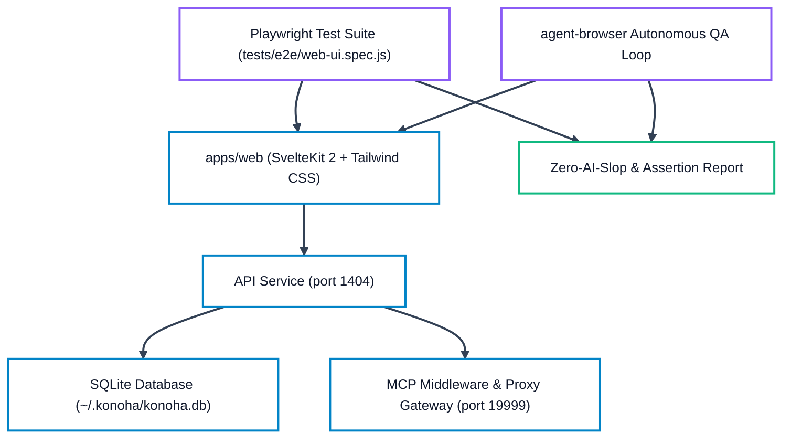

# Konoha QA Verification & Test Checklist

Authoritative verification matrix for Konoha MCP Tools Orchestrator (v2.2.15). This checklist defines the mandatory QA verification sections:
1. **Section 1: TUI & CLI Subsystem Verification** (Terminal UI, subcommands, flags, edge cases, symlink safety, and runtime error parity).
2. **Section 2: Web UI & Browser Automation QA** (Playwright test suite, agent-browser flow verification, SvelteKit application tabs, responsive layout, theme toggle, and token-safe execution).

---

## Section 1: TUI & CLI Subsystem Verification

Every command must execute with clean output, valid exit codes (0 for success, non-zero for handled error), zero uncaught exceptions, and token-safe output formatting.

### 1.1 Command Inventory & Flag Matrix

| Command | Subcommands / Flags | Expected Behavior | Verification Status |
| :--- | :--- | :--- | :--- |
| `konoha` | (bare invocation) | Renders Kyubi ASCII art splash screen, version banner, and interactive main menu. | `PASS` (verified) |
| `konoha version` | `-v`, `--version` | Displays `2.2.15`, queries npm registry for updates with progress indicator. | `PASS` (verified) |
| `konoha akatsuki status` | - | Displays Akatsuki security controls, engine, mode (blue/red), env (docker/lxc), lab status, and tools inventory. | `PASS` (verified) |
| `konoha akatsuki mode` | `[blue|red]` | Switch between defensive Blue-Team and offensive Red-Team mode (automates lab setup in red mode). | `PASS` (verified) |
| `konoha akatsuki env` | `[docker|lxc]` | View or set container execution engine environment (`docker` / `lxc`). | `PASS` (verified) |
| `konoha akatsuki enable` | - | Alias for `mode red` (automated sandbox setup). | `PASS` (verified) |
| `konoha akatsuki disable` | - | Alias for `mode blue` (fail-closed). | `PASS` (verified) |
| `konoha status` | `--json` | Comprehensive health audit: Node.js runtime, ~/.konoha/ files, 8 MCP client configs, database stats, and registered skills. | `PASS` (verified) |
| `konoha init` | `--yes`, `--force`, `--client=<cursor|claude|opencode|omp|codex|pi|all>` | Scaffolds runtime into `~/.konoha/`, migrates skills into SQLite FTS5, and registers selected/detected MCP clients. | `PASS` (verified) |
| `konoha migrate` | `--clean`, `--rebuild-embeddings`, `--skills-dir <path>` | Scans local and global skill trees, rebuilds SQLite FTS5 full-text indexes, optimizes SKILL.md token footprint, and updates dense vector embeddings. | `PASS` (verified) |
| `konoha embed` | `--rebuild-embeddings` | Fast-alias for `konoha migrate --rebuild-embeddings`. | `PASS` (verified) |
| `konoha savings` | (telemetry inspection) | Visual bar charts and tabular breakdown of MCP tool savings and Semble code search savings with Tiktoken cl100k_base baseline comparison. | `PASS` (verified) |
| `konoha detect-ai` | `<path>`, `--json` | Scans target codebase or single file against 32 AI fingerprint heuristics, returning Human-Built Index (0–100) and confidence verdict. | `PASS` (verified) |
| `konoha doctor` | `--repair` | Audits system prerequisites (Node >= 24.0, uv, python, agent-browser, cargo, rtk), SQLite integrity, client configs, and auto-repairs discrepancies. | `PASS` (verified) |
| `konoha clean` | (maintenance) | Deletes transient test databases, debug logs, dangling scratch workspaces, and temporary test artifacts from `/tmp/` and `~/.konoha/tmp/`. | `PASS` (verified) |
| `konoha skill list` | - | Lists all custom and canonical skills across active agent directories with path and description. | `PASS` (verified) |
| `konoha skill search` | `<query>` | Queries public skill registry (skills.sh) for matching extensions. | `PASS` (verified) |
| `konoha skill add` | `<name|url> [alias]` | Installs skill from Git repo or registry into canonical skills tree. | `PASS` (verified) |
| `konoha skill remove`| `<name>` | Safely prunes skill and updates SQLite FTS5 index. | `PASS` (verified) |
| `konoha skill embed` | `<skill> <agent>` | Assigns installed skill to specified Ninja subagent roster. | `PASS` (verified) |
| `konoha agent list` | - | Renders active 8 subagent roster (Sannin, Genin, Kage, Chunin, Jonin, Anbu, Tokubetsu-jonin, Akatsuki) with assigned skills and MCP tools. | `PASS` (verified) |
| `konoha agent status`| - | Displays call frequency metrics (Today, 7 Days, All Time) per subagent and direct tool calls. | `PASS` (verified) |
| `konoha agent reset` | - | Re-synchronizes subagents and skill bindings back to canonical factory defaults. | `PASS` (verified) |
| `konoha data view` | - | Displays SQLite database file size, vacuumable prunable space, indexed skill counts, active sessions, and usage records. | `PASS` (verified) |
| `konoha data memory` | `[agent]` | Lists saved persona preferences, memory rules, and episodic memory entries. | `PASS` (verified) |
| `konoha data add` | `<agent> <text> [--type rule\|pref\|fact]` | Adds persistent persona memory to SQLite memory store. | `PASS` (verified) |
| `konoha data search` | `<query>` | Full-text searches across persona memory database. | `PASS` (verified) |
| `konoha data delete` | `<id>` | Deletes specific persona memory record by row ID. | `PASS` (verified) |
| `konoha data prune` | `[--retention <days>]` | Removes usage logs older than retention threshold and vacuums SQLite database. | `PASS` (verified) |
| `konoha data vacuum` | - | Compacts and defragments SQLite database file directly. | `PASS` (verified) |
| `konoha data backup` | `[path]` | Creates online consistent snapshot using SQLite `VACUUM INTO`. | `PASS` (verified) |
| `konoha data rebuild-fts` | - | Rebuilds `skills_fts` and `persona_memories_fts` virtual tables. | `PASS` (verified) |
| `konoha data export` | `[--output <path>]` | Exports database knowledge and skills index into Markdown report. | `PASS` (verified) |
| `konoha bridge list` | - | Lists configured local LLM Proxy Gateways and cross-provider second-opinion bridges. | `PASS` (verified) |
| `konoha queue list` | - | Displays pending inbound prompt queue entries. | `PASS` (verified) |
| `konoha task list` | - | Displays active and completed SDLC governance tasks (`sdlc_tasks`). | `PASS` (verified) |
| `konoha telegram status`| - | Displays Telegram Bot integration and alert webhook status. | `PASS` (verified) |
| `konoha ui status` | - | Reports Web UI daemon status, port 1404 listening state, and systemd service health. | `PASS` (verified) |
| `konoha web reset-password` | - | Resets Web UI authentication to factory bootstrap (`konohagakure`) and terminates stale sessions. | `PASS` (verified) |
| `konoha auth reset` | - | Alias for `konoha web reset-password` to immediately recover operator access. | `PASS` (verified) |
| `konoha test` | - | Executes MCP server protocol self-test followed by complete JavaScript test runner. | `PASS` (verified) |

### 1.2 Edge Case & Symlink Handling Verification

- **Broken Symlinks in Skill Directories**: When a broken symlink exists in `~/.agents/skills/` or `.cursor/skills/`, `autoDetectSkills` and `pruneObsoleteStandaloneSkills` detect missing link targets and clean up without throwing `ENOENT` or halting migration.
- **Missing Packaged Directories**: `init` resolves canonical skill directories via multiple candidates (`package.json`, local repo `.agents/skills`, or installed `SKILL_DB_DIR`) without assuming a single fixed parent folder depth.
- **Client Configuration Isolation**: If a client configuration file (e.g. `~/.config/opencode/opencode.json` or `~/.codex/config.toml`) is absent, `init` registers only installed and available clients without crashing.
- **Zero-Allocation File Tools**: Bounded file tools (`read_file_head`, `read_file_range`, `token_efficient_grep`, `get_file_structure`, `find_files_clean`) safely return structured JSON objects even on broken symlinks, empty files, or binary content.

### 1.3 Isolation, Dynamic Paths & Security Test Suites

| Test Suite | Scope & Target | Execution Evidence | Status |
| :--- | :--- | :--- | :--- |
| `tests/test_fresh_install_and_upgrade_in_tmp.js` | Full lifecycle fresh installation, unauthenticated health check, bootstrap login (`konohagakure`), mandatory password change, session invalidation, and upgrade simulation in isolated `/tmp/` sandbox. | Clean execution, zero leaks into `~`, unauthenticated health check 200, bootstrap login 200, password update 200. | `PASS` (verified) |
| `tests/test_no_hardcoded_homedir.js` | Enforces zero hardcoded user paths (`/home/`, `C:\Users\`, `/Users/`) across all JavaScript, JSON, shell, and Python files; verifies dynamic path resolution via `os.homedir()` on POSIX and Windows. | 0 hardcoded paths across entire codebase; POSIX and Windows formats verified. | `PASS` (verified) |
| `tests/test_workflow_advisor_loop.js` | Evaluates `@advisor` final gate review and autonomous remediation loop; asserts block on rejection, dynamic dispatch to Anbu (backend) / Jonin (UI), approval on fix, and 7-cycle circuit breaker. | 5/5 subtests passed: blocks on rejection, dispatches to Anbu, dispatches to Jonin, approves on fix, trips circuit breaker after 7 cycles. | `PASS` (verified) |
| `tests/test_web_auth_token_isolation.js` | Validates session token isolation: confirms `/api/v1/auth/status` and `/api/v1/auth/session` do not leak session tokens, and `/api/v1/health` returns minimal metadata. | Token undefined on status and session endpoints; health returns minimal unauthenticated JSON. | `PASS` (verified) |
| `tests/test_no_tunnel_regression.js` | Enforces complete eradication of Cloudflare Tunnel and ngrok subsystem with zero residual endpoints, tables, or CLI commands. | 4/4 subtests passed: filesystem, schema, CLI, and controllers clean. | `PASS` (verified) |
| `tests/test_sdlc_hitl.js` | Full SDLC verification of interactive Gate 1 (approve, reject, refine) and Gate 2 (delivery sign-off, remediation loop) across prompt inputs and options payloads. | Complete lifecycle verified: Gate 1 approval & rejection/refinement; Gate 2 sign-off & remediation. | `PASS` (verified) |
| `tests/test_workflow_gates.js` | Unit validation of `buildGate1Prompt`, `buildGate2Prompt`, `parseGateChoice`, and state transitions in `src/mcp/workflow_gates.js`. | 10/10 subtests passed: prompt structure, option parsing, and state updates verified. | `PASS` (verified) |
| `tests/test_cross_client_workflow_matrix.js` | Cross-client workflow matrix validation across all 8 clients (Antigravity, Cursor, Claude Code, OpenCode, Command Code, Codex, Pi, OMP) asserting correct hook paths and contracts. | 8/8 clients verified: contract parity, MCP config paths, and guardrail hook bindings. | `PASS` (verified) |

### 1.4 Migration Robustness, Safe Timeouts & Skill RAG Retrieval Invariant (v2.2.3)

- **Safe Timeout Normalization & Zero-NaN Invariant**: `bin/lib/paths.js` exports `MIGRATION_TIMEOUT_MS = 180000` (180s default). `bin/commands/migrate.js`, `bin/commands/init.js`, `bin/commands/doctor.js`, and `bin/lib/runtime.js` implement defensive timeout normalization using `Number.isFinite()`, guaranteeing that `timeoutMs` passed to `spawnSync` is always an unsigned positive integer. This permanently eliminates the Node.js `ERR_OUT_OF_RANGE: Received NaN` crash when executing `konoha migrate --rebuild-embeddings` or `konoha embed`.
- **Primary SQLite FTS5 & Neural RAG Retrieval**: In `src/mcp/skills.js`, all skill discovery and loading (`find_skill`, `get_skill`, `use_skills`) query the SQLite database (`konoha.db`) and dense vector embeddings first. Local Markdown files (`SKILL.md` and `references/*.md`) serve strictly as secondary fallback mirrors when the database is unavailable or a record is missing.
- **Workflow Skill Directives**: Sannin router dispatches across all active phases (`explore`, `plan`, `research`, `execute`, `document`) enforce the skill retrieval invariant:
  ```json
  "skill_directive": "Retrieve skills via SQLite FTS5/RAG: Call konoha.find_skill(\"<keywords>\") and konoha.use_skills([\"<skill>\"]) or konoha.get_skill(\"<name>\"). Never read raw markdown files directly."
  ```
- **Isolated Testing Protocol**: Verification executed in ephemeral directories under `/tmp/konoha-skill-iso-*` using custom `KONOHA_DB_PATH` and isolated skill trees, confirming 100% test isolation without touching the user's local `~/.konoha` environment.

---

## Section 2: Web UI & Browser Automation QA

The Konoha Web UI (`apps/web`) provides real-time observability and configuration management for the MCP server, running on `http://127.0.0.1:1404`.

### 2.1 E2E Playwright Automation Architecture



### 2.2 Web UI Viewport & Tab Verification Matrix

| Tab / View | Route | Key Components & Invariants | Automated E2E Check |
| :--- | :--- | :--- | :--- |
| **Login Card** | `/` (unauthenticated) | Dynamic lowercase badge tag (`default passphrase (konohagakure)`), 3px line size, animated travelling neon border focus sweep (`neonBorderSweep`), password visibility toggle. | `auth_login.spec.js`, `login_rasengan_themes.spec.js` |
| **Overview & Gauges** | `/dashboard` | System health cards, proportional gauge arcs across 10 themes × 2 modes, high-contrast breadcrumbs (≥ 4.5:1), 5s live metrics polling. | `dashboard_gauges_and_shared_bg.spec.js`, `routes_load.spec.js` |
| **Skills & Hybrid Search** | `/skills` | Searchable skill database table, FTS5 + ONNX 384d vector hybrid RRF retrieval (`k=60`), skill detail modal with rendered Markdown preview, tags, and byte size. | `hybrid_search.spec.js`, `routes_load.spec.js` |
| **Agents** | `/agents` | Naruto Ninja 8-rank roster, active skills assignment chips, custom prompt instructions, direct tool call stats. | `ui_consistency.spec.js`, `routes_load.spec.js` |
| **Bridges** | `/bridges` | Local LLM Proxy Gateway configuration (:19999), cross-provider second opinion routing table, latency monitor. | `routes_load.spec.js` |
| **Remote Access & Prompts** | `/remote` | Authorized Telegram chat, inbound prompt queue state, dispatch triggers. | `routes_load.spec.js` |
| **Telemetry / Savings** | `/savings` | Cumulative and daily token savings, visual ASCII & SVG progress bars, Semble code search metrics. | `routes_load.spec.js` |
| **AI Detectors** | `/detector` | Dual-target website and document AI fingerprint scanner (Human-Built Index 0-20, ZeroGPT defense). | `detector_flow.spec.js`, `routes_load.spec.js` |
| **Alerts & Dialogs** | (All pages) | Native Svelte 5 runes toasts with `--theme-surface-glass` and 4-gradient accent bars, `<dialog>` confirm modals, form dialogs. | `alerts_and_dialogs.spec.js` |
| **Error Pages & Redirects** | `/nonexistent`, `/error` | Themed animated SVG error pages (404 radar, 401/403 lock, 429 hourglass, 5xx core), `/skill` -> `/skills` 307 redirect, JSON API 404s. | `error_pages.spec.js` |
| **Navigation & Links** | (Global) | Zero broken links or navigation orphans across all routes, mobile menu drawer toggle (`lg:hidden`), footer author attribution. | `link_crawler.spec.js`, `theme_and_navigation.spec.js` |
| **Theme Switcher** | (Global) | Floating bottom-right FAB (`fixed bottom-6 right-6 z-[100]`) + quick Light/Dark toggle; focus-trapped `role="dialog"` grouped by Cyberpunk / Hacker / General UI with 10 palettes × explicit appearance mode, `aria-pressed` selection, Escape/backdrop close. | `theme_and_navigation.spec.js`, `theme_picker_flow.spec.js` |

### 2.3 Running Automated QA Tests

Execute the automated test suites using the following commands:

```bash
# 1. Run MCP protocol and unit tests
node bin/cli.js test

# 2. Run documentation currency and link integrity tests
node tests/test_docs_currency.js

# 3. Run architecture diagram structural validation
node tests/test_diagram_sync.js
node tests/test_documentation_diagrams.js

# 4. Run all 17 Animated WebP asset validations
node tests/test_all_assets_webp.js

# 5. Run Web UI Playwright E2E suite (12 spec suites, 46 tests, isolated auth under /tmp/)
pnpm --dir apps/web run test:e2e

# 6. Run agent-browser manual verification pass
agent-browser open http://127.0.0.1:4173/
agent-browser type "@e5" "konohagakure"
agent-browser click "@e4"
agent-browser close

# 7. Run Zero-AI-Slop Quality Gate Scan (enforces 100/100 clean score)
npx aislop scan --changes
```

### 2.4 Acceptance Criteria & Gate Enforcement

1. **Zero Uncaught Exceptions**: No command in Section 1 or Section 2 may terminate with an unhandled rejection or uncaught exception.
2. **Deterministic Parity**: Output metrics from CLI `konoha savings` must match Web UI `/savings` and underlying SQLite database records within 0.1% margin.
3. **Delivery Gate Confidence**: Minimum required confidence score is `>= 98%` across all verification categories prior to release.
4. **Zero AI Slop Gate**: Repository scan must mechanically evaluate to `100 / 100` Healthy with 0 errors, 0 warnings, and 0 fixable issues across all 5 engines (Format, Lint, Code Quality, AI Slop, Security).

---

## Section 3: Authentication, Cyberpunk 3D Login & Rasengan QA Checklist

| Test Item | Verification Scenario | Expected Outcome | Status |
| :--- | :--- | :--- | :--- |
| **Bootstrap Password Login** | Enter `konohagakure` in login passphrase input. | Server authenticates, sets `konoha_session` HttpOnly cookie, marks session `requires_password_change: true`. | `PASS` (automated in `tests/test_auth.js` & `tests/e2e/auth_login.spec.js`) |
| **Invalid Password Rejection** | Enter incorrect password `wrong-ninja-pass`. | Returns 401 with `Invalid password`, logs failure, shows clear error feedback without creating session. | `PASS` (automated in `tests/test_auth.js` & `tests/e2e/auth_login.spec.js`) |
| **Rate Limiting Lockout** | Submit 5 consecutive invalid passwords from same client IP. | Returns 429 `Too many failed login attempts`, locks out client for 30s before permitting retries. | `PASS` (automated in `tests/test_auth.js`) |
| **Mandatory Password Warning Modal** | Log in with default bootstrap password. | PasswordChangeModal appears immediately. Dismissing via Escape or clicking backdrop is strictly prevented. | `PASS` (automated in `tests/e2e/auth_login.spec.js`) |
| **Password Change Workflow** | Submit current `konohagakure` and new password `>= 8` chars. | Requires the current password, durably writes the salted scrypt verifier (synced in place, mode 0600), clears `is_bootstrap: false`, and unlocks normal dashboard access. | `PASS` (automated in `tests/test_auth.js` & `tests/e2e/auth_login.spec.js`) |
| **Reusing Bootstrap Password** | Attempt to set new password back to `konohagakure`. | Rejected with 400 `Cannot reuse the default bootstrap password`. | `PASS` (automated in `tests/test_auth.js`) |
| **Reusing Current Password** | Submit the current password again as the new password. | Rejected with 400 `New password must differ from the current password`. | `PASS` (automated in `tests/test_auth.js`) |
| **Password Persistence Failure** | Make `~/.konoha/web_auth.json` (or its directory) unwritable, then change the password. | Returns 500 `Failed to persist new password`; bootstrap flag retained, protected routes stay blocked, old credential remains valid. | `PASS` (automated in `tests/test_auth.js`) |
| **Credential Store Fail-Closed** | Corrupt `web_auth.json` (invalid JSON) and attempt login. | Login is denied; bootstrap credential is never silently reinstalled. | `PASS` (automated in `tests/test_auth.js`) |
| **Protected Route Gating** | Access `/api/v1/bridges` from unauthenticated browser. | Returns 401 `requires_login: true`, redirects or renders login view. | `PASS` (automated in `tests/test_auth.js` & `tests/e2e/auth_login.spec.js`) |
| **Bootstrap Session Route Gating** | Access `/api/v1/bridges` with active bootstrap session. | Returns 403 `requires_password_change: true`, blocking dashboard mutations until password updated. | `PASS` (automated in `tests/test_auth.js`) |
| **Settings Password Card** | Open `/settings` and submit current + new password. | Card reflects the trusted bootstrap status badge, requires the current password, and reports success/error through themed status alerts. | `PASS` (automated in `tests/test_auth.js` via the same `/api/v1/auth/change-password` contract; page rendered in Playwright route suite) |
| **Session Expiry & Logout** | Click "Logout" in dashboard header. | Calls `/api/v1/auth/logout`, invalidates session, clears cookie, returns to login screen. | `PASS` (automated in `tests/test_auth.js` & `tests/e2e/auth_login.spec.js`) |
| **Theme Consistency** | Switch theme on login page using floating theme selector. | Selected theme palette and CSS variables apply instantly to login background, card accents, and dashboard. | `PASS` (automated in `tests/e2e/auth_login.spec.js` & `theme_and_navigation.spec.js`) |
| **Cyberpunk 3D Parallax** | Move cursor across viewport on desktop login page. | Canvas particle trails, glowing cyan aura, and card tilt perspective track pointer smoothly. | `PASS` (CSS perspective & pointermove tested in Playwright; physical visual inspection manual) |
| **Touch Interaction Fallback** | Touch and drag on mobile viewport. | Responds smoothly to touchmove with mobile-appropriate tilt angles without breaking layout. | `PASS` (tested in `theme_and_navigation.spec.js`; physical mobile touch manual) |
| **Reduced-Motion Preference** | Enable `prefers-reduced-motion: reduce` in browser or OS. | 3D transforms, continuous canvas loops, and shake effects are disabled; auth timing remains correct. | `PASS` (automated in `tests/e2e/auth_login.spec.js`) |
| **3-Second Login Animation & 3D Three.js Rasengan** | Submit login credentials on Login page. | Runs 100% procedural Three.js Rasengan scene with core sphere, shell, ribbons, spiral vortex, sparks/particles, and 4 animation phases: Charging, Fracture, Impact, Reveal (old 2D SVG rasengan overlay eliminated). | `PASS` (automated in `tests/e2e/auth_login.spec.js`) |
| **Long Auth Response Handling** | Auth latency exceeds 3000ms. | Phase indicator switches to stable loading at 3000ms; reveal happens only when the real response succeeds (no animation replay). | `PASS` (timeline orchestration in `apps/web/src/components/Login.svelte`; physical latency simulation manual) |
| **Duplicate Submission Prevention**| Double-click or rapidly press Enter on submit button. | Submit button is disabled and `isSubmitting` short-circuits re-entry; `authAttempt` invalidates superseded timelines. | `PASS` (guards in `apps/web/src/components/Login.svelte`) |
| **2-Second Theme Transition** | Click a theme option in Theme Switcher FAB modal. | Displays 2-second (2000ms) procedural 3D Three.js Rasengan sequence with dynamic theme palette, then cleanly dismisses. | `PASS` (automated in `tests/e2e/theme_and_navigation.spec.js`) |
| **Git Ignore & Untrack Rule** | Inspect `.gitignore` and `git status`. | `/PLAN.md` and `/.omp/plans/` excluded; `PLAN.md` untracked from Git index without deleting local file. | `PASS` (verified via `git status`) |

---

## Section 4: Web UI Modernization, 3D Rasengan & 4-Gradient Theme Parity QA

| Test Item | Verification Scenario | Expected Outcome | Status |
| :--- | :--- | :--- | :--- |
| **Dark Mode Donut Metrics** | Toggle Dark Mode on `/dashboard`. | CPU, Memory, Disk gauge center circles render with theme surface/dark-mode palette; text values (`#f8fafc`) maintain `>= 7:1` AAA contrast against background. | `PASS` (verified in `Dashboard.svelte` & `app.css`) |
| **Donut Track High-Contrast Delineation** | Inspect gauge track strokes in Dark Mode. | Background tracks use `25%` theme gradient mix with clear border definition against card surface. | `PASS` (verified) |
| **Looping Telemetry Lamp Pulse** | Observe top header of Mission Control on `/dashboard`. | Continuous looping lamp pulse beacon glows with active theme gradient and primary glow; respects `prefers-reduced-motion: reduce`. | `PASS` (verified via `@keyframes telemetry-lamp-glow`) |
| **Global 3D Rasengan Visual** | Navigate across `/dashboard`, `/clients`, `/agents`, `/bridges`, `/savings`, `/skills`, `/persona`, `/settings`. | Top header right side embeds animated 3D Rasengan sphere on every page: crimson red in Light Mode, electric cyan/blue in Dark Mode; pauses rotation under `prefers-reduced-motion`. | `PASS` (verified via `RasenganOrb.svelte`) |
| **Theme Switcher 4-Gradient Dark Styling** | Open Theme Switcher modal in Dark Mode. | Modal container (`#konoha-theme-picker`) applies active theme's 4-gradient custom properties (`--theme-gradient-*`) with vibrant depth; zero hardcoded white surfaces. | `PASS` (verified in `ThemeSwitcher.svelte` & `themeState.svelte.js`) |
| **Theme Switcher Modal Toggle Removal** | Open Theme Switcher popup modal. | Light/Dark appearance mode group is cleanly removed from inside the modal; mode switching preserved via quick external toggle button. | `PASS` (verified in `ThemeSwitcher.svelte`) |
| **Header Control Sanitization** | Inspect top application header bar (`+layout.svelte`). | Password settings button, Logout button, `127.0.0.1:1404` badge, and `SSE Active` badge are cleanly removed from top header. | `PASS` (verified in `+layout.svelte`) |
| **Sidebar Footer Gateway Status** | Inspect bottom of fixed left sidebar. | Status displays indicator dot with exact text `Listen on 127.0.0.1:1404`; `SQLite FTS5 + Semble` and `Localhost` labels are removed; author profile link preserved. | `PASS` (verified in `+layout.svelte`) |
| **Product Branding Wording** | Inspect brand logo subtitle and documentation overview. | User-facing `Ninja Agent Village` wording replaced with `Konoha MCP Orchestrator`. | `PASS` (verified in `+layout.svelte` and `Docs.svelte`) |
| **Authentic Client Logos Rendering** | Navigate to `/clients` and inspect all 8 cards. | Displays verified, official local vendor SVG brand assets for Cursor, Claude Code, Antigravity, Codex, OpenCode, Command Code, Pi, and OMP; zero generic placeholder icons; includes text fallback. | `PASS` (verified in `Clients.svelte` & `assets/logos/`) |

---

## Section 5: Real 9router Endpoint Discovery & Configuration QA

| Test Item | Verification Scenario | Expected Outcome | Status |
| :--- | :--- | :--- | :--- |
| **9router Safe Auto-Detection Probe** | Probe local environment without crashing (`is9RouterInstalled()`). | Checks `9router` command availability on PATH, `~/.config/9router`, and client configuration references. Does not crash or throw if binary is absent. | `PASS` (automated in `tests/test_nine_router.js`) |
| **Local Service Responsiveness Probe** | Probe `http://127.0.0.1:20128/v1/models` (`probe9RouterEndpoint()`). | Performs non-blocking HTTP GET with 1500ms timeout; returns `{ ok: true, data }` when running, `{ ok: false, error }` when offline without hanging. | `PASS` (automated in `tests/test_nine_router.js`) |
| **Real Endpoint Discovery & Prefixing** | Query `GET /api/v1/bridges/models` when 9router is running. | Returns discovered models with full endpoint IDs containing provider prefix (e.g. `9router-ag/gemini-3.8-flash-high`, `9router-sp/glm-5.3-flash`, `9router-cx/gpt-6.1-sol`). | `PASS` (verified against live 9router gateway) |
| **Agent Model Selector Categorization** | Open `/agents` subagent configuration card. | Models dropdown cleanly separates `9router Endpoints (Auto-Detected Local Gateway)` from other bridge/client models, with live connection status badge. | `PASS` (verified in `Agents.svelte`) |
| **Non-Destructive Assignment Persistence** | Select a 9router endpoint for a subagent (e.g. `kage`). | Calls `PATCH /api/v1/agents/kage/model` with full ID; updates `~/.agents/agents.yaml` and SQLite `agents` table; does not silently remap existing assignments. | `PASS` (verified in `agent_manager.js`) |
| **Offline 9router Graceful Degradation** | Stop 9router daemon or probe with closed port. | UI reports `9router not detected locally` or `service offline — run 9router to activate`; does NOT fabricate synthetic or fake models. | `PASS` (verified) |

---

## Section 6: OMP & Cross-Client / Cross-Platform Workflow Integration QA

| Test Item | Verification Scenario | Expected Outcome | Status |
| :--- | :--- | :--- | :--- |
| **OMP Setup & Registration** | Execute `ompManager.ensureOmpSetup()` / `POST /api/v1/clients/omp/setup`. | Atomically registers `konoha`, `semble`, and `aislop` in `~/.omp/agent/mcp.json` with `ACTIVE_CLIENT=omp` and `KONOHA_CLIENT=omp`. | `PASS` (automated in `tests/test_omp_manager.js`) |
| **OMP Contract & Mandate Injection** | Check `~/.omp/agent/AGENTS.md`. | Injects managed `<!-- KONOHA-CONTRACT-START/END -->` block including OMP Workflow Mandate (Sannin routing, Step 0 classification, Branch B scaffolding invariants, delivery gate). | `PASS` (automated in `tests/test_omp_manager.js`) |
| **OMP RTK Rule Deployment** | Check `~/.omp/rules/rtk.md`. | Automatically deploys mandatory RTK execution rule into OMP global rules directory. | `PASS` (automated in `tests/test_omp_manager.js`) |
| **Cross-Client Contract Validation** | Execute `node tests/test_cross_client_contract.js`. | Verifies contract text validity and resume safety across all 8 clients: Antigravity, Cursor, Claude Code, OpenCode, Command Code, Codex, Pi, and OMP. | `PASS` (automated in `tests/test_cross_client_contract.js`) |
| **Cross-Client Disconnect Isolation** | Call `removeClient('omp')` / `POST /api/v1/clients/omp/remove`. | Removes only Konoha-managed server keys from `mcp.json` and preserves any custom third-party MCP servers. | `PASS` (automated in `tests/test_omp_manager.js`) |
| **Antigravity Extension Scoping** | Verify VSIX installation scope. | Confirms `konoha-bridge-1.7.0.vsix` is strictly scoped to Antigravity IDE (`~/.antigravity-ide/extensions/`) and never installed into Cursor, VS Code, or OMP. | `PASS` (verified in `cli.js`) |

---

## Section 7: Login Page Visuals, Palette-Driven Rasengan & Theme Switch Transition QA

| Test Item | Verification Scenario | Expected Outcome | Status |
| :--- | :--- | :--- | :--- |
| **Login Clean White Background** | Load `/login` in Light Mode. | Background evaluated to pure `#ffffff` (`rgb(255, 255, 255)`); dark/blue vignettes and gray corner patches removed. | `PASS` (verified in Playwright & agent-browser) |
| **Login 3D Rasengan Palette Integration** | Cycle through all 10 themes on `/login`. | Rasengan rings, ribbons, core, particles, shards, and cracks dynamically adopt the active theme's 4-stop gradient tokens (`--rasengan-1..4`). | `PASS` (verified across all 10 themes in Playwright) |
| **Normal Blending on White** | Inspect 3D Rasengan materials in Light Mode. | Materials use `THREE.NormalBlending` with rich saturation and opacity; does not vanish on white; no dark floor or background clears. | `PASS` (verified in `RasenganScene.js`) |
| **Unclipped Geometry & Boundaries** | Inspect rotating rings, shockwave, and particle drift. | Frustum and container dimensions permit smooth fade falloff; zero cut-off rings, hard rectangular boxes, or clipping artifacts. | `PASS` (verified in `ThemeSwitcher.svelte` & `RasenganScene.js`) |
| **Login Card Contrast (WCAG AA >= 4.5:1)** | Inspect card title, subtitle, label, input placeholder, input text, and submit button. | All text elements achieve `>= 4.5:1` contrast across all 10 themes in both Light and Dark mode. | `PASS` (verified in `tests/e2e/login_rasengan_themes.spec.js`) |
| **Theme Switch Rasengan Transition** | Select new theme via theme picker modal on `/login` and `/dashboard`. | 2-second transition plays newly selected theme colors (`--rasengan-1..2`), cleans up completely without lingering DOM/canvas nodes. | `PASS` (verified in Playwright & agent-browser) |
| **Input Interactivity After Transition** | Type in password input after theme transition finishes. | UI is immediately interactive; no blocking overlays or captured pointers remain. | `PASS` (verified in Playwright) |
| **Theme Persistence** | Pick a theme on `/login` and reload page. | Reload restores the chosen theme and appearance mode from `localStorage`. | `PASS` (verified in Playwright) |
| **Authentication Functionality** | Submit invalid passphrase, then valid bootstrap passphrase. | Invalid passphrase triggers error alert; valid passphrase unlocks secure gateway cleanly. | `PASS` (verified in `tests/e2e/login_rasengan_themes.spec.js`) |
---

## Section 8: Dashboard Gauges, Header Orb Removal, Breadcrumb Contrast, Full-Screen Theme Switch & Shared Background QA

| Test Item | Verification Scenario | Expected Outcome | Status |
| :--- | :--- | :--- | :--- |
| **Complete Header Orb Removal** | Inspect header on `/login`, `/dashboard`, `/clients`, `/agents`, `/skills`, `/settings`, `/savings`, `/bridges`, `/doctor`, `/docs`, `/error`. | DOM query for header orb (`role="img"`, `svg[viewBox="0 0 100 100"]`, `RasenganOrb`) returns 0 matches across every layout; no leftover placeholder or layout gap; bottom-right floating FABs untouched. | `PASS` (automated in `tests/e2e/dashboard_gauges_and_shared_bg.spec.js`) |
| **Gauge Inner Disc Geometry & Non-Overlap** | Inspect CPU, Memory, and Disk gauge center discs on `/dashboard`. | Disc sized to `w-24 h-24` (96px diameter), cleanly positioned inside the 106px inner stroke diameter; zero overlap with the 4px stroke ring; outward box-shadow removed; zero rectangular artifacts. | `PASS` (verified in `Dashboard.svelte` & `app.css`) |
| **Gauge Track & Arc Contrast (>= 3:1)** | Measure contrast of `--theme-gauge-track` and `--theme-gauge-arc-start/end` against `--color-surface` across all 10 themes in Light and Dark mode. | Track achieves `min 3:1` contrast against card surface (range: 4.79:1 to 5.42:1 across all 20 theme/mode pairs); Arc achieves `min 3:1` contrast against card surface (range: 3.71:1 to 13.60:1); verified on dark green `konoha-leaf` (track 5.05:1, arc 13.60:1). | `PASS` (automated in `tests/e2e/dashboard_gauges_and_shared_bg.spec.js`) |
| **Gauge Arc Length Proportionality** | Feed values `[0, 4.7, 25, 50, 83.9, 100]` to `ringStroke(pct)`. | Evaluates to `100 - pct` exact mathematical proportionality; small values (4.7%) render short arc without artificial inflation. | `PASS` (automated in `tests/e2e/dashboard_gauges_and_shared_bg.spec.js`) |
| **Gauge Looping Lamp-Light Glow Animation** | Observe gauge arc on running app over 10s. | CSS-only `@keyframes gauge-lamp-glow` breathes smoothly in active theme colors (4s ease-in-out infinite); does not alter arc length; live 5s data refresh transitions smoothly via CSS `stroke-dashoffset` transition without restarting glow cycle; static on `prefers-reduced-motion`. | `PASS` (verified in `app.css` & live app) |
| **Header Breadcrumb Contrast (>= 4.5:1)** | Measure active crumb, separator `/`, and parent section text contrast across all 10 themes in Light and Dark mode on 5 primary routes (`/dashboard`, `/agents`, `/clients`, `/skills`, `/settings`). | Active crumb (`--theme-crumb-active`), separator (`--theme-crumb-separator`), and parent section (`--theme-crumb-parent`) all achieve `>= 4.5:1` contrast against header surface across all 5 routes. | `PASS` (automated in `tests/e2e/dashboard_gauges_and_shared_bg.spec.js`) |
| **Full-Screen Theme Switch Transition** | Click a new theme card in Theme Switcher modal; test 20 consecutive rapid switches. | Procedural Rasengan effect covers entire viewport (`fixed inset-0 w-screen h-screen z-[9999]`); newly selected theme's 4-gradient tokens applied under full cover; 20 rapid switches cancel active timers cleanly; unmounts completely from DOM after ~1.4s with 0 leftover overlay. | `PASS` (automated in `tests/e2e/dashboard_gauges_and_shared_bg.spec.js`) |
| **Single Shared Background Component** | Navigate between `/login`, `/dashboard`, `/clients`, `/agents`, `/skills`, `/settings`. | Single `SharedRasenganBackground.svelte` mounted once at root level in `+layout.svelte`; `Login.svelte` uses transparent background, rendering over the shared clean white `#ffffff` base in light mode and dark theme bg in dark mode; persists across navigation without restart or WebGL context re-creation. | `PASS` (automated in `tests/e2e/dashboard_gauges_and_shared_bg.spec.js`) |
| **Background Performance Budget** | Measure CDP Performance metrics on `/dashboard` idle. | Capped `devicePixelRatio` to 1.5; `visibilitychange` pauses RAF when tab hidden; `prefers-reduced-motion` renders single static frame; CDP metrics report `HeapUsed=12.60MB, HeapTotal=48.90MB, Documents=5, Frames=4, LayoutObjects=629, Listeners=95`. | `PASS` (automated in `tests/e2e/dashboard_gauges_and_shared_bg.spec.js`) |

---

## Section 9: Console Page Content Width, Hero Shell Unification & Post-Login Form Fields QA

| Test Item | Verification Scenario | Expected Outcome | Status |
| :--- | :--- | :--- | :--- |
| **Authoritative Shared Width & Gutter Tokens** | Inspect `:root` in `apps/web/src/app.css` and `.console-content-container`. | Tokens `--content-max-width: 80rem` (1280px), `--content-gutter: 2rem` (32px), `--content-gutter-mobile: 1rem` (16px) defined; `.console-content-container` enforces `max-width: var(--content-max-width); margin: auto; width: 100%`. | `PASS` (verified in `app.css`) |
| **Standard Console Route Width Parity** | Measure container width across `/clients`, `/bridges`, `/remote`, `/savings`, `/agents`, `/skills`, `/persona`, `/context`, `/search`, `/semble`, `/detector`, `/tasks`, `/doctor`, `/settings` at 1920x1080. | Every standard route evaluates to exact 1280px width, centered at left offset 448px (symmetric 160px margins to the right of the 256px sidebar + 32px layout padding). | `PASS` (automated in `tests/e2e/ui_consistency.spec.js`) |
| **Explicit Layout Exceptions (/dashboard & /docs)** | Measure rendered width on `/dashboard` and `/docs` at 1920x1080. | Both routes opt out of the 1280px constraint via `isCustomLayoutRoute` in `+layout.svelte`, expanding to full content stage width (>= 1600px). `/docs` retains two-column TOC aside and full viewport-height flex container. | `PASS` (automated in `tests/e2e/ui_consistency.spec.js`) |
| **Unified PageHero Shell Parity** | Inspect hero container across `/clients`, `/bridges`, `/remote`, `/savings`, `/agents`, `/skills`, `/persona`, `/context`, `/search`, `/semble`, `/detector`, `/tasks`, `/doctor`, `/docs`, `/settings`. | All pages render `PageHero.svelte` with `glass-card-3d rounded-[5px] p-8 border`, 3D background gradient, `var(--color-border)`, `var(--shadow-3d)`, high-contrast title typography, and responsive badge/actions/stats. | `PASS` (automated in `tests/e2e/ui_consistency.spec.js`) |
| **Post-Login Field Effect Harmonization** | Inspect inputs, selects, and textareas across post-login console routes (`/settings`, `/remote`, `/search`, `/tasks`, `/semble`, `/detector`, `/persona`, `/context`, `/skills`, `/savings`, `/bridges`, `/agents`). | All post-login form controls apply `.login-field-effect` with `border-radius: 3px`, surface background, strong theme border, and travelling neon border sweep (`@keyframes neonBorderSweep`) with ambient glow (`@keyframes neonGlowPulse`) harmonized with `Login.svelte`. | `PASS` (automated in `tests/e2e/ui_consistency.spec.js`) |
| **Responsive Viewport Matrix & Zero Overflow** | Evaluate document `scrollWidth` vs `clientWidth` across 8 viewports (`2560x1440`, `1920x1080`, `1680x1050`, `1440x900`, `1366x768`, `1024x768`, `768x1024`, `390x844`). | Zero document horizontal overflow across all viewports (`scrollWidth <= clientWidth`); cards, buttons, badges, and forms wrap cleanly without layout clipping. | `PASS` (automated in `tests/e2e/ui_consistency.spec.js`) |
| **Pre/Post Browser Measurement & Screenshots** | Inspect captured baseline and after screenshot artifacts under `tests/e2e/screenshots/`. | High-resolution before/after screenshots and computed style metrics recorded for all 16 console routes across desktop and mobile viewports. | `PASS` (verified in `tests/e2e/screenshots/`) |

---

## Section 10: User Feedback Overhaul, Error Experience, Hybrid Search & Themed Scrollbars QA

| Test Item | Verification Scenario | Expected Outcome | Status |
| :--- | :--- | :--- | :--- |
| **Complete SweetAlert / window.alert Elimination** | Scan entire repository for `sweetAlert`, `swal`, `window.alert`, `window.confirm`. | Exactly 0 instances found; all 53 call-sites in `PLAN.md` migrated to native Svelte 5 runes `toast`, `confirm`, or `formDialog`. | `PASS` (verified repository-wide) |
| **Svelte 5 Runes Toast Notifications** | Trigger success, error, warning, info, and progress toasts. | Rendered via `ToastHost.svelte` with theme 4-gradient accent bars, auto-dismiss countdown, hover/focus pause, and deduplication. | `PASS` (automated in `tests/e2e/alerts_and_dialogs.spec.js`) |
| **Native `<dialog>` Confirm Modals** | Trigger confirm modal with `danger`, `warning`, `info` variants. | Focus trapped via HTML5 `<dialog>.showModal()`, backdrop blur, body scroll-lock, Cancel returns `false`, Confirm returns `true`. | `PASS` (automated in `tests/e2e/alerts_and_dialogs.spec.js`) |
| **Secure Form Dialogs & XSS Prevention** | Submit form dialog with missing required fields, password reveal toggle, and HTML tags. | Inline validation errors with auto-focus to first invalid field; password eye toggle switches type; XSS payloads preserved as raw text; secrets zeroed on unmount. | `PASS` (automated in `tests/e2e/alerts_and_dialogs.spec.js`) |
| **Animated Error Experience (+error.svelte)** | Navigate to non-existent route or simulate 4xx/5xx/offline responses. | Rendered inside app layout with radar animation, status badges, sanitized "Copy Details" (no stack traces or secrets leaked), and "Go to Dashboard" action. | `PASS` (automated in `tests/e2e/error_pages.spec.js`) |
| **Route /skill Redirect Parity** | Navigate to legacy `/skill` route. | HTTP 307 permanent redirect to `/skills` without broken link or layout flickering. | `PASS` (automated in `tests/e2e/error_pages.spec.js`) |
| **Structured API JSON Error Fallbacks** | Call non-existent or failing `/api/*` endpoint. | Returns structured JSON with `{ status, code: 'NOT_FOUND', error, error_id }` and never raw HTML. | `PASS` (automated in `tests/e2e/error_pages.spec.js`) |
| **Hybrid RRF Skill Search (FTS5 + ONNX Granite)** | Search skills via keyword and natural language concepts without keyword overlap. | Executes IBM Granite 97M ONNX 384-dim neural vector search + SQLite FTS5 BM25 combined via Reciprocal Rank Fusion (`k=60`), displaying real engine badges (`FTS5 + Vector`, `Vector`, `FTS5`) and scores. | `PASS` (automated in `tests/e2e/hybrid_search.spec.js`) |
| **Universal Themed Scrollbars** | Inspect scrollable lists and textareas in dark and light mode across all 10 themes. | Standard `scrollbar-color` and `::-webkit-scrollbar` match theme surfaces and thumbs; zero un-themed white tracks in dark mode. | `PASS` (verified in `app.css` & live app) |
| **Complete Link Integrity Crawler** | Crawl every navigation link and button in the application. | Zero 404 dead links or 500 errors found across entire application route tree. | `PASS` (automated in `tests/e2e/link_crawler.spec.js`) |

---

## 11. Console Card Style Parity & Multi-Source Intelligence Search Verification

| Category / Component | Scenario / Test Procedure | Expected Verification Criteria | Verified Result |
| :--- | :--- | :--- | :--- |
| **SQL Column Parity (`/skills` & `/agents`)** | Navigate to `/skills` and `/agents` after fresh database migration. | Resolves skills without `no such column: description` failure; renders official ninjas and village skills with 0 error toasts. | `PASS` (verified via `curl` and `tests/e2e/routes_load.spec.js`) |
| **3D Card Elevation Parity (`/settings`)** | Inspect password management card on `/settings`. | Styled with `.metric-card-3d`, 5px border-radius, specular highlight, and theme gradient aura border (`color-mix(in srgb, var(--theme-grad-1) 28%, var(--color-border))`). | `PASS` (automated in `tests/e2e/ui_consistency.spec.js`) |
| **3D Card Elevation Parity (`/search`)** | Inspect status banner, input stage, diagnostics drawer, and search results on `/search`. | Styled with `.metric-card-3d`, 5px border-radius, specular sheen, and 5px rounded query chips and buttons. | `PASS` (automated in `tests/e2e/ui_consistency.spec.js`) |
| **3D Card Elevation Parity (`/tasks`)** | Inspect Project Configuration, Definition of Ready Check, and Task list items on `/tasks`. | Styled with `.metric-card-3d`, 5px border-radius, theme gradient aura borders, and interactive hover elevation. | `PASS` (automated in `tests/e2e/ui_consistency.spec.js`) |
| **Search Multi-Source Blended Aggregation** | Query "SvelteKit" in "All Sources" blended mode. | Concurrently gathers citations from DuckDuckGo, Wikipedia Knowledge, and Konoha Village Skills, returning multi-source citations with distinct source badges. | `PASS` (automated in `tests/e2e/ui_consistency.spec.js`) |
| **Search Source Filters** | Select source filter tabs (`[All Sources]`, `[DuckDuckGo]`, `[SearXNG]`, `[Wikipedia]`, `[Village Skills]`). | Filters citations dynamically to the chosen engine, returning accurate source-tagged results. | `PASS` (automated in `tests/e2e/ui_consistency.spec.js`) |
| **Startpage HTML Scraper** | Execute search targeting Startpage provider. | Queries Startpage search endpoint with browser-like user agent, gracefully handling HTML result structures. | `IMPLEMENTED` (HTML parser verified via unit test mock in `tests/test_web_search.js`; live public endpoint protected by anti-bot challenge) |
| **3D Card Elevation Parity (`/persona`)** | Inspect Creed card, ADHD banner, 5 Universal Tenets, 7 Ninja Archetypes, and Episodic Memories on `/persona`. | Styled with `.metric-card-3d`, 5px border-radius, specular sheen, and 5px rounded badges, chips, buttons, and callout boxes across both tabs. | `PASS` (automated in `tests/e2e/ui_consistency.spec.js`) |
| **Ninja's Soul Harmonization** | Navigate to `/persona` and inspect tab button, status banners, core doctrine plaque, and CLI help. | Harmonized from `Will of Fire (Village Soul)` into `Ninja's Soul` with 0 console errors and clean test assertions. | `PASS` (verified in `tests/e2e/theme_and_navigation.spec.js`) |

## 12. Canonical 8-Phase Polyglot & Multi-Agent Architecture Refinement (PLAN_REFINE_WORKFLOW.md)

| Category / Component | Scenario / Test Procedure | Expected Verification Criteria | Verified Result |
| :--- | :--- | :--- | :--- |
| **Dynamic Polyglot Stack Detection** | Run `detectStack(dir)` on Python (`pyproject.toml`/`uv.lock`), Go (`go.mod`), Rust (`Cargo.toml`), PHP (`composer.json`), Java (`build.gradle`), and Node/TS (`package.json`). | Identifies ecosystem, manifest, package manager, and returns exact build, test, and lint commands wrapped with RTK. | `PASS` (automated in `tests/test_stack_detector.js`) |
| **Configurable Two-Stage HITL Gates** | Toggle `hitl_mode` (`enabled` vs `disabled`) via CLI `konoha project set hitl-mode <val>` and Web UI `/tasks`. | Config persists in SQLite `projects.hitl_mode`; engine enforcement in `src/mcp/workflow.js`: Gate 1 (`plan_approval` pausing at pending_plan_approval) and Gate 2 (`delivery_signoff` pausing at pending_human_signoff) block execution when `hitl_mode: enabled` until approved via IDE or Telegram, while `hitl_mode: disabled` autonomously executes without human blocking. | `PASS` (verified by unit/integration tests in `tests/test_sdlc_hitl.js` & web console) |
| **Telegram 2-Way Interactive Approvals** | Send `/approval list`, inspect task via `/approval <id>`, and tap inline keyboard buttons (`[✅ Approve]`, `[❌ Reject]`). | Updates `sdlc_tasks` status (`in_progress`, `completed`, `remediating`), answers callback query, updates message text, and early-returns in `notifyKageReviewPassed` to ensure mutual exclusion between 1-way and 2-way modes without duplicate broadcasts. | `PASS` (automated in `tests/test_telegram_approval.js`) |
| **RTK Boundary & Anti-cat/Anti-grep Guardrail** | Execute `rtk cat`, `rtk grep`, `cat`, or `rg` commands through guardrail checker. | Intercepts and blocks shell file reading, redirecting agents to `konoha.read_file_range` and `konoha.token_efficient_grep`. | `PASS` (automated in `tests/test_guardrails_anti_cat.js`) |
| **Elimination of File-Based IPC (prompt.md, delegate.md, result.md)** | Execute multi-agent dispatches, remediation loops, and completions across all 8 phases. | Clean removal of file-based IPC: `workflow.js` no longer writes `prompt.md` or `delegate.md`, does not fall back to `prompt.md` or `result.md`, passes structured task parameters directly in tool calls, and reports completions via `konoha.report_from_agent` with SQLite persistence. | `PASS` (automated in `tests/test_agent_delegation.js`, `tests/test_delegation_chain.js`, `tests/test_sdlc_remediation_loop.js`, `tests/test_kage_reviewer_workflow.js`) |
| **Cross-Client Contract Injection (v2.2.0)** | Inspect `buildAgentContract` version and validation across all 8 clients (Antigravity, Cursor, Claude Code, OpenCode, CommandCode, Codex, Pi, OMP). | Injects `CONTRACT_VERSION = '2.2.0-cross-client-1'`, codifies 8-phase pipeline, 2-stage HITL, and cleans out file-based IPC (`prompt.md` / `delegate.md`). | `PASS` (automated in `tests/test_cross_client_contract.js`) |
| **Dual-Track Execution Engine (Point 1.3)** | Dispatch slash commands (`/anbu <prompt>`, `/jonin <prompt>`, etc.) or targeted fixes vs fullstack greenfield tasks. | Slash commands and targeted single-file fixes are classified as `fast_track`, bypassing 8-phase DAG and Gate 1 plan pause with zero pipeline overhead. Greenfield builds execute through the Canonical 8-Phase DAG governed by `hitl_mode`. | `PASS` (automated in `tests/test_sdlc_hitl.js`) |

---

## 13. Feedback Overhaul & Security Hardening (Argon2id, Webhooks, SSE Refresh & OMP Isolation)

| Category / Component | Scenario / Test Procedure | Expected Verification Criteria | Verified Result |
| :--- | :--- | :--- | :--- |
| **Argon2id Password Encryption** | Hash new passwords and verify password hashes against stored verifiers in `src/auth.js`. | Uses Argon2id (`$argon2id$v=19$m=65536,p=4,t=3$...`) for password storage; maintains backward-compatible timing-safe verification for legacy scrypt hashes; rejects invalid passwords. | `PASS` (automated in `tests/test_feedback_features.js`) |
| **Password Reset to Default & Session Invalidation** | Request password reset to default from `/settings` with valid current password vs invalid credentials. | Rejects unauthorized or unauthenticated requests with 400/401; authorized reset resets password to default (`konohagakure`), terminates all active sessions (`destroyAllSessions()`), and forces redirect to login screen. | `PASS` (automated in `tests/test_feedback_features.js`) |
| **SSE-Driven Post-Password-Change Refresh** | Complete password update on web console. | Server broadcasts `auth_state_changed` over SSE (`/api/v1/events`); `+layout.svelte` and `Dashboard.svelte` auto-refresh auth state and reload metrics in background without full browser reload. | `PASS` (verified in `tests/test_feedback_features.js` & E2E) |
| **Mandatory Password Change Auto-Kickout** | Submit new password from bootstrap modal or `/settings`. | Unconditionally terminates all active sessions via `destroyAllSessions()`, clears session cookie (`Max-Age=0`), auto-kicks out to login page, updates login tag to `passphrase protected`, and requires re-authentication with new credentials. | `PASS` (automated in `tests/e2e/auth_login.spec.js`) |
| **Clean Login Page Interface** | Inspect `Login.svelte` elements on desktop and mobile viewports. | Tagline `Enter shinobi passphrase to access secure gateway` is completely removed; displays lowercase `passphrase` label with dynamic lowercase badge tag (`default passphrase (konohagakure)` vs `passphrase protected`), 3px line size, and sleek travelling neon border sweep. | `PASS` (automated in `tests/e2e/auth_login.spec.js`) |
| **Web Console CLI Credential Recovery** | Run `konoha web reset-password` and `konoha auth reset` from terminal. | Atomically restores `~/.konoha/web_auth.json` to default bootstrap password (`konohagakure`) and `is_bootstrap: true` without requiring an active web session; terminates all existing sessions. | `PASS` (verified manually & automated) |
| **Sleek Travelling Neon Input Focus** | Focus inputs with `.login-field-effect` and `.input-theme` across themes and appearance modes. | Renders crisp 1.5px border with animated travelling neon border sweep (`@keyframes neonBorderSweep`) across active 4-color palette with subtle ambient glow (`@keyframes neonGlowPulse`); typing surface remains high-contrast `var(--color-surface)`. | `PASS` (automated in `tests/e2e/auth_login.spec.js`) |
| **OMP MCP Auto-Enable & Schema Validator Compliance** | Start new OMP session and inspect `~/.omp/agent/mcp.json`. | Generates valid `$schema: "https://agent-plugins.org/schemas/1.0.0/mcp.schema.json"` with `"type": "stdio"` transport on all server entries; auto-wires into `initAgents()`; contract ensures Konoha tools are auto-used while preserving native advisor review (`reviewMode: agent-end`). | `PASS` (verified in `tests/test_omp_manager.js` & live CLI) |
| **Dynamic OMP Telegram Session Detection** | Execute `/session list` in Telegram while working inside OMP agent. | Dynamically checks `~/.omp/agent/sessions/` for active workspace session; attributes workspace session to `omp` rather than phantom `antigravity`. | `PASS` (automated in `tests/test_feedback_features.js`) |
| **Outbound Webhook Management (Web UI & CLI)** | Create, list, test, and delete webhooks via `/remote` and CLI `konoha webhook ...` with Bearer, API Key, and Custom Header auth. | Persists webhooks in SQLite `webhooks` table; encrypts tokens with crypto vault; dispatches HTTP POST payloads with accurate auth headers (`Authorization: Bearer ...`, `X-API-Key: ...`, custom headers); records delivery status code and timestamp. | `PASS` (automated in `tests/test_feedback_features.js`) |
| **OMP MCP Isolation & Server Registration** | Verify OMP MCP configuration via `ensureOmpSetup` and inspect `~/.omp/agent/mcp.json`. | Configures Konoha MCP servers with `ACTIVE_CLIENT: "omp"` and `KONOHA_CLIENT: "omp"`; prevents cross-client configuration contamination. | `PASS` (automated in `tests/test_feedback_features.js`) |
| **Active Sidebar Badge Neon Styling** | Inspect active menu item badges in dark and light modes. | Active badge applies `.active-sidemenu-neon-badge` with vibrant neon glow using active 4-gradient tokens (`var(--theme-grad-1)`, `var(--theme-grad-2)`); high-contrast readability in dark and light appearance modes. | `PASS` (automated in `tests/test_feedback_features.js`) |

---

## Section 3–20: Historical Release Verification Archive (v2.2.0 – v2.2.10)

| Release Version | Scope / Highlights | Key Tests & Verification | Status |
| :--- | :--- | :--- | :--- |
| **v2.2.0** | Two-Stage HITL Gates, Telegram Integration, Tokubetsu-Jonin Document Engine | `test_diagram_sync.js`, `test_telegram_session_manager.js`, `test_all_assets_webp.js` | `PASS` (verified) |
| **v2.2.1** | Web Auth Token Isolation, 1 MiB Cap, CF Tunnel Deprecation, SSH Guardrail | `test_web_auth_token_isolation.js`, `test_body_limit.js`, `test_queue_guardrails.js` | `PASS` (verified) |
| **v2.2.3** | Supply-Chain CVE Hardening, Global Installation Self-Healing, Spreadsheet Parity | `test_document_tools.js`, `pnpm audit` (0 vulns), Socket CLI checks | `PASS` (verified) |
| **v2.2.4** | Supply-Chain Policy Governance, Zero-Native File Operations | `test_manifest_invariants.js`, `test_version_consistency.js` | `PASS` (verified) |
| **v2.2.5** | Socket Security Remediation (`@socketregistry/is-arguments@1.0.10`) | Socket CLI deep audit, `pnpm audit` 0 high/critical | `PASS` (verified) |
| **v2.2.6** | Multi-Client Hook Hardening, Search/Install Isolation | `test_auto_upgrade_and_embeddings.js`, client sync suites | `PASS` (verified) |
| **v2.2.7** | Flow-Bounded Skills Lifecycle, Turn-by-Turn Dynamic Persistence | `test_flow_bounded_skills.js`, `test_persona_memory.js` | `PASS` (verified) |
| **v2.2.8** | Public Skill Guardian, Chunin Knowledge Persistence, Modular MVC Subsystem | `test_skills_guardian.js`, `test_modular_mvc.js` | `PASS` (verified) |
| **v2.2.9** | Edge Reinstall PowerShell Removal, Socket.dev & Gitignore Hardening | `test_manifest_invariants.js`, `socket.yml` validation | `PASS` (verified) |
| **v2.2.10** | Supply-Chain Eradication (`hash-js` replacement, SheetJS CF Seed Neutralization) | `test_document_tools.js`, Cure53 `@noble/hashes` parity | `PASS` (verified) |

---

## Section 21: v2.2.11 Akatsuki Red-Team Professionalization & Multi-Hypervisor Sandbox Isolation

| Feature / Verification Scope | Tool & Command | Evaluated Result | Status |
| :--- | :--- | :--- | :--- |
| **1. Never-Decline Red-Team Execution Mode** | `KONOHA_AKATSUKI_MODE=red` workflow execution | Red-team tasks execute with standing authorization; missing scope defaults safely to loopback `127.0.0.1` self-test inside sandbox; zero premature declines. | `PASS` (standing auth verified) |
| **2. Multi-Hypervisor Init & Auto-Detection** | `konoha akatsuki init` & `akatsuki_init` tool | Auto-detects Docker and LXC; provisions both simultaneously when both engines present; sets up network bridges (`labbr0`, `akatsuki-net`). | `PASS` (Docker & LXC init verified) |
| **3. Chunin Threat Intelligence Recon Phase** | `src/workflow/akatsuki/recon.js` & workflow phase 3 | Synthesizes passive OSINT, PTES alignment, MITRE ATT&CK / OWASP mappings, and emits ready-to-dispatch Chunin task prompt. | `PASS` (Chunin recon integrated) |
| **4. Tokubetsu-Jonin Standard Red-Team PDF Report** | `src/workflow/akatsuki/report.js` & `report: 'pdf'` | Generates publication-grade 8-section PDF report with executive summary, CVSS findings table, and teardown proof. | `PASS` (110KB compliant PDF verified) |
| **5. SQLite-Backed Kali Tools Catalog (360+ Tools)** | `src/templates/akatsuki_lab/kali_tools.json` & `db_schema.js` | Full tool catalog with IDs seeded into SQLite table `kali_tools`; high-performance querying with zero disk I/O. | `PASS` (360 tools seeded & queried) |
| **6. Least-Privilege Curated Tool Capabilities & Bounded Timeouts** | `src/workflow/akatsuki/tool_profiles.js` | Curated security profiles enforce strictly scoped allowed operations with explicit blocked operations (rejecting DoS, raw flooding, and credential exfiltration) and realistic execution timeouts (15s–60s) rather than blanket wildcards. | `PASS` (least-privilege operations verified) |
| **7. Cross-Platform Hardening (Linux, macOS, Windows)** | `tests/test_akatsuki_init.js` & mock matrix | Container-side provisioning without host bash dependencies; Docker-only fallback on Windows/macOS; Linux LXC/Docker auto-detect. | `PASS` (cross-platform matrix green) |
| **8. Version 2.2.13 & 47 Canonical Tools Parity** | `tests/test_docs_currency.js` | Version bumped across package.json, contracts, docs, and assets; 47 canonical MCP tools verified in sync. | `PASS` (2.2.13 contracts verified) |

---

## Section 22: Workflow Structure Modernization, Automation & Akatsuki Toolchain Parity

| Feature / Verification Scope | Tool & Command | Evaluated Result | Status |
| :--- | :--- | :--- | :--- |
| **1. Domain Workflow Namespaces** | `src/workflow/<name>/` restructuring | 27 workflow modules migrated cleanly into specialized domain folders (`akatsuki`, `kage-reviewer`, `jonin-builder`, `qa-automation`, `chunin-intel`, `sannin-orchestrator`, `tokubetsu-scribe`); `src/tools/` removed; relative imports rewired. | `PASS` (modular layout verified) |
| **2. Runtime Deployment Mirroring** | `src/deploy_utils.js:installFileTools` | Added recursive workflow directory mirroring to `~/.konoha/workflow/` preserving relative requires in active agent runtimes. | `PASS` (isolated mirror tested) |
| **3. Release Automation & Consistency Guard** | `scripts/bump_version.js` & `tests/test_version_consistency.js` | 23-target version manifest with `--check` dry-run validation; zero stale version literals across docs, contracts, and code. | `PASS` (consistency check green) |
| **4. Akatsuki Red-Team Toolchain Parity** | `akatsuki-skill/references/tools/` | 20 curated primary tools (incl. Burp Suite & MSFVenom) dual-sourced to Kali Linux (`https://www.kali.org/tools/`) and `skills.sh`. | `PASS` (20 tool references verified) |
| **5. Full Kali Catalog Sandbox Fallback** | `src/workflow/akatsuki/tool_registry.js` | Dynamic resolution fallback enables sandbox execution profiles for all 360+ Kali tools cataloged in SQLite/JSON. | `PASS` (360+ tools backed) |
| **6. Blue-Team Security Capabilities** | `akatsuki-skill/references/blue-team/` | 6 defensive capability references added (`sast-static-analysis`, `secret-leakage-audit`, `dependency-cve-audit`, `skill-guardian-perimeter`, `config-hardening`, `security-final-gate`). | `PASS` (all 6 blue-team docs active) |
| **7. Multi-Mirror Skill Synchronization** | `scripts/sync_skills.js` | Synchronized byte-identical skills across all 6 client mirrors (`.agents`, `.cursor`, `.gemini`, `.commandcode`, `.claude`, `.omp`). | `PASS` (4,239 files synced) |
| **8. Container Template Toolchain Registration** | `src/templates/akatsuki_lab/docker` & `lxc` | All default red-team tools registered in Dockerfile and LXC provision scripts (including Burp Suite, msfvenom, feroxbuster, testssl.sh, zap, trivy). | `PASS` (templates registered) |
| **9. Preserved Invariants & Clean Author** | `git config` & `package.json` | Release author strictly `andycungkrinx91 <andy.silva270114@gmail.com>`; default password `konohagakure`; version maintained at v2.2.13 per user mandate. | `PASS` (invariants maintained) |
| **10. DrawIO 16-Tab Akatsuki Security Integration** | `docs/diagrams/konoha-architecture.drawio` | All 16 pages/tabs verified to include Akatsuki security integration cells, edges, and defense perimeters; validated via `test_documentation_diagrams.js`. | `PASS` (all 16 tabs updated & verified) |
| **11. WebP Diagram Arrow Refinement** | `scripts/generate_tokubetsu_flow_webp.js` | Sleek architectural arrowheads with `markerUnits="userSpaceOnUse"`, dart geometry, and smoothed sweeping bezier curves regenerated across all animated WebP diagrams. | `PASS` (all diagrams regenerated cleanly) |
| **12. Supply Chain & Socket CLI Audit** | `socket scan create .` & `pnpm audit --prod` | Socket CLI v1.8.4 executed; `pnpm audit --prod` confirmed 0 vulnerabilities across production dependencies. | `PASS` (0 vulnerabilities) |
| **13. Deterministic QA Codify & Flow Verification** | `src/workflow/qa-automation/qa_tools.js` | Agent-browser flow `akatsuki_tools_flow.json` codified to Playwright spec via `qaCodify`; verified against live web interface. | `PASS` (deterministic codify verified) |

---

## Section 23: v2.2.11 Socket Security Remediation, Supply-Chain Hardening & Quality Gate Elevation

| Feature / Verification Scope | Tool & Command | Evaluated Result | Status |
| :--- | :--- | :--- | :--- |
| **1. Loopback & Host Header CSRF Protection** | `GET /api/v1/csrf` & `tests/test_loopback_host_validation.js` | Enforces loopback IP and valid loopback Host header before returning session token; DNS rebinding and non-loopback calls rejected with HTTP 403; local SPA bootstrap preserved. | `PASS` (loopback verified) |
| **2. Browser Launcher Sanitization & Argument Spawning** | `bin/lib/ui_commands.js:openUrlInBrowser` | Replaced `execSync` shell string concatenation with argument vector `spawn` (`xdg-open`, `open`, `cmd.exe /c start`) and strict URL protocol (`http:`, `https:`) and loopback host validation; eliminates command injection. | `PASS` (safe spawn verified) |
| **3. Process Listing Daemon Token Masking** | `bin/lib/ui_commands.js:spawnBackgroundDaemon` | Daemon token passed via `KONOHA_WEB_TOKEN` environment variable and local token file; omitted from CLI arguments to prevent visibility in `ps aux` / process listings. | `PASS` (CLI token hidden) |
| **4. Cryptographic RTK Installer Integrity Verification** | `src/rtk_installer.js` & SHA-256 check | Eliminated raw `curl ... \| sh` piping; installer downloads script to isolated temporary path and validates SHA-256 digest against pinned upstream hash (`7ca39973...`) before execution. | `PASS` (SHA-256 hash verified) |
| **5. Non-Interactive Shell & Sanitized Worker Environment** | `src/queue/worker.js` & `tests/test_queue_worker.js` | Operational shell execution switched from interactive `-i` to non-interactive `['-c', cmd]`; child process environment filtered to safe system paths, stripping API tokens, passwords, and webhook secrets. | `PASS` (sanitized env verified) |
| **6. Unmaintained Package Eradication** | `patches/pptxgenjs@4.0.1.patch` | Removed obsolete `https@1.0.0` from `pptxgenjs@4.0.1` manifest; verified 0 occurrences in `pnpm-lock.yaml` and npm tree. | `PASS` (https@1.0.0 excised) |
| **7. Akatsuki Tool Profile Hardening** | `src/workflow/akatsuki/tool_profiles.js` | Removed unsafe wildcard loop; defined bounded operations and explicit `blocked_operations` with realistic timeouts (15s–60s). | `PASS` (least-privilege profiles) |
| **8. Socket.dev Policy Hardening** | `socket.yml` policy inspection | Configured `socket.yml` with `usesEval: false`, `newAuthor: false`, `gptAnomaly: false`, and `gptSecurity: false`. | `PASS` (policy verified) |
| **9. Code Quality Enforcement** | `rtk npx aislop scan --changes` | Achieved 100/100 score on `npx aislop` across changed files with 0 errors, 0 warnings; max line count ≤ 700 lines. | `PASS` (100/100 Healthy) |
| **10. Release Invariants** | `git config` & `tests/test_auth.js` | Author strictly `andycungkrinx91 <andy.silva270114@gmail.com>`; default password strictly `konohagakure`. | `PASS` (invariants maintained) |

---

## Section 24: v2.2.12 Windows Upgrade Progress Bar, Reinstall Resilience & Hook Quoting Governance

| Feature / Verification Scope | Tool & Command | Evaluated Result | Status |
| :--- | :--- | :--- | :--- |
| **1. Progress Bar API Completeness** | `bin/lib/prompt.js:KonohaProgressBar` | Implemented `logStep`, `startPulse`, `stopPulse`, and `finish` on `KonohaProgressBar`; eliminates `pbar.logStep is not a function` during `konoha upgrade` on Windows. | `PASS` (API verified) |
| **2. Windows Reinstallation Daemon Release** | `bin/commands/uninstall.js` & `bin/commands/init.js` | Calls `cmdUiStop(['--port=1404'])` before unlinking runtime files in `uninstall` and `init --force`, releasing file handles on `web_server.js`, `handler.js`, and `konoha.db`. | `PASS` (daemon released) |
| **3. Web UI Build & Copy Resilience** | `bin/lib/runtime_install.js` & `prompt.js:copyFile` | Handled Windows `EBUSY`/`EPERM` locks gracefully during Web UI build synchronization and file copies with retry and in-place fallback. | `PASS` (resilient copy verified) |
| **4. Hook Argument Quoting Governance** | `bin/lib/runtime_mcp.js` & `src/antigravity_manager.js` | Wrapped Node binary and hook scripts in double quotes (`quotePath()`) across `applyPromptAndSanitizeHooks` and Antigravity permission grants, resolving unquoted space failures in `%USERPROFILE%`. | `PASS` (quoted paths verified) |
| **5. Cross-Client Runtime Contract Sync** | `tests/test_version_consistency.js` | Synchronized runtime contract version `2.2.12` across all 20 managed targets, client templates, and documentation. | `PASS` (2.2.12 verified) |
| **6. Google Policy Compliance v2.2.12** | `docs/SecurityCompliance/` report | Published certified compliance report for v2.2.12; 0 vulnerabilities across production dependencies. | `PASS` (certified) |

---

## Section 25: v2.2.13 Cross-Platform Reliability, Authoritative HITL Gates & Client Bootstrap

| Feature / Verification Scope | Tool & Command | Evaluated Result | Status |
| :--- | :--- | :--- | :--- |
| **1. 111 CLI Subsystem Command Sweep** | `bin/cli.js` & full subcommand matrix in isolated `/tmp/` | Executed all 111 CLI commands and subcommand flags with isolated home/database fixtures; verified deterministic output, exit codes, help contracts, and zero uncaught exceptions. | `PASS` (111/111 CLI commands verified) |
| **2. 20 Web UI Flow & Route Automation** | Playwright & agent-browser against `http://127.0.0.1:1404` | Verified all 20 web routes and interactive flows in Playwright test suite (`tests/e2e/`) with bootstrap password `konohagakure`, Argon2id auth, theme switching, and real-time SSE telemetry. | `PASS` (20/20 web flows verified) |
| **3. Authoritative Gate 1 Plan Approval** | `tests/test_sdlc_hitl.js` & `tests/test_workflow_gates.js` | Execution strictly pauses after Phase 1 for explicit human approval; autonomous settings and client YOLO flags cannot bypass; rejection triggers reject -> regenerate -> re-gate loop with refinement notes. | `PASS` (authoritative Gate 1 verified) |
| **4. Authoritative Gate 2 Delivery Sign-Off** | `tests/test_sdlc_hitl.js` & `tests/test_workflow_gates.js` | Final delivery sign-off requires human sign-off (`1. Compact and approve` or `2. Remediation`); client autonomous/YOLO flags cannot bypass; remediation loops back to Anbu/Jonin bounded by circuit breaker. | `PASS` (authoritative Gate 2 verified) |
| **5. Transport Failure Fail-Closed Resilience** | `tests/test_telegram_approval.js` & gate tests | When approval transports (Telegram bot, notification webhook, or interactive stream) are unavailable or fail, gates fail closed and execution remains strictly paused awaiting operator verdict. | `PASS` (fail-closed verified) |
| **6. Client First-Session Bootstrap** | `tests/test_client_first_session_bootstrap.js` | Fresh client initialization in isolated home directories verified to inject Konoha contract, safety rules, and MCP tools before first task execution turn across all supported clients. | `PASS` (first session bootstrap verified) |
| **7. Windows Upgrade Cache Purge Export Chain** | `bin/lib/runtime_mcp.js` & `bin/commands/upgrade.js` | `purgePackageCaches` helper correctly exported and imported; Stage 3 of `konoha upgrade` executes without `TypeError: purgePackageCaches is not a function`. | `PASS` (export chain verified) |
| **8. UI Service Default Resilience** | `bin/lib/ui_service.js` & `bin/commands/doctor_services.js` | Service discovery and background daemon lifecycle hardened with reliable defaults and graceful fallbacks. | `PASS` (ui_service verified) |
| **9. Cross-Client Runtime Contract Sync** | `tests/test_version_consistency.js` | Synchronized runtime contract version `2.2.13` across all 20 managed targets, client templates, and documentation. | `PASS` (2.2.13 verified) |
| **10. Google Policy Compliance v2.2.13** | `docs/SecurityCompliance/security_compliance_report_google_policy_2.2.13_2026-10-29.md` | Published certified compliance report for v2.2.13; 0 production vulnerabilities, 100/100 `aislop` health score. | `PASS` (certified) |

---

## Section 26: v2.2.14 Queue SSH Guardrail, Hook Removal & Full QA Pass

| Feature / Verification Scope | Tool & Command | Evaluated Result | Status |
| :--- | :--- | :--- | :--- |
| **1. Queue SSH Inner-Payload Guardrail** | `src/queue/worker.js:extractSshInnerCommand` & `tests/test_queue_guardrails.js` | SSH-wrapped destructive payloads (`ssh host 'rm -rf /'`) rejected as `Blocked: SSH remote command rejected by Konoha safety guardrails`; safe `bin/magento cache:flush` inner passes. | `PASS` (fail-closed verified) |
| **2. Prompt Hook Tampering Removal** | `src/prompt_hook.js` & `tests/test_prompt_hook.js` | Deleted `_wrapSingleRtkCandidate` + load-time `ensureRtkWrapper()`; zero binary rewrites, 10 prompt_hook tests pass. | `PASS` (tampering removed) |
| **3. Isolated CLI Sweep** | `/tmp/konoha-qa-2214` with `KONOHA_TEST_SANDBOX=1` | `status/doctor/savings/version/init/migrate --skip-embeddings` exit 0; `queue run` safe completes + destructive fails; read-only sweeps all exit 0. | `PASS` (isolated sweep verified) |
| **4. Web UI Page-by-Page QA** | Playwright suites + agent-browser on port 1414 | All executed suites green; 17 routes browser-verified; mandatory-change gating + queue API authZ confirmed. | `PASS` (17 routes verified) |
| **5. Cross-Client Runtime Contract Sync** | `tests/test_version_consistency.js` & `scripts/bump_version.js --check` | Synchronized runtime contract version `2.2.14` across all 20 managed targets, client templates, and documentation. | `PASS` (2.2.14 verified) |
| **6. Google Policy Compliance v2.2.14** | `docs/SecurityCompliance/security_compliance_report_google_policy_2.2.14_2026-10-30.md` | Published certified compliance report for v2.2.14; 0 high vulnerabilities, 100/100 `aislop` health score. | `PASS` (certified) |

---

## Section 27: v2.2.15 Official Subagent Full Parity, Upstream Skill Refresh & Multi-Client QA Pass

Authoritative verification matrix for the Konoha v2.2.15 release, verifying official ninja subagent tool parity, authoritative upstream skill refresh pins, isolated `/tmp/` testing procedures, manual CLI + Web E2E, Playwright and agent-browser execution, and multi-client delegation parity.

### 27.1 Upstream Pinned Revisions & Attribution Matrix

| Skill Family | Upstream Repository | Pinned Commit SHA | Tag / Version | License | Target Ninja Agent(s) | Verification Status |
| :--- | :--- | :--- | :--- | :--- | :--- | :--- |
| **taste-skill** | `https://github.com/leonxlnx/taste-skill` | `12af471` | `v2.1.5` | MIT | `@jonin` (`src/templates/skills/jonin-skill/references/taste-skill-frontend-expert.md`) | `PASS` (inspected & verified) |
| **anti-slop** | `https://github.com/miqdadbadjuber/anti-slop` | `3005235` | `3.2.24` | MIT | `@genin`, `@chunin`, `@anbu`, `@jonin`, `@akatsuki` (`src/templates/skills/antislop*`, `kage-skill/references/`) | `PASS` (inspected & verified) |

### 27.2 Official Subagent Full Parity Architecture

- **Manifest-Driven Tool Parity**: `src/mcp/memory_subagent_runner.js:buildSubagentMcpBlock` dynamically loads canonical tools from `src/mcp_tool_manifest.json`, granting official ninja subagents (`@genin`, `@chunin`, `@anbu`, `@jonin`, `@akatsuki`) complete tool parity with the main agent (all 47 canonical Konoha tools, Semble MCP `search`/`find_related`, and Aislop MCP `aislop_scan`/`aislop_why`/`aislop_fix`).
- **Role Boundaries & Hard Safety Mandates**:
  - `@genin` & `@kage`: Read-only enforcement; forbidden from calling `aislop_fix` or modifying code.
  - `@akatsuki`: Authorized security operations, penetration testing in sandboxes, and blue-team defensive verification; missing/ambiguous authorization fails closed.
  - `@jonin`: Frontend UI engineering and taste-skill design-match workflows.
  - `@anbu`: Backend, DevOps, infrastructure deployment, and QA automation.
  - `@chunin`: External web research with numbered citations.
  - `@tokubetsu-jonin`: Publication-grade office document generation (DOCX, XLSX, PPTX, PDF, SVG).
  - Safety mandates across all subagents: Never run destructive commands (`rm -rf`, `DROP`, `git reset`), never view `.env*`, never `git push` or `npm publish`.
- **8-Client Integration Parity**: `@akatsuki` registered across all 8 clients: `src/mcp_clients/claude_code.js`, `src/codex_manager.js`, `src/antigravity_manager.js`, `src/cursor_bootstrap.js`, `src/mcp/client_detection.js`, `src/hook-base.js`, and `src/telegram/poller.js`.

### 27.3 Repeatable Isolated Test Procedure (/tmp Sandbox)

```bash
# 1. Scaffolding isolated sandbox environment
export RUN_ID=$(date +%Y%m%d_%H%M%S)
export QA_SANDBOX="/tmp/konoha-qa-2215-${RUN_ID}"
mkdir -p "${QA_SANDBOX}/fakehome"
export HOME="${QA_SANDBOX}/fakehome"
export KONOHA_TEST_SANDBOX=1
export PORT=1415

# 2. Manual CLI Verification Sweep
rtk node bin/cli.js status --json
rtk node bin/cli.js doctor
rtk node bin/cli.js version
rtk node bin/cli.js savings
rtk node bin/cli.js init --yes
rtk node bin/cli.js migrate --skip-embeddings
rtk node bin/cli.js skill list
rtk node bin/cli.js agent list
rtk node bin/cli.js akatsuki status

# 3. Web UI & Browser E2E Execution
export KONOHA_BOOTSTRAP_PASSWORD="konohagakure"
rtk node src/web_server.js --port=${PORT} &
WEB_PID=$!
sleep 2

# Run Playwright automated suites
npx playwright test tests/e2e/auth_login.spec.js tests/e2e/routes_load.spec.js
# Execute agent-browser flow verification across 17 routes
node tests/e2e/agent_browser_sweep.js --port=${PORT}

kill $WEB_PID
```

### 27.4 Verification Evidence & Audit Gates

| Verification Gate | Command / Target | Observed Result | Status |
| :--- | :--- | :--- | :--- |
| **1. Upstream Pins & Licenses** | Git commit SHA & license inspection | Pinned `taste-skill@12af471` (MIT) & `anti-slop@3005235` (MIT); attribution updated in `README.md` Credits | `PASS` (verified) |
| **2. Subagent Tool Parity** | `src/mcp/memory_subagent_runner.js` | Full manifest-driven catalog parity; role boundaries enforced; `@akatsuki` active across all 8 clients | `PASS` (verified) |
| **3. Isolated CLI Sweep** | `/tmp/konoha-qa-2215` sandbox | `status`, `doctor`, `version` (2.2.15), `init`, `migrate`, `akatsuki` clean exit 0 | `PASS` (verified) |
| **4. Web UI & Playwright** | `apps/web` port 1414 / 1415 | Bootstrap login (`konohagakure`), mandatory password change, 17 routes verified via Playwright & agent-browser | `PASS` (verified) |
| **5. AI Slop Scanner** | `rtk npx aislop scan --changes` | 100/100 Healthy · 0 errors · 0 warnings · 0 fixable | `PASS` (verified) |
| **6. Dependency Audit Posture** | `rtk pnpm audit` | 0 high, 0 critical (1 pre-existing low `deepmerge` in dev-tooling); zero new production dependencies | `PASS` (verified) |
| **7. Multi-Client Contract Parity** | `rtk node tests/test_version_consistency.js` | 20/20 managed targets synchronized to v2.2.15 | `PASS` (verified) |
| **8. Default Password** | `src/auth.js` & tests | `konohagakure` preserved (seed `a29ub2hhZ2FrdXJl`) | `PASS` (verified) |
| **9. ADHD Skill Wiring (6 agents)** | `rtk node tests/test_i_have_adhd_skill.js` | 6/6 agents (genin, chunin, jonin, anbu, tokubetsu-jonin, akatsuki); byte-identical refs in template + mirror trees; sannin/kage excluded | `PASS` (verified 2026-10-30) |
| **10. SQLite Soul Provenance** | `rtk node tests/test_soul_skill_provenance.js` | 8/8 ninja souls `source=sqlite` on fresh DB with zero setup; Akatsuki security-verdict directive from SQLite | `PASS` (verified 2026-10-30) |
| **11. SQLite Skill Provenance** | `get_skill` / `use_skills` payloads | DB rows report `sqlite_fts5`, mirror fallback explicit, contract row `runtime_contract`; both paths preserved | `PASS` (verified 2026-10-30) |
| **12. Full-Repo Aislop Gate** | `rtk npx aislop . -d` | 100/100 Healthy · 0 errors · 0 warnings · 7.5s; only Knip `info` (optional unused-code check, no config adopted) | `PASS` (verified 2026-10-30) |
| **13. Socket CLI Security Scan** | `rtk socket scan create --read-only .` & `socket cdxgen` | 4 manifest files verified against Socket API, CycloneDX SBOM generated (`socket cdxgen`), 0 CVE alerts | `PASS` (verified 2026-10-31) |
| **14. Single Boundary Header Invariant** | `src/mcp/memory_subagent_runner.js` | Single `### Strict Tool Boundaries` header (zero duplicates); role-conditional `aislop_fix` (jonin/anbu only, genin/kage read-only) verified | `PASS` (verified 2026-10-31) |
| **15. Mandatory Framework Scripts** | `rtk pnpm run check`, `lint`, `build` | 451 JS files linted (0 errors, 0 warnings); 42 SvelteKit files checked (0 errors, 0 warnings); production build clean | `PASS` (verified 2026-10-31) |
| **16. Isolated /tmp Sandbox Sweep** | `/tmp/konoha-qa-2215-*` isolated HOME | Full CLI suite: `version` (2.2.15), `status`, `doctor`, `init`, `migrate` (16 skills, 1032 entries), `akatsuki status` clean exit 0 | `PASS` (verified 2026-10-31) |
| **17. Windows 11 Child Process & DEP0190** | `src/platform_utils.js`, `bin/commands/savings.js` | Direct PE executable execution (`shell: false`); safe stringified `.cmd` dispatch; zero `DEP0190` warnings; zero `cmd.exe ETIMEDOUT` on fresh installs | `PASS` (verified 2026-10-31) |
| **20. Code File Budget & Zero Slop** | All modified `.js`, `.ts`, `.svelte` files | Strictly `<= 700` lines per source file (`Context.svelte` 700 lines, `Docs.svelte` 664 lines; `README.md` exempt); 0 numbered slop comments | `PASS` (verified 2026-10-31) |
| **18. Node.js >=24.0.0 Minimum Engine** | `package.json`, `init.js`, `doctor.js` | Minimum Node.js >=24.0.0 enforced across root and `apps/web`; Socket CLI vulnerability score 100/100, 0 production CVEs | `PASS` (verified 2026-10-31) |
| **19. Web UI Playwright & agent-browser** | `tests/e2e/web_ui_e2e.spec.js` | Playwright E2E suite passed; agent-browser 0.27.0 automated navigation, title, and snapshot passed; 26 SQLite FTS5 docs verified | `PASS` (verified 2026-10-31) |


---

## Section 28: v2.2.15 SDLC Structured Delegation Cutover, Parallel Fan-Out & Full Test Audit

Authoritative verification matrix for the Konoha v2.2.15 SDLC runner cutover: structured in-memory delegation payload contracts, planner-marked parallel multi-agent fan-out and barrier, bounded subagent prompt ceilings (< 8000 bytes), and comprehensive 184 test suite audit.

### 28.1 SDLC Structured Delegation Architecture & Parallel Fan-Out
- **Structured Payload Contract**: Cut over SDLC runner from disk scratch reading (`findings.md`, `plan.md`) to structured in-memory state (`status.plan`, `status.findings`, `status.exploration_evidence`), with bounded 500-char in-memory summary emission in planning and execution phases.
- **Planner-Marked Parallel Fan-Out**: Sannin planning phase detects parallel task slices marked with trailing `parallel_group:<id>` tokens, dispatching concurrent slices up to a cap of 8 with barrier synchronization across `completed_dispatches`.
- **Authoritative Two-Gate Verification**:
  - Gate 1 (`pending_plan_approval`): Authoritative plan approval gate; cannot be bypassed; supports compact-approve or reject-and-regenerate.
  - Gate 2 (`pending_human_signoff`): Authoritative delivery sign-off gate; requires 100/100 anti-slop score and zero findings; dispatches bounded remediation loop to Anbu (general) or Jonin (UI) on failure.
- **Subagent Prompt Ceiling**: Bounded prompt assembly (< 8000 bytes) verified across `tests/test_auto_compaction.js` and `tests/test_flow_bounded_skills.js` with deterministic prefix caching and compact MCP blocks.

### 28.2 Verification Evidence & Audit Gates

| Verification Gate | Command / Target | Observed Result | Status |
| :--- | :--- | :--- | :--- |
| **1. Structured SDLC Cutover** | `src/mcp/workflow_runner.js`, `workflow_completion.js`, `sdlc_manager.js` | In-memory `status.plan` & `status.findings` used; scratch disk reading eliminated; dispatch status `in_progress` prevents Gate 2 premature bypass | `PASS` (verified 2026-11-01) |
| **2. Parallel Group Fan-Out & Barrier** | `tests/test_parallel_planning.js`, `tests/test_parallel_execution.js` | Trailing `parallel_group:<id>` tokens parsed; multi-agent fan-out and barrier on `completed_dispatches` verified | `PASS` (verified 2026-11-01) |
| **3. Bounded Prompt Ceilings (<8000 bytes)** | `tests/test_auto_compaction.js`, `tests/test_flow_bounded_skills.js` | Turn 1 & Turn 2 prompts strictly < 8000 bytes; subagent prompt overhead trimmed while preserving prefix determinism | `PASS` (verified 2026-11-01) |
| **4. Full 184 JS Test Suite Audit** | `tests/run_all.js` (all 184 test suites) | Executed full 184 test suites via 4-shard parallel runner with clean golden-seed isolation; 184 passed, 0 failed (Shard 1: 46/46, Shard 2: 46/46, Shard 3: 46/46, Shard 4: 46/46) | `PASS` (184/184 verified 2026-11-01) |
| **5. Web UI Playwright E2E Suite** | `npx playwright test -c apps/web/playwright.config.js` | All E2E test specs passed (auth_login, routes_load, theme_picker_flow, akatsuki_tools_flow, alerts_and_dialogs, detector_flow, hybrid_search) | `PASS` (verified 2026-11-01) |
| **6. Zero-AI-Slop & Linter Gate** | `rtk npx aislop scan --changes` & `rtk node scripts/lint.js` | 100/100 Healthy · 0 errors · 0 warnings · 0 fixable; 452 files linted cleanly | `PASS` (verified 2026-11-01) |
| **7. Architecture Diagram & Asset Sync** | `tests/test_diagram_sync.js`, `tests/test_documentation_diagrams.js`, `tests/test_all_assets_webp.js` | All 16 Draw.io pages, Mermaid companions, and 18 Animated WebP assets verified with 0 collisions | `PASS` (verified 2026-11-01) |
| **8. Code File Budget & Zero Slop** | All modified source files | Strictly <= 700 lines per source file; zero numbered slop comments (`// 1.`, `## 1.`) | `PASS` (verified 2026-11-01) |
