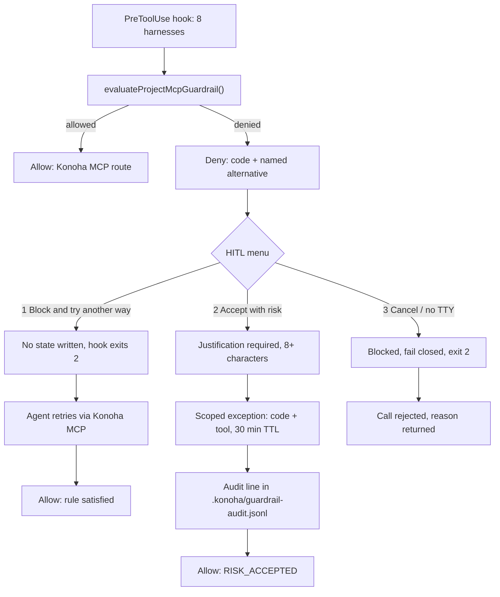

# Konoha MCP Security Architecture & Ingress Controls (v2.2.23)

## 1. Overview & Threat Model

Konoha MCP operates as an orchestrator and tool provider across AI coding clients (OMP, Antigravity, Cursor, Claude Code, Codex, OpenCode, CommandCode, Pi). In version 2.2.1, substantive security hardening was executed in response to supply-chain and ingress audit findings.

---

## 2. Web Authentication & HTTP Ingress Hardening

### 2.1 Privileged Token Isolation
- **No Token on Public Status Endpoints**: `/api/v1/auth/status` and `/api/v1/auth/session` return session metadata (`authenticated`, `is_bootstrap`, `requires_password_change`) without leaking `sessionToken`.
- **Authorized Token Channels Only**: The session token is strictly obtainable via:
  1. Successful `POST /api/v1/auth/login`
  2. Successful `POST /api/v1/auth/pin`
  3. Loopback authenticated `GET /api/v1/csrf` or `GET /api/v1/token`
- **Gate Capabilities, Not the Master Token**: the HITL picker routes (`/api/v1/hitl/picker`, `/api/v1/hitl/verdict`) are the only `/api/v1/` paths exempt from the session-cookie and CSRF-header checks, and they enforce their own control: an HMAC-SHA256 signature of the task directory, keyed by the persisted session token and compared in constant time. The signature is scoped to one directory (a link for one gate cannot approve another), never contains the token, and the page is served `Referrer-Policy: no-referrer` with `Cache-Control: no-store` so the capability does not leak through a referrer or a shared cache.
- **Health Metadata Gating**: `GET /api/v1/health` returns only minimal status (`status: "healthy"`, `version`, `uptime`) to unauthenticated callers. Internal system details (ports, host, database paths, agent counts, Node runtime) are restricted to authenticated sessions.

### 2.2 Request Body Size Limits
- **1 MiB Payload Cap**: `MAX_BODY_BYTES = 1048576` is enforced on all `POST`, `PUT`, `PATCH`, and `DELETE` requests.
- **Early Rejection**: Requests specifying `Content-Length > 1 MiB` are immediately rejected with `413 Payload Too Large`.
- **Stream Protection**: Chunked request streams exceeding 1 MiB are aborted and the socket is destroyed (`req.destroy()`).

---

## 3. Remote Ingress Architecture & Local Authentication

- **Local Loopback & Stdio Exclusivity**: Public tunnel subsystems (Cloudflare Tunnel, ngrok) are permanently eradicated from the Konoha runtime. All ingress routes exclusively over local stdio MCP processes and the authenticated local Web console on `127.0.0.1:1404`.
- **Argon2id Session Authentication**: Web UI access enforces Argon2id password hashing, session tokens, and strict cookie flags (`HttpOnly`, `SameSite: Lax`). All unauthenticated endpoints reject access without leaking tokens.

---

## 4. Telegram Bot Surface Hardening

### 4.1 Deprecation of Shell Handlers (`/sh` and `/exec`)
- Arbitrary host shell execution via Telegram (`/sh` and `/exec`) was permanently removed in v2.2.1.
- Incoming commands receive a decline notification directing operators to use governed autonomous task execution (`/run <task>`).

### 4.2 Universal HTML Escaping
- All dynamic inputs, usernames, workspace paths, session IDs, task prompts, and task summaries are escaped via `escapeHtml(...)` to eliminate HTML injection in Telegram parse mode.

---

## 5. Queue Worker & Autonomous Task Execution

### 5.1 Config-Gated Autonomy
- The `--dangerously-skip-permissions` flag passed to headless CLI workers is strictly disabled by default.
- It is enabled only when explicitly configured via environment variable:
  ```bash
  export KONOHA_ALLOW_UNSAFE_AUTONOMY=1
  ```

### 5.2 SSH Command Hygiene
- Prompts extracting remote SSH executions validate `key` path (`/^[~/][\w.\-/]*$/`), `host` FQDN pattern, and path.
- Injections containing shell command chaining, backticks, subshells (`$()`), pipes (`|`), redirects (`<`, `>`), or newlines are immediately rejected.
- Remote commands are enclosed in single quotes with escaped inner single quotes (`'...'`).

### 5.3 Extended Dangerous Pattern Interception
- Safety guardrails intercept and reject destructive patterns including `drop table`, `chmod 777 /`, `chmod -r 777 /`, `mkfs.`, `> /dev/sd`, `curl | bash`, `curl | sh`, `wget | bash`, `wget | sh`, and forkbombs (`:(){`).

---

## 6. Document & Diagram Engine Hardening

### 6.1 Shared Chromium Launcher (`src/workflow/tokubetsu-scribe/chromium_utils.js`)
- Chromium launches headless with sandbox enabled by default. Safe `--no-sandbox` fallback is attempted only when container host permissions specifically demand it, emitting an explicit warning log.
- Hardcoded `/usr/bin/google-chrome` paths were eliminated in favor of Playwright bundled Chromium resolution or optional `process.env.KONOHA_CHROME_PATH`.

### 6.2 Offline Network Interception
- Render pages intercept network calls: external HTTP/HTTPS and `file:` schemes are blocked. Local system font stacks replace external Google Fonts `@import` calls.

### 6.3 Formula Injection Guard
- Spreadsheet generation validates formula strings, rejecting Excel DDE and dangerous functions: `WEBSERVICE`, `ENCODEURL`, `HYPERLINK`, `CALL`, `REGISTER.ID`/`REGISTER(...)`, `DDE`, `DDEREFERENCE`, `SQL.REQUEST`. See §12.4 for the v2.2.23 additions.

---

## 7. Bridge Architecture: Extension Removal vs. Proxy Gateway

- **Removed**: The external `konoha-bridge` VSIX extension feature from `https://github.com/andycungkrinx91/konoha-bridge` and its auto-install routines.
- **Preserved**: The **OpenAI-Compatible Local LLM Proxy Gateway** (`src/bridge/*`) running locally on port **19999** for token-efficient model routing remains active and protected.

---

## 8. Multi-Workflow Delegation & File Tools

- **Anti-Lost-in-the-Middle**: Dual-Boundary Anchoring (Sandwich Pattern) repeats invariants at prompt headers and tails.
- **Large File Pagination**: `read_file_range` auto-clamps spans $> 250$ lines to 200-line windows with actionable pagination metadata, eliminating exception refusals. Line-by-line stream reading bounds heap usage to $O(1)$.

---

## 9. Runtime Security & Node.js CVE Mitigation

- **Node.js Runtime Baseline (`>=24.0.0`)**: Shipped environments require Node.js `>=24.0.0` (verified on `v24.22.2`), providing built-in `node:sqlite` with FTS5 and mitigating upstream high-severity Brotli/TLS/DNS security advisories.
- **Known Advisories Are Patched, Not Waived**: continuous automated auditing runs `pnpm audit --json` across the root and `apps/web` manifests and asserts the advisory set is *exactly* `["GHSA-fc5q-39xc-vjpf"]` — a repeated-extglob ReDoS in `picomatch <=4.0.7`, which upstream has not released past, so the resolved version string stays flagged. The code is fixed in-tree by `patches/picomatch@4.0.7.patch` and proven by `tests/test_picomatch_redos_patch.js`. There is no `audit.ignore` list: a second advisory fails the gate rather than being silently suppressed.
- **Package Manager Mandate**: Scaffolding and installs strictly utilize `pnpm` with token-safe non-interactive flags; standalone unconstrained `npx` or `npm` fallbacks are permanently decommissioned.

### 9.1 The one accepted static-scan finding: `GHSA-fc5q-39xc-vjpf`

`aislop scan` reports exactly one diagnostic, `security/vulnerable-dependency` for `picomatch`. It is accepted, not suppressed — no `.aislopignore` entry, no `--ignore` flag, no baseline write. Three facts make it unavoidable:

1. **No upstream fix exists.** The advisory covers `picomatch <=4.0.7` and upstream declares `patched_versions: null`. There is no version to upgrade to; `pnpm-workspace.yaml:86` pins the current release and applies `patches/picomatch@4.0.7.patch` on top.
2. **The local patch is verified.** The patched build resolves as `picomatch@4.0.7_patch_hash=30ae93f3…` and contains `analyzeRepeatedExtglob` / `repeatedExtglobRecursion` plus the `analysis.risky` gate. `tests/test_picomatch_redos_patch.js` proves the ReDoS is gone in a child process while 20 realistic globs keep their semantics.
3. **The scanner has no patched-dependency awareness.** aislop shells out to `pnpm audit`, which keys on the resolved version string alone, so a patched build is indistinguishable from an unpatched one.

Consequence: `.aislop/config.yml` sets `ci.failBelow: 100`, and **that target is not reachable while the advisory is open** — the scan tops out at 99. Nothing fails today because aislop is not wired into any `.github/workflows/` file; if it is ever added, the gate must special-case `security/vulnerable-dependency` for `picomatch` rather than lower the threshold. See `docs/TROUBLESHOOTING.md` §"`GHSA-fc5q-39xc-vjpf` is patched, not ignored" for the advisory's history.

---

## 10. Akatsuki Security Sandbox Controls & Dual-Mode Isolation

`@akatsuki` is the successor to the legacy BlackOps security identity and holds all dedicated offensive and defensive security responsibilities in Konoha. `@anbu` remains an independent agent focused on Backend engineering, DevOps, infrastructure automation, and bug fixing, escalating security reviews and vulnerability assessments to `@akatsuki`.

### 10.1 Dual-Mode Operation (`mode: blue | red`) & Governance Integration
- **Default Mode (`blue` — Defensive Security Review & SDLC Gate)**:
  - By default, `@akatsuki` operates in **Blue Mode (`mode: blue`)** as a standard, non-invasive defensive security reviewer integrated into Konoha SDLC governance (`runAkatsukiFinalGate`).
  - Blue Mode performs static application security testing (SAST) on modified files, secret/credential leakage detection (`.env*`, API tokens, private keys), dependency supply-chain CVE verification (`pnpm audit`, Socket CLI), and Skill Guardian policy checks (`src/workflow/kage-reviewer/skill_guardian.js`) before `@kage` evaluates the final delivery gate.
  - Normal defensive code review is standard engineering governance—not an invasive or unauthorized activity. In Blue Mode, any offensive `akatsuki-lab` container is stopped and removed (`fail-closed` safety invariant).
- **Authorized Red-Team Mode (`red` — Isolated Sandbox Assessment)**:
  - Switching to Red Mode via `konoha akatsuki mode red` or `konoha akatsuki enable` provisions an isolated, unprivileged sandbox container (`akatsuki-lab`) for authorized security assessments, penetration testing, and exploit verification within Konoha or an explicitly user-approved local/dev project scope.

### 10.2 Container Execution Engine Isolation (`env: docker | lxc`)
- **Host Execution Prohibited**: Direct execution of offensive security tools (`nmap`, `metasploit`, `zap`, `nuclei`, `ffuf`, `sqlmap`, `tshark`, `testssl`, `trivy`, `curl_probe`) on the host system is strictly blocked.
- **Docker Sandbox Engine (Default)**: Executes within container `akatsuki-lab` with `--security-opt=no-new-privileges:true`, `--cap-drop=ALL`, `--cap-add=NET_RAW`, non-root user `akatsuki` (UID 1000), internal bridge isolation (`internal: true`), 2GB memory cap, and 2 CPU core limit.
- **LXC Container Engine**: Executes within an unprivileged system container (`security.privileged=false`) bound to isolated bridge `labbr0` with strict egress ACL rejection (`lab-egress`).

### 10.3 Authorized Scope Boundaries & Persona Gating
- **Authorized vs. Prohibited Activity**:
  - **Authorized Scope**: Defensive Blue-Mode code review of the active workspace, dependency auditing, and authorized Red-Mode testing against `localhost`, `127.0.0.1`, local containers, or explicitly user-approved project targets under written Rules of Engagement (RoE).
  - **Prohibited Activity**: Targeting unauthorized external infrastructure, destructive payloads (`rm -rf`, `DROP`), credential exfiltration, or unconsented network probing is strictly forbidden and fails closed immediately.
- **Strict Persona Access**: Dedicated security skills (`akatsuki-skill` today; any skill named under the `pentest-` / `patch-diff-exploit-` prefixes, listed in `RED_SKILLS`, or tagged `red-team` / `pentest` / `offensive`) are classified red by the single registry `src/skill_authorization.js` and are strictly quarantined to `@akatsuki`. Invocations from other Ninja agents, or from anonymous callers, return `SKILL_AUTHORIZATION_DENIED` fail-closed. The gate runs at discovery (`find_skill`, `list_skills`), retrieval (`get_skill`), MCP dispatch, delegation (`buildSpawnDirective`), Sannin route/envelope, and inside `runRedTeamWorkflow`. At the MCP boundary the caller identity comes from `_resolveAgentIdentity(args)`, never from the requested tool name; an absent identity is a denial, not a pass. Discovery returns redacted metadata (`content: '[REDACTED]'`) rather than file bodies. See [docs/security/RED-SKILL-INVENTORY.md](security/RED-SKILL-INVENTORY.md).

### 10.4 Lab Database Segregation
- **Physically Separate SQLite File**: The Akatsuki Lab stores its run history, tool invocations, Kali catalog, and red-skill audit trail (`red_skill_audit`) in `~/.konoha/akatsuki-lab/lab.db` (`KONOHA_LAB_DB_ROOT` / `KONOHA_AKATSUKI_LAB_DB` overrides), opened only through `src/workflow/akatsuki/lab_db.js#openLabDb`. The main store (`~/.konoha/konoha.db`) remains untouched by lab provisioning, execution, and teardown.
- **Enforced by Connection Boundary**: `getConnection` refuses any path under the lab root (`LAB_DB_ISOLATION_VIOLATION`); `openRawConnection` never inherits `KONOHA_DB_PATH` and skips the main schema, migration, and vector setup. Lab child processes get `KONOHA_DB_PATH` pinned to the lab file. No config flag or option can move a lab write onto the main connection. See [docs/security/DATABASE-ISOLATION-INVENTORY.md](security/DATABASE-ISOLATION-INVENTORY.md).
- **Audit Write Is Never an Authority**: `runRedTeamWorkflow` attempts to record each red-skill decision (`allowed`/`denied`) through `auditRedSkill` (`src/workflow/akatsuki/lab_audit.js`) → `recordRedSkillAudit`, into a caller-supplied connection or an existing-file-only open that cannot create or migrate the store. Best-effort: a missing lab or a failed write costs the row and never changes the decision. Both the denial and allowed paths are covered; the identity recorded is the one the gate resolved.
- **Teardown Purge**: On confirmed teardown the lab file and its WAL sidecars are deleted; a failed teardown retains them for post-mortem. There is no backup surface for the lab store.

---

## 11. Bridge Payload Budget & 3D Reference-Image Ingress (v2.2.23)

### 11.1 Bridge Request Budget
- **Hard Ceilings**: `src/bridge/request_budget.js` enforces `MAX_BODY_BYTES = 32 MiB`, `MAX_INPUT_TOKENS = 200000` (estimated at ~3.5 chars/token), and `MAX_MESSAGES = 2000` per bridge request.
- **Reject Before Read**: `rejectOversizedByHeader()` runs before the request body is buffered, so an oversized `Content-Length` never allocates payload memory. In-stream payloads that exceed the transcript ceiling are cut off at the same boundary.
- **Cache Capability Is Never Assumed**: `src/bridge/cache_capability.js` reports cached-token support only for recognised Anthropic, OpenAI, and Google hosts (with Anthropic's 1024-token minimum and 4-breakpoint limit). An unrecognised endpoint is reported as `unknown` instead of being treated as cache-capable.
- **Prefix Stability**: `src/bridge/prefix_stability.js` refuses to emit provider cache hints when the prompt prefix contains volatile material (ISO timestamps, UUIDs, epoch milliseconds, job IDs), preventing cache-miss storms that silently multiply billed input tokens.

### 11.2 3D Reference-Image Upload
- **Decoded Size Cap**: `POST /api/v1/3d/upload-image` accepts at most 12 MiB of decoded image data; larger payloads are refused with `413`.
- **Magic-Byte Sniffing**: The declared filename extension is ignored. Only PNG, JPEG, and WebP signatures are accepted; anything else is refused with `415`.
- **Filename Sanitisation**: the reference stem is reduced to `[a-zA-Z0-9_-]` before it is used as a filesystem name, so upload names cannot traverse directories.
- **Authenticated Only**: the route requires an authenticated Web session like every other mutating `/api/v1/*` endpoint.

---

## 12. Supply Chain & Dynamic Execution Hardening (v2.2.23)

### 12.1 Zero Dynamic Execution
- **No `eval` / `Function` in the runtime**: `src/`, `bin/`, and `scripts/` contain no `eval(`, no `new Function(`, and no `node:vm` code-generation call. `tests/test_no_dynamic_execution.js` scans every runtime file and fails the build if one reappears.
- **Guardrail checker is embedded, not compiled**: `src/mcp_clients/command_code.js`, `src/mcp_clients/claude_code_hooks.js`, and `src/pi_blocker_template.js` emit `buildGuardrailCheckerSource()` verbatim as a function expression (`const checkCommandGuardrails = function checkCommandGuardrails(command) {...}`) instead of wrapping the source in `new Function(...)()`. One source of truth, zero code generation in the generated hook.

### 12.2 `lodash` Removal (`patches/xlsx-populate@1.21.0.patch`)
- **Why**: `lodash` was a transitive dependency of `xlsx-populate@1.21.0` only, and its `template()` function compiles strings with `Function`, which is the static eval sink scanners flagged. Konoha never called `template`; the sink was nonetheless shipped inside the published tarball, because `xlsx-populate` is a `bundleDependency`.
- **What**: the pnpm patch replaces all 19 `require("lodash")` call sites with `lib/lodash-lite.js`, a 27-helper shim implementing exactly the surface `xlsx-populate` uses, with lodash-4-faithful semantics (object-shorthand iteratees, `sortBy` identity default and iteratee-list flattening, `remove` mutation, `includes` SameValueZero, cycle-safe `cloneDeep`). `lodash` is dropped from the dependency list.
- **Parity**: `tests/test_xlsx_populate_lodash_lite.js` asserts the helper behaviours against documented lodash 4 semantics, including sparse-array iteration and a full XLSX round-trip (merges, frozen pane, autofilter, formulas, styles) through the real `spreadsheet_create` tool.
- **Bundle removal**: the patch also deletes `browser/` (13.9 MiB webpack bundle, 52 `Function(` occurrences, 154 `template` references) and `examples/`, and removes the `browser` field from the manifest. Konoha is Node-only (`main: lib/XlsxPopulate.js`), so no consumer path changes.

### 12.3 Presentation Image Boundary (`src/workflow/tokubetsu-scribe/doc_engine_presentation.js`)
- `pptxgenjs` resolves `addImage({ path })` with `fs.readFileSync` and `addImage({ path: 'http…' })` with an HTTPS GET. Konoha only embeds internally rendered cover artwork, so the engine routes every image through `addInlineImage(slide, buffer)`, which requires an in-memory PNG buffer (magic-byte checked) and emits a base64 data URI. No path or URL string can reach `addImage`; `tests/test_document_engine_security.js` asserts the single guarded call site.

### 12.4 Spreadsheet Formula Blocklist
- `sanitizeFormula()` now also rejects `DDE(` and `REGISTER.`/`REGISTER(`, closing the Excel DDE command-execution vector alongside the existing `WEBSERVICE`, `ENCODEURL`, `HYPERLINK`, `CALL`, `DDEREFERENCE`, and `SQL.REQUEST` rules.
- **DDE link operator**: the same payload has a second spelling, `=cmd|' /C calc'!A0`, which names none of those functions. `|` is not an Excel operator, so any pipe outside a quoted string literal is treated as a DDE link and rejected. `Sheet2!A1` references and `="a|b"` text still pass; `tests/test_document_engine_security.js` asserts all four directions.

### 12.5 Install Scripts & Deterministic Releases
- **Native install scripts stay denied**: `pnpm-workspace.yaml#allowBuilds` keeps `onnxruntime-node: false` and `protobufjs: false`. `onnxruntime-node`'s postinstall downloads CUDA EP binaries from NuGet without checksum verification; ONNX inference itself is unaffected because the JS binding ships prebuilt.
- **Frozen installs**: `.github/workflows/publish.yml` installs with `--frozen-lockfile`. Release builds cannot resolve a dependency version that is not in the committed lockfile.
- **Exact pins**: `xlsx-populate`, `pptxgenjs`, `cfb`, `docx`, `playwright`, and `hash-wasm` are pinned to exact versions, so the patched and bundled packages cannot drift between lockfile resolution and publish.
- **No browser bundles in the shipped tree**: the three patched packages ship only the Node entry points Konoha loads. `xlsx-populate` loses `browser/` (13.9 MiB, 52 `Function(` occurrences) and `examples/`; `pptxgenjs` loses `dist/pptxgen.bundle.js` and its source map; `jszip` loses `dist/` and the `browser` manifest field. All three bundles carry a `setImmediate` polyfill of `new Function(""+e)`, and the remaining `pptxgen.cjs.js`/`.es.js`/`.min.js` and `jszip/lib/` contain none. A scan of the packed tarball finds zero `new Function(` or `eval(` occurrences across 205 bundled `.js` files. `tests/test_dependency_posture.js` asserts the installed trees, not just the patch files, so a stale `node_modules` cannot re-ship a deleted bundle.
- **Socket suppressions narrowed**: `socket.yml` no longer suppresses `usesEval`, and no longer ignores `pnpm-lock.yaml` or `patches/**`, so supply-chain and patch changes are audited. `envVars`, `urlStrings`, `networkAccess`, `gptSecurity`, `gptAnomaly`, and `newAuthor` remain suppressed because those capabilities are Konoha's documented contract.

### 12.6 Release-Time Dependency Audit
- `tests/test_dependency_posture.js` fails the build if `lodash` reappears in the lockfile or manifest, if the `xlsx-populate` patch loses its `lodash-lite` shim or stops deleting the browser bundle, if the `pptxgenjs` or `jszip` patches stop deleting their browser builds, if an installed tree still contains a deleted bundle (a stale `node_modules` after a patch edit), if any bundled dependency loses its exact pin, if the publish workflow reverts to `--no-frozen-lockfile`, or if `onnxruntime-node` builds are re-enabled.
- **License attribution is part of the audit.** The tarball redistributes `bundleDependencies` and their transitive closure — 19 packages across Apache-2.0, MIT, ISC, and BlueOak-1.0.0. `NOTICE` names each one with its license and copyright, records that `jszip` is redistributed under its MIT option rather than GPL-3.0-or-later, and `tests/test_package_tarball_files.js` reads the packed artifact to fail on an unattributed package or a missing license file. Patched files stay under the license of the package they patch.

---

## 13. Subagent Process Launch Hardening (v2.2.23)

Delegation runs other coding harnesses as child processes, so the launch path is an execution boundary. Seven properties are enforced; the first five have a check in `tests/test_spawn_harness_contracts.js` that fails when the behaviour is removed, and the last two are pinned by `tests/test_deploy_safety.js` and `tests/test_omp_manager.js`.

- **No shell interpolation of task text on POSIX.** The harness is spawned with `shell: false` and the task arrives as a single argv element, so `$HOME`, backticks, and quotes in a task reach the child literally. The CLI fallback that a model is told to run is POSIX-quoted (`'…'` with `'\''` for embedded quotes) rather than JSON-encoded, because a shell would expand a JSON string's `$` and backticks.
- **Windows goes through `ComSpec` only for shims, with verbatim argv.** npm/pnpm install these harnesses as `.cmd` shims, and Node refuses to spawn those without a shell (EINVAL since the CVE-2024-27980 fix). A `.cmd`/`.bat` is launched as `ComSpec /d /s /c "<line>"` with `windowsVerbatimArguments`, so libuv does not re-quote the command line. Each argument is quoted and embedded quotes are doubled. `cmd.exe` treats a newline as a command separator, so on this one route newlines are flattened to spaces; a real executable (`.exe`) is spawned directly with no shell.
- **`%NAME%` expansion remains possible inside a `cmd.exe` line.** Environment expansion is a property of the shell, not of the quoting, so a Windows task string containing `%USERPROFILE%` would expand. The task text originates from the orchestrating agent in the same trust domain, not from remote input; if that assumption ever changes, the upgrade path is to pass the prompt through a temp file rather than argv.
- **Cancellation kills the tree, not the launcher.** Because the process held on Windows is `cmd.exe`, a plain `kill()` would leave the harness running. Timeout and abort escalation use `taskkill /pid <pid> /T`, with `/F` only on the escalation pass after the grace window; POSIX keeps the existing `SIGTERM`→`SIGKILL` sequence, which already reaches the child.
- **Fail-closed capability gate.** A harness is only launched when its binary resolves on `PATH`; the probe is `PATHEXT`-aware on Windows and checks the execute bit on POSIX, so a same-named non-executable file cannot be selected and turned into an `EACCES`. When nothing resolves, the spawn returns `UNSUPPORTED_NATIVE_SPAWN` with an actionable message instead of falling back to a guess.
- **Deployed agent files are overwritten only when Konoha wrote them.** Ownership is established by the `generated_by: konoha` frontmatter marker *or* the managed contract block, so an agent file Konoha deployed in an earlier release is upgraded in place instead of being treated as user-authored and parked as `.konoha-proposed`. Without the contract-block clause, every agent deployed before the marker existed kept the tool grants of the release that first wrote it — including `Write`/`Edit`/`Bash` on the read-only scout. The foreign-file path is unchanged: user-authored agents still receive a one-time `.konoha-backup` and a `.konoha-proposed` candidate, never an overwrite.
- **A sandboxed home cannot rewrite project configuration.** `ensureOmpSetup` auto-detects a project from `cwd`, which is correct for the CLI and wrong for anything running under a temporary `HOME`: a test run rewrote the repository's `.omp/mcp.json` to point at its own throwaway launcher, after which every delegated agent in that checkout started without the Konoha MCP server. The sandbox check compares `options.home` against `os.userInfo().homedir`, not `process.env.HOME`, because the environment variable is exactly what a sandbox overrides.

---

## 14. Guardrail Denial & Human-in-the-Loop Resolution (v2.2.23)

The project guardrail intercepts every harness `PreToolUse` call and denies native reads, searches, globs, outlines, and unwrapped shell inside a Konoha checkout. A denial is not a dead end: it is a decision point with exactly two real outcomes — route the call through the Konoha alternative, or accept the risk with a written, scoped, expiring, audited exception.

### 14.1 Hooks stay fail-closed; the prompt is a separate front end

A hook has one non-interactive JSON answer and cannot ask a question, so the automated path never prompts. `scripts/konoha_project_mcp_guard.js` keeps its hook contract (`--harness <name>`, stdin JSON, one JSON object on stdout, exit `2` on deny with `--exit-on-deny`) and adds an opt-in interactive path behind `--hitl`.

The copy that ships is `.agents/plugins/konoha-mcp-guard/scripts/konoha_project_mcp_guard.js`, which has no `src/` sibling, so both `project_konoha_mcp_guardrail` and `guardrail_hitl` resolve through one candidate search (`_resolveSrcModule`) rather than a relative `require`. Without it, `--hitl` on the deployed copy exited `2` with `Cannot find module '../src/guardrail_hitl'` and nothing else — the same code a real denial returns, with no briefing and no named alternative, so neither the harness nor the human could tell a crash from a block.

The denial payload arrives on **stdin**, so stdin is a pipe whenever `--hitl` runs in a pipeline — and a pipe cannot answer a prompt. The menu therefore reads the **controlling terminal** (`/dev/tty`, or `CONIN$`/`CONOUT$` on Windows) instead of `process.stdin`. No controlling terminal — a hook, a CI job, a detached process — fails closed: the reason and the named alternative go to **stderr** (so a caller parsing stdout still gets clean JSON) and the exit code is `2`. Nothing is recorded. `KONOHA_GUARD_NO_TTY=1` forces the no-terminal branch explicitly, which is how the regression proves it from a script instead of waiting on a developer's keyboard; the override can only force a block, never an allow.

### 14.2 Denials name the alternative

Every denial carries a code, and every code maps to the Konoha route that satisfies it (`describeGuardrailRemediation`). A denial that only says "blocked" trains an agent to retry the same call; a denial that names `konoha:read_file_range` ends the loop in one step.

| Denial code | Named alternative |
|---|---|
| `KONOHA_MCP_REQUIRED_READ` | `konoha:read_file_range`, `read_file_head`, `file_info` |
| `KONOHA_MCP_REQUIRED_SEARCH` | `konoha:code_search`, `code_symbol`, `code_impact`, `token_efficient_grep` |
| `KONOHA_MCP_REQUIRED_DISCOVERY` | `konoha:find_files_clean` |
| `KONOHA_MCP_REQUIRED_STRUCTURE` | `konoha:get_file_structure`, `code_symbol` |
| `READ_ONLY_AGENT_WRITE_DENIED` | delegate the edit to `@anbu` or `@jonin` |
| `RTK_REQUIRED` | prefix the command with `rtk` |
| `RETIRED_LEGACY_MCP` | `konoha:find_skill`, `use_skills`, `build_from_source` |
| `RETIRED_LEGACY_IPC`, `SHELL_GUARDRAIL_VIOLATION` | no in-place alternative; rewrite the call |
| `SECRET_FILE_WRITE_DENIED` | no alternative by design |
| `GUARDRAIL_STATE_WRITE_DENIED` | nothing writes the store by hand; accept through the guard CLI at a human terminal |

### 14.3 The three-way menu



The projection of this page is `assets/konoha-flow-19-guardrail-denial-human-in-the-loop-resolution.webp`; drawio page 19 is the editable source.

### 14.4 An accepted risk is narrow by construction

- **Scoped to one denial code and one tool.** `_exceptionCovers` compares the code and the tool name only. The target path is recorded for the audit trail but is deliberately *not* part of the match: `_extractTargetPath` returns a grep call's `pattern` before its `path`, so path equality rejected the very call the human had just approved. Accepting `KONOHA_MCP_REQUIRED_READ` for `Read` therefore leaves `Glob` and `Grep` denied.
- **Time-limited.** Default TTL 30 minutes (`--ttl-minutes` overrides). Expired entries are pruned on read, so an acceptance cannot outlive its window by being left on disk.
- **Justified.** `recordGuardrailException` throws below 8 characters; `--accept-with-risk` refuses the same way. An empty justification is a rubber stamp, not a decision.
- **Audited.** `.konoha/guardrail-audit.jsonl` is append-only and records `risk_accepted` (id, code, tool, path, harness, who, why, expiry) and `exceptions_revoked` (count). A reviewer can reconstruct every acceptance without asking the operator.
- **Revocable.** `--revoke-exceptions` deletes the store and audits the removal; `--list-exceptions` prints what is live.
- **Not writable by the gated agent.** The store is the bypass, so a tool call that could write it would grant itself permission. Both the write-tool branch and the `rtk` shell branch deny `GUARDRAIL_STATE_WRITE_DENIED` when a call names `guardrail-exceptions.json` or `guardrail-audit.jsonl` — a plain `Write` and an `rtk cp` over the same path are closed the same way.
- **Not available for every rule.** `NON_ACCEPTABLE_CODES` reserves `SECRET_FILE_WRITE_DENIED`, `SHELL_GUARDRAIL_VIOLATION`, `GUARDRAIL_STATE_WRITE_DENIED`, and the retired IPC paths: the menu withholds accept, `recordGuardrailException` throws, and `evaluateProjectMcpGuardrail` ignores any entry for them even if one is written into the store by hand. A rule whose only correct outcome is "no" would otherwise become a button.
- **Capped.** A requested TTL is clamped to `MAX_EXCEPTION_TTL_MS` (one hour), and `readGuardrailExceptions` drops any entry older than that ceiling regardless of the expiry it claims, so neither `--ttl-minutes` nor a hand-edited `expires_at` can mint a permanent bypass.

Both files are machine-local runtime state and are gitignored (`.konoha/guardrail-*.json`, `.konoha/guardrail-*.jsonl`). A risk acceptance is a decision about one checkout on one machine, so shipping it in a tag would hand a future clone an exception its operator never granted.

### 14.5 Non-interactive acceptance

An operator who has already decided does not need a prompt:

```bash
echo '{"tool_name":"Read","tool_input":{"file_path":"src/server.js"},"cwd":"'$PWD'"}' \
  | node scripts/konoha_project_mcp_guard.js --harness omp \
      --accept-with-risk --justification "auditing the guard for the CI fix" --ttl-minutes 15
```

The justification is still mandatory, the TTL still applies, and the audit line is still written — the only thing skipped is the menu.

`tests/test_project_konoha_mcp_guardrail.js` covers all of it: tests 9-13 assert that acceptance writes the exception and the audit line and lets the next identical call through while a different code or tool stays denied, that blocking writes nothing, that an expired entry is pruned and ignored, that `--hitl` with no controlling terminal exits `2` and records nothing, and that the menu defaults to block on EOF and refuses a short justification. Test 14 drives the CLI under a real pty with the payload on stdin, which is the shipped shape of the command: the menu appears, choice `1` exits `2` and writes nothing, and choice `2` records exactly one exception scoped to the denied tool. Test 15 closes the self-minting loop: a `Write` and an `rtk cp` against the store are both denied `GUARDRAIL_STATE_WRITE_DENIED`, an unconditional rule refuses to be recorded and is not covered by a forged entry, an entry past the one-hour ceiling is pruned, a requested TTL is clamped, and an ordinary write to `src/` still passes. Each behaviour is proven to bite by a mutation (exception match disabled, expiry ignored, exit code softened, menu default flipped, payload re-read from a drained stdin, justification length unchecked, store write allowed, forged unconditional entry honoured, menu refusal disabled, ceiling removed, TTL uncapped — eleven mutations, all reported). Test 6 closes the loop on the copy that actually ships: it runs `.agents/plugins/konoha-mcp-guard/scripts/konoha_project_mcp_guard.js` with `--hitl` and no terminal and asserts the fail-closed briefing on stderr, which is what a relative `require` into a directory with no `src/` sibling cannot produce.

---
