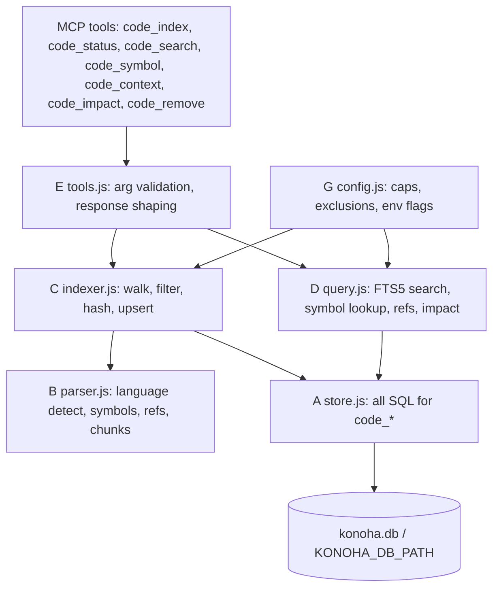

# Issue #13 — Gate 1: Native Code Intelligence Engine (audit, design, approval packet)

Status: **Gates 1–5 complete — implemented on the feature branch for v2.2.22.**
Branch: `feature/issue-13-native-code-intelligence` · base `09faf82a` (v2.2.21, schema v5, 50 MCP tools) · targets schema v6 with 55 canonical MCP tools.
Scope of this document: the Gate 1 audit and design, preserved as the record of what was measured before the change. Sections 1–13 describe the pre-change tree and keep their original line citations; Sections 10 and 14 carry the as-built notes.

---

## 1. Executive Summary

Semble is an external Python MCP server (`uvx --from semble[mcp]@latest semble --content all`) registered into 8 client configuration paths and granted to every subagent; it is the only code-search path Konoha has today. Issue #13 replaces it with a native engine living in Konoha's own `~/.konoha/konoha.db` (honoring `KONOHA_DB_PATH`): 7 new MCP tools over schema **v6** with 6 new declared tables (5 ordinary + 1 FTS5 virtual, plus 4 extension-created shadow tables), symbol extraction by a pure-JS lexer with **zero new dependencies**. An LSP adapter was considered and deferred (see Section 7); nothing in the shipped engine spawns a process. Semble is removed only after parity, data migration, and 3-OS test evidence exist. Separately, the audit found two pre-existing deployment-safety defects that will corrupt user files on the next `konoha init`: `syncSoulAcrossClients` overwrites `SOUL.md` in 10 home directories with no backup or ownership check, and `_deployClaudeCodeAgents` overwrites and deletes files under `~/.claude/agents/` unconditionally. Both fixes are scheduled in Gate 2, before any re-deploy. Recommendation: **approve Gate 2**.

Measured blast radius of the current integration: 44 source files under `src/` and `bin/`, 37 test files, 35 documentation files, 17 template files.

## 2. Current State of Semble Integration

### 2.1 Package and runtime

| Concern | Implementation | Location |
|---|---|---|
| Package spec | `SEMBLE_PACKAGE = 'semble[mcp]@latest'` | `src/semble_manager.js:3` |
| Co-located Aislop spec | `AISLOP_PACKAGE = 'aislop@latest'` | `src/semble_manager.js:4` |
| uvx resolution | `resolveUvxExecutablePath()` / `getUvxCommand()` / `isUvxUsable()` | `src/semble_manager.js:11`, `:45`, `:49` |
| Status probe | `getSembleStatus()` builds `{ package, command }` | `src/semble_manager.js:63`, `:83-85` |
| Savings cache | `SEMBLE_SAVINGS_TTL_MS = 60000`; 60 s TTL guard | `src/semble_manager.js:96`, `:171` |
| Search invocation | `spawnSync(uvxCmd, ['--from', SEMBLE_PACKAGE, 'semble', 'search', query, path, '-k', k])` | `src/semble_manager.js:230` |
| Public surface | `module.exports` keeps `SEMBLE_PACKAGE`, `AISLOP_PACKAGE`, and the helpers | `src/semble_manager.js:249-260` |

### 2.2 MCP registration (8 sites)

| Client | Registration |
|---|---|
| Cursor bootstrap | `src/cursor_bootstrap.js:184` |
| Pi | `src/pi_manager.js:437` |
| Cursor | `src/cursor_manager.js:97-104` |
| Codex | `src/codex_manager.js:284` |
| OpenCode | `src/opencode_manager.js:150` |
| Shared MCP client writer | `src/mcp_clients/common.js:115-121` |
| OMP | `src/omp_manager.js:149` |
| Runtime MCP (CLI-launched servers) | `bin/lib/runtime_mcp.js:188-213` |

`KONOHA_MCP_NAMES = ['konoha', 'semble', 'aislop']` at `src/mcp_clients/common.js:20` is the single list that the per-client writers iterate; ownership of the injected keys is recorded as `mcpServers.konoha` / `mcpServers.semble` at `src/mcp_clients/common.js:156`.

### 2.3 Tool grants and prompt policy

| Concern | Location |
|---|---|
| Grant construction `mcp__semble__search`, `mcp__semble__find_related` | `src/mcp_clients/common.js:218-220` |
| Safe-grant table for subagents | `src/mcp_clients/common.js:246-249` |
| Expanded subagent grants | `src/mcp_clients/common.js:268-280` |
| Subagent tool catalog injection | `src/mcp/memory_subagent_runner.js:129-132` |
| System-prompt mandate "SEMBLE IS MANDATORY" | `src/mcp/memory_subagent_runner.js:508` |
| Prompt policy constants | `src/search_policy.js:3`, `:6`, `:9`, `:34`, `:62-66` |

### 2.4 User-facing surfaces

| Surface | Location |
|---|---|
| `konoha status` per-client rows keyed on `mcpSemble` | `bin/commands/status.js:139-148`, `:153-210` |
| `konoha doctor` MCP-config health | `src/doctor.js:78-92` |
| `doctor services` | `bin/commands/doctor_services.js:89-99` |
| Web services controller | `src/web/controllers/services_controller.js:172-192` |
| `konoha init` install path and uv warning | `bin/commands/init.js:53`, `:75`, `:120`, `:127-128` |

### 2.5 Removal hazard

`src/semble_manager.js` is **not** Semble-only. Aislop's `uvx` resolution and `AISLOP_PACKAGE` are imported from it by 9 modules: `src/mcp_clients/common.js:6`, `src/cursor_manager.js:10`, `src/omp_manager.js:31`, `src/codex_manager.js:3`, `src/opencode_manager.js:19`, `src/pi_manager.js:17`, `src/cursor_bootstrap.js:29`, `bin/lib/runtime_mcp.js:20`, `bin/commands/doctor_services.js:19`. Gate 5 must therefore **edit** this module, not delete it.

## 3. Repository Constraints and Invariants

Any design must satisfy all of the following. Each is enforced by a test or by a load-bearing code path.

1. **Single `user_version` writer.** `setUserVersion(conn, CURRENT_SCHEMA_VERSION)` at `src/db_schema.js:566` is the only write. `tests/test_schema_migrations_and_lifecycle.js:131-149` scans `src/` and `bin/` for any second `PRAGMA user_version = N` and fails.
2. **`setupSchema` is not transactional.** It is `setupSchema(conn, backupDatabaseFn)` at `src/db_schema.js:123`; each legacy block is wrapped in its own `try/catch` that swallows non-fatal errors (e.g. `:539`, `:547`). `runTransactionalDatabaseMigration()` at `bin/lib/install_lifecycle.js:55-62` merely *calls* `setupSchema(conn)` — it does not wrap it. Therefore a new migration must open its own `BEGIN IMMEDIATE` transaction and roll back on failure.
3. **Integrity verification is currently discarded.** `verifyIntegrity(conn)` is called at `src/db_schema.js:567` and its boolean return value is dropped.
4. **Table counts are asserted.** `tests/test_schema_migrations_and_lifecycle.js:162` asserts a fresh `setupSchema` produces exactly 32 base tables; `tests/test_schema_traceability.js:23-24` pins `RAW_TABLE_COUNT = 32`, `DECLARED_TABLE_COUNT = 24` (24 declared + 8 FTS5 shadow tables; `_sqliteai_vector` and `sqlite_%` are excluded as extension-owned, per the comment at `:19-22`).
5. **Every declared table must be documented.** `assertEveryTableIsDocumented()` at `tests/test_schema_traceability.js:68-81` filters out `_fts_(data|idx|config|docsize|content)` shadows and requires every remaining fresh table name to appear in `docs/security/DATABASE-SCHEMA-AUDIT-2026-11-09.md`. That document's own counts are "Fresh: 33 user tables, 58 indexes, 31 named indexes, 6 triggers" (`docs/security/DATABASE-SCHEMA-AUDIT-2026-11-09.md:31-36`) — 33 because it counts `_sqliteai_vector`.
6. **FTS5 is capability-probed, not assumed.** `hasFts5Support(conn)` creates and drops a temp probe table (`src/db_schema.js:30-38`); the two existing virtual tables are only created when it returns true (`:375-431`).
7. **External-content FTS5 pattern is fixed.** `skills_fts` uses `content=skills, content_rowid=rowid` with `ai`/`ad`/`au` triggers, the delete rows using the `'delete'` command form (`src/db_schema.js:378-403`). New tables must mirror this shape.
8. **Tool registration is a triple that must move together.** `src/mcp_tool_manifest.json` (50 tools), `TOOL_HANDLERS` in `src/file_tools_router.js:443`, and dispatch in `src/mcp/tool_dispatch.js:475`. `tests/test_docs_currency.js:140-145` asserts the manifest length is exactly 50 **and** that the manifest set equals the router set.
9. **The manifest drives the protocol.** `MCP_MANIFEST` is loaded from JSON at `src/mcp/protocol.js:48-56`; `tools/list` filters it at `:203` and unknown tool names are rejected against it at `:145`.
10. **Subagent prompts are manifest-derived with a hard ceiling.** `_loadManifestToolCatalog()` at `src/mcp/memory_subagent_runner.js:107`, injection at `:129-137`, ceiling `PROMPT_CEILING_BYTES = 8000` at `:160`, enforced at `:637-650`.
11. **CI is 3 OSes × 8 shards.** `.github/workflows/cross-platform.yml:43` (checks job matrix) and `:104-105` (test matrix `os: [ubuntu-latest, windows-latest, macos-latest]` × `shard: [1..8]`). Shard discovery is `tests/test_*.js` via `tests/run_all.js:311-352`; an empty shard is a hard failure (`:346-350`).
12. **One DB path resolver, WAL, FK on.** `src/db.js:17-18` honors `KONOHA_DB_PATH`; `_applyConnectionPragmas` sets `journal_mode = WAL`, `foreign_keys = ON`, `busy_timeout = 5000`, `synchronous = NORMAL` (`src/db.js:51-54`).
13. **Lab isolation is enforced by name and by path.** `getLabDbDir()` (`src/skill_authorization.js:149`), `isLabDbPath()` (`:158`), `assertLabDbPath()` (`:170`) with code `LAB_DB_ISOLATION_VIOLATION`; `KONOHA_LAB_DB_ROOT` override at `:150`; Akatsuki's own env `KONOHA_AKATSUKI_LAB_DB` / `lab.db` at `src/workflow/akatsuki/lab_db.js:21-22`.
14. **Genin read-only is a two-layer guarantee.** Tool-level block list at `src/mcp/tool_dispatch.js:518-526` (5 document/export tools) plus prompt-level mandate at `src/mcp/memory_subagent_runner.js:151` and `:512`.
15. **No new runtime dependency.** Nothing is installed automatically by `konoha init`; `node_modules` contains no parser library (see F-09).

## 4. Verified Findings

All findings below were confirmed by reading the cited lines in this working tree. Nothing in this section is inferred.

| ID | Finding | Location |
|---|---|---|
| F-01 | `generateDeterministicVector()` builds a normalized `Float32Array` from sha256 hex pairs and is what `embedText()` falls back to when no ONNX extractor exists. It carries no semantic information. | `src/vector_pipeline.js:165-176`, `:202+` |
| F-02 | `getEmbedPipeline()` is the only reliable "real embeddings are available" probe; it is defined at `:66` and exported at `:301`. | `src/vector_pipeline.js:66`, `:301-316` |
| F-03 | `verifyIntegrity(conn)` return value is discarded at the end of `setupSchema()`. | `src/db_schema.js:567` |
| F-04 | `setupSchema(conn, backupDatabaseFn)` is not wrapped in a transaction; per-migration helpers back up individually through `_tryBackupBeforeMigration`. | `src/db_schema.js:123`, `:49-56` |
| F-05 | `setUserVersion()` is the only `user_version` writer, and a test enforces it by scanning `src/` and `bin/`. | `src/db_schema.js:566`; `tests/test_schema_migrations_and_lifecycle.js:131-149` |
| F-06 | Table-count assertions: fresh `setupSchema` must yield exactly 32 base tables; traceability pins 32 raw / 24 declared. | `tests/test_schema_migrations_and_lifecycle.js:162`; `tests/test_schema_traceability.js:23-24` |
| F-07 | The schema audit document is the canonical inventory and every declared table must appear in it. | `docs/security/DATABASE-SCHEMA-AUDIT-2026-11-09.md:31-36`, `:80-82`, `:200-202`; `tests/test_schema_traceability.js:68-81` |
| F-08 | FTS5 support is probed via a temp table; existing virtual tables use `content=` plus `ai`/`ad`/`au` triggers with `'delete'`-command rows. | `src/db_schema.js:30-38`, `:378-431` |
| F-09 | No parser library is installed: no `tree-sitter`, `web-tree-sitter`, `acorn`, `typescript`, `@babel/parser`, `swc`, or `esprima` in `node_modules`; `vendor/` contains only `sqlite-vector/linux-x64`. | `node_modules`, `vendor/` |
| F-10 | Tool registration is a three-part contract; the docs test pins the manifest at exactly 50 and requires manifest set == router set. | `src/mcp_tool_manifest.json`; `src/file_tools_router.js:443`; `src/mcp/tool_dispatch.js:475`; `tests/test_docs_currency.js:140-145` |
| F-11 | `MCP_MANIFEST` drives `tools/list` and rejects unknown tool calls. | `src/mcp/protocol.js:48-56`, `:145`, `:203` |
| F-12 | Subagent prompts are generated from the manifest under an 8000-byte ceiling, so a new tool auto-exposes to every archetype. | `src/mcp/memory_subagent_runner.js:107`, `:129-137`, `:160`, `:637-650` |
| F-13 | Semble package constant, status, savings cache, and search implementation. | `src/semble_manager.js:3-4`, `:63`, `:96`, `:171`, `:230`, `:249-260` |
| F-14 | Semble is registered into 8 client config paths. | `src/cursor_bootstrap.js:184`; `src/pi_manager.js:437`; `src/cursor_manager.js:97-104`; `src/codex_manager.js:284`; `src/opencode_manager.js:150`; `src/mcp_clients/common.js:115-121`; `src/omp_manager.js:149`; `bin/lib/runtime_mcp.js:188-213` |
| F-15 | Semble tools are granted to subagents through three separate grant builders. | `src/mcp_clients/common.js:218-220`, `:246-249`, `:268-280`; `src/mcp/memory_subagent_runner.js:131-132` |
| F-16 | Semble-specific prompt policy constants are injected into agent instructions. | `src/search_policy.js:3`, `:9`, `:34`, `:62-66`; `src/mcp/memory_subagent_runner.js:508` |
| F-17 | Semble status is surfaced in CLI, doctor, and the web API. | `bin/commands/status.js:139-148`, `:153-210`; `src/doctor.js:78-92`; `bin/commands/doctor_services.js:89-99`; `src/web/controllers/services_controller.js:172-192` |
| F-18 | Aislop consumes `AISLOP_PACKAGE` and `resolveUvxExecutablePath` from `semble_manager`, so that module cannot be deleted wholesale. | `src/mcp_clients/common.js:6`; `src/cursor_manager.js:10`; `src/omp_manager.js:31`; `src/codex_manager.js:3`; `src/opencode_manager.js:19`; `src/pi_manager.js:17`; `src/cursor_bootstrap.js:29`; `bin/lib/runtime_mcp.js:20`; `bin/commands/doctor_services.js:19` |
| F-19 | Genin read-only enforcement covers only 5 document/export tools plus the prompt mandate. | `src/mcp/tool_dispatch.js:518-526`; `src/mcp/memory_subagent_runner.js:151`, `:512` |
| F-20 | Lab DB isolation helpers exist and are reusable for index-path exclusion. | `src/skill_authorization.js:149-177`; `src/workflow/akatsuki/lab_db.js:21-22` |
| F-21 | `syncSoulAcrossClients` writes 10 home paths through `copyIfDifferent`, which overwrites on any byte difference with no backup and no ownership check; the function returns a count, so conflicts are unrepresentable. | `src/deploy_utils.js:155-175`, `:359-390` |
| F-22 | `_deployClaudeCodeAgents` writes each agent file with an unconditional `fs.writeFileSync`, then `_cleanMcpAgentFiles` unlinks every `mcp_*.md` in the directory. | `src/mcp_clients/claude_code.js:449-471` |
| F-23 | A managed-block injector already exists that backs up before writing and records ownership. | `src/config_merger.js:290-329` |
| F-24 | `runTransactionalDatabaseMigration()` calls `setupSchema` and then seeds; it does not wrap DDL in a transaction. | `bin/lib/install_lifecycle.js:55-62`, `:81-88` |
| F-25 | CI runs 3 OSes × 8 shards; shard selection is `tests/test_*.js` based and refuses to pass an empty shard. | `.github/workflows/cross-platform.yml:43`, `:104-105`; `tests/run_all.js:311-352` |
| F-26 | DB path honors `KONOHA_DB_PATH`; connections use WAL, `foreign_keys = ON`, `busy_timeout = 5000`, `synchronous = NORMAL`. | `src/db.js:17-18`, `:51-54` |
| F-27 | Build output is present in the working tree and is git-ignored: `.svelte-kit/`, `build/`, `dist/`. The 12 largest `.js` files in the tree are all generated SvelteKit artifacts. | `.gitignore:70-71`, `:126`; measured below in §8 |
| F-28 | `schema_migrations` is listed in `requiredTables` but is not created by `setupSchema`; creating it during the v6 migration would change the fresh-table count and break F-06. | `src/db_schema.js:600-606`, `:604` |
| F-29 | The docs-currency link checker walks `README.md` plus every `.md` under `docs/` and fails on any unresolvable relative link. | `tests/test_docs_currency.js:73-109` |
| F-30 | `docs/DATABASE-ERD.md` is the human-facing ERD referenced by the audit document's traceability matrix; it is not machine-checked. | `docs/security/DATABASE-SCHEMA-AUDIT-2026-11-09.md:200-202` |

## 5. Unverified Assumptions

Each item lists the command or measurement that resolves it. None of these block Gate 1; all must be resolved before the gate named.

| ID | Assumption | Resolves via | Gate |
|---|---|---|---|
| A-01 | The index must comfortably handle repositories larger than this one; no sample corpus exists in-repo. | After the indexer exists: index this repo, then a public monorepo (`git clone --depth 1` of a ~100k-file project) and record wall time, DB size, and peak RSS. | 3 |
| A-02 | Some users have hand-edited `~/.claude/agents/*.md` or `~/SOUL.md`. Unknowable today because no ownership markers exist. | Cannot be measured; treat as certain and design the conflict path (§12) rather than detecting it. | 2 |
| A-03 | `uvx` may be absent on user machines while Aislop is still expected to work. `konoha init` only warns: "uv not found … semble MCP will install lazily on first use". | `bin/commands/init.js:120`; verify by running init with `uv` removed from `PATH`. | 5 |
| A-04 | A pure-JS lexer reaches acceptable symbol precision on real code without a grammar. Measured only as token-scan throughput, not as extraction accuracy. | Gate 2 fixture suite (§8 acceptance rule). | 2 |
| A-05 | Semantic reranking is optional because `KONOHA_SEMANTIC_SEARCH` is off by default in practice. Not measured. | `grep -rn "KONOHA_SEMANTIC_SEARCH" src bin` then check the default at the read site. | 3 |
| A-06 | No user currently depends on `code_*` table names colliding with anything else. | `PRAGMA table_list` on a live DB; no `code_` prefix exists in `src/db_schema.js`. | 2 |
| A-07 | The v6 migration fits comfortably in the 5 s `busy_timeout` window even with an MCP server attached. | Gate 2 test: migrate a copy of a live DB while a second process holds a read connection. | 2 |

## 6. Known Risks

| ID | Risk | Trigger | Blast radius | Mitigation | Gate |
|---|---|---|---|---|---|
| R-01 | v6 migration runs on a live DB while an MCP server holds a connection | `konoha init` / `doctor --fix` during an active session | Migration stalls, then errors out; DB left at v5 | `BEGIN IMMEDIATE` + explicit `ROLLBACK`; backup first; `busy_timeout` 5000; idempotent `IF NOT EXISTS` so a retry is safe | 2 |
| R-02 | Migration partially applies and leaves `user_version` at 5 with tables present | Process kill between DDL and `setUserVersion` | Next run re-executes DDL; `IF NOT EXISTS` makes it a no-op, but indexes could be half-created | All DDL in one transaction; `foreign_key_check` + `integrity_check` enforced before commit completes the sequence | 2 |
| R-03 | Index size blowup from chunk duplication | Chunking at 64 KiB over a 20k-file repo | DB growth exceeds source size, slows every other query on the same file | Chunk cap 512/file, body cap 64 KiB, `UNIQUE(file_id, chunk_index)`, measured budget in §13 | 3 |
| R-04 | Parser mis-extracts on minified or generated files | Build artifacts in the tree (F-27) | Nonsense symbols, garbage search hits, wasted index space | Exclude `.svelte-kit`, `build`, `dist`, `node_modules`, `vendor`, `.git`; skip files with an average line length > 500 chars or a file > 1 MiB | 2 |
| R-05 | FTS5 unavailable on a platform | Node built without FTS5 | `code_search` returns nothing | `hasFts5Support()` gate; fall back to `LIKE` with a `degraded: true` flag in the response and a doctor warning | 2 |
| R-06 | Akatsuki lab content leaks into the shared index | User points `code_index` at a path under the lab root | Lab source becomes searchable by every agent, breaking the lab contract | Reject paths under `getLabDbDir()` / `KONOHA_LAB_DB_ROOT`; reuse `isLabDbPath()`; test asserts rejection | 4 |
| R-07 | Removing Semble breaks Aislop | Gate 5 deletes `src/semble_manager.js` | `aislop` MCP registration disappears from 8 clients | Keep `AISLOP_PACKAGE` + `resolveUvxExecutablePath` + `getUvxCommand` + `isUvxUsable`; only delete Semble-specific exports (F-18) | 5 |
| R-08 | Subagent prompt overflows 8000 bytes when 7 tools are added | Manifest grows 50 → 57 | Prompt truncation at `truncateAtBoundary`, silent loss of instructions | Catalog lines are one line per tool; measure assembled prompt bytes in a test after the manifest change | 3 |
| R-09 | `SOUL.md` overwrite destroys a user's hand-written soul file | Next `konoha init` on any machine with a customized `SOUL.md` | Irrecoverable user content loss across 10 clients | Managed block + backup + conflict report (§12); fix ships in Gate 2 before any re-deploy | 2 |
| R-10 | `~/.claude/agents/*.md` overwrite or deletion destroys user agents | Next `konoha init` with a customized agent | Irrecoverable user content loss | Ownership frontmatter key + `.konoha-proposed` sidecar (§12) | 2 |
| R-11 | Doc-count drift after the migration | Forgetting one of the four count assertions | 3 test suites fail at once, CI red on all 3 OSes | §9 lists all four sites; they must be changed in the same commit | 2 |
| R-12 | New tools auto-exposed to archetypes that must not have them | Manifest-driven catalog (F-12) | Genin gains index-write capability | `code_index` is DB-write only and stays inside the existing read-only contract; document explicitly in §10 | 4 |

## 7. Target Architecture



| Layer | File | Responsibility |
|---|---|---|
| A storage | `src/code_intel/store.js` | every SQL statement touching `code_*`; root registration and lookup; freshness/status transitions |
| B parse | `src/code_intel/parser.js` | language detection by extension; symbol, reference, and chunk extraction in pure JS |
| C index | `src/code_intel/indexer.js` | directory walk, exclusion filters, content hashing, incremental upsert, git HEAD read |
| D query | `src/code_intel/query.js` | FTS5 search, symbol lookup, reference lookup, reverse-impact traversal, snippet extraction |
| E tools | `src/code_intel/tools.js` | the 7 MCP handlers; argument validation; response caps |
| F ddl | `src/code_intel/ddl.js` | the v6 `code_*` DDL strings; keeps `src/db_schema.js` the migration orchestrator instead of a DDL dump |
| G config | `src/code_intel/config.js` | caps, exclusion patterns, env flags, defaults in one place |

Integration is additive and small:

- `src/mcp/tool_dispatch.js` gains one `_dispatchCodeIntelTool()` branch alongside the existing handlers; no change to `GENIN_BLOCKED_MUTATION_TOOLS`.
- `src/file_tools_router.js:443` `TOOL_HANDLERS` gains 7 entries.
- `src/mcp_tool_manifest.json` gains 7 definitions (50 → 57).
- `src/db_schema.js` gains `_applyCodeIntelligenceMigration()`, requires the DDL from `src/code_intel/ddl.js`, and bumps `CURRENT_SCHEMA_VERSION` to 6.

Unchanged by design: Kage ownership and review gates, HITL gate handling, `src/mcp/workflow_sannin.js` orchestration, all `sdlc_*` and `skills`/`persona_memories` lifecycles.

**LSP adapter: deferred.** The design carried an optional `lsp_adapter.js` that would refine symbol spans by talking JSON-RPC to a language server the user already runs. It is not shipped. A spawn-and-handshake client with no caller and no test is a new process-spawning surface inside a tool that is supposed to touch nothing but its own database, and every behaviour it would add (hover, definition) is already covered by `code_symbol` and `code_impact` at the granularity the tools expose. Adding it later is a self-contained change: it consumes the same `parseFile` return shape and would gate on an explicit opt-in env var. Until then `code_status` reports no LSP field, because reporting a switch for a feature that does not exist is worse than reporting nothing.

## 8. Parser Selection and Compatibility Spike

### 8.1 Decision

**Pure-JS lexer inside `src/code_intel/parser.js`. Zero new dependencies.**

Rejections:

| Option | Why rejected |
|---|---|
| `tree-sitter` (native) | Needs `node-gyp` and per-OS/per-ABI prebuilds; would ship a compiled addon in a package that currently ships only JS; violates the no-automatic-install constraint; adds a build step to a 3-OS × 8-shard CI matrix |
| `web-tree-sitter` | Avoids compilation but requires vendoring one `.wasm` grammar per supported language (multi-MB each) plus an async init before the first tool call, and the wasm itself must be produced from a grammar package |
| `acorn` / `@babel/parser` / `typescript` | Not installed (F-09); adding one is a new runtime dependency and only covers JS/TS |
| Regex-only | Cannot bound a symbol's extent, so `code_context` and `code_impact` would return wrong line ranges — the two tools whose value is precision |

### 8.2 Compatibility spike (executed on this host)

```
node v24.22.2
sqlite 3.53.4
fts5-ok
```

| Measurement | Result |
|---|---|
| Node version | v24.22.2 |
| SQLite version (via `node:sqlite`) | 3.53.4 |
| FTS5 with `tokenize="unicode61 remove_diacritics 2"` | available |
| Read + token-scan of the 12 largest `.js` files in the tree | 2.26 MB in 22.0 ms (≈103 MB/s) |

The 12 largest `.js` files are all generated SvelteKit output under `apps/web/.svelte-kit/` and `apps/web/build/` (F-27) — evidence that the exclusion list is mandatory, not cosmetic. The 22 ms figure is an upper bound on read+scan throughput, not an extraction-accuracy measurement.

Fixed decision rule: if `hasFts5Support()` is false on a host, `code_search` falls back to `LIKE '%token%'` over `code_chunks.body` and every response carries `degraded: true`; the design does not change. No parser decision remains open.

### 8.3 Lexer contract

- Input: one file's text, plus its detected language.
- Scan: single pass over a token stream with a brace-depth counter (and an indent-depth counter for Python); comments and string literals are skipped using language-specific delimiters, and template literals are skipped with brace tracking.
- Emitted symbol kinds: `function`, `class`, `method`, `interface`, `type`, `enum`, `const`, `module`, `import`.
- Each symbol carries `name`, `kind`, `parent_name`, `start_line`, `end_line`, `signature` (first line of the declaration, truncated to 200 characters).
- Reference emission: identifier tokens that match a declared symbol name, excluding the declaration site itself, recorded with `line` and `kind` (`call` | `type` | `import` | `extend`).
- Acceptance: for each supported language, a 12-file fixture whose expected symbol names and start lines are written by hand must match exactly. A mismatch is a Gate 2 failure, not a warning.

## 9. Database Schema Design (v6)

`CURRENT_SCHEMA_VERSION` 5 → 6. Six new declared tables: 5 ordinary + 1 FTS5 virtual; the extension additionally creates 4 shadow tables for the virtual table.

### 9.1 DDL (verbatim, to be applied by `_applyCodeIntelligenceMigration`)

```sql
CREATE TABLE IF NOT EXISTS code_index_roots (
  root_hash TEXT PRIMARY KEY,
  root_path TEXT NOT NULL UNIQUE,
  head_sha TEXT NOT NULL DEFAULT '',
  status TEXT NOT NULL DEFAULT 'stale' CHECK (status IN ('fresh','stale','indexing','failed')),
  file_count INTEGER NOT NULL DEFAULT 0,
  symbol_count INTEGER NOT NULL DEFAULT 0,
  chunk_count INTEGER NOT NULL DEFAULT 0,
  indexed_at TEXT,
  updated_at TEXT NOT NULL,
  error TEXT NOT NULL DEFAULT ''
);

CREATE TABLE IF NOT EXISTS code_files (
  id INTEGER PRIMARY KEY AUTOINCREMENT,
  root_hash TEXT NOT NULL REFERENCES code_index_roots(root_hash) ON DELETE CASCADE,
  rel_path TEXT NOT NULL,
  language TEXT NOT NULL,
  byte_size INTEGER NOT NULL,
  line_count INTEGER NOT NULL,
  content_hash TEXT NOT NULL,
  indexed_at TEXT NOT NULL,
  UNIQUE (root_hash, rel_path)
);

CREATE TABLE IF NOT EXISTS code_symbols (
  id INTEGER PRIMARY KEY AUTOINCREMENT,
  root_hash TEXT NOT NULL REFERENCES code_index_roots(root_hash) ON DELETE CASCADE,
  file_id INTEGER NOT NULL REFERENCES code_files(id) ON DELETE CASCADE,
  name TEXT NOT NULL,
  kind TEXT NOT NULL,
  parent_name TEXT NOT NULL DEFAULT '',
  start_line INTEGER NOT NULL,
  end_line INTEGER NOT NULL,
  signature TEXT NOT NULL DEFAULT '',
  language TEXT NOT NULL,
  UNIQUE (file_id, name, kind, start_line)
);

CREATE TABLE IF NOT EXISTS code_refs (
  id INTEGER PRIMARY KEY AUTOINCREMENT,
  root_hash TEXT NOT NULL REFERENCES code_index_roots(root_hash) ON DELETE CASCADE,
  file_id INTEGER NOT NULL REFERENCES code_files(id) ON DELETE CASCADE,
  target_name TEXT NOT NULL,
  target_symbol_id INTEGER REFERENCES code_symbols(id) ON DELETE SET NULL,
  kind TEXT NOT NULL,
  line INTEGER NOT NULL
);

CREATE TABLE IF NOT EXISTS code_chunks (
  id INTEGER PRIMARY KEY AUTOINCREMENT,
  root_hash TEXT NOT NULL,
  file_id INTEGER NOT NULL REFERENCES code_files(id) ON DELETE CASCADE,
  rel_path TEXT NOT NULL,
  language TEXT NOT NULL,
  chunk_index INTEGER NOT NULL,
  start_line INTEGER NOT NULL,
  end_line INTEGER NOT NULL,
  body TEXT NOT NULL,
  embedding BLOB,
  embedding_model TEXT,
  UNIQUE (file_id, chunk_index)
);

CREATE INDEX IF NOT EXISTS idx_code_files_root ON code_files(root_hash);
CREATE INDEX IF NOT EXISTS idx_code_files_lang ON code_files(root_hash, language);
CREATE INDEX IF NOT EXISTS idx_code_symbols_name ON code_symbols(root_hash, name);
CREATE INDEX IF NOT EXISTS idx_code_symbols_file ON code_symbols(file_id);
CREATE INDEX IF NOT EXISTS idx_code_refs_target ON code_refs(root_hash, target_name);
CREATE INDEX IF NOT EXISTS idx_code_refs_file ON code_refs(file_id);
CREATE INDEX IF NOT EXISTS idx_code_chunks_root ON code_chunks(root_hash);
```

### 9.2 FTS5 block (created only when `hasFts5Support(conn)` is true)

```sql
CREATE VIRTUAL TABLE IF NOT EXISTS code_chunks_fts USING fts5(
  body, rel_path, language,
  content='code_chunks', content_rowid='id',
  tokenize="unicode61 remove_diacritics 2"
);
CREATE TRIGGER IF NOT EXISTS code_chunks_ai AFTER INSERT ON code_chunks BEGIN
  INSERT INTO code_chunks_fts(rowid, body, rel_path, language) VALUES (new.id, new.body, new.rel_path, new.language);
END;
CREATE TRIGGER IF NOT EXISTS code_chunks_ad AFTER DELETE ON code_chunks BEGIN
  INSERT INTO code_chunks_fts(code_chunks_fts, rowid, body, rel_path, language) VALUES('delete', old.id, old.body, old.rel_path, old.language);
END;
CREATE TRIGGER IF NOT EXISTS code_chunks_au AFTER UPDATE ON code_chunks BEGIN
  INSERT INTO code_chunks_fts(code_chunks_fts, rowid, body, rel_path, language) VALUES('delete', old.id, old.body, old.rel_path, old.language);
  INSERT INTO code_chunks_fts(rowid, body, rel_path, language) VALUES (new.id, new.body, new.rel_path, new.language);
END;
```

### 9.3 Embedding honesty rule

`code_chunks.embedding` is written only when `await getEmbedPipeline()` returns non-null (F-02), and `embedding_model` records the model identifier at the same time. The hash-derived fallback at `src/vector_pipeline.js:165` is never called from `src/code_intel/`. A row with `embedding IS NOT NULL AND embedding_model IS NULL` is a defect and the store rejects it.

### 9.4 Migration function

`_applyCodeIntelligenceMigration(conn, backupDatabaseFn)` in `src/db_schema.js`, called after the Yamanaka block and before the version write:

1. `if (getCurrentUserVersion(conn) >= 6) return;` — idempotent entry.
2. `_tryBackupBeforeMigration(conn, backupDatabaseFn);` — reuse the existing helper (`src/db_schema.js:50-57`); do not add a second backup path.
3. `conn.exec('SAVEPOINT konoha_code_intel_v6')`; run §9.1 DDL, then §9.2 when FTS5 is supported; `RELEASE` the savepoint. On any throw: `ROLLBACK TO` then `RELEASE`, and rethrow with a `CODE_INTEL_MIGRATION_FAILED:` prefix. Never swallow. SAVEPOINT replaces the `BEGIN IMMEDIATE` this section originally specified because `setupSchema` may already hold a transaction; see §14.
4. Post-commit assertions: `PRAGMA foreign_key_check` must return zero rows; `PRAGMA integrity_check` must return exactly `ok`. Failure throws.
5. `setUserVersion(conn, 6)` remains the single writer at `src/db_schema.js:601`. The migration must not call it.
6. `verifyIntegrity(conn)` at `:604` must have its boolean checked and throw on false — this fixes F-03 and is part of Gate 2, not an optional cleanup.

### 9.5 Count and documentation updates (all in the same commit)

| Artifact | Change |
|---|---|
| `tests/test_schema_migrations_and_lifecycle.js:162` | `32` → `42` |
| `tests/test_schema_traceability.js:23-24` | `RAW_TABLE_COUNT` 32 → 42; `DECLARED_TABLE_COUNT` 24 → 30 |
| `docs/security/DATABASE-SCHEMA-AUDIT-2026-11-09.md:31-36` | Fresh user tables 33 → 43; index counts +7 named; add 6 inventory rows and 6 traceability-matrix rows |
| `docs/QA-TEST-CHECKLIST.md:111` | "33 raw tables, 24 declared" → "42 raw tables, 30 declared" |
| `src/templates/skills/konoha/SKILL.md:51` | "canonical 33-table list" → "canonical 42-table list" (the traceability count, which excludes extension-owned `_sqliteai_vector`) |
| `docs/DATABASE-ERD.md` | add the `code_*` entities and their relations |
| `src/db_schema.js:645-651` | `requiredTables` gains the 5 ordinary `code_*` tables; **do not** add `code_chunks_fts` |

Arithmetic: 32 raw = 24 declared + 8 FTS5 shadows. Adding 5 ordinary tables + 1 virtual + 4 shadows = +10 → 42 raw, 24 + 6 = 30 declared. The audit document's 33 counts `_sqliteai_vector`, so it becomes 43. `schema_migrations` stays uncounted because it is still not created by `setupSchema` (F-28) — adding it here would break the fresh-table assertion for an unrelated reason.

## 10. Search, Graph, and Genin Integration Design

### 10.1 Search pipeline

1. Reduce the query to terms: lowercase, split on `[^a-z0-9_]+`, drop single characters, keep the first 12. Nothing but `[a-z0-9_]` survives, so no FTS5 operator, quote, or parenthesis can be constructed from input.
2. Build the MATCH expression: each term becomes `"term"*`; terms are ANDed. FTS5's default OR would rank a one-word match above a full-phrase match.
3. `SELECT ... FROM code_chunks_fts JOIN code_chunks ON code_chunks.id = code_chunks_fts.rowid JOIN code_files ON code_files.id = code_chunks.file_id WHERE code_chunks_fts MATCH ?` with an optional `code_chunks.root_hash = ?` scope.
4. Order by a definition flag, then `bm25(code_chunks_fts, 10.0, 4.0, 1.0)` ascending. The flag is `EXISTS (SELECT 1 FROM code_symbols WHERE file_id = code_chunks.file_id AND start_line = code_chunks.start_line AND lower(name) IN (...))` — bm25 alone ranks by term frequency, so a file that mentions an identifier forty times in comments would beat the file that defines it.
5. Snippet: the stored chunk body, capped at 40 lines and 2000 characters per hit; at most 20 hits.

An empty or punctuation-only query returns `total: 0` without touching the database.

### 10.2 Semantic rerank (deferred)

Not shipped. `store.attachEmbeddings()` exists and hard-throws without a model label, so `generateDeterministicVector`'s hash output can never be stored as an embedding (F-01). There is no caller: the rerank step needs `await getEmbedPipeline()` to be non-null, and wiring a keyword-plus-vector fusion path with no test and no consumer would ship a code path that cannot be verified. Upgrade path: fuse `code_chunks_fts` and a vector table with the existing `reciprocalRankFusion` from `src/vector_chunker.js` once `getEmbedPipeline()` returns a pipeline on the platforms we ship.

### 10.3 Symbol resolution

Exact-name lookup within the root. One match → set `target_symbol_id`. Multiple matches → prefer the match in the same `file_id`; if still ambiguous, leave `target_symbol_id` NULL and return `ambiguous: true` with the candidate count and the first 5 candidates. Deterministic; no heuristics and no fuzzy matching at this layer.

### 10.4 Impact traversal

Reverse BFS over `code_refs` starting from the resolved symbol name: `code_refs.target_name = ?` → collect `file_id`s → resolve those files' symbols that reference the same names. Depth ≤ 3, visited set, ≤ 200 nodes, ordered by depth then `rel_path` then `start_line`.

### 10.5 Genin read-only contract

All 7 tools are read-only with respect to the analyzed repository. `code_index` writes only to the Konoha database, which is not a repository file. Therefore:

- `GENIN_BLOCKED_MUTATION_TOOLS` at `src/mcp/tool_dispatch.js:518-521` does not gain any `code_*` entry.
- Genin's prompt mandate at `src/mcp/memory_subagent_runner.js:151` and `:512` is unchanged.

Lab isolation is structural, not a path check. `store.openConnection()` goes through `db.getConnection()`, which throws `LAB_DB_ISOLATION_VIOLATION` for any lab path, and the lab schema has no `code_*` tables at all — so there is nothing for the index to write into even if a lab path were reached. `tests/test_code_intel_isolation.js` asserts both the throw and the absence of the tables before and after indexing.

Indexing is not restricted to the working directory. A root is resolved with `path.resolve()` and walked read-only; refusing other checkouts would make the tool useless for the common case of indexing a sibling repository. The walker skips symlinks and never writes to the root.

### 10.6 Tool contract

| Tool | Arguments | Returns |
|---|---|---|
| `code_index` | `root?`, `force?`, `max_files?` | `{ root, root_hash, status, files, symbols, chunks, indexed_now, removed, unchanged, errors, duration_ms, skipped }` |
| `code_search` | `query`, `root?`, `limit?` | `{ query, total, degraded, hits: [{ path, language, lines, score, snippet }] }` |
| `code_symbol` | `name`, `root?` | `{ name, total, ambiguous, symbols: [{ path, kind, name, parent, lines, signature }] }` |
| `code_context` | `file`, `root?`, `start_line?`, `end_line?` | `{ path, language, lines, truncated, content }` |
| `code_impact` | `name`, `root?`, `max_depth?`, `max_nodes?` | `{ name, total, truncated, max_depth, dependents: [{ path, line, depth, enclosing, kind }] }` |
| `code_status` | `root?` | `{ roots: [{ root, root_hash, status, files, symbols, chunks, indexed_at, error }] }` |
| `code_remove` | `root` | `{ root, removed, files_deleted }` |

`root` defaults to the process working directory. Omitting it from `code_search` / `code_symbol` / `code_impact` searches every indexed root.

Manifest went 50 → 57; `tests/test_docs_currency.js` asserts the manifest set equals the router set, so both change in the same commit.

## 11. Security and Isolation Model

| Control | Rule |
|---|---|
| Language allowlist | Only extensions in `LANG_BY_EXT` (`src/code_intel/parser.js`) are read: JS/TS, Python, Go, Rust, Java, C#, Kotlin, Swift, C/C++, Ruby, PHP, shell, SQL, Markdown. Anything else — YAML, JSON, INI, binaries — is never opened |
| Lab exclusion | Structural. `store.openConnection()` goes through `db.getConnection()`, which throws `LAB_DB_ISOLATION_VIOLATION` for any lab path; the lab schema has no `code_*` tables. The index lives only in the main DB (`KONOHA_DB_PATH` honored) |
| No execution of indexed code | No `spawn` anywhere in `src/code_intel/`. Repository access is `fs.readFileSync` / `fs.readdirSync` only, so no repo file, script, or hook can run |
| No writes into the repo | The only write targets are the Konoha DB and its pre-migration backup. `tests/test_code_intel_tools.js` snapshots a fixture repository before and after indexing and asserts byte equality |
| Secret exclusion | Basenames matching `^(\.env(\..*)?|\.npmrc|\.netrc|\.pgpass|id_(rsa|dsa|ecdsa|ed25519)(\..*)?)$` and extensions `.pem`, `.key`, `.p12`, `.pfx`, `.keystore`, `.jks`, `.asc`. Belt and braces: the language allowlist already rejects them |
| Binary and generated exclusion | `EXCLUDED_DIRS` (`.git`, `node_modules`, `vendor`, `dist`, `build`, `target`, `.next`, `.svelte-kit`, `__pycache__`, `.venv`, …) plus `EXCLUDED_EXTENSIONS` (media, archives, office, binaries, fonts, `*.min.js`, `*.map`, `*.snap`) |
| Caps | ≤ 1 MiB per file, ≤ 20,000 files per root, ≤ 2000 symbols and 5000 refs per file, ≤ 40 lines and 2000 chars per chunk, ≤ 20 search hits, ≤ 3 impact depth, ≤ 200 impact nodes |
| Symlinks | Skipped outright during the walk (`isSymbolicLink()`), so a symlink cannot pull a file from outside the root into the index |
| Query hardening | Input is reduced to `[a-z0-9_]` terms before it reaches FTS5 `MATCH`, capped at 12; the degraded `LIKE` path binds the pattern as a parameter. `tests/test_code_intel_isolation.js` feeds 8 hostile inputs and asserts they neither throw nor match |
| Embeddings | `store.attachEmbeddings()` throws unless a model label is supplied, so hash-derived vectors cannot be written as semantic embeddings |
| Agent surface | Genin stays read-only (§10.5); Kage ownership and HITL gates untouched |

## 12. Deployment Safety Audit (SOUL.md and `[CC]` agent files)

### 12.1 Defects

**D-1 — `SOUL.md` overwrite.** `syncSoulAcrossClients()` (`src/deploy_utils.js:367-390`) builds 10 targets (`~/.agents`, `~/.gemini`, `~/.cursor`, `~/.claude`, `~/.commandcode`, `~/.codex`, `~/.config/opencode`, `~/.opencode`, `~/.pi`, `~/.omp`) and writes each through `_copySingleSoulTarget` → `copyIfDifferent` (`:155-175`, `:359-365`). `copyIfDifferent` overwrites whenever the bytes differ, with no backup, no ownership marker, and no conflict reporting; it returns a count, so a skipped or conflicted target cannot even be expressed. Any hand-edited `SOUL.md` is destroyed by the next `konoha init`.

**D-2 — `~/.claude/agents/*.md` overwrite and deletion.** `_deployClaudeCodeAgents()` (`src/mcp_clients/claude_code.js:460-471`) calls `fs.writeFileSync(targetPath, mdContent)` for every agent, and then `_cleanMcpAgentFiles()` (`:449-458`) unlinks every `mcp_*.md` in that directory. There is no ownership check on either operation.

### 12.2 Fix design (as shipped)

**Fixes for D-1.** `_syncSingleSoulTarget()` (`src/deploy_utils.js:390`) writes the SOUL content inside `<!-- KONOHA-START -->` / `<!-- KONOHA-END -->`, the same markers `config_merger` uses, so the file has one recognizable block format across the codebase. Behavior:

- Target absent → write the block, `appended`.
- Target present with a block that differs → replace only the block in place, `updated`.
- Target present with a block that is byte-identical → no write, `skipped`.
- Target present with no block, and contents differ from the source → `backupOnce()` to `<dest>.konoha-backup`, then write the block, `conflicted` (reported, not silent).
- Target present with no block but identical to the source → `skipped`.

`mergeTextManagedBlock()` was not reused: it takes a key and a merge function and records ownership for `config_merger`'s registry, none of which applies to a ten-target SOUL fan-out. The marker format is shared; the registry is not.

Return shape changed from a number to `{ updated, appended, skipped, conflicts }`. Callers updated: `src/agent_deployer.js` (ignores the value inside its own try/catch) and `tests/test_fresh_install_cross_platform_sync.js:37`.

`src/global_skill_sync.js:319-334` skips a `SOUL.md` that already contains `<!-- KONOHA-START -->` and counts it `unchanged`, so the two writers cannot fight over the same file.

**Fixes for D-2.** Generated agent files carry `generated_by: konoha` in their frontmatter (an HTML comment would break frontmatter-at-line-1). Before writing: if the target exists, differs, and lacks the key, back it up to `<target>.konoha-backup`, write `<target>.konoha-proposed`, and report a conflict instead of overwriting. `_cleanMcpAgentFiles()` only unlinks `mcp_*.md` files whose content contains the key. `isKonohaOwnedAgentFile()` and `AGENT_OWNERSHIP_MARKER` are exported for tests and for future callers.

**Shared helper.** `copyIfDifferent(src, dest, { strategy })` gained a `strategy` option defaulting to `'overwrite'`, preserving every existing call site; `backupOnce()` backs up once per path (first backup wins, never overwritten by a later run).

Both fixes shipped in Gate 2, before any re-deploy, because they are the only thing standing between a user's customized files and deletion.

## 13. Implementation Roadmap (Gates 2–6) and Verification Plan

### 13.1 Gates

| Gate | Deliverable | Exit criterion |
|---|---|---|
| 2 | Schema v6 + `store.js` + `parser.js` + `indexer.js` + `config.js`; deployment-safety fixes D-1/D-2; count and doc updates from §9.5 | `node tests/test_schema_migrations_and_lifecycle.js`, `tests/test_schema_traceability.js`, `tests/test_docs_currency.js`, `tests/test_code_intel_migration.js`, `tests/test_deploy_safety.js` all pass; fixture precision suite matches exactly |
| 3 | `query.js` + `tools.js` + 7 tools wired into manifest/router/dispatch; prompt-budget check | Manifest set == router set at 57; `tests/test_code_intel_search.js`, `tests/test_code_intel_tools.js` pass; subagent prompt stays under 8000 bytes |
| 4 | Genin contract, subagent grants, lab exclusion, impact graph | `tests/test_code_intel_isolation.js` (lab path rejection, symlink escape, secret skip), `tests/test_code_intel_graph.js` pass |
| 5 | Semble removal: keep `AISLOP_PACKAGE` + uvx helpers, delete Semble-only exports and the 8 registration sites, update 37 test files, `src/templates/AGENTS.md`, and `tests/test_mcp_tools_table_parity.js:20` | `grep -r "mcp__semble__\|SEMBLE_PACKAGE" src bin` returns only Aislop-adjacent uses; parity test passes with the new wording and stays under 1600 bytes |
| 6 | Cross-OS validation | 3 OSes × 8 shards green on `.github/workflows/cross-platform.yml` |

### 13.2 Acceptance mapping

| Issue requirement | Proof | Gate |
|---|---|---|
| Uses the main Konoha DB, honors `KONOHA_DB_PATH` | `tests/test_code_intel_migration.js` opens via `src/db.js` with `KONOHA_DB_PATH` set to a temp file | 2 |
| No separate DB, no vector DB, no external service | `tests/test_code_intel_isolation.js` scans every file in `src/code_intel/` and asserts none contains `new DatabaseSync(`, `child_process`, or `generateDeterministicVector` | 2 |
| Akatsuki lab isolation preserved | `tests/test_code_intel_isolation.js` asserts the lab DB carries zero `code_*` tables before and after indexing, and that `db.getConnection(labPath)` throws `LAB_DB_ISOLATION_VIOLATION` | 4 |
| Hash vectors never used as embeddings | `tests/test_code_intel_isolation.js` asserts no `code_intel` module mentions `generateDeterministicVector`, that `attachEmbeddings` throws without a model label, and that the `embedding` column stays empty | 2 |
| Genin stays read-only | `GENIN_BLOCKED_MUTATION_TOOLS` gains no `code_*` entry; `tests/test_code_intel_tools.js` snapshots a fixture repository before and after indexing and asserts byte equality | 4 |
| Kage ownership, HITL, governance unchanged | `git diff --stat` on `src/mcp/workflow_sannin.js`, `src/mcp/workflow_kage*`, gate modules is empty at Gate 5 | 5 |
| Semble not deleted before parity | Gate 5 is the only gate that removes Semble | 5 |
| Aislop still works | `tests/test_mcp_clients.js` registers aislop through the retained uvx helpers | 5 |
| Deployment safety | `tests/test_deploy_safety.js`: a customized `SOUL.md` keeps its user content in place, an unmarked agent file is backed up and proposed rather than overwritten, and `_cleanMcpAgentFiles` leaves unowned files alone | 2 |
| No SDLC table or lifecycle changes | `tests/test_schema_traceability.js` unchanged for `sdlc_*`, `skills`, `persona_memories`, `projects`, `active_sessions`, `tool_calls` | 2 |

### 13.3 Performance budget

| Metric | Budget | Measurement |
|---|---|---|
| Index 5,000 files | ≤ 60 s on a CI runner | Gate 3 benchmark script, median of 3 |
| `code_search` p95 | ≤ 150 ms over 50,000 chunks | Gate 3 benchmark, 200 iterations |
| DB growth | ≤ 35% of indexed source bytes | compare `page_count * page_size` to summed file sizes |

## 14. Recommendation

**Gates 2–5 are implemented and verified; the whole change is committed for v2.2.22 and not yet published.**

What shipped, against the three non-negotiables:

1. **Schema v6 lands with backup, a `SAVEPOINT` transaction, rollback-and-rethrow on failure, `PRAGMA foreign_key_check` returning zero rows, and an enforced `PRAGMA integrity_check`.** `SAVEPOINT` replaced the planned `BEGIN IMMEDIATE`: `setupSchema` is called from several entry points and at least one may already hold a transaction, and a savepoint nests where a second `BEGIN` fails. `setupSchema` is still not transactional overall (F-04, F-24), so the migration supplies the guarantees the surrounding code does not, and `verifyIntegrity` is now a hard gate rather than a discarded result (F-03).
2. **Semble is retired.** Gate 5 deleted `src/semble_manager.js` outright and moved Aislop's `uvx` resolution into `src/uvx_runtime.js`, which exports only `AISLOP_PACKAGE` and `resolveUvxExecutablePath` (F-18 named 9 importers; all were repointed). Producer registrations are gone from every client manager and both prompt-policy builders. The cleanup entries that strip a stale `semble` server from an existing user config are deliberately retained, so upgrading from an older Konoha still purges it — `tests/test_fresh_install_mcp.js` and `tests/test_mcp_subagent_contract.js` pin both halves.
3. **No new runtime dependency.** The parser is pure JS. Nothing in `src/code_intel/` spawns a process or writes to an analyzed repository, and `tests/test_code_intel_isolation.js` asserts both by scanning the module directory.

Two deployment-safety defects (D-1, D-2) were pre-existing and independent of Issue #13; they were fixed first in Gate 2 because the same `konoha init` path that re-deploys after this change is the one that destroyed user files.
